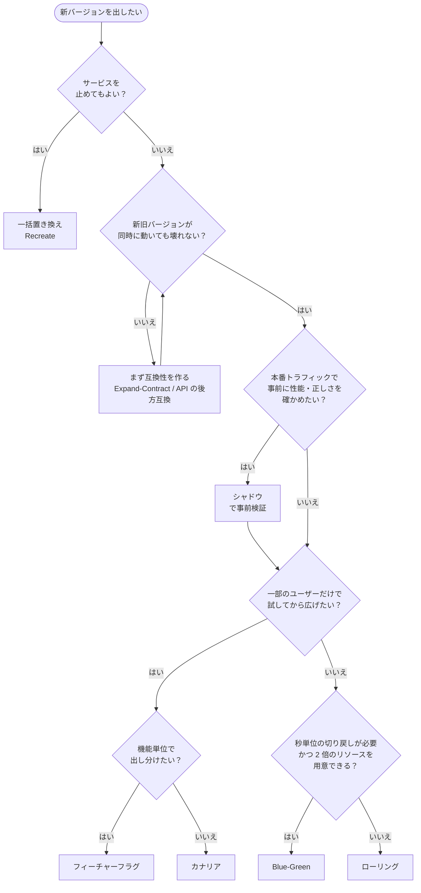

# デプロイ戦略の全体像と選び方

[[MOC_リリース・デプロイ体系|📚 目次]] ｜ [[01_リリースとデプロイの違い|← 前へ]] ｜ [[03_ローリングアップデート|次へ →]]

> [!abstract] この記事で分かること
> - 代表的な 6 つのデプロイ戦略（一括置き換え・ローリング・Blue-Green・カナリア・フィーチャーフラグ・シャドウ）の特徴
> - ダウンタイム・切り戻し速度・コスト・複雑さ・新旧混在の観点での比較
> - 状況に応じた戦略の選び方（選定フロー）
> - 戦略を組み合わせる考え方と、Shop ならどう選ぶか
>
> **前提**：[[01_リリースとデプロイの違い]] を読んでいると理解しやすいです。

## 1. ひとことで言うと

お店の改装に例えてみます。

- **一括置き換え**：「本日休業」の札を出して一気に改装する
- **ローリング**：レジを 1 台ずつ新型に交換する（営業は続ける）
- **Blue-Green**：隣にもう 1 店舗作っておき、ある日入口の看板を新店舗に向け直す
- **カナリア**：新メニューをまず 1 割のお客さんにだけ出し、反応を見て広げる
- **フィーチャーフラグ**：新メニューは厨房に用意してあるが、メニュー表に載せるかはスイッチで決める
- **シャドウ**：新人シェフにも同じ注文を作らせるが、お客さんに出すのはベテランの料理だけ

どれが「一番良い」ということはなく、**止めてよいか・どれだけ早く戻したいか・お金と手間をどこまでかけられるか** で選びます。そして実務では、複数を組み合わせるのが普通です。

> [!note] 要点
> どの戦略を選んでも（一括置き換え以外は）**新旧のバージョンが同時に動く瞬間がある**。「新旧が並んでも壊れない作り」がすべての戦略の前提になる。

## 2. 6 つの戦略をざっくり見る

Shop API（4 Pod、ロードバランサーの後ろ）を v1 から v2 に入れ替える場面で考えます。

### 2.1 一括置き換え（Recreate）

```text
[v1][v1][v1][v1]  → 全停止 →  [  ][  ][  ][  ]  →  [v2][v2][v2][v2]
                              ↑ この間サービス停止
```

古いものをすべて止めてから新しいものを起動します。旧教材で「単純デプロイ」と呼んでいたものです。仕組みは一番簡単で、新旧が混ざることはありませんが、**入れ替え中はサービスが止まります**。社内ツールや、新旧を同時に動かすと壊れるもの（同じファイルやキューを排他的に使う処理など）で使います。Kubernetes では `strategy.type: Recreate` です。

### 2.2 ローリングアップデート（Rolling Update）

```text
[v1][v1][v1][v1] → [v2][v1][v1][v1] → [v2][v2][v1][v1] → ... → [v2][v2][v2][v2]
```

1 台（または n 台）ずつ順番に入れ替えます。追加のサーバーがほぼ要らず、止まらないので、Kubernetes や ECS の **既定の方式** です。ただし入れ替え中は v1 と v2 が混在し、戻すのも 1 台ずつです。→ [[03_ローリングアップデート]]

### 2.3 Blue-Green デプロイ

```text
         ┌─▶ Blue  [v1][v1][v1][v1]   ← いまの本番
LB ──────┤
         └ ─ Green [v2][v2][v2][v2]   ← 待機。確認後に LB の向きを切り替え
```

同じ構成の環境を 2 つ用意し、待機側に新バージョンを入れて確認した後、ロードバランサーの向きを一気に切り替えます。**戻すときは向きを戻すだけ** なので数秒で切り戻せますが、切替前後はサーバーが 2 倍必要です。→ [[04_Blue-Greenデプロイ]]

### 2.4 カナリアリリース（Canary Release）

```text
LB ── 90% ──▶ [v1][v1][v1]
   └─ 10% ──▶ [v2]           ← エラー率・レイテンシを v1 と比べて、良ければ広げる
```

新バージョンに一部のトラフィックだけを流し、指標を見ながら 10% → 50% → 100% と広げます。名前は、炭鉱で有毒ガスを早く知らせるために連れて行ったカナリアに由来します。問題があっても影響は一部のユーザーだけで済みます。→ [[05_カナリアリリース]]

### 2.5 フィーチャーフラグ（Feature Flag / Feature Toggle）

```ts
if (flags.isEnabled('coupon-checkout', { userId })) {
  return applyCoupon(order);   // 新しい処理
}
return order;                  // 今までの処理
```

コードはすべてのサーバーに入っているが、機能の ON/OFF を設定で切り替えます。厳密には「デプロイ戦略」ではなく **リリースの仕組み** ですが、デプロイとリリースを分ける中心的な道具なのでここに並べます。ユーザー単位・割合単位で出し分けられ、戻すのはスイッチを切るだけです。→ [[06_フィーチャーフラグ]]

### 2.6 シャドウデプロイ（Shadow Deployment / トラフィックミラーリング）

```text
ユーザー ──▶ LB ──▶ [v1] ──▶ 応答はユーザーへ
              └─ コピー ─▶ [v2] ──▶ 応答は捨てる（比較・計測だけ）
```

本番のリクエストをコピーして新バージョンにも流しますが、ユーザーに返すのは旧バージョンの応答だけです。**ユーザーへの影響ゼロで、本番の実トラフィックに対する性能や正しさを確かめられます**。ただし、新バージョンが DB への書き込みや決済・メール送信をすると二重処理になるので、副作用のある処理には工夫が必要です。→ [[07_シャドウデプロイとダークローンチ]]

## 3. 比較表

| 戦略 | ダウンタイム | 切り戻し速度 | 追加コスト | 仕組みの複雑さ | 新旧の混在 | 影響範囲を絞れるか |
|---|---|---|---|---|---|---|
| 一括置き換え | **あり** | 遅い（再デプロイ＋再停止） | なし | ◎ 簡単 | なし | ✕ 全員 |
| ローリング | なし | 中（1 台ずつ戻す。数分） | ほぼなし（数台分の余裕） | ○ 標準機能 | **あり**（入れ替え中） | △ 台数の割合で多少 |
| Blue-Green | なし | **速い**（LB の向きを戻すだけ。秒単位） | **高い**（切替時に 2 倍） | △ 環境 2 つの管理 | ほぼなし（切替の瞬間のみ） | ✕ 切替後は全員 |
| カナリア | なし | 速い（配分を 0% に戻す） | 低〜中 | ✕ 配分制御と指標比較が必要 | **あり**（意図的に） | ◎ 割合で絞れる |
| フィーチャーフラグ | なし | **最速**（スイッチを切る。再デプロイ不要） | 低（フラグ管理サービス代） | △ コード内に分岐が増える | あり（コード上で両方の処理が共存） | ◎ ユーザー単位で絞れる |
| シャドウ | なし | （ユーザーに出していないので不要） | **高い**（新側も本番相当の負荷） | ✕ ミラーリングと副作用対策 | あり（裏で並走） | ◎ 影響ゼロ |

表の読み方のポイントです。

- **ダウンタイムが許されるなら、一括置き換えが一番シンプル。** 夜間に止めてよい社内システムなら、凝った戦略は不要です。
- **切り戻しの速さとコストはトレードオフ。** Blue-Green は速く戻せる代わりに 2 倍のリソースが要ります。
- **「新旧の混在」はほとんどの戦略で起きる。** Blue-Green でも DB は共有なので、スキーマは新旧どちらのアプリからも使える必要があります（[[02_Expand-Contractのリリース計画]]）。
- **フラグとカナリアは「影響範囲を絞る」のが得意。** 一部のユーザーで試してから広げられます。

## 4. 選び方のフロー



フローで迷ったときの目安です。

| 状況 | 選びやすい戦略 |
|---|---|
| 小規模、夜間停止 OK の社内ツール | 一括置き換え |
| 普通の Web API、まず止めずに出したい | ローリング（K8s / ECS の既定） |
| 決済など「壊れたら即戻したい」重要サービス | Blue-Green、またはカナリア |
| ユーザー数が多く、影響を数 % に抑えたい | カナリア |
| 仕様変更・UI 変更など「機能」のリスクが大きい | フィーチャーフラグ |
| 大規模なリライト、検索エンジンや料金計算ロジックの置き換え | シャドウで比較 → カナリア |
| モバイルアプリ（一度入った版はこちらから消せない） | ストアの段階的公開＋フラグ |

> [!warning] 「新旧が並んでも壊れない」が先
> フローの 2 番目の質問で「いいえ」なら、どの戦略を選んでも事故が起きます。たとえば列名の変更や、新しい API を呼ぶフロントエンドを同時に出すような変更は、まず互換性を保つ形に分割します。詳しくは [[08_ゼロダウンタイムデプロイの条件]] と [[01_アプリとDB変更のリリース順序]] で扱います。

## 5. 組み合わせ方

実務では 1 つの戦略だけで完結することは少なく、**「デプロイの仕組み」と「リリースの仕組み」を組み合わせる** のが普通です。

### 5.1 Blue-Green ＋ フィーチャーフラグ

```text
1. Green にクーポン機能入りの v2 をデプロイ（フラグは OFF）
2. Green を確認 → LB を Green に切替        ← デプロイのリスクは Blue-Green で守る
3. フラグを社内 → 5% → 100% と ON            ← 機能のリスクはフラグで守る
```

インフラの問題（起動しない、設定ミス）は Blue-Green の即時切り戻しで、機能の問題（クーポンの計算ミス）はフラグ OFF で、それぞれ別の手段で戻せます。

### 5.2 カナリア ＋ ローリング

まず 1 台（全体の 10% 程度）だけ新バージョンにして指標を見て、問題なければ残りをローリングで入れ替える方法です。ねる前エンジニアリングのクリップでも「カナリアで 1 割出してからローリングで広げる」組み合わせが紹介されています。Argo Rollouts の canary 戦略は、段階的に Pod を増やしながら指標を自動判定するので、実質的にこの組み合わせを自動化したものです。

### 5.3 シャドウ ＋ カナリア

まずシャドウで本番トラフィックに対する応答を旧版と比較し、差分がないことを確かめてから、カナリアで実際にユーザーに出し始める方法です。決済額の計算や検索ランキングのように「正しさ」の確認が難しいロジックの置き換えに向きます。

### 5.4 自動判定との組み合わせ

カナリアや段階的な移行では、「どの数字が悪ければ戻すか」を先に決めて、ツールに自動判定させるのが理想です。メトリクスに基づく自動分析は [[02_段階的トラフィック移行と自動分析]]、自動ロールバックは [[03_ヘルスチェックと自動ロールバック]] で扱います。

## 6. Shop ならどうするか

Shop の構成（Shop API 4 Pod、PostgreSQL、Next.js フロント、モバイルアプリ）で、変更の種類ごとに選んでみます。

| 変更 | 戦略 | 理由 |
|---|---|---|
| ログ出力の改善、依存ライブラリの更新 | ローリング（K8s 既定） | 互換性の問題がなく、リスクが低い。毎日の普通のデプロイ |
| 注文確定 API にクーポン機能を追加 | ローリング（またはカナリア）でデプロイ ＋ **フラグ** でリリース | 機能のリスクが大きいので、社内 → 5% → 100% と出し分ける |
| Node.js のメジャーバージョン更新 | **カナリア** | 実行環境の変化は性能やメモリに影響しやすい。10% で様子を見る |
| 決済代行会社の切り替え | **フラグ**（＋ 必要ならシャドウ的な並行検証） | 外部への処理は戻せないので、ユーザー単位で慎重に広げる |
| セール初日に向けた大規模改修 | **Blue-Green** ＋ フラグ | 本番と同じ環境で事前確認し、問題があれば秒で戻せる状態にしておく |
| orders テーブルの列名変更 | どの戦略でも **Expand-Contract で 3 回に分ける** | DB は 1 つなので、戦略ではリスクを消せない（[[02_Expand-Contractのリリース計画]]） |

ポイントは、**「毎日のデプロイはシンプルな仕組み（ローリング）で回し、リスクの大きい変更にだけ追加の手段を重ねる」** ことです。すべてのデプロイを Blue-Green ＋ カナリア ＋ フラグで行うと、仕組みの複雑さそのものが障害の原因になります。

## よくある誤解・つまずき

❌ **誤解**：Blue-Green（またはカナリア）にすれば、新旧の互換性を気にしなくてよい。
✅ **実際**：DB やキャッシュ、キューは新旧で共有されます。切り戻しても DB の変更は戻らないので、どの戦略でもスキーマとデータ形式の互換性は必要です。

❌ **誤解**：一番高機能な戦略を選ぶのが正解。
✅ **実際**：仕組みが複雑になるほど、設定ミスや運用ミスの余地が増えます。止めてよいシステムなら一括置き換えで十分ですし、普段はローリングで足りることがほとんどです。

❌ **誤解**：フィーチャーフラグがあればデプロイ戦略は要らない。
✅ **実際**：フラグは「機能」のリスクを守りますが、「新しいコンテナが起動しない」「メモリリークする」といったデプロイ自体のリスクは守れません。デプロイ戦略と組み合わせて使います。

❌ **誤解**：シャドウなら何を流しても安全。
✅ **実際**：新バージョンが DB に書き込んだりメールや決済を実行したりすると、ユーザーに見えないところで二重処理が起きます。副作用のある処理は止めるか、モックに向ける必要があります。

## まとめ

- 代表的な戦略は **一括置き換え・ローリング・Blue-Green・カナリア・フィーチャーフラグ・シャドウ** の 6 つ
- 比較の軸は **ダウンタイム・切り戻し速度・コスト・複雑さ・新旧の混在・影響範囲**
- 一括置き換え以外では **新旧が同時に動く瞬間がある** ので、互換性のある作りが前提
- 選び方は「止めてよいか → 互換性はあるか → 一部で試したいか → 秒で戻したいか」の順で考える
- 実務では **デプロイの仕組み（ローリング / Blue-Green）とリリースの仕組み（フラグ）を組み合わせる**
- 普段はシンプルに、リスクの大きい変更にだけ手段を重ねる

## 確認クイズ

1. 「サーバー代は増やしたくないが、止めずに出したい。新旧が混在しても問題ない API」に向く戦略はどれですか。
> [!tip]- 答え
> ローリングアップデートです。追加のサーバーがほぼ不要（数台分の余裕だけ）で、止めずに入れ替えられます。Kubernetes や ECS の既定の方式でもあります。

2. Blue-Green デプロイで Green に切り替えた直後にエラーが増えたので Blue に戻しました。ところが Blue でもエラーが出ています。考えられる原因は何でしょうか。
> [!tip]- 答え
> v2（Green）が DB のスキーマや共有キャッシュのデータ形式を変更していて、v1（Blue）がそれを読めなくなっている可能性があります。Blue-Green はアプリの切り戻しは速いですが、共有している DB やキャッシュは戻りません。スキーマ変更は Expand-Contract で互換性を保つ必要があります。

3. 「クーポン機能の追加」で、インフラ起因の失敗と機能起因の失敗の両方に素早く対処したいです。どんな組み合わせが考えられますか。
> [!tip]- 答え
> 例えば Blue-Green（またはカナリア）でデプロイし、クーポン機能はフィーチャーフラグで OFF にしておく組み合わせです。起動失敗などのインフラの問題は LB の向きを戻す（または配分を 0% にする）ことで、クーポン計算の誤りなど機能の問題はフラグを OFF にすることで、それぞれ再デプロイなしに戻せます。

## 関連ノート

- [[01_リリースとデプロイの違い]] — デプロイとリリースを分ける考え方
- [[03_ローリングアップデート]] / [[04_Blue-Greenデプロイ]] / [[05_カナリアリリース]] / [[06_フィーチャーフラグ]] / [[07_シャドウデプロイとダークローンチ]] — 各戦略の詳細
- [[08_ゼロダウンタイムデプロイの条件]] — 「止めずに入れ替える」ためにアプリ側で満たすべき条件
- [[02_Expand-Contractのリリース計画]] — どの戦略でも必要な DB 変更の分割
- [[01_ロールバック戦略]] — 戦略ごとの戻し方
- [[止めずに入れ替える — デプロイの仕組み｜ねる前エンジニアリング]] — ローリング・Blue-Green・カナリアと戻せないものを図解したクリップ
- [[なぜデプロイは怖くなくなったのか]] — デプロイが日常になった歴史のクリップ
- [[10-Kubernetes]] — Kubernetes の基礎
- [[05_CodeDeployとは]] — AWS でのデプロイ自動化サービス

## 参考

- [Kubernetes Docs — Deployments（Strategy）](https://kubernetes.io/docs/concepts/workloads/controllers/deployment/#strategy)
- [Martin Fowler — BlueGreenDeployment](https://martinfowler.com/bliki/BlueGreenDeployment.html)
- [Danilo Sato — CanaryRelease](https://martinfowler.com/bliki/CanaryRelease.html)
- [Pete Hodgson — Feature Toggles (aka Feature Flags)](https://martinfowler.com/articles/feature-toggles.html)
- [Argo Rollouts — Canary](https://argo-rollouts.readthedocs.io/en/stable/features/canary/)
- [Amazon ECS — DeploymentConfiguration（strategy: ROLLING / BLUE_GREEN / LINEAR / CANARY）](https://docs.aws.amazon.com/AmazonECS/latest/APIReference/API_DeploymentConfiguration.html)
