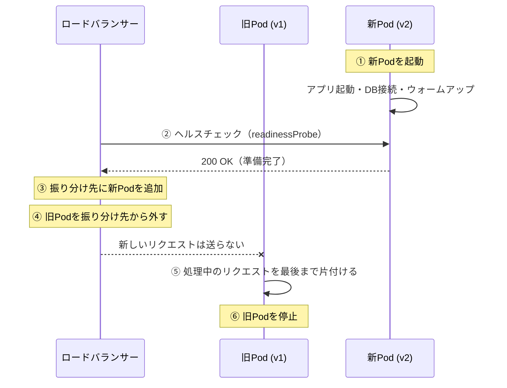

# ローリングアップデート

[[MOC_リリース・デプロイ体系|📚 目次]] ｜ [[02_デプロイ戦略の全体像と選び方|← 前へ]] ｜ [[04_Blue-Greenデプロイ|次へ →]]

> [!abstract] この記事で分かること
> - ローリングアップデート（Rolling Update）が「1 台ずつ / n 台ずつ」入れ替える仕組み
> - Kubernetes Deployment の `maxSurge` / `maxUnavailable` の意味と既定値（25%）、readinessProbe の役割
> - `kubectl rollout status` / `undo` を使った進捗確認と切り戻し
> - 新旧バージョンの混在が起こす問題と、その防ぎ方
> - Amazon ECS の `minimumHealthyPercent` / `maximumPercent` の考え方
>
> **前提**：[[02_デプロイ戦略の全体像と選び方]] を読んでいると理解しやすいです。Kubernetes の基本は [[10-Kubernetes]] を参照してください。

## 1. ひとことで言うと

4 つのレジがあるスーパーで、レジを新型に交換するとします。全部いっぺんに止めたらお客さんが会計できません。そこで「1 番レジだけ『休止中』の札を出し、並んでいたお客さんの会計を済ませてから交換。新しいレジが正しく動くか試してから再開。次は 2 番レジ……」と順番に進めます。お店は一度も閉まりません。

これが **ローリングアップデート** です。サーバー（Pod、タスク）を少しずつ新バージョンに置き換えていき、全体としてはサービスを止めずに入れ替えます。

> [!note] 要点
> - 追加のサーバーをほとんど用意せずに、止めずに入れ替えられる
> - Kubernetes Deployment と Amazon ECS の **既定の方式**
> - 入れ替え中は **新旧バージョンが混在する** ことを必ず意識する

## 2. 仕組み：1 台ずつ、n 台ずつ

### 2.1 1 台の入れ替えで起きていること

1 台を入れ替えるたびに、次の手順が行われます。



ポイントは 2 つです。

- **準備ができてから振り分ける**：起動直後の Pod は DB 接続やキャッシュの準備ができていません。ヘルスチェックに合格するまでトラフィックを送りません。
- **片付けてから止める**：旧 Pod は振り分け先から外された後も、処理中のリクエストを終えてから止まります（**グレースフルシャットダウン**、Graceful Shutdown）。この作り込みは [[08_ゼロダウンタイムデプロイの条件]] で扱います。

### 2.2 何台ずつ入れ替えるか

一度に入れ替える台数が多いほど早く終わりますが、その間に処理できる台数が減ります。

```text
Shop API 4 台、1 台ずつ入れ替える場合

時刻  台1  台2  台3  台4    稼働中の台数
t0   v1   v1   v1   v1     4
t1   --   v1   v1   v1     3   ← 1 台減る間、残り 3 台で全トラフィックを受ける
t2   v2   v1   v1   v1     4
t3   v2   --   v1   v1     3
...
t8   v2   v2   v2   v2     4
```

「台数を減らさずに入れ替えたい」なら、**先に 1 台多く起動してから古いものを止める** 方法もあります（一時的に 5 台になる）。この「何台まで増やしてよいか」「何台まで減ってよいか」を決めるのが、Kubernetes の `maxSurge` / `maxUnavailable`、ECS の `maximumPercent` / `minimumHealthyPercent` です。

## 3. Kubernetes Deployment の RollingUpdate

### 3.1 maxSurge と maxUnavailable

Kubernetes の Deployment は、`spec.strategy.type` に `RollingUpdate`（既定）か `Recreate` を指定できます。RollingUpdate では次の 2 つで速度と余裕を調整します。

| 設定 | 意味 | 既定値 | 割合の丸め方 |
|---|---|---|---|
| `maxSurge` | 希望する Pod 数より **何個まで多く** 起動してよいか | **25%** | 切り上げ |
| `maxUnavailable` | 希望する Pod 数より **何個まで少なく**（利用不可に）なってよいか | **25%** | 切り捨て |

どちらも絶対数（`1`）か割合（`25%`）で書けます。また **両方を 0 にはできません**（どちらかが 0 なら、もう一方は 1 以上が必要）。

Shop API（`replicas: 4`）を既定値で更新すると、

- `maxSurge: 25%` → 4 × 0.25 = 1（切り上げで 1）→ **最大 5 Pod** まで
- `maxUnavailable: 25%` → 4 × 0.25 = 1（切り捨てで 1）→ **最低 3 Pod** は利用可能

となります。代表的な設定パターンは次のとおりです。

| 設定 | 動き | 向いている場面 |
|---|---|---|
| `maxSurge: 1, maxUnavailable: 0` | 必ず 1 つ増やしてから 1 つ減らす。処理能力が落ちない | 本番 API の定番。余裕が少ないサービス |
| `maxSurge: 0, maxUnavailable: 1` | 1 つ止めてから 1 つ起動。追加リソース不要 | クラスタに空きがない、ライセンス数が固定 |
| `maxSurge: 25%, maxUnavailable: 25%`（既定） | 増減の両方を使ってそこそこ速く | 一般的なケース |
| `maxSurge: 100%, maxUnavailable: 0` | 新しい Pod を全部起動してから古いものを消す | 速く終わらせたい、一時的に 2 倍のリソースを使える |

### 3.2 Shop API の Deployment 例

```yaml
apiVersion: apps/v1
kind: Deployment
metadata:
  name: shop-api
spec:
  replicas: 4
  revisionHistoryLimit: 10          # 戻せる過去の ReplicaSet の数（既定 10）
  progressDeadlineSeconds: 600      # 10 分進まなければ「失敗」とみなす（既定 600）
  minReadySeconds: 10               # Ready になってから 10 秒安定したら「利用可能」とみなす（既定 0）
  strategy:
    type: RollingUpdate
    rollingUpdate:
      maxSurge: 1
      maxUnavailable: 0             # 処理能力を落とさない
  selector:
    matchLabels:
      app: shop-api
  template:
    metadata:
      labels:
        app: shop-api
    spec:
      terminationGracePeriodSeconds: 30
      containers:
        - name: shop-api
          image: ghcr.io/example/shop-api:1.8.0
          ports:
            - containerPort: 3000
          readinessProbe:            # 「トラフィックを受けてよいか」
            httpGet:
              path: /healthz/ready
              port: 3000
            periodSeconds: 5
            failureThreshold: 3
          livenessProbe:             # 「生きているか（固まっていないか）」
            httpGet:
              path: /healthz/live
              port: 3000
            periodSeconds: 10
            failureThreshold: 3
```

`minReadySeconds` を 0 より大きくすると、「起動直後は Ready を返すがすぐクラッシュする」ような Pod で次へ進んでしまうのを防げます。

### 3.3 readinessProbe が要（かなめ）

ローリングアップデートは「新しい Pod が使える状態になったら、次の古い Pod を止める」を繰り返します。この「使える状態」を判断するのが **readinessProbe（レディネスプローブ：準備完了チェック）** です。

- readinessProbe が失敗している Pod は、Service の振り分け先（エンドポイント）から外されます。**再起動はされません**（再起動するのは livenessProbe の役割）。
- readinessProbe が成功しない限り、ロールアウトは次へ進みません。`maxUnavailable: 0` なら古い Pod も減らないので、**壊れた新バージョンが出てもサービスは止まりません**。

> [!warning] 「いつでも 200 OK」のヘルスチェックは危険
> `/healthz` が無条件に 200 を返すと、DB に接続できていない Pod や設定を読み込めていない Pod にもトラフィックが流れ、ロールアウトも止まりません。readiness では「DB やキャッシュなど、リクエスト処理に必要なものの準備ができたか」を確かめます。ただし外部サービスの障害で全 Pod が一斉に Not Ready になると全滅するので、何をチェックに含めるかは慎重に決めます（[[depends_on_healthcheck]]、[[03_ヘルスチェックと自動ロールバック]]）。

### 3.4 kubectl rollout で見る・戻す

```bash
# 新しいイメージでロールアウト開始
kubectl set image deployment/shop-api shop-api=ghcr.io/example/shop-api:1.9.0

# 進捗を見る（完了するか、progressDeadlineSeconds を超えるまで待つ）
kubectl rollout status deployment/shop-api
# Waiting for deployment "shop-api" rollout to finish: 2 out of 4 new replicas have been updated...
# deployment "shop-api" successfully rolled out

# 様子がおかしいので一時停止（途中の状態で止まる）
kubectl rollout pause deployment/shop-api
kubectl rollout resume deployment/shop-api

# 履歴を見る
kubectl rollout history deployment/shop-api
kubectl rollout history deployment/shop-api --revision=3

# 1 つ前のリビジョンに戻す
kubectl rollout undo deployment/shop-api

# 特定のリビジョンに戻す
kubectl rollout undo deployment/shop-api --to-revision=3
```

`kubectl rollout status` は、ロールアウトが失敗すると 0 以外の終了コードを返します。CI/CD のパイプラインで `kubectl set image` の後に実行すれば、「デプロイが完了しなかったらジョブを失敗させる」ことができます。

`rollout undo` は、Deployment が残している古い ReplicaSet（`revisionHistoryLimit` の数だけ保持）を使って、**逆向きのローリングアップデート** を行います。つまり戻すときも 1 台ずつで、数分かかります。Blue-Green のような「一瞬で戻す」ではない点に注意してください。

## 4. 新旧バージョン混在が起こす問題

ローリングアップデート中は、v1 と v2 が同時にリクエストを受けています。ロードバランサーはリクエストごとに振り分け先を選ぶので、**同じユーザーの連続したリクエストが v1 と v2 を行き来する** ことがあります。

### 4.1 典型的な事故パターン

| パターン | 何が起きるか | Shop での例 |
|---|---|---|
| 新しい API を新フロントが呼ぶ | 新フロントのリクエストが v1 の Pod に届き 404 | Next.js の新画面が `POST /orders/coupon` を呼ぶが、v1 にはそのエンドポイントがない |
| リクエスト形式の変更 | v1 が新しいフィールドを知らず無視、または必須フィールド欠落でエラー | 注文 API の `couponCode` を v2 だけが受け付ける |
| レスポンス形式の変更 | クライアントが v1 / v2 の両方の形式を処理できない | `total` を数値から `{ amount, currency }` に変えた |
| DB スキーマの変更 | v1 が存在しない列を読みに行ってエラー | `orders.name` を `full_name` にリネーム |
| キャッシュ・キューのデータ形式 | v2 が書いた形式を v1 が読めない | セッションに保存するカートの JSON 構造を変えた |

### 4.2 防ぎ方：後方互換を保ち、順番を分ける

原則は 1 つ、**「v1 と v2 が並んでも、どちらも正しく動く」ように変更を分割する** ことです。

```text
❌ 1 回で出す：API に /orders/coupon を追加 ＋ フロントで呼び出し
   → ローリング中、新フロント → v1 API で 404

✅ 2 回に分ける：
   ① API に /orders/coupon を追加（まだ誰も呼ばない）→ 全台に行き渡るまで待つ
   ② フロントで呼び出しを開始（またはフラグで ON）
```

- **追加は先、利用は後**：新しいエンドポイントやフィールドは、まず受け付ける側を全台に入れてから使い始めます。
- **削除は後**：古いフィールドは、誰も使わなくなったことを確認してから消します。
- **読めるようにしてから書き方を変える**：新しいデータ形式は、まず v1 相当のコードでも読めるようにしてから書き始めます。
- **DB は Expand-Contract**：列の追加 → データ移行 → 古い列の削除 を別々のデプロイに分けます（[[02_Expand-Contractのリリース計画]]、[[07_ゼロダウンタイムのスキーマ変更]]）。

> [!tip] セッションアフィニティは根本解決ではない
> ロードバランサーの「スティッキーセッション」（同じユーザーを同じサーバーに送り続ける設定）で行き来を減らすことはできますが、そのサーバーが入れ替わる瞬間には結局切り替わります。互換性のある作りが先です。

## 5. Amazon ECS のローリングアップデート

Amazon ECS のサービスも、既定ではローリングアップデート（デプロイコントローラー `ECS`、2026 年時点の API では `strategy: ROLLING`）で入れ替えます。調整に使うのは次の 2 つです。

| 設定 | 意味 | REPLICA サービスの既定値 | 丸め方 |
|---|---|---|---|
| `minimumHealthyPercent` | デプロイ中に **最低限動かしておく** タスク数（希望数に対する %） | **100%** | 切り上げ |
| `maximumPercent` | デプロイ中に **最大で動かしてよい** タスク数（希望数に対する %） | **200%** | 切り捨て |

Kubernetes と対応させると、`minimumHealthyPercent` は `maxUnavailable` の裏返し、`maximumPercent` は `maxSurge` の裏返しです。

| Shop API（希望 4 タスク） | 動き |
|---|---|
| 既定（100% / 200%） | 4 タスクを維持したまま、最大 8 タスクまで増やして入れ替え。処理能力は落ちないが一時的に 2 倍のリソース |
| `minimumHealthyPercent: 50` / `maximumPercent: 100` | 先に 2 タスク止めて 2 タスク起動、を繰り返す。追加リソース不要だが能力が半分になる時間がある |
| `minimumHealthyPercent: 100` / `maximumPercent: 125` | 4 × 1.25 = 5 → 1 タスクずつ増やして入れ替え（K8s の `maxSurge: 1, maxUnavailable: 0` に近い） |

ECS には、新しいタスクが起動し続けられない場合にデプロイを失敗とみなして前の状態に戻す **デプロイサーキットブレーカー（deployment circuit breaker）** があります。CloudWatch アラームによる失敗検知と組み合わせることもできます。

```bash
aws ecs update-service \
  --cluster shop \
  --service shop-api \
  --task-definition shop-api:42 \
  --deployment-configuration "minimumHealthyPercent=100,maximumPercent=125,deploymentCircuitBreaker={enable=true,rollback=true}"
```

> [!warning] 動けない設定に注意
> 「最低 100%、最大 100%」のように、タスクを 1 つも止められず 1 つも増やせない設定にするとデプロイが進みません。AWS のドキュメントでも、少なくとも 1 タスクを止めるか起動できる値にするよう注意されています。

## 6. 長所と短所

| 長所 | 短所 |
|---|---|
| 追加リソースがほとんど要らない | 入れ替え中は **新旧が混在** する（互換性が必須） |
| サービスを止めずに入れ替えられる | 戻すのも 1 台ずつで、**切り戻しに数分** かかる |
| Kubernetes / ECS の標準機能で、特別な仕組みが不要 | 問題があっても、気づくまでに入れ替わった分のユーザーは影響を受ける |
| readinessProbe と組み合わせれば、起動しない版で全滅しない | 「起動はするがバグがある」版は止められない（指標による判定がない） |
| 途中で一時停止できる | 何 % のユーザーに出すかを細かく制御できない（台数の割合のみ） |

短所の最後の 2 つ、「指標を見て自動で止める」「割合を細かく制御する」が必要になったら、カナリアリリース（[[05_カナリアリリース]]）や Argo Rollouts の導入を検討します。

## よくある誤解・つまずき

❌ **誤解**：ローリングアップデートならダウンタイムは絶対にゼロ。
✅ **実際**：readinessProbe がない、グレースフルシャットダウンしていない、`preStop` で振り分け解除を待っていないなどの理由で、入れ替えの瞬間に数件のエラーが出ることはよくあります（[[08_ゼロダウンタイムデプロイの条件]]）。

❌ **誤解**：`kubectl rollout undo` で何でも元に戻る。
✅ **実際**：戻るのは Pod のイメージや設定（Pod テンプレート）だけです。DB のスキーマ変更、ConfigMap / Secret の中身、外部に送ったメールなどは戻りません（[[03_ロールバックできない変更]]）。

❌ **誤解**：`maxUnavailable: 0` にすれば安全なので、追加リソースは要らない。
✅ **実際**：`maxUnavailable: 0` では古い Pod を止める前に新しい Pod を起動するので、`maxSurge` 分の空きリソースがクラスタに必要です。空きがないと新しい Pod が Pending のままロールアウトが進みません。

❌ **誤解**：readiness と liveness は同じエンドポイントでよい。
✅ **実際**：liveness に DB 接続チェックを入れると、DB の一時的な障害で全 Pod が再起動され、障害が拡大します。readiness は「受けてよいか」、liveness は「固まっていないか」と役割を分けます。

## まとめ

- ローリングアップデートは **1 台（n 台）ずつ順番に入れ替える** 方式で、Kubernetes / ECS の既定
- Kubernetes では `maxSurge`（既定 25%、切り上げ）と `maxUnavailable`（既定 25%、切り捨て）で速度と余裕を調整する
- **readinessProbe** が「準備ができた Pod にだけ流す」「壊れた版で全滅させない」の要
- `kubectl rollout status` で完了を待ち、`kubectl rollout undo` で戻す（戻すのも 1 台ずつ）
- 入れ替え中は **新旧が混在** するので、「追加は先・利用は後・削除は最後」で互換性を保つ
- ECS では `minimumHealthyPercent`（既定 100%）と `maximumPercent`（既定 200%）、失敗時はサーキットブレーカーで自動ロールバック

## 確認クイズ

1. `replicas: 4`、`maxSurge: 25%`、`maxUnavailable: 25%`（既定値）の Deployment を更新するとき、Pod 数は最大何個、利用可能な Pod は最低何個になりますか。
> [!tip]- 答え
> 最大 5 個、最低 3 個です。`maxSurge` は 4 × 25% = 1（切り上げ）なので 4 + 1 = 5、`maxUnavailable` は 4 × 25% = 1（切り捨て）なので 4 − 1 = 3 です。

2. 新しいバージョンの Pod が、起動はするが DB に接続できず readinessProbe に失敗し続けています。`maxSurge: 1, maxUnavailable: 0` の場合、サービスと Deployment はどうなりますか。
> [!tip]- 答え
> 新しい Pod は Ready にならないのでトラフィックを受けず、`maxUnavailable: 0` なので古い Pod も減りません。サービスは古い 4 Pod で動き続けます。ロールアウトは進まず、`progressDeadlineSeconds`（既定 600 秒）を超えると Deployment の状態が失敗（ProgressDeadlineExceeded）になります。`kubectl rollout undo` で戻すか、原因を直して再デプロイします。

3. Shop で「注文 API に新しいエンドポイントを追加し、同じリリースで Next.js から呼び出す」予定です。ローリングアップデートで出すと何が起きる可能性があり、どう分ければよいですか。
> [!tip]- 答え
> 入れ替え中、新しいフロントエンドからのリクエストがまだ v1 の Pod に届くと、エンドポイントが存在せずエラー（404 など）になります。まず API 側のエンドポイント追加だけを出して全 Pod に行き渡らせ、その後でフロントエンドの呼び出しを出す（またはフィーチャーフラグで ON にする）ように、2 段階に分けます。

## 関連ノート

- [[02_デプロイ戦略の全体像と選び方]] — 戦略全体の比較
- [[04_Blue-Greenデプロイ]] — 次の回。一気に切り替えて一瞬で戻す方式
- [[05_カナリアリリース]] — 指標を見ながら割合で広げる方式
- [[08_ゼロダウンタイムデプロイの条件]] — グレースフルシャットダウンや preStop など、アプリ側の条件
- [[03_ヘルスチェックと自動ロールバック]] — ヘルスチェックの設計と自動ロールバック
- [[02_Expand-Contractのリリース計画]] — 新旧混在に耐える DB 変更
- [[止めずに入れ替える — デプロイの仕組み｜ねる前エンジニアリング]] — ローリング中の「行ったり来たり」問題を図解したクリップ
- [[10-Kubernetes]] — Kubernetes の基礎
- [[depends_on_healthcheck]] — ヘルスチェックの考え方
- [[本番向けベストプラクティス]] — コンテナを本番で動かすときの注意

## 参考

- [Kubernetes Docs — Deployments](https://kubernetes.io/docs/concepts/workloads/controllers/deployment/)
- [Kubernetes Docs — Configure Liveness, Readiness and Startup Probes](https://kubernetes.io/docs/tasks/configure-pod-container/configure-liveness-readiness-startup-probes/)
- [Kubernetes Docs — kubectl rollout](https://kubernetes.io/docs/reference/kubectl/generated/kubectl_rollout/)
- [Amazon ECS — Deploy Amazon ECS services by replacing tasks](https://docs.aws.amazon.com/AmazonECS/latest/developerguide/deployment-type-ecs.html)
- [Amazon ECS API Reference — DeploymentConfiguration](https://docs.aws.amazon.com/AmazonECS/latest/APIReference/API_DeploymentConfiguration.html)
