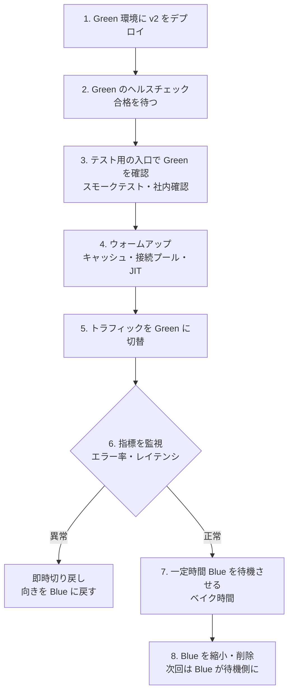

# Blue-Greenデプロイ

[[MOC_リリース・デプロイ体系|📚 目次]] ｜ [[03_ローリングアップデート|← 前へ]] ｜ [[05_カナリアリリース|次へ →]]

> [!abstract] この記事で分かること
> - Blue-Green デプロイ（Blue-Green Deployment）の仕組みと、トラフィックを切り替える 3 つの方法（LB / DNS / Kubernetes Service）
> - 切替の手順と、一瞬で戻せる理由
> - コストが 2 倍になる点、DB を共有するので互換性が必要な点、ウォームアップの必要性
> - AWS CodeDeploy（ECS Blue/Green）、ECS 組み込み Blue/Green、Argo Rollouts の設定例
> - DNS で切り替えるときの TTL の罠
>
> **前提**：[[02_デプロイ戦略の全体像と選び方]] と [[03_ローリングアップデート]] を読んでいると理解しやすいです。

## 1. ひとことで言うと

劇場の舞台を想像してください。今の公演（Blue）を上演している間に、裏にもう 1 つ同じ舞台（Green）を組み、次の演目のリハーサルを済ませておきます。準備ができたら、回り舞台をくるっと回して客席に向けるだけで、次の演目が始まります。もし幕が上がってから大道具が倒れたら、舞台を回し戻せば元の演目にすぐ戻れます。

**Blue-Green デプロイ** は、本番と同じ構成の環境を 2 つ用意し、片方（Blue）で本番を受けている間にもう片方（Green）へ新バージョンを入れ、確認できたらトラフィックの向きを一気に切り替える方式です。名前は Martin Fowler によると Daniel Terhorst-North と Jez Humble の話し合いから生まれたもので、色に特別な意味はありません（「今の本番」と「次の本番」を区別できれば何でもよい）。

> [!note] 要点
> - 切替は **一瞬**、切り戻しも **向きを戻すだけで一瞬**
> - その代わり、切替前後は **2 倍のリソース** が要る
> - DB は共有なので、**新旧どちらのアプリからも使えるスキーマ** が必要

## 2. 仕組み：2 つの環境とトラフィック切替

```text
【切替前】                                【切替後】
            ┌──▶ Blue  (v1) ×4  本番                   ┌ ─ Blue  (v1) ×4  待機（すぐ戻れる）
ユーザー ─ LB┤                          ユーザー ─ LB──┤
            └ ─ Green (v2) ×4  確認中                  └──▶ Green (v2) ×4  本番
                     │                                           │
                     └────────── PostgreSQL（共有）─────────────┘
```

切り替える「向き」をどこで変えるかで、3 つの方法があります。

| 切替の場所 | 仕組み | 切替の速さ | 注意点 |
|---|---|---|---|
| **ロードバランサー**（ALB のリスナー / ターゲットグループ） | LB の転送先を Blue のターゲットグループから Green に変える | 速い（秒単位） | AWS では最も一般的。重み付きにすればカナリアにも使える |
| **DNS**（Route 53 などのレコード） | `api.shop.example.com` が指す先を Blue の LB から Green の LB に変える | **遅い・不確実**（TTL とキャッシュ次第） | 6 章の「TTL の罠」を参照 |
| **Kubernetes Service** | Service の `selector` を `version: blue` → `version: green` に変える | 速い（エンドポイントの更新） | 同じクラスタ内で完結。手作業ならラベル管理に注意 |

### 2.1 ALB で切り替える例

ALB のリスナー（443 番ポートで受けるルール）の転送先を、Green のターゲットグループに変えます。

```bash
# Green のターゲットグループに転送（Blue → Green に切替）
aws elbv2 modify-listener \
  --listener-arn arn:aws:elasticloadbalancing:ap-northeast-1:123456789012:listener/app/shop-alb/xxxx/yyyy \
  --default-actions Type=forward,TargetGroupArn=arn:aws:elasticloadbalancing:ap-northeast-1:123456789012:targetgroup/shop-api-green/zzzz

# 戻すときは Blue のターゲットグループ ARN を指定して同じコマンド
```

ALB は 1 つのアクションで複数のターゲットグループに重みを付けて転送することもできるので、「Green に 10%」のようなカナリア的な移行にも使えます（[[05_カナリアリリース]]）。

### 2.2 Kubernetes Service で切り替える例

```yaml
# Blue と Green の 2 つの Deployment を用意（抜粋）
apiVersion: apps/v1
kind: Deployment
metadata:
  name: shop-api-green
spec:
  replicas: 4
  selector:
    matchLabels: { app: shop-api, version: green }
  template:
    metadata:
      labels: { app: shop-api, version: green }
    spec:
      containers:
        - name: shop-api
          image: ghcr.io/example/shop-api:1.9.0
---
# 本番トラフィックを受ける Service
apiVersion: v1
kind: Service
metadata:
  name: shop-api
spec:
  selector:
    app: shop-api
    version: blue          # ← ここを green に変えると切替
  ports:
    - port: 80
      targetPort: 3000
```

```bash
# Green に切替
kubectl patch service shop-api -p '{"spec":{"selector":{"app":"shop-api","version":"green"}}}'
# Blue に戻す
kubectl patch service shop-api -p '{"spec":{"selector":{"app":"shop-api","version":"blue"}}}'
```

手作業でも実現できますが、ラベルの付け間違いや古い環境の片付け忘れが起きやすいので、実務では後述の Argo Rollouts などに任せるのが一般的です。

## 3. 切替の手順と即時切り戻し



各ステップのポイントです。

1. **Green にデプロイ**：本番と同じ台数・同じ設定で用意します。台数が少ないと、切替の瞬間に負荷に耐えられません。
2. **ヘルスチェック**：すべてのインスタンスが Ready になるのを待ちます。
3. **テスト用の入口で確認**：本番 URL ではなく、テスト用のリスナー（例：ALB の 8080 番）や `preview` 用の Service を通して、Green に直接アクセスして確認します。**本番と同じネットワーク・同じ DB・同じ設定で確かめられる** のが Blue-Green の大きな利点です。
4. **ウォームアップ**：4 章で説明します。
5. **切替**：LB の向きを変えます。新旧が混在する時間はごく短くなります。
6. **監視**：切替直後は特に重点的に見ます（[[01_リリース後の重点監視]]）。
7. **ベイク時間（Bake time）**：問題がないことを確かめるまで Blue を消さずに置いておきます。この間はいつでも戻せます。
8. **片付け**：Blue を縮小します。次のデプロイでは、今の Green が「Blue（本番）」役になり、空いた側が新しい待機環境になります。

### 即時切り戻しが速い理由

ローリングアップデートの `rollout undo` は、古いバージョンの Pod を 1 台ずつ **起動し直す** ので数分かかります。Blue-Green では、Blue は **起動したまま待っている** ので、向きを戻すだけで済みます。

| | ローリング | Blue-Green |
|---|---|---|
| 戻すときにやること | 旧バージョンを 1 台ずつ起動し直す | LB / Service の向きを戻す |
| 戻るまでの時間 | 数分（起動時間 × 台数 ÷ 並列数） | 数秒 |
| 戻せる期限 | 古い ReplicaSet が残っている限り（ただし起動が必要） | Blue を消すまで |

Fowler は、Blue-Green は **ホットスタンバイと同じ仕組み** なので、リリースのたびに災害復旧（切替）手順を試していることにもなる、と指摘しています。

## 4. 実務での注意点

### 4.1 コストが 2 倍

切替前後は、Blue と Green の両方が本番相当の台数で動きます。

- **常時 2 倍** にすると費用が大きいので、多くの場合「デプロイのときだけ Green を立ち上げ、ベイク時間が終わったら Blue を消す」運用にします。それでも、その時間は 2 倍です。
- クラウドなら時間課金なので、ベイク時間を 1 時間にするか 1 日にするかでコストが変わります。
- Kubernetes ではクラスタに 2 倍分の空きが必要です。足りないと Green の Pod が Pending になります。

### 4.2 DB は共有なので互換性が必要

Blue-Green で 2 つになるのは **アプリケーション** だけで、DB は 1 つを共有するのが普通です（DB まで 2 つにすると、データの同期という別の難問が生まれます）。

```text
❌ v2 のデプロイ時に orders.name を full_name にリネーム
   → Green に切替後、問題があって Blue に戻す
   → Blue (v1) は name 列を読みに行ってエラー。「すぐ戻せる」はずが戻せない
```

したがって、スキーマ変更は **v1 と v2 の両方が動く形（Expand-Contract）** にする必要があります。Fowler の記事でも、スキーマ変更はアプリのアップグレードとは別に、まず新旧両方のバージョンをサポートする形で行い、古いものへの対応は後で消すよう勧めています（[[02_Expand-Contractのリリース計画]]、[[07_ゼロダウンタイムのスキーマ変更]]）。

DB 以外にも、**共有しているもの** はすべて同じ注意が必要です。

- Redis のセッション・キャッシュのデータ形式
- SQS などのキューに入れるメッセージの形式
- S3 に保存するファイルの形式
- 外部 API への送信（切り戻しても送ったものは戻らない）

### 4.3 セッションとキャッシュのウォームアップ

Green は起動したばかりで「冷えた」状態です。いきなり本番トラフィックを 100% 流すと、次のような問題が起きます。

| 冷えているもの | 何が起きるか | 対策 |
|---|---|---|
| アプリ内キャッシュ（商品マスタなど） | 切替直後に全リクエストが DB へ。DB 負荷が急増 | 起動時にプリロード、または Redis など共有キャッシュを使う |
| DB 接続プール | 接続確立が集中し、レイテンシが悪化 | 起動時に最小接続数を確保 |
| JIT コンパイル / 遅延初期化 | 最初のリクエスト群が遅い | ウォームアップ用のリクエストを流してから切り替える |
| サーバー内に保存したセッション | ログイン中のユーザーが全員ログアウトされる | セッションは Redis や DB など外部に置く |
| ロードバランサー自体（DNS 切替で新しい LB を使う場合） | 新しい LB の処理能力の拡張が追いつかない | 事前に負荷をかける、段階的に移す |

> [!tip] セッションを外に出すのは前提条件
> サーバー内（メモリ）にセッションを持っていると、Blue-Green に限らずどの戦略でも入れ替えでユーザーがログアウトされます。セッションを外部ストアに置き、Blue と Green で共有するのが基本です。この場合も、セッションに入れるデータの形式は新旧互換にします。

### 4.4 切替の瞬間の処理中リクエスト

切替時に Blue で処理中だったリクエストは、最後まで Blue で処理させる必要があります。ALB の **登録解除の遅延（deregistration delay）** や、アプリのグレースフルシャットダウンで対応します（[[08_ゼロダウンタイムデプロイの条件]]）。

## 5. ツールでの設定例

### 5.1 AWS CodeDeploy による ECS Blue/Green

AWS CodeDeploy は、ECS サービスの Blue/Green デプロイを管理できます（サービスのデプロイコントローラーを `CODE_DEPLOY` にする）。2 つのターゲットグループと、本番用リスナー・テスト用リスナーを用意し、AppSpec ファイルで何をデプロイするかを書きます。

```yaml
# appspec.yaml（Shop API を ECS で Blue/Green デプロイ）
version: 0.0
Resources:
  - TargetService:
      Type: AWS::ECS::Service
      Properties:
        TaskDefinition: "arn:aws:ecs:ap-northeast-1:123456789012:task-definition/shop-api:42"
        LoadBalancerInfo:
          ContainerName: "shop-api"
          ContainerPort: 3000
Hooks:
  # テスト用リスナーに Green が繋がった後に、スモークテストを実行する Lambda
  - AfterAllowTestTraffic: "arn:aws:lambda:ap-northeast-1:123456789012:function:shop-api-smoke-test"
  # 本番トラフィック切替後の確認
  - AfterAllowTraffic: "arn:aws:lambda:ap-northeast-1:123456789012:function:shop-api-post-check"
```

ECS 用のライフサイクルフックには `BeforeInstall` / `AfterInstall` / `AfterAllowTestTraffic` / `BeforeAllowTraffic` / `AfterAllowTraffic` があり、それぞれ Lambda 関数で検証を行い、失敗すればデプロイを止めてロールバックできます。デプロイグループ側では、トラフィックの移し方（一括 `CodeDeployDefault.ECSAllAtOnce`、段階的な Canary / Linear）や、切替後に Blue のタスクを何分残すかを設定します。CodeDeploy 自体の基本は [[05_CodeDeployとは]] を参照してください。

### 5.2 ECS 組み込みの Blue/Green（2025 年〜）

2025 年 7 月から、ECS は CodeDeploy を使わずに **ECS 自体の機能として Blue/Green デプロイ** を行えるようになりました（同年 10 月には Canary / Linear も追加）。2026 年時点では、新しく作るなら組み込み版を検討する価値があります。

```json
"deploymentConfiguration": {
  "strategy": "BLUE_GREEN",
  "bakeTimeInMinutes": 15,
  "deploymentCircuitBreaker": { "enable": true, "rollback": true }
}
```

`bakeTimeInMinutes` は、本番トラフィックを Green に移した後、Blue と Green を並行して残しておく時間（3 章のベイク時間）です。ロードバランサー側には、Blue / Green 用の 2 つのターゲットグループ（代替ターゲットグループ）と本番リスナールールを指定します。ライフサイクルフック（Lambda）による検証にも対応しています。

### 5.3 Argo Rollouts の blueGreen 戦略

Kubernetes で Blue-Green を行うなら、Deployment の代わりに Argo Rollouts の `Rollout` リソースを使うのが定番です。2 章の「Service の selector を書き換える」作業を自動でやってくれます。

```yaml
apiVersion: argoproj.io/v1alpha1
kind: Rollout
metadata:
  name: shop-api
spec:
  replicas: 4
  revisionHistoryLimit: 3
  selector:
    matchLabels:
      app: shop-api
  template:
    metadata:
      labels:
        app: shop-api
    spec:
      containers:
        - name: shop-api
          image: ghcr.io/example/shop-api:1.9.0
          ports:
            - containerPort: 3000
  strategy:
    blueGreen:
      activeService: shop-api-active     # 本番トラフィックを受ける Service（必須）
      previewService: shop-api-preview   # 切替前に新バージョンを確認する Service
      autoPromotionEnabled: false        # 人が promote するまで切り替えない
      scaleDownDelaySeconds: 600         # 切替後 10 分は旧版を残す（既定 30 秒）
      prePromotionAnalysis:              # 切替前の自動チェック（失敗なら中止）
        templates:
          - templateName: shop-api-smoke
      postPromotionAnalysis:             # 切替後の自動チェック（失敗なら戻す）
        templates:
          - templateName: shop-api-error-rate
```

| 項目 | 役割 | 既定値 |
|---|---|---|
| `activeService` | 本番用 Service。promote 時に新しい ReplicaSet を指すように書き換えられる | 必須 |
| `previewService` | 確認用 Service。promote 前から新しい ReplicaSet を指す | なし |
| `autoPromotionEnabled` | 新しい ReplicaSet が準備できたら自動で切り替えるか | `true` |
| `scaleDownDelaySeconds` | 切替後、旧 ReplicaSet を縮小するまでの待ち時間 | 30 秒 |
| `previewReplicaCount` | 切替前の新バージョンの台数（少なくしてコストを抑える） | `replicas` と同じ |
| `prePromotionAnalysis` / `postPromotionAnalysis` | 切替前後に指標を自動分析。失敗時は中止 / 切り戻し | なし |

```bash
# kubectl プラグインで操作
kubectl argo rollouts set image shop-api shop-api=ghcr.io/example/shop-api:1.9.0
kubectl argo rollouts get rollout shop-api --watch   # 状態を見る
kubectl argo rollouts promote shop-api               # Green に切替
kubectl argo rollouts undo shop-api                  # 前のリビジョンに戻す
```

自動分析（AnalysisTemplate）の書き方は [[02_段階的トラフィック移行と自動分析]] で扱います。

## 6. DNS 切替の TTL の罠

DNS で Blue-Green を行う場合、`api.shop.example.com` のレコードを Blue の LB から Green の LB に書き換えます。手軽ですが、**切り替わるタイミングを自分で制御できない** という大きな落とし穴があります。

```text
10:00  DNS を Green に書き換え（TTL 300 秒）
10:00  新しく DNS を引いたクライアント → Green
10:00〜10:05  キャッシュを持っているクライアント → まだ Blue
10:05以降  TTL を守るクライアント → Green
  ……  TTL を無視して長くキャッシュするクライアント → いつまでも Blue  ← ここが罠
```

| 問題 | 内容 |
|---|---|
| 切替が一瞬でない | TTL（Time To Live：キャッシュしてよい秒数）の間は新旧が混在する |
| TTL を守らないクライアント | 古い OS・ライブラリ、JVM の DNS キャッシュ設定、社内のキャッシュ DNS などが長く古い IP を使い続ける |
| 長寿命の接続 | すでに確立された HTTP Keep-Alive や WebSocket の接続は、DNS が変わっても Blue に繋がったまま |
| 切り戻しも遅い | 戻すときも同じだけ待つ必要がある。「即時切り戻し」という Blue-Green の利点が弱まる |

AWS のホワイトペーパーでも、DNS による Blue/Green は実装が簡単な一方、TTL とクライアントの積極的なキャッシュのため、一部のセッションが古い環境に結び付いたままになりうるので、切り戻しの速さを考慮するよう注意しています。

対策は次のとおりです。

- **できるだけ LB 層で切り替える**：DNS は固定し、ALB のリスナーやターゲットグループで切り替えるのが確実です。
- DNS を使うなら、**数日前に TTL を短く（例：60 秒）** しておく。TTL の変更自体も古い TTL の間は伝わらないので、事前に行います。
- **Blue をすぐに消さない**：TTL を過ぎても Blue へのアクセスが続いていないか、Blue 側のアクセスログやメトリクスで確認してから止めます。
- Route 53 の **重み付きルーティング** で、段階的に Green へ移す（カナリア的な移行）。

## よくある誤解・つまずき

❌ **誤解**：Blue-Green なら、いつでも完全に元に戻せる。
✅ **実際**：戻せるのはアプリだけです。v2 が DB スキーマやキャッシュのデータ形式を変えていたら、Blue に戻しても動きません。共有しているものは新旧互換にしておく必要があります。

❌ **誤解**：Blue-Green では新旧の混在が起きないので、API 互換性は気にしなくてよい。
✅ **実際**：切替の瞬間には処理中のリクエストがあり、ブラウザやモバイルアプリには古い画面が残っています。DNS 切替なら混在は数分以上続きます。クライアントとの互換性は必要です。

❌ **誤解**：Green は少ない台数で確認して、切り替えてから増やせばよい。
✅ **実際**：切替の瞬間に 100% のトラフィックが流れるので、Green は本番と同じ処理能力が必要です。確認中だけ台数を減らす（Argo Rollouts の `previewReplicaCount`）場合も、切替前に元の台数に戻します。

❌ **誤解**：DNS を書き換えれば数秒で切り替わる。
✅ **実際**：TTL の間はキャッシュされ、TTL を守らないクライアントや長寿命の接続はさらに長く古い環境に残ります。秒単位の切替・切り戻しが必要なら LB 層で切り替えます。

## まとめ

- Blue-Green は **同じ構成の環境を 2 つ用意し、向きを一気に切り替える** 方式。切り戻しも向きを戻すだけ
- 切替の場所は **LB（推奨）・DNS・Kubernetes Service** の 3 つ
- 本番と同じ環境で事前確認でき、ベイク時間中はいつでも戻せる。その代わり **切替前後はリソースが 2 倍**
- **DB やキャッシュは共有** なので、新旧どちらでも動く互換性（Expand-Contract）が必要
- 冷えた環境への一斉切替に備えて、**ウォームアップ** とセッションの外部化を行う
- ツールは **CodeDeploy（ECS）・ECS 組み込み Blue/Green・Argo Rollouts**。DNS 切替は **TTL の罠** に注意

## 確認クイズ

1. ローリングアップデートの `kubectl rollout undo` に比べて、Blue-Green の切り戻しが速いのはなぜですか。
> [!tip]- 答え
> ローリングの undo は旧バージョンの Pod を 1 台ずつ起動し直すため、起動時間 × 台数分の時間がかかります。Blue-Green では旧バージョン（Blue）が起動したまま待機しているので、ロードバランサーや Service の向きを戻すだけで数秒で切り戻せます。

2. Shop の Blue-Green デプロイで、Green に切り替えた直後に DB の CPU 使用率が急上昇し、レイテンシが悪化しました。考えられる原因と対策は何ですか。
> [!tip]- 答え
> Green のアプリ内キャッシュ（商品マスタなど）が空の状態で全トラフィックを受けたため、リクエストが一斉に DB に流れた可能性があります。起動時にキャッシュをプリロードする、ウォームアップ用のリクエストを流してから切り替える、共有キャッシュ（Redis など）を使う、段階的にトラフィックを移す（重み付き転送）などで対策します。

3. DNS レコードを書き換えて Blue → Green に切り替えたあと、Blue の LB にまだアクセスが来ています。TTL は 60 秒で、切替から 30 分たっています。何が考えられ、Blue を止めてよいかどう判断しますか。
> [!tip]- 答え
> TTL を守らずに DNS を長くキャッシュするクライアント（古いライブラリ、JVM の DNS キャッシュ、社内のキャッシュ DNS など）や、確立済みの Keep-Alive / WebSocket 接続が Blue に残っている可能性があります。Blue 側のアクセスログやリクエスト数のメトリクスを見て、アクセスが十分に減ったことを確認してから止めます。今後は DNS ではなく LB 層で切り替えることを検討します。

## 関連ノート

- [[03_ローリングアップデート]] — 前の回。1 台ずつ入れ替える方式との比較
- [[05_カナリアリリース]] — 次の回。一部のトラフィックだけ新バージョンに流す方式
- [[02_デプロイ戦略の全体像と選び方]] — Blue-Green ＋ フラグなどの組み合わせ方
- [[08_ゼロダウンタイムデプロイの条件]] — 切替時の処理中リクエスト、グレースフルシャットダウン
- [[02_Expand-Contractのリリース計画]] — 共有 DB の互換性を保つリリース計画
- [[01_ロールバック戦略]] / [[03_ロールバックできない変更]] — 戻せるもの・戻せないもの
- [[02_段階的トラフィック移行と自動分析]] — Argo Rollouts の自動分析
- [[止めずに入れ替える — デプロイの仕組み｜ねる前エンジニアリング]] — ブルーグリーンの切替と「DB は戻らない」を図解したクリップ
- [[05_CodeDeployとは]] — AWS CodeDeploy の基本
- [[10-Kubernetes]] — Service と Deployment の基礎
- [[07_ゼロダウンタイムのスキーマ変更]] — スキーマ変更の SQL 側の詳細

## 参考

- [Martin Fowler — BlueGreenDeployment](https://martinfowler.com/bliki/BlueGreenDeployment.html)
- [AWS CodeDeploy — AppSpec 'resources' section (Amazon ECS)](https://docs.aws.amazon.com/codedeploy/latest/userguide/reference-appspec-file-structure-resources.html)
- [AWS CodeDeploy — AppSpec 'hooks' section](https://docs.aws.amazon.com/codedeploy/latest/userguide/reference-appspec-file-structure-hooks.html)
- [AWS What's New — Amazon ECS enables built-in blue/green deployments（2025-07）](https://aws.amazon.com/about-aws/whats-new/2025/07/amazon-ecs-built-in-blue-green-deployments/)
- [Amazon ECS API Reference — DeploymentConfiguration](https://docs.aws.amazon.com/AmazonECS/latest/APIReference/API_DeploymentConfiguration.html)
- [Argo Rollouts — BlueGreen Deployment Strategy](https://argo-rollouts.readthedocs.io/en/stable/features/bluegreen/)
- [AWS Whitepaper — Blue/Green Deployments on AWS: Update DNS Routing with Amazon Route 53](https://docs.aws.amazon.com/whitepapers/latest/blue-green-deployments/update-dns-routing-with-amazon-route-53.html)
- [AWS CLI Reference — elbv2 modify-listener](https://docs.aws.amazon.com/cli/latest/reference/elbv2/modify-listener.html)
