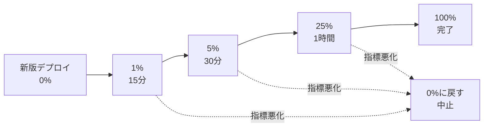

# カナリアリリース

[[MOC_リリース・デプロイ体系|📚 目次]] ｜ [[04_Blue-Greenデプロイ|← 前へ]] ｜ [[06_フィーチャーフラグ|次へ →]]

> [!abstract] この記事で分かること
> - 「カナリア」という名前の由来と、なぜ「一部の利用者にだけ先に出す」と安全なのか
> - トラフィック割合を 1% → 5% → 25% → 100% と段階的に上げる進め方と、各段階で見る指標
> - ユーザー単位の固定（sticky）が必要になる理由
> - Argo Rollouts と AWS ALB（加重ターゲットグループ）での具体的な設定例
> - 少ないトラフィックでは「良し悪しを統計的に判断できない」という落とし穴
>
> **前提**：[[02_デプロイ戦略の全体像と選び方]]、[[03_ローリングアップデート]] を読んでいると理解しやすいです。

## 1. ひとことで言うと

新しい料理をメニューに載せる前に、まず常連さん数人にだけ「試食」してもらい、反応が良ければ全員に出す——これがカナリアリリース（Canary Release）です。新しいバージョンを**ごく一部の利用者（トラフィック）にだけ**先に届け、旧バージョンと数字を比べて問題がないと確かめてから、少しずつ割合を増やしていきます。

- 壊れていても**被害は一部の人・短い時間だけ**で済む
- 「旧版 vs 新版」を**同じ時間帯・同じ本番環境**で比べられる
- 問題があれば新版への配分を 0% に戻すだけで止められる

## 2. 名前の由来と考え方

### 炭鉱のカナリア

昔の炭鉱では、一酸化炭素などの有毒ガスに人間より敏感なカナリア（小鳥）をかごに入れて坑道に持ち込みました。カナリアの様子がおかしくなったら、人間が倒れる前に避難できます。

ソフトウェアでも同じで、新バージョンを**先に少数のサーバー・少数のリクエストで動かし、異常の「早期警報」役**にします。全員が被害を受ける前に問題を検知するのが狙いです。

### ローリング・Blue-Green との違い

| 戦略 | 新版に触れる利用者 | 判断材料 | 戻し方 |
|---|---|---|---|
| ローリング（[[03_ローリングアップデート]]） | 台数の入れ替えに比例して増える | 主にヘルスチェック | 再度ローリングで戻す |
| Blue-Green（[[04_Blue-Greenデプロイ]]） | 切り替えた瞬間に 100% | 切り替え前の社内確認 | ルーターの向きを戻す |
| **カナリア** | **意図した割合だけ（1%など）** | **旧版と新版の指標比較** | **配分を 0% に戻す** |

カナリアの本質は「割合を**自分で決めて**少しずつ上げる」「各段階で**数字を見て判断**する」の 2 点です。クリップ [[止めずに入れ替える — デプロイの仕組み｜ねる前エンジニアリング]] でも「肝は、どの数字が悪ければ戻すかを先に決めておくこと」と強調されています。

## 3. 段階の進め方と比較する指標

### 典型的な段階

Shop API の「注文確定 API に新しいクーポン機能を追加する」リリースを例にします。



- **1%**：致命的なバグ（起動直後の例外、500 連発）を見つける段階。被害を最小に抑える
- **5%**：ある程度のリクエスト数が集まり、エラー率やレイテンシを比較できるようになる
- **25%**：負荷に起因する問題（DB コネクション不足、キャッシュのヒット率低下）が見え始める
- **100%**：全面展開。旧版を片付ける

割合や待ち時間に「正解」はありません。トラフィック量、サービスの重要度、過去の障害傾向で決めます。

### 比較する指標

基本は [[03_ゴールデンシグナル]]（レイテンシ・トラフィック・エラー・飽和度）です。カナリアでは特に次の 2 つを**旧版（stable）と新版（canary）で並べて**見ます。

| 指標 | 例 | 判断の目安（例） |
|---|---|---|
| エラー率 | HTTP 5xx の割合、注文確定の失敗率 | canary が stable より明確に高ければ中止 |
| レイテンシ | p50 / p95 / p99 の応答時間 | p99 が stable の 1.2 倍を超えたら中止 |
| ビジネス指標 | 注文完了率、カート離脱率 | 大きく下がったら中止 |
| 飽和度 | CPU・メモリ・DB コネクション数 | 上限に近づいたら中止 |

ポイントは**絶対値ではなく比較**することです。「エラー率 0.5%」だけでは良いか悪いか分かりませんが、「stable が 0.1% で canary が 0.5%」なら新版が怪しいと判断できます。同じ時間帯に並走しているので、時間帯による変動（夜は少ない、セール中は多い）の影響を打ち消せます。

これらを人が目で見るのではなく、Prometheus などのメトリクスを使って**自動で判定**する仕組み（Argo Rollouts の AnalysisTemplate など）は [[02_段階的トラフィック移行と自動分析]] で詳しく扱います。

## 4. ユーザー単位の固定（sticky）

### なぜ必要か

リクエストごとにランダムで 5% を新版に振ると、同じ利用者の操作が新版と旧版を行ったり来たりします。

```
Aさん: 商品一覧 → [新版] クーポン欄あり
Aさん: カート   → [旧版] クーポン欄なし ← 画面がちぐはぐ
Aさん: 注文確定 → [新版] クーポン適用 API を呼ぶ
```

画面がちらつくだけならまだしも、新版の画面が新版にしかない API を呼んで旧版に届くとエラーになります（[[03_ローリングアップデート]] と同じ「新旧混在」の問題）。また、利用者が新旧どちらに当たったか分からないと、ビジネス指標の比較も正確にできません。

### 固定の方法

| 方法 | 仕組み | 注意 |
|---|---|---|
| Cookie による固定 | ロードバランサーが「どちらに振ったか」を Cookie に記録 | Cookie を持たない API クライアントには効かない |
| ヘッダーによる振り分け | `X-Canary: true` やユーザー ID ハッシュで経路を決める | サービスメッシュ（Istio 等）やゲートウェイが必要 |
| フィーチャーフラグ | アプリ内でユーザー ID をハッシュして機能の ON/OFF を決める | 同じバイナリ内での切り替え（[[06_フィーチャーフラグ]]） |

AWS ALB では、複数ターゲットグループへ重み付き転送するとき **ターゲットグループ単位のスティッキー（TargetGroupStickinessConfig）** を有効にすると、`AWSALBTG` という Cookie で同じターゲットグループに固定されます（次節の例を参照）。

## 5. 設定例

### Argo Rollouts の canary steps

Argo Rollouts は Kubernetes の Deployment を置き換える `Rollout` リソースで、段階的な配分を宣言的に書けます（2026 年時点）。

```yaml
apiVersion: argoproj.io/v1alpha1
kind: Rollout
metadata:
  name: shop-api
spec:
  replicas: 4
  selector:
    matchLabels:
      app: shop-api
  template:
    metadata:
      labels:
        app: shop-api
    spec:
      containers:
        - name: shop-api
          image: ghcr.io/example/shop-api:1.8.0
          ports:
            - containerPort: 3000
  strategy:
    canary:
      canaryService: shop-api-canary   # 新版の Pod だけを選ぶ Service
      stableService: shop-api-stable   # 旧版の Pod だけを選ぶ Service
      trafficRouting:
        alb:
          ingress: shop-api-ingress
          rootService: shop-api-root
          servicePort: 80
      steps:
        - setWeight: 1
        - pause: { duration: 15m }
        - setWeight: 5
        - pause: { duration: 30m }
        - setWeight: 25
        - pause: {}                    # 無期限停止。人が promote するまで待つ
        - setWeight: 100
```

- `setWeight` で新版へのトラフィック割合、`pause` で待ち時間（`s` / `m` / `h`）を指定します
- `pause: {}` は無期限停止で、`kubectl argo rollouts promote shop-api` で次へ進めます
- 中止は `kubectl argo rollouts abort shop-api`。配分が stable に戻ります

> [!note] trafficRouting がない場合
> `trafficRouting` を書かないと、Argo Rollouts は **Pod の台数比** で割合を近似します。4 Pod の Shop API では「1 台 = 25%」が最小単位になり、1% や 5% は実現できません。細かい割合を出したいなら、ALB や Istio などのトラフィックルーターが必要です。

### ALB の加重ターゲットグループ

上の Rollout は、Ingress の注釈（annotation）を書き換えて ALB の**加重ターゲットグループ（weighted target groups）** を操作します。5% の段階では、注釈は次のようになります。

```yaml
apiVersion: networking.k8s.io/v1
kind: Ingress
metadata:
  name: shop-api-ingress
  annotations:
    alb.ingress.kubernetes.io/actions.shop-api-root: |
      {"Type":"forward","ForwardConfig":{"TargetGroups":[
        {"ServiceName":"shop-api-canary","ServicePort":"80","Weight":5},
        {"ServiceName":"shop-api-stable","ServicePort":"80","Weight":95}]}}
spec:
  ingressClassName: alb
  rules:
    - http:
        paths:
          - path: /
            pathType: Prefix
            backend:
              service:
                name: shop-api-root
                port:
                  name: use-annotation
```

Kubernetes を使わず ECS や EC2 で直接 ALB を操作する場合は、リスナールールの forward アクションに重みを書きます。重みは 0〜999 の相対値です。

```bash
aws elbv2 modify-listener --listener-arn "$LISTENER_ARN" \
  --default-actions '[{
    "Type": "forward",
    "ForwardConfig": {
      "TargetGroups": [
        {"TargetGroupArn": "'"$TG_STABLE"'", "Weight": 95},
        {"TargetGroupArn": "'"$TG_CANARY"'", "Weight": 5}
      ],
      "TargetGroupStickinessConfig": {"Enabled": true, "DurationSeconds": 3600}
    }
  }]'
```

`TargetGroupStickinessConfig` を有効にすると、最初に振られたターゲットグループに 1 時間固定されます。なお、加重ターゲットグループの片方が空や全台 unhealthy でも、ALB は**自動でもう片方に逃がしてくれません**。カナリア側の Pod が全滅すると、その割合のリクエストはエラーになります。

AWS CodeDeploy の ECS デプロイでも `CodeDeployDefault.ECSCanary10Percent5Minutes`（10% を 5 分→残り全部）のような定義済み設定で同じことができます（[[05_CodeDeployとは]]）。

## 6. カナリア期間の長さと「統計の壁」

### 期間はどう決めるか

短すぎると問題が表に出る前に 100% になり、長すぎるとリリースが詰まります。次の要素で決めます。

- **問題が表に出るまでの時間**：メモリリークは数時間後、日次バッチ連携は翌日に現れる
- **トラフィックの周期**：昼と夜で利用者層が違うなら、両方を通過させたい
- **十分なリクエスト数**：次に述べる統計の問題

実務では「各段階 15 分〜1 時間、全体で数時間」が出発点になり、重要な決済系では 1 日以上かけることもあります。

### 少トラフィックでは判断できない

Shop API が 1 分間に 200 リクエスト受けているとします。1% のカナリアなら **1 分あたり 2 リクエスト**、15 分で約 30 リクエストです。

```
エラー率 0.1% の stable と、エラー率 1%（10倍悪い）の canary を比べたい
  canary 30 リクエスト中のエラー期待値 = 0.3 件
  → 0 件のことが多く、「エラーなし＝合格」と誤判定しやすい
```

母数が小さいと、**本当に悪い新版でも偶然エラーが出ず合格**したり、逆に**たまたま 1 件のエラーで不合格**になったりします。対策は次の通りです。

- 判定前に**最低リクエスト数**（例：1,000 件）を条件にする
- 割合を上げるか、期間を延ばして母数を稼ぐ
- 比率の検定（Kayenta の Mann-Whitney U 検定など）を使う自動分析を導入する（[[02_段階的トラフィック移行と自動分析]]）
- そもそもトラフィックが少ないサービスでは、カナリアより**ステージングでの負荷試験やシャドウ**（[[07_シャドウデプロイとダークローンチ]]）を重視する

## よくある誤解・つまずき

- ❌ カナリアなら DB スキーマを好きに変えてよい
  ✅ DB は新旧で共有です。新版のスキーマ変更が旧版を壊すことがあります。Expand-Contract で段階的に変えます（[[02_Expand-Contractのリリース計画]]）。
- ❌ 1% で 15 分エラーがなければ安全
  ✅ リクエスト数が少なすぎると統計的に何も言えません。最低件数を判定条件に入れます。
- ❌ カナリア＝Pod を 1 台だけ新版にすること
  ✅ 台数比だと 4 Pod なら最小 25% です。細かい割合にはトラフィックルーター（ALB / Istio 等）が必要です。
- ❌ 戻す基準はその場で判断すればよい
  ✅ 事前に「p99 が 1.2 倍」「5xx が 0.5% 超」など数値で決めておかないと、迷っている間に被害が広がります（[[04_ロールバック判断基準]]）。

## まとめ

- カナリアリリースは新版を一部のトラフィックだけに出し、旧版と**比較**して広げる戦略
- 1% → 5% → 25% → 100% のように段階を踏み、各段階でエラー率・レイテンシを比べる
- 同じ利用者が新旧を行き来しないよう sticky（Cookie・ヘッダー・フラグ）で固定する
- Argo Rollouts の `steps`、ALB の加重ターゲットグループで宣言的に実装できる
- 少トラフィックでは統計的に判断できないので、最低件数・期間・自動分析で補う

## 確認クイズ

1. 4 Pod で動く Shop API を Argo Rollouts で `setWeight: 5` にしたのに、実際には 25% のトラフィックが新版に流れました。原因と対策は？
> [!tip]- 答え
> `trafficRouting` を設定しておらず、Pod の台数比で割合を近似しているためです。4 Pod では 1 台＝25% が最小単位になります。ALB や Istio などのトラフィックルーターを設定すると、Pod 数と関係なく 5% を流せます。

2. カナリアでは、なぜエラー率の「絶対値」ではなく「stable との比較」で判断するのですか？
> [!tip]- 答え
> エラー率は時間帯や外部要因（決済代行の障害、セールなど）でも変動するからです。同じ時間帯に並走している stable と比べれば、外部要因の影響を打ち消し、新版固有の悪化だけを取り出せます。

3. 1 分 200 リクエストのサービスで「1% を 15 分、エラー 0 件なら合格」というルールの問題点は？
> [!tip]- 答え
> カナリアへのリクエストは約 30 件しかなく、エラー率が 10 倍悪い新版でも 0 件になる可能性が高いです。最低リクエスト数を判定条件にする、割合や期間を増やす、統計的な自動分析を使うなどで補います。

## 関連ノート

- [[04_Blue-Greenデプロイ]] — 一度に切り替える方式との比較
- [[06_フィーチャーフラグ]] — 機能単位のカナリア（コードは全台、見せるのは一部）
- [[07_シャドウデプロイとダークローンチ]] — 利用者に影響を出さずに新版を試す方法
- [[02_段階的トラフィック移行と自動分析]] — AnalysisTemplate による自動判定の詳細
- [[04_ロールバック判断基準]] — 戻す基準の決め方
- [[03_ゴールデンシグナル]] — 比較する指標の基本
- [[止めずに入れ替える — デプロイの仕組み｜ねる前エンジニアリング]] — カナリアを含む 3 つの入れ替え方の解説動画（クリップ）
- [[10-Kubernetes]] — Kubernetes の基礎

## 参考

- [Argo Rollouts - Canary Deployment Strategy](https://argoproj.github.io/argo-rollouts/features/canary/)
- [Argo Rollouts - AWS Load Balancer Controller](https://argoproj.github.io/argo-rollouts/features/traffic-management/alb/)
- [AWS - Action types for listener rules（加重ターゲットグループとスティッキー）](https://docs.aws.amazon.com/elasticloadbalancing/latest/application/rule-action-types.html)
- [Martin Fowler / Danilo Sato - CanaryRelease](https://martinfowler.com/bliki/CanaryRelease.html)
- [Google SRE Workbook - Canarying Releases](https://sre.google/workbook/canarying-releases/)
