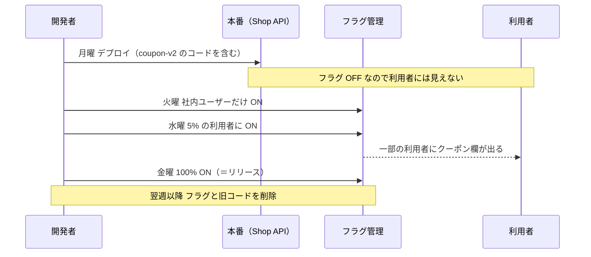

# フィーチャーフラグ

[[MOC_リリース・デプロイ体系|📚 目次]] ｜ [[05_カナリアリリース|← 前へ]] ｜ [[07_シャドウデプロイとダークローンチ|次へ →]]

> [!abstract] この記事で分かること
> - フィーチャーフラグで「デプロイ（配置）」と「リリース（公開）」を切り離せる理由
> - フラグの 4 種類（Release / Experiment / Ops / Permissioning）と、それぞれの寿命
> - 段階公開・ターゲティング・キルスイッチの使い方と、OpenFeature（Node.js）でのコード例
> - トランクベース開発との関係と、放置すると生まれる「フラグ負債」の片付け方
>
> **前提**：[[01_リリースとデプロイの違い]]、[[05_カナリアリリース]] を読んでいると理解しやすいです。

## 1. ひとことで言うと

フィーチャーフラグ（Feature Flag、Feature Toggle とも）は、**コードの中に置く「機能の電灯スイッチ」**です。新しい照明器具（コード）は工事の日に天井へ取り付けておき（デプロイ）、点灯するかどうか（リリース）は後で壁のスイッチで決めます。スイッチは誰でも安全に何度でも切り替えられ、工事のやり直し（再デプロイ）は要りません。

- コードは本番に入っているが、フラグが OFF なら誰にも見えない
- 「社内だけ」「5% だけ」「特定の国だけ」に見せられる
- 問題があれば**数秒でスイッチを切る**（キルスイッチ）

## 2. デプロイとリリースを分離する

[[01_リリースとデプロイの違い]] で見たように、デプロイは「新しいコードを本番環境に置くこと」、リリースは「利用者がその機能を使えるようにすること」です。フラグがないと、この 2 つは同時に起きます。



Shop の「注文確定 API に新しいクーポン機能」を例にすると、コードはこうなります。

```ts
const useCouponV2 = await flags.getBooleanValue('coupon-v2', false, ctx);
if (useCouponV2) {
  total = applyCouponV2(order, couponCode);  // 新しいクーポン計算
} else {
  total = applyLegacyDiscount(order);        // 従来の割引計算
}
```

これで得られるものは次の通りです。

| 得られること | 説明 |
|---|---|
| デプロイの怖さが減る | デプロイ時点では挙動が変わらないので、いつデプロイしてもよい |
| リリースの日時をビジネス側が決められる | セール開始の 0 時ちょうどに ON にできる |
| 戻すのが速い | 再デプロイ（数分〜数十分）ではなくフラグ切り替え（数秒） |
| 機能単位のカナリア | 同じバイナリのまま、機能だけを 1% → 100% に広げる |

クリップ [[止めずに入れ替える — デプロイの仕組み｜ねる前エンジニアリング]] でも「出すことと見せることを分ける」として紹介されています。

## 3. フラグの 4 種類

Pete Hodgson が Martin Fowler のサイトで発表した記事「Feature Toggles (aka Feature Flags)」は、フラグを目的別に 4 つに分類しています。種類によって**寿命**と**切り替えの頻度（動的さ）**が違うので、管理方法も変える必要があります。

| 種類 | 目的 | Shop での例 | 寿命 | 動的さ |
|---|---|---|---|---|
| **Release Toggle** | 未完成・未公開の機能を隠してデプロイする | `coupon-v2` | 短い（通常 1〜2 週間） | 低い |
| **Experiment Toggle** | A/B テストで利用者を群に分ける | 決済ボタンの色 A/B | 統計的に意味のある結果が出るまで（数時間〜数週間） | 高い（リクエストごと） |
| **Ops Toggle** | 運用上、重い機能を止める | 「おすすめ商品」表示を高負荷時に OFF | 多くは短期、キルスイッチは長期 | 即座に切り替えたい |
| **Permissioning Toggle** | 一部の利用者だけに機能を許可する | 有料会員向けの送料無料 | 長い（数年も） | 高い（ユーザーごと） |

```
         寿命が長い
              ▲
Permissioning │            Ops(キルスイッチ)
              │
              │  Experiment
     Release  │
              └──────────────────────▶ 動的さが高い
         寿命が短い
```

特に重要なのは、**Release Toggle は「消す前提」の一時的なもの**だという点です。Permissioning Toggle のような「ずっと残る」フラグと混ぜて管理すると、どれを消してよいか分からなくなります。

## 4. 段階公開・ターゲティング・キルスイッチ

### 段階公開（パーセンテージロールアウト）

利用者 ID をハッシュ関数にかけて 0〜99 の数に割り当て、「数が 5 未満なら ON」のように決めます。ハッシュなので**同じ利用者は毎回同じ結果**になり、[[05_カナリアリリース]] で見た sticky の問題が自然に解決します。

### ターゲティング

属性で ON/OFF を決めます。

- 社内アカウント（`email` が `@example.com`）だけ ON → 本番でのドッグフーディング
- ベータ参加者リストのユーザーだけ ON
- 国・アプリのバージョン・プランで分ける（例：モバイルアプリ v5.2 以上だけ ON）

### キルスイッチ

外部の決済代行や推薦エンジンが不調なとき、その機能だけを止める Ops Toggle です。「障害時に OFF にすると、こう縮退する」という動作をあらかじめ作り、テストし、[[02_ランブックの書き方|ランブック]] に書いておきます。いざという時に初めて押すスイッチは、たいてい期待通りに動きません。

## 5. コード例：OpenFeature の Node.js SDK

OpenFeature は CNCF のプロジェクトで、フラグ評価の**ベンダー中立な標準 API** です。アプリは OpenFeature の API だけを呼び、裏側の「プロバイダー」（LaunchDarkly、Unleash、Flagsmith、flagd など）を差し替えられます。2026 年時点で、サーバー向け SDK は `@openfeature/server-sdk`（Node.js 18 以上）です。

```bash
npm install --save @openfeature/server-sdk @openfeature/flagd-provider
```

```ts
// src/flags.ts
import { OpenFeature } from '@openfeature/server-sdk';
import { FlagdProvider } from '@openfeature/flagd-provider';

// 起動時に一度だけ。プロバイダーの準備完了まで待つ
await OpenFeature.setProviderAndWait(new FlagdProvider());
export const flags = OpenFeature.getClient();
```

```ts
// src/routes/orders.ts（Express）
import { flags } from '../flags';

app.post('/orders/:id/confirm', async (req, res) => {
  const user = req.user;
  // 評価コンテキスト：誰に対する評価か
  const ctx = {
    targetingKey: user.id,     // 段階公開のハッシュに使うキー
    email: user.email,
    plan: user.plan,
  };
  // 第 2 引数は「フラグ基盤に届かない時」の既定値。安全側（OFF）にする
  const useCouponV2 = await flags.getBooleanValue('coupon-v2', false, ctx);

  const order = await confirmOrder(req.params.id, {
    couponCode: useCouponV2 ? req.body.couponCode : undefined,
  });
  res.json(order);
});
```

フラグの定義（どの条件で ON か）はコードの外に置きます。flagd を使う場合の定義ファイルは次の通りです。

```json
{
  "$schema": "https://flagd.dev/schema/v0/flags.json",
  "flags": {
    "coupon-v2": {
      "state": "ENABLED",
      "variants": { "on": true, "off": false },
      "defaultVariant": "off",
      "targeting": {
        "if": [
          { "ends_with": [{ "var": "email" }, "@example.com"] },
          "on",
          { "fractional": [["on", 5], ["off", 95]] }
        ]
      }
    }
  }
}
```

- 社内メールアドレスなら常に ON、それ以外は 5% だけ ON
- `fractional` は既定で `targetingKey` とフラグ名を組み合わせてハッシュするので、同じ利用者は同じ結果になる
- 5 → 25 → 100 と書き換えるだけで公開範囲が広がり、再デプロイは不要

> [!warning] 既定値は「安全側」に
> `getBooleanValue('coupon-v2', false, ...)` の `false` は、フラグ基盤がダウンした・フラグ名を打ち間違えた時に返る値です。新機能のフラグは OFF、キルスイッチは「機能が動く」側を既定にするなど、**壊れた時にどうなってほしいか**で決めます。

## 6. トランクベース開発との関係

[[03-Trunk-Based-Development|トランクベース開発]] では、全員が main（trunk）に 1 日 1 回以上マージします。しかしクーポン機能のように 2 週間かかる機能は、途中の状態で main に入ります。そこで**未完成の機能を Release Toggle で隠したまま main に入れる**のが定石です。

| 長命ブランチで開発 | トランクベース + フラグ |
|---|---|
| 2 週間ブランチで隠す | main に毎日マージし、フラグで隠す |
| 最後に巨大なマージ（コンフリクト地獄） | 小さなマージの積み重ね |
| リリース＝マージ＝デプロイ | デプロイは毎日、リリースはフラグで |

クリップ [[なぜデプロイは怖くなくなったのか]] にある「小さく頻繁に統合すれば痛みは消える」という CI の考え方を、未完成の機能にも適用する道具がフラグだと言えます。ブランチ戦略の全体像は [[01_リリースサイクルとブランチ戦略]] を参照してください。

## 7. フラグ負債と削除の運用

フラグは 1 つ増えるごとに分岐が倍になります。10 個のフラグがあれば理論上 2^10 = 1,024 通りの組み合わせがあり、すべてをテストすることはできません。使い終わったフラグを放置した状態を**フラグ負債**と呼びます。

> [!danger] 実例：Knight Capital（2012 年）
> 米国の証券会社 Knight Capital は、古い機能に使っていたフラグを新機能に再利用し、一部のサーバーに新コードがデプロイされていなかったため、旧コードが目覚めて大量の誤発注を行いました。約 45 分で約 4.6 億ドルの損失を出したとされます。Hodgson の記事でも、フラグ管理の失敗例として挙げられています。

### 削除の運用ルール（例）

- **作成と同時に削除チケットを作る**：「coupon-v2 を消す」を backlog に入れておく
- **期限を付ける**：フラグに `expires: 2026-11-30` のようなメタデータを持たせる
- **タイムボム**：期限切れのフラグが残っていたら CI のテストを失敗させる
- **上限を決める**：チームのフラグ数に上限を設け、新しく作るには古いものを消す
- **フラグ名を再利用しない**：Knight Capital の教訓
- **削除の手順**：100% ON で一定期間安定 → `if` 分岐と旧コード（`applyLegacyDiscount`）を削除してデプロイ → フラグ管理画面から定義を削除（この順。先に定義を消すと既定値 `false` に戻ってしまう）

## 8. 主なサービス

| サービス | 特徴（2026 年時点） |
|---|---|
| LaunchDarkly | 商用 SaaS の代表格。ターゲティング・実験・監査ログが充実 |
| Unleash | OSS（セルフホスト可）+ 商用版。段階公開の「strategy」が分かりやすい |
| Flagsmith | OSS（セルフホスト可）+ SaaS。リモート設定値も扱える |
| AWS AppConfig | AWS のマネージドサービス。フラグの段階的な配信と CloudWatch アラームによる自動ロールバックが可能 |
| flagd | OpenFeature 公式の軽量なフラグ評価エンジン（OSS）。設定ファイルや Kubernetes CRD で定義 |

最初はアプリの設定ファイルや環境変数でも始められますが、「再デプロイなしで切り替える」「ユーザー単位で評価する」「誰がいつ切り替えたかを記録する」が必要になったら専用サービスを検討します。OpenFeature を挟んでおけば、後から乗り換えるのも楽です。

## よくある誤解・つまずき

- ❌ フラグがあればロールバック不要
  ✅ フラグで戻せるのはフラグで囲んだコードだけです。DB スキーマ変更や囲み忘れたバグは戻せません（[[03_ロールバックできない変更]]）。
- ❌ フラグは作ったら終わり
  ✅ Release Toggle は「消すまでが 1 つの変更」です。削除チケットと期限をセットで作ります。
- ❌ フラグ OFF ならテストしなくてよい
  ✅ 本番では ON と OFF の両方が同時に動きます。少なくとも「現在の本番の状態」と「次に切り替える状態」の両方をテストします。
- ❌ フラグの値はリクエストのたびにサーバーへ問い合わせる
  ✅ 多くの SDK はルールをメモリにキャッシュしてローカルで評価するため高速です。その代わり、基盤ダウン時の既定値の設計が重要になります。

## まとめ

- フィーチャーフラグはデプロイ（配置）とリリース（公開）を切り離す「機能のスイッチ」
- Release / Experiment / Ops / Permissioning の 4 種類で寿命と管理方法が違う
- 段階公開（ハッシュで sticky）・ターゲティング・キルスイッチで、機能単位のカナリアができる
- OpenFeature を使うとベンダー中立な API で評価でき、既定値は「壊れた時の安全側」にする
- トランクベース開発で未完成機能を main に入れるための道具でもある
- 使い終わったフラグは期限・チケット・タイムボムで確実に消す

## 確認クイズ

1. 「有料会員だけに送料無料を表示する」フラグと「クーポン機能 v2 を隠してデプロイする」フラグは、それぞれどの種類で、管理上どこが違いますか？
> [!tip]- 答え
> 前者は Permissioning Toggle で、数年単位で残り続けます。後者は Release Toggle で、全面公開したら 1〜2 週間程度で削除すべき一時的なものです。混ぜて管理すると消してよいフラグが分からなくなるため、種類や期限をメタデータで区別します。

2. coupon-v2 を 100% ON にして 2 週間安定しました。フラグを片付ける正しい順番は？
> [!tip]- 答え
> まずコードから `if` 分岐と旧コードを削除してデプロイし、その後でフラグ管理側の定義を削除します。先に定義を消すと、まだフラグを参照しているコードが既定値（false）を受け取り、旧機能に戻ってしまいます。

3. ランダムではなく利用者 ID のハッシュで 5% を決めるのはなぜですか？
> [!tip]- 答え
> 同じ利用者が毎回同じ結果になる（sticky）ようにするためです。リクエストごとにランダムだと、画面が新旧を行き来したり、新画面が旧 API を呼んでエラーになったりします。

## 関連ノート

- [[01_リリースとデプロイの違い]] — デプロイとリリースの定義
- [[05_カナリアリリース]] — インフラ層での段階公開
- [[07_シャドウデプロイとダークローンチ]] — フラグを使って機能を隠したまま本番負荷をかける
- [[03-Trunk-Based-Development]] — フラグと相性の良いブランチ戦略
- [[01_リリースサイクルとブランチ戦略]] — リリースサイクル全体での位置づけ
- [[03_ロールバックできない変更]] — フラグでも戻せないもの
- [[止めずに入れ替える — デプロイの仕組み｜ねる前エンジニアリング]] — 「出すことと見せることを分ける」の解説（クリップ）
- [[なぜデプロイは怖くなくなったのか]] — 小さく頻繁に出す文化の歴史（クリップ）

## 参考

- [Pete Hodgson - Feature Toggles (aka Feature Flags)（martinfowler.com）](https://martinfowler.com/articles/feature-toggles.html)
- [OpenFeature - Node.js SDK](https://openfeature.dev/docs/reference/sdks/server/javascript/)
- [flagd - Fractional Operation](https://flagd.dev/reference/custom-operations/fractional-operation/)
- [LaunchDarkly](https://launchdarkly.com/)
- [Unleash](https://www.getunleash.io/)
- [Flagsmith](https://www.flagsmith.com/)
- [AWS AppConfig - Feature flags](https://docs.aws.amazon.com/appconfig/latest/userguide/what-is-appconfig.html)
