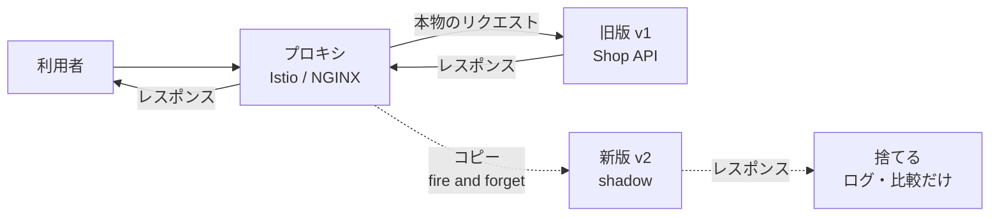
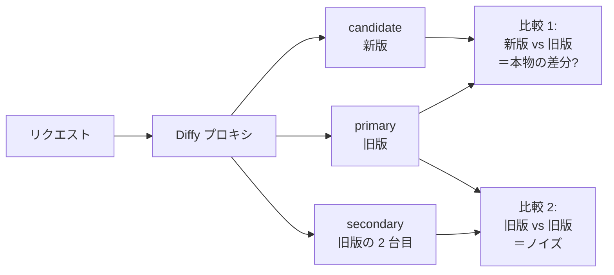

# シャドウデプロイとダークローンチ

[[MOC_リリース・デプロイ体系|📚 目次]] ｜ [[06_フィーチャーフラグ|← 前へ]] ｜ [[08_ゼロダウンタイムデプロイの条件|次へ →]]

> [!abstract] この記事で分かること
> - 本番トラフィックを新版に「コピー」して流すシャドウデプロイ（トラフィックミラーリング）の仕組み
> - 新版のレスポンスを捨てる理由と、書き込み・外部 API・メールなど副作用の扱い方
> - 新旧のレスポンスを比較する手法（Diffy 的手法）と、Istio / NGINX の設定例
> - ダークローンチ（機能を隠したまま本番負荷をかける）と Facebook チャットの事例
>
> **前提**：[[05_カナリアリリース]]、[[06_フィーチャーフラグ]] を読んでいると理解しやすいです。

## 1. ひとことで言うと

新人の通訳者が、ベテランの横で同じ会議を聞きながら**マイクを切った状態で**通訳してみる——これがシャドウデプロイ（Shadow Deployment）です。お客さんに聞こえるのはベテラン（旧版）の通訳だけ。新人（新版）の訳は録音しておき、後でベテランの訳と比べて評価します。

- 利用者への影響は（正しく作れば）**ゼロ**
- 本物のリクエストで新版を試せる（テストデータでは再現できない多様さ）
- カナリアと違い、新版の失敗が誰にも届かない

ダークローンチ（Dark Launch）は、これをアプリの中で行うものです。**機能を画面には出さず、裏で本番の負荷だけかけて**耐えられるかを確かめます。

## 2. トラフィックミラーリングの仕組み



1. プロキシ（ロードバランサー、サービスメッシュ）がリクエストを受ける
2. 本来の宛先（旧版）に送り、そのレスポンスを利用者に返す
3. 同時に**同じリクエストのコピー**を新版にも送る
4. 新版のレスポンスは**利用者に返さず捨てる**（fire and forget：撃ちっぱなし）。新版が遅くても落ちても、利用者には影響しない

「捨てる」のが大事な点です。新版のレスポンスを待つ必要がないので、新版がタイムアウトしても旧版の応答速度は変わりません。代わりに、新版側のログ・メトリクス・レスポンス内容を記録して後から評価します。

### 何が分かるか

| 確認できること | 例 |
|---|---|
| エラー・例外 | 本番にしかない変なデータ（絵文字入りの住所など）で落ちないか |
| 性能 | 本番と同じリクエスト量・内容でレイテンシや CPU はどうか |
| 正しさ | 旧版と同じレスポンスを返すか（次節の比較） |
| 容量 | 新しい DB やキャッシュが本番負荷に耐えるか |

## 3. 副作用の扱い（いちばんの難所）

ミラーリングは「同じリクエストを 2 回処理する」ことです。読み取り（GET）なら問題ありませんが、**書き込みを伴うリクエストをそのまま新版に流すと、二重に処理されます。**

Shop の「注文確定 API」をミラーリングすると、こうなります。

```
POST /orders/123/confirm をミラーリング
  旧版: orders を更新、在庫を減らす、決済代行に課金、確認メール送信
  新版: orders を更新、在庫を減らす、決済代行に課金、確認メール送信 ← 二重！
```

対策は「新版の副作用をどこで止めるか」です。

| 副作用 | 対策 |
|---|---|
| **DB への書き込み** | 新版は**別の DB（本番のコピー）**に接続する／書き込みをトランザクションでロールバックする／読み取り系 API だけミラーする |
| **外部 API（決済・配送）** | 新版はモック（スタブ）やサンドボックス環境に向ける。本番の決済代行には絶対に送らない |
| **メール・プッシュ通知** | 新版では送信処理を無効化し、「送るはずだった内容」をログに出すだけにする |
| **メッセージキューへの発行** | 新版は別のトピック／キューに発行する |
| **ID の採番・冪等キー** | 本番のシーケンスを消費しない設計にする |

実務では、新版を「シャドウモード」で起動する環境変数（例：`SHADOW_MODE=true`）を用意し、副作用を出す箇所（Repository 層・外部クライアント）を一括で差し替える作りがよく使われます。**最も安全なのは、副作用のない読み取り API だけを対象にすること**です。検索 API、商品一覧、価格計算などはミラーリング向きです。

## 4. レスポンスの比較（Diffy 的手法）

性能だけでなく「新版が旧版と同じ答えを返すか」を自動で確かめたい場合、レスポンスを比較します。Twitter（現 X）が 2015 年に公開した OSS **Diffy** は、この手法の代表例です。



ポイントは **旧版を 2 台用意する**ことです。レスポンスには毎回変わる値（タイムスタンプ、リクエスト ID、ランダムなおすすめ順）が含まれます。旧版同士でも違う項目は「ノイズ」と判断して除外し、**新版だけが違う項目＝本物の差分（回帰バグの候補）**として報告します。

自前で作る場合の最小構成は次の通りです。

- ミラー先の新版で、レスポンス本文とリクエスト ID をログ（またはキュー）に出す
- 旧版も同じリクエスト ID でレスポンスをログに出す
- バッチで突き合わせ、`createdAt` など既知のノイズ項目を除外して JSON 差分を取る
- 差分率をダッシュボードにし、一定以下になったら次のステップ（カナリア）へ進む

## 5. 設定例

### Istio の mirror

Istio（サービスメッシュ）の VirtualService で、v1 への通常ルーティングに加えて v2 にミラーします（2026 年時点）。

```yaml
apiVersion: networking.istio.io/v1
kind: VirtualService
metadata:
  name: shop-api
spec:
  hosts:
    - shop-api
  http:
    - route:
        - destination:
            host: shop-api
            subset: v1
          weight: 100
      mirror:
        host: shop-api
        subset: v2
      mirrorPercentage:
        value: 10.0        # リクエストの 10% をミラー。省略すると 100%
---
apiVersion: networking.istio.io/v1
kind: DestinationRule
metadata:
  name: shop-api
spec:
  host: shop-api
  subsets:
    - name: v1
      labels:
        version: v1
    - name: v2
      labels:
        version: v2
```

- ミラーされたリクエストは fire and forget で、レスポンスは捨てられます
- ミラーされたリクエストの `Host` ヘッダーには `-shadow` が付きます（例：`shop-api-shadow`）。新版側はこれを見て「シャドウとして処理中」と判断することもできます
- いきなり 100% ではなく、新版の容量に合わせて `mirrorPercentage` を上げていきます

### NGINX の mirror

NGINX の `ngx_http_mirror_module` でも同様のことができます。

```nginx
upstream shop_api_v1     { server 10.0.1.10:3000; server 10.0.1.11:3000; }
upstream shop_api_shadow { server 10.0.2.10:3000; }

server {
    listen 80;

    location /api/products {
        mirror /mirror;              # このパスへのリクエストをコピー
        mirror_request_body on;      # 本文もコピー（既定で on）
        proxy_pass http://shop_api_v1;
    }

    location = /mirror {
        internal;                    # 外部から直接アクセスさせない
        proxy_pass http://shop_api_shadow$request_uri;
        proxy_set_header X-Shadow-Request "true";
    }
}
```

- ミラーのサブリクエストのレスポンスは無視され、利用者には `shop_api_v1` の結果だけが返ります
- 上の例では副作用のない `/api/products`（商品一覧）だけをミラーしています
- 注意：ミラー先が遅いと、NGINX がサブリクエストの完了を待つことで元のリクエストの処理（keepalive 接続の次のリクエストなど）が遅れるケースが報告されています。`proxy_read_timeout` を短くするなど、ミラー先の遅延が本番に波及しないよう監視します

## 6. ダークローンチ

### 機能を隠して本番負荷をかける

ダークローンチは、新機能の**裏側の処理だけを本番で実際に動かし、画面には出さない**手法です。シャドウデプロイがプロキシ層でリクエストをコピーするのに対し、ダークローンチはアプリのコードの中で、フィーチャーフラグ（[[06_フィーチャーフラグ]]）を使って行うのが一般的です。

Shop で「おすすめ商品 API（新しい推薦エンジン）」を導入する例を考えます。

```ts
// 商品ページ表示時
const page = await renderProductPage(productId);

// ダークローンチ：結果は使わないが、本番トラフィックで推薦エンジンを呼ぶ
if (await flags.getBooleanValue('reco-dark-launch', false, ctx)) {
  recoClient.getRecommendations(user.id, productId)   // await しない
    .then((r) => metrics.observe('reco.latency', r.elapsedMs))
    .catch((e) => metrics.increment('reco.error'));   // 失敗しても画面に影響させない
}
return page;
```

- 画面には何も出ないので、推薦エンジンが遅くても落ちても利用者は気づかない
- フラグで呼び出す割合を 1% → 10% → 100% と上げ、推薦エンジンのスケールを確かめる
- 十分耐えると分かってから、別のフラグで画面に表示する（＝リリース）

### Facebook チャットの事例（2008 年）

ダークローンチという言葉を広めたのは、Facebook が 2008 年に Facebook Chat を公開した時の取り組みです。数千万人規模の利用者に一斉に公開する前に、**通常のページ表示の裏で、チャットの通信を模擬するリクエストを本番のブラウザから送らせ**、UI は一切見せずにチャットサーバー（Erlang 製）に本番規模の負荷をかけました。これでボトルネックを事前に見つけて直し、その後で段階的に公開しています。

## 7. 使いどころ

| 場面 | シャドウ／ダークローンチが向く理由 |
|---|---|
| **大規模な性能検証** | 負荷試験ツールでは本番のリクエストの多様さ・偏りを再現しにくい |
| **言語・フレームワークの書き換え** | 例：Shop API を Node.js から Go に書き直す。同じ入力に同じ出力を返すかを Diffy 的に確認できる |
| **DB・検索基盤の移行** | 例：商品検索を PostgreSQL の LIKE から Elasticsearch に移す。両方に問い合わせて結果と速度を比較する |
| **新しいキャッシュ・インフラ** | 本番トラフィックでのヒット率やメモリ使用量を事前に見られる |
| **トラフィックが少なくカナリアで判断しにくい** | 100% をミラーすれば、利用者を危険にさらさずに母数を稼げる（[[05_カナリアリリース]] の「統計の壁」対策） |

逆に向かないのは、**書き込みや外部連携が中心の機能**（注文確定、決済）です。副作用の分離にかかるコストが大きく、カナリア＋フィーチャーフラグの方が現実的なことが多いです。また、新版の分だけ**インフラ費用が増える**（100% ミラーなら計算資源がほぼ 2 倍）点にも注意します。

## よくある誤解・つまずき

- ❌ シャドウなら利用者に影響しないので、何をミラーしてもよい
  ✅ 書き込み・外部 API・メールは二重に実行されます。副作用を止める仕組みがない限り、読み取り系だけを対象にします。
- ❌ シャドウで問題がなければ、そのまま 100% リリースしてよい
  ✅ シャドウでは新版のレスポンスを利用者が受け取らないので、画面やクライアントとの組み合わせの問題は分かりません。シャドウの後にカナリアを挟むのが安全です。
- ❌ 新旧のレスポンスが違えば新版のバグ
  ✅ タイムスタンプやランダム要素など、毎回変わる値（ノイズ）があります。旧版同士の比較でノイズを除外してから判断します。
- ❌ ダークローンチは特別なインフラが必要
  ✅ フィーチャーフラグと「結果を使わない非同期呼び出し」があればアプリ内で実現できます。

## まとめ

- シャドウデプロイは本番リクエストのコピーを新版に流し、レスポンスは捨てて評価だけ行う
- 最大の難所は副作用。DB・外部 API・メールは別環境やモックに向けるか、読み取り系だけを対象にする
- Diffy 的手法は「新版 vs 旧版」と「旧版 vs 旧版（ノイズ）」を比べ、本物の差分だけを見つける
- Istio の `mirror` / `mirrorPercentage`、NGINX の `mirror` で設定できる
- ダークローンチは機能を隠したまま本番負荷をかける手法で、Facebook Chat（2008 年）が有名な例
- 性能検証・書き換え・基盤移行で特に有効。通常はシャドウ → カナリア → 全面公開の順に進める

## 確認クイズ

1. Shop の注文確定 API（POST）を、そのまま Istio の mirror で新版にミラーすると何が起きますか？
> [!tip]- 答え
> 新版でも注文の更新・在庫の減算・決済・メール送信が実行され、二重処理になります。新版を本番のコピー DB・決済のモック・メール無効化の状態で動かすか、副作用のない読み取り API だけをミラー対象にします。

2. Diffy が旧版を 2 台（primary と secondary）用意するのはなぜですか？
> [!tip]- 答え
> タイムスタンプやランダムな並び順など、同じコードでも毎回変わる値（ノイズ）を見分けるためです。旧版同士でも違う項目はノイズとして除外し、新版だけが違う項目を本物の差分として報告します。

3. シャドウデプロイとダークローンチの違いを、実装する層の観点で説明してください。
> [!tip]- 答え
> シャドウデプロイは主にプロキシ／サービスメッシュの層でリクエストをコピーし、別バージョンのサービスに送ります。ダークローンチはアプリのコード内でフィーチャーフラグを使い、新機能の裏側の処理だけを本番で呼び出して、結果を画面に出しません。

## 関連ノート

- [[05_カナリアリリース]] — シャドウの後に進む段階公開
- [[06_フィーチャーフラグ]] — ダークローンチの実装に使うスイッチ
- [[08_ゼロダウンタイムデプロイの条件]] — 新旧並走の前提条件
- [[01_リリース後の重点監視]] — 新版のメトリクスの見方
- [[04_リハーサルとステージング環境]] — ステージングでの検証との使い分け
- [[MOC_可観測性体系]] — ログ・メトリクスの基礎
- [[止めずに入れ替える — デプロイの仕組み｜ねる前エンジニアリング]] — 戻せない副作用（メール・外部処理）の話（クリップ）

## 参考

- [Istio - Mirroring](https://istio.io/latest/docs/tasks/traffic-management/mirroring/)
- [NGINX - Module ngx_http_mirror_module](https://nginx.org/en/docs/http/ngx_http_mirror_module.html)
- [opendiffy/diffy（GitHub）](https://github.com/opendiffy/diffy)
- [Simon Willison - Engineering @ Facebook: Facebook Chat（2008 年の紹介記事）](https://simonwillison.net/2008/May/15/engineering/)
- [Facebook Messenger - Wikipedia](https://en.wikipedia.org/wiki/Facebook_Messenger)
