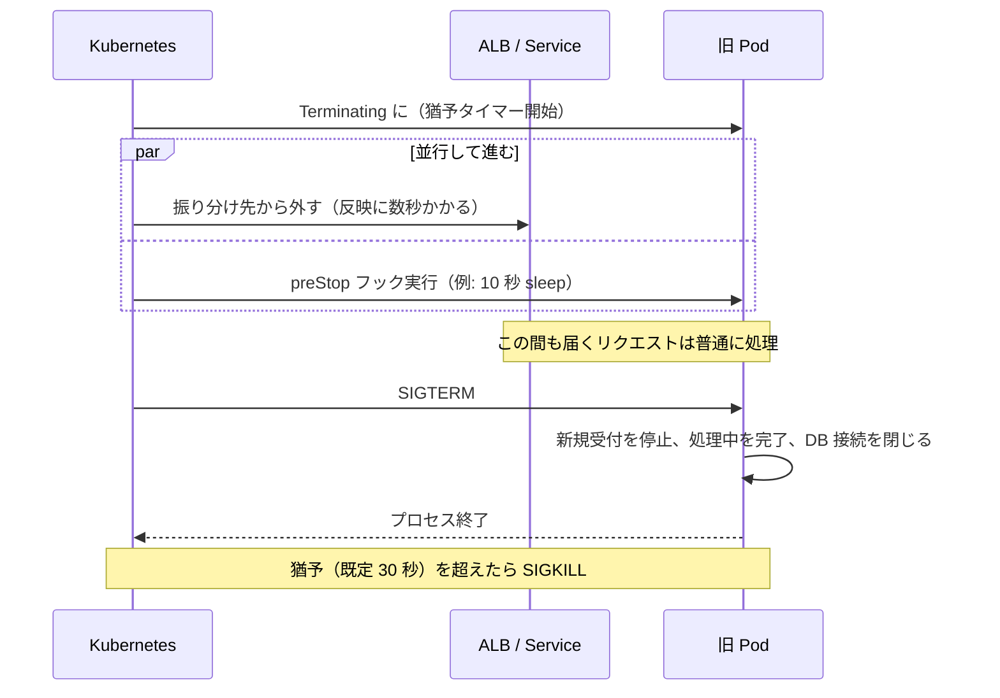

# ゼロダウンタイムデプロイの条件

[[MOC_リリース・デプロイ体系|📚 目次]] ｜ [[07_シャドウデプロイとダークローンチ|← 前へ]] ｜ [[01_セマンティックバージョニング|次へ →]]

> [!abstract] この記事で分かること
> - 「止めずに入れ替える」ために、デプロイ戦略より前にアプリとインフラが満たすべき条件
> - liveness / readiness / startup の 3 種類のヘルスチェックの役割の違い
> - SIGTERM・preStop・terminationGracePeriodSeconds・ALB の登録解除の遅延を組み合わせたグレースフルシャットダウン
> - ステートレス化と、新旧バージョンの後方互換（API・DB・メッセージ形式）
> - 長時間ジョブ・WebSocket・キャッシュ／CDN の落とし穴
>
> **前提**：[[03_ローリングアップデート]]、[[04_Blue-Greenデプロイ]] を読んでいると理解しやすいです。

## 1. ひとことで言うと

営業中のレストランで、料理人を 1 人ずつ交代させる場面を想像してください。新しい料理人は「包丁を研ぎ終わって準備ができた」と言ってから厨房に入り（readiness）、帰る料理人は**新しい注文を受けるのをやめ、作りかけの料理を仕上げてから**エプロンを外します（グレースフルシャットダウン）。お客さんの注文票は厨房の共有ボードに貼ってあるので、誰が交代しても続きを作れます（ステートレス）。そして新旧の料理人は同じレシピの書き方を理解できます（後方互換）。

ローリング・Blue-Green・カナリアのどれを選んでも、**この 4 つが揃っていなければ、入れ替えの瞬間にエラーが出ます**。

| 条件 | 満たさないと起きること |
|---|---|
| ヘルスチェック | 起動途中の Pod にリクエストが届き 502/503 |
| グレースフルシャットダウン | 処理中のリクエストが途中で切られ 502 |
| ステートレス化 | 入れ替えのたびにログアウトされる、カートが消える |
| 後方互換 | 新旧混在の時間に「列がない」「知らない形式」エラー |

## 2. ヘルスチェック（liveness / readiness / startup）

Kubernetes には役割の違う 3 種類のプローブ（probe：死活確認）があります。混同すると、かえって障害を広げます。

| プローブ | 問い | 失敗したら | Shop API での実装例 |
|---|---|---|---|
| **readiness** | 今リクエストを受けられるか？ | Service の振り分け先から**外す**（再起動はしない） | DB 接続プールの初期化完了、キャッシュのウォームアップ完了で 200 |
| **liveness** | プロセスが生きているか（固まっていないか）？ | コンテナを**再起動**する | イベントループが応答すれば 200。DB は見ない |
| **startup** | 起動が終わったか？ | 規定回数失敗で再起動。成功するまで他の 2 つを止める | 起動が遅いアプリで liveness に殺されないための猶予 |

```yaml
# Deployment の containers[] の一部（Shop API）
readinessProbe:
  httpGet: { path: /readyz, port: 3000 }
  periodSeconds: 5
  failureThreshold: 2
livenessProbe:
  httpGet: { path: /livez, port: 3000 }
  periodSeconds: 10
  failureThreshold: 3
startupProbe:
  httpGet: { path: /livez, port: 3000 }
  periodSeconds: 5
  failureThreshold: 24     # 最大 5秒 × 24 = 120 秒まで起動を待つ
```

> [!warning] liveness で DB を見てはいけない
> liveness が DB に問い合わせると、DB が数秒遅くなっただけで**全 Pod が一斉に再起動**し、障害が拡大します。外部依存の確認は readiness（受付停止）に留め、liveness は「自分のプロセスが固まっていないか」だけを見ます。

ゼロダウンタイムに直接効くのは **readiness** です。ローリングアップデートは「新 Pod が Ready になってから旧 Pod を消す」ので、readiness が「起動しただけで常に 200」だと、準備前の Pod にリクエストが流れます。クリップ [[止めずに入れ替える — デプロイの仕組み｜ねる前エンジニアリング]] でも「いつでも元気ですと返すだけだと、壊れた版や準備中の版にも配られる」と注意されています。Docker Compose での例は [[depends_on_healthcheck]]、自動ロールバックとの連携は [[03_ヘルスチェックと自動ロールバック]] を参照してください。

## 3. グレースフルシャットダウン

起動側より見落とされやすいのが**終了側**です。旧 Pod を消すとき、処理中のリクエストを最後まで返してから終わる必要があります。

### Kubernetes で Pod が消える流れ



落とし穴は「振り分け先から外す」と「SIGTERM」が**並行して**起きる点です。ロードバランサーへの反映には数秒かかるので、SIGTERM ですぐ終了すると、その数秒間に届いたリクエストが閉じたポートに当たってエラーになります。そこで **preStop フックで数秒待ってから SIGTERM を受ける**のが定石です。

```yaml
spec:
  terminationGracePeriodSeconds: 60   # preStop + 終了処理の合計の上限（既定 30 秒）
  containers:
    - name: shop-api
      lifecycle:
        preStop:
          sleep:
            seconds: 10               # LB から外れるのを待つ
```

- `terminationGracePeriodSeconds` は **preStop の時間を含む合計**です。preStop 10 秒 + 終了処理 最大 40 秒 < 60 秒 になるように設定します
- `preStop.sleep` は Kubernetes v1.29 で導入された組み込みの待機です（2026 年時点の主要バージョンで利用可）。古いクラスタやイメージでは `exec: { command: ["sleep", "10"] }` を使います（イメージに `sleep` コマンドが必要）

### Node.js 側の実装（server.close）

```ts
// src/server.ts
const server = app.listen(3000);
let shuttingDown = false;

app.get('/readyz', (_req, res) => {
  res.status(shuttingDown ? 503 : 200).end();   // 終了中は Not Ready
});

process.on('SIGTERM', () => {
  shuttingDown = true;
  // 新しい接続の受付を止め、処理中のリクエストが終わるのを待つ
  server.close(async () => {
    await db.end();          // PostgreSQL の接続プールを閉じる
    process.exit(0);
  });
  server.closeIdleConnections();  // 待機中の keep-alive 接続を閉じる（Node.js 18.2+）
  // 猶予を超えそうなら強制終了（terminationGracePeriodSeconds より短く）
  setTimeout(() => process.exit(1), 40_000).unref();
});
```

> [!note] SIGTERM がアプリに届かない問題
> Dockerfile で `CMD npm start` や `CMD node dist/server.js`（シェル形式）にすると、PID 1 が npm やシェルになり、SIGTERM が Node.js に届かないことがあります。`CMD ["node", "dist/server.js"]`（exec 形式）で直接起動します。詳しくは [[本番向けベストプラクティス]]。

### ALB の登録解除の遅延（コネクションドレイニング）

AWS ALB では、ターゲットを外すと状態が `draining` になり、新しいリクエストは送られなくなりますが、**処理中のリクエストは「登録解除の遅延（deregistration delay）」の間だけ待ってもらえます**。既定値は **300 秒**です。

```bash
aws elbv2 modify-target-group-attributes \
  --target-group-arn "$TG_ARN" \
  --attributes Key=deregistration_delay.timeout_seconds,Value=30
```

- 既定の 300 秒のままだと、デプロイのたびに旧ターゲットが最大 5 分残り、デプロイが遅くなる
- 短くしすぎると、遅い API（CSV エクスポートなど）が途中で切られる
- 「アプリの最長リクエスト時間 < 登録解除の遅延 ≤ terminationGracePeriodSeconds」の大小関係を揃えるのがコツ
- 処理中のリクエストがなければ、遅延を待たずに解除が完了します

この仕組みは一般に**コネクションドレイニング（connection draining）**と呼ばれ、ECS でも同じターゲットグループ属性が効きます。

## 4. ステートレス化（状態を外へ出す）

サーバーのメモリやローカルディスクに状態を持つと、そのサーバーを消した瞬間に状態も消えます。

| 状態 | ありがちな置き場所（NG） | 外に出す先 |
|---|---|---|
| ログインセッション | プロセスのメモリ（express-session の MemoryStore） | Redis / DB、または JWT のようにクライアント側に持たせる |
| カートの中身 | メモリ | DB（PostgreSQL）や Redis |
| アップロードファイル | コンテナのローカルディスク | S3 などのオブジェクトストレージ |
| 定期実行の状態 | 各サーバーの cron | 専用のジョブ基盤、DB のロック |

ロードバランサーの sticky セッション（同じ利用者を同じサーバーに固定）で「ステートフルのまま」動かすこともできますが、そのサーバーを入れ替えると結局セッションは消えます。**ゼロダウンタイムを目指すなら、どのサーバーが消えても困らない作りが前提**です。

## 5. 新旧の後方互換

ローリングでもカナリアでも、入れ替え中は**新旧のバージョンが同時に動きます**。Blue-Green でも DB やキューは共有です。したがって、次の 3 つは「新旧どちらからも扱える」必要があります。

```
         ┌─────── 新旧が同時に触るもの ───────┐
 旧 v1 ──┤ ① API（クライアント ⇄ サーバー）   ├── 新 v2
         │ ② DB スキーマ                     │
         │ ③ メッセージ・キャッシュの形式       │
         └───────────────────────────────────┘
```

| 対象 | 壊れる例（Shop） | 守り方 |
|---|---|---|
| **API** | v2 の画面が新設の `POST /coupons/validate` を呼び、まだ v1 の Pod に届いて 404 | サーバー側の新 API を先に全台へ出し、画面は後で切り替える。項目の追加は OK、削除・改名は段階的に |
| **DB スキーマ** | v2 が `users.name` を `full_name` に改名 → v1 が `name` を読んでエラー | Expand-Contract（追加 → 移行 → 削除を別デプロイに分ける） |
| **メッセージ形式** | v2 が注文イベントに必須項目 `couponId` を追加 → v1 のコンシューマーが検証エラー | 新しい項目は任意（optional）で追加。読む側を先に対応させる |
| **キャッシュ** | v2 が Redis のカートを新形式で保存 → v1 に戻したら読めない | キーにスキーマバージョンを含める（`cart:v2:{userId}`）、または v1 でも読める形にする |

原則は「**まず読めるようにしてから、書き方を変える**」です。これはモバイルアプリのように古いバージョンが長く残るクライアントでは特に重要です。データ形式の互換性（前方互換・後方互換）の理論は [[08_データのエンコードとスキーマ進化]] を参照してください。

DB 変更の具体的な進め方は 50 章で扱います。

- [[01_アプリとDB変更のリリース順序]] — アプリと DB のどちらを先に出すか
- [[02_Expand-Contractのリリース計画]] — 3 回のデプロイに分ける計画
- [[03_長時間DDLとデータ移行のリリース]] — ロックを取る DDL と大量データ移行
- SQL の書き方は [[07_ゼロダウンタイムのスキーマ変更]]

## 6. 長時間ジョブ・WebSocket・キャッシュと CDN

### 長時間ジョブ

月次の売上集計のような 10 分かかるジョブは、30〜60 秒の猶予では終わりません。

- ジョブを小さな単位に分け、**途中から再開できる（冪等な）作り**にする。SIGTERM を受けたら現在の単位だけ終えて、残りはキューに戻す
- API サーバーとジョブワーカーを別の Deployment に分け、ワーカーだけ `terminationGracePeriodSeconds` を長くする
- Kubernetes の Job / CronJob で動かし、デプロイ（Deployment の更新）と切り離す

### WebSocket・長時間接続

WebSocket（注文状況のリアルタイム通知など）は、1 本の接続が何時間も続きます。グレースフルシャットダウンで「処理中が終わるまで待つ」と、永遠に終わりません。

- SIGTERM を受けたら、クライアントに「再接続してください」を通知して接続を閉じる（WebSocket の close フレーム、コード 1001 Going Away など）
- クライアント側に**自動再接続（指数バックオフ＋ジッター）**を必ず実装する。全員が同時に再接続して新 Pod に殺到しないようにするため
- 再接続後に取りこぼしたイベントを取り直せる（最後に受けたイベント ID から再送する）設計にする

### キャッシュと CDN

フロントエンド（Next.js）を CDN 経由で配信している場合、次の事故が起きがちです。

```
1. 利用者が古い index.html（v1）をキャッシュから受け取る
2. index.html が指す /_next/static/chunks/main-abc123.js をリクエスト
3. デプロイで v1 のファイルが消えていて 404 → 画面が真っ白
```

- 静的ファイルは**ファイル名にハッシュを含め**（Next.js の既定）、長期キャッシュにする
- **古いバージョンの静的ファイルをしばらく残す**（S3 などに追記型でアップロードし、即削除しない）
- HTML は短いキャッシュにするか、デプロイ時に CDN のキャッシュを無効化（invalidation）する
- API のレスポンスを CDN でキャッシュしている場合、新旧で形式が変わると古い形式が返り続けるので、URL やキーにバージョンを含める

## 7. ゼロダウンタイムの事前チェックリスト

デプロイ戦略を決める前に、次を確認します。

- [ ] readiness は「本当にリクエストを処理できる」ときだけ 200 を返す
- [ ] liveness は外部依存（DB）を見ていない
- [ ] 起動が遅いアプリには startupProbe がある
- [ ] SIGTERM を受けて新規受付停止 → 処理中の完了 → 接続クローズ をしている（exec 形式で起動）
- [ ] preStop で LB からの切り離しを待っている
- [ ] 最長リクエスト時間 < 登録解除の遅延 ≤ terminationGracePeriodSeconds
- [ ] セッション・カート・ファイルがサーバーの外にある
- [ ] API・DB スキーマ・メッセージ・キャッシュの形式が新旧どちらからも扱える
- [ ] 長時間ジョブは中断・再開でき、WebSocket クライアントは自動再接続する
- [ ] 古い静的ファイルがデプロイ直後に消えない
- [ ] ローリング中に台数が減っても捌けるだけの余力がある（`maxUnavailable: 0` + `maxSurge` など）

## よくある誤解・つまずき

- ❌ Kubernetes のローリングアップデートを使えば自動でゼロダウンタイムになる
  ✅ readiness・グレースフルシャットダウン・後方互換がアプリ側に揃って初めてゼロダウンタイムになります。設定しないと、入れ替えのたびに数秒〜数十秒のエラーが出ます。
- ❌ SIGTERM を受けたらすぐ `process.exit()` すればよい
  ✅ LB の切り離しより先に終了すると、届いたリクエストがエラーになります。preStop で待ち、処理中を終えてから終了します。
- ❌ liveness と readiness は同じエンドポイントでよい
  ✅ 役割が違います。依存先の障害で readiness を落とすのは正しいですが、liveness まで落とすと全 Pod が再起動し、障害が拡大します。
- ❌ Blue-Green なら新旧が混ざらないので互換性は不要
  ✅ DB・キャッシュ・キューは共有で、切り戻しもあり得ます。新旧どちらからも扱える形が必要です。

## まとめ

- ゼロダウンタイムはデプロイ戦略ではなく、アプリとインフラが満たす**前提条件**の問題
- readiness で「準備できてから受ける」、グレースフルシャットダウンで「処理を終えてから去る」
- preStop・terminationGracePeriodSeconds・ALB の登録解除の遅延の時間の大小関係を揃える
- セッションやファイルはサーバーの外に置き、どのサーバーが消えても困らない作りにする
- API・DB・メッセージ・キャッシュは「まず読めるようにしてから書き方を変える」。DB は 50 章の Expand-Contract へ
- 長時間ジョブ・WebSocket・CDN の古い静的ファイルは個別の対策が必要

## 確認クイズ

1. Shop API の Pod が消えるたびに数件の 502 が出ます。SIGTERM のハンドラは実装済みです。何を疑いますか？
> [!tip]- 答え
> LB（Service / ALB）からの切り離しと SIGTERM が並行して起きるため、切り離しが反映される前にプロセスが終了している可能性があります。preStop で数秒待つ設定を入れます。また、Dockerfile がシェル形式で SIGTERM が Node.js に届いていない可能性も確認します。

2. terminationGracePeriodSeconds が 30 秒、preStop の sleep が 10 秒、アプリの最長リクエストが 45 秒です。何が起きますか？
> [!tip]- 答え
> 猶予の 30 秒には preStop の 10 秒が含まれるので、アプリの終了処理に使えるのは約 20 秒です。45 秒かかるリクエストは途中で SIGKILL され、失敗します。猶予を延ばすか、長いリクエストを非同期ジョブに切り出します。

3. readiness で DB 接続を確認するのは良いが、liveness ではダメな理由は？
> [!tip]- 答え
> readiness の失敗は「振り分け先から外す」だけなので、DB が戻れば自然に復帰します。liveness の失敗は「再起動」なので、DB の一時的な遅延で全 Pod が同時に再起動し、起動処理の負荷も加わって障害が拡大します。

## 関連ノート

- [[03_ローリングアップデート]] — readiness と maxSurge / maxUnavailable の関係
- [[04_Blue-Greenデプロイ]] — 共有リソースと切り戻し
- [[05_カナリアリリース]] — 新旧並走を前提にした段階公開
- [[03_ヘルスチェックと自動ロールバック]] — ヘルスチェックを使った自動判定
- [[01_アプリとDB変更のリリース順序]] — DB 変更とアプリの順番
- [[02_Expand-Contractのリリース計画]] — スキーマ変更を 3 段階に分ける
- [[08_データのエンコードとスキーマ進化]] — 前方互換・後方互換の理論
- [[07_ゼロダウンタイムのスキーマ変更]] — SQL レベルの手法
- [[depends_on_healthcheck]] — Docker Compose でのヘルスチェック
- [[本番向けベストプラクティス]] — コンテナを本番で動かす際の基本
- [[止めずに入れ替える — デプロイの仕組み｜ねる前エンジニアリング]] — 新旧が並ぶ瞬間と「並んでも困らない作り」（クリップ）
- [[なぜデプロイは怖くなくなったのか]] — デプロイが日常になった歴史（クリップ）

## 参考

- [Kubernetes - Configure Liveness, Readiness and Startup Probes](https://kubernetes.io/docs/tasks/configure-pod-container/configure-liveness-readiness-startup-probes/)
- [Kubernetes - Container Lifecycle Hooks](https://kubernetes.io/docs/concepts/containers/container-lifecycle-hooks/)
- [Kubernetes - Pod Lifecycle（Termination of Pods）](https://kubernetes.io/docs/concepts/workloads/pods/pod-lifecycle/#pod-termination)
- [KEP-3960: Pod lifecycle sleep action](https://www.kubernetes.dev/resources/keps/3960/)
- [AWS - Edit target group attributes（Deregistration delay）](https://docs.aws.amazon.com/elasticloadbalancing/latest/application/edit-target-group-attributes.html)
- [Node.js - http.Server close / closeIdleConnections](https://nodejs.org/api/http.html#serverclosecallback)
