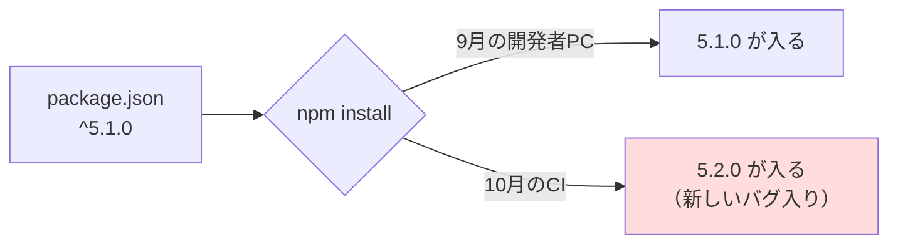
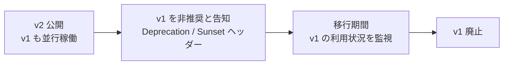

# セマンティックバージョニング

[[MOC_リリース・デプロイ体系|📚 目次]] ｜ [[08_ゼロダウンタイムデプロイの条件|← 前へ]] ｜ [[02_カレンダーバージョニング|次へ →]]

> [!abstract] この記事で分かること
> - セマンティックバージョニング（SemVer）2.0.0 の規則：MAJOR.MINOR.PATCH、プレリリース、ビルドメタデータ、0.x の扱い、優先順位
> - 「破壊的変更（breaking change）」とは何か — API・ライブラリ・CLI での具体例
> - npm の `^` と `~` の意味と、ロックファイルが必要な理由
> - Web サービス（SaaS）では SemVer の意味が薄くなる理由と、API バージョニング（`/v1`）
>
> **前提**：[[01_リリースとデプロイの違い]] を読んでいると理解しやすいです。

## 1. ひとことで言うと

家電の取扱説明書に「第 2 版」「第 2.1 版」と書いてあると、「大きく作り直したのか、ちょっと直しただけか」がなんとなく分かります。**セマンティックバージョニング（Semantic Versioning, SemVer）** は、これをもっと厳密にしたルールで、**バージョン番号を見ただけで「アップデートしても自分のコードが壊れないか」が分かる**ようにする約束事です。

- `1.4.2` → `1.4.3`：バグ修正だけ。安心して上げてよい
- `1.4.2` → `1.5.0`：機能追加。既存の使い方は壊れない
- `1.4.2` → `2.0.0`：**互換性が壊れる変更あり**。移行作業が必要かもしれない

ポイントは、番号が「どれだけ作業したか」ではなく、**「利用者にとって互換性がどうなったか」**を表すことです。

## 2. SemVer 2.0.0 の基本規則

仕様は [semver.org](https://semver.org/) で公開されています。中心となるのは次の 3 つの数字です。

```
   2 . 5 . 1
   │   │   └─ PATCH：後方互換のあるバグ修正
   │   └───── MINOR：後方互換のある機能追加（非推奨化もここ）
   └───────── MAJOR：後方互換のない変更（破壊的変更）
```

| 上げる番号 | いつ | 下位の番号 |
|---|---|---|
| MAJOR | 公開 API に互換性のない変更を入れたとき | MINOR・PATCH を 0 に戻す |
| MINOR | 互換性を保ったまま機能を追加したとき／機能を非推奨（deprecated）にしたとき | PATCH を 0 に戻す |
| PATCH | 互換性を保ったままバグを直したとき | — |

大前提として、SemVer は **「公開 API（public API）」を宣言していること**を求めます。公開 API とは「利用者が依存してよいと約束した部分」のことで、ライブラリなら公開関数、Web API ならエンドポイントとレスポンス形式、CLI ならコマンドとオプションです。何が公開 API なのかが曖昧だと、「これは破壊的変更か？」の判断もできません。

もう一つ大事な規則は、**一度リリースしたバージョンの中身は変更してはいけない**（変更するなら新しいバージョンを出す）ことです。これは [[03_gitタグとリリースの作り方]] で扱う「不変なアーティファクト」の考え方につながります。

### 2.1 0.x.y（メジャーバージョン 0）の扱い

仕様の規則 4 は「**メジャーバージョン 0 は初期開発用。いつ何が変わってもよく、公開 API は安定していないとみなす**」と定めています。

- `0.3.0` → `0.4.0` で破壊的変更が入ってもルール違反ではない
- 「本番で使われ始めた」「利用者が依存し始めた」なら `1.0.0` を出すべき合図
- 0.x のまま何年も放置すると、利用者は互換性の目安を失います

### 2.2 プレリリース（`-alpha.1` など）

PATCH の直後に **ハイフン `-`** を付けると、プレリリース版を表せます。

```
1.0.0-alpha
1.0.0-alpha.1
1.0.0-beta.2
1.0.0-rc.1        ← release candidate（リリース候補）
```

- 識別子に使えるのは英数字とハイフンのみ。ドット区切りで複数並べられる
- 数値の識別子に先頭ゼロ（`alpha.01`）は不可
- プレリリースは「**不安定かもしれない**」という意味で、正式版 `1.0.0` より優先順位が低い

### 2.3 ビルドメタデータ（`+` 以降）

**プラス `+`** の後ろには、ビルド番号やコミット SHA などの付加情報を書けます。

```
1.0.0+20261012.a1b2c3d
1.0.0-rc.1+build.457
```

ビルドメタデータは **優先順位の比較で無視されます**。つまり `1.0.0+aaa` と `1.0.0+bbb` は「同じ優先順位」です。識別用のメモとして使い、「どちらが新しいか」の判断材料にはしません。

> [!warning] Docker タグでは `+` が使えない
> コンテナイメージのタグに `+` は使えないため、`1.0.0+abc` をそのままタグにできません。実務では `1.0.0-abc` や別タグにする工夫が必要です（[[02_カレンダーバージョニング]] で扱います）。

### 2.4 優先順位（どちらが新しいか）の比較

規則 11 の比較手順は次のとおりです。

1. MAJOR → MINOR → PATCH の順に **数値として** 比較する（`1.10.0` > `1.9.0`。文字列比較ではない）
2. 3 つが同じなら、**プレリリース付きの方が低い**
3. プレリリース同士は、ドット区切りの識別子を左から 1 つずつ比べる
   - 数字だけの識別子は数値として比較
   - 英数字を含む識別子は ASCII 順で比較
   - 数字の識別子は英数字の識別子より低い
   - 途中まで同じなら、識別子が多い方が高い

仕様に載っている例をそのまま並べると次の順になります。

```
1.0.0-alpha < 1.0.0-alpha.1 < 1.0.0-alpha.beta < 1.0.0-beta
  < 1.0.0-beta.2 < 1.0.0-beta.11 < 1.0.0-rc.1 < 1.0.0
```

`beta.2 < beta.11` に注目してください。数値として比べるので 2 < 11 です。一方、`rc1`（ドットなし）と書くと英数字の文字列扱いになり、`rc10 < rc2` という逆転が起きます。**番号はドットで区切る（`rc.1`）** のが安全です。

## 3. 何が「破壊的変更」か

「利用者がコードや設定を変えずにアップデートしたとき、動かなくなる可能性がある変更」が破壊的変更です。種類ごとに例を挙げます。

| 対象 | 破壊的（MAJOR） | 非破壊（MINOR / PATCH） |
|---|---|---|
| Web API | フィールドの削除・改名、型の変更（数値→文字列）、必須パラメータの追加、エラーコードの変更、認証方式の変更 | 任意パラメータの追加、レスポンスへのフィールド追加（※） |
| ライブラリ | 公開関数の削除・改名、引数の順序変更、戻り値の型変更、サポートする Node.js の下限を上げる | 新しい関数の追加、任意引数の追加 |
| CLI | コマンドやオプションの削除・改名、既定値の変更、出力形式（スクリプトがパースする部分）の変更、終了コードの変更 | 新しいオプションの追加、ヘルプ文言の改善 |

※ レスポンスへのフィールド追加は通常は非破壊ですが、利用側が「未知のフィールドがあるとエラー」にする厳密なパーサーを使っていると壊れます。どこまでを互換とするかは、API のドキュメントで **「フィールドが増えることはあります」** と事前に宣言しておくと揉めません。

### Shop の例：クーポン機能

注文確定 API `POST /orders` にクーポン機能を追加するケースで考えます。

```jsonc
// 変更前のリクエスト
{ "items": [{ "productId": 10, "quantity": 2 }] }

// 案A：couponCode を「任意」で追加 → MINOR（既存クライアントはそのまま動く）
{ "items": [...], "couponCode": "AUTUMN10" }

// 案B：合計金額 total を { amount, currency } のオブジェクトに変更 → MAJOR
// 旧: "total": 3980
// 新: "total": { "amount": 3980, "currency": "JPY" }
```

案 B は、モバイルアプリの古いバージョンが `total` を数値として読んでいるとクラッシュします。モバイルアプリは利用者が更新するまで古いコードが残るため、**サーバー側だけの判断で「戻す・切り替える」ができない**点に注意が必要です（[[03_ロールバックできない変更]]）。

> [!tip] バグ修正が破壊的になることもある
> 「仕様と違う動きを直した」だけでも、利用者がその誤った動きに依存していれば壊れます。仕様上は PATCH でも、影響が大きいならリリースノートで明示しましょう（[[04_変更履歴とリリースノートの書き方]]）。

## 4. npm の `^` と `~`、そしてロックファイル

SemVer が最も実感されるのは、依存パッケージを指定するときです。`package.json` の `dependencies` には、バージョンの **範囲（range）** を書けます（npm が使う [node-semver](https://github.com/npm/node-semver) の定義）。

| 書き方 | 意味 | 許される範囲 |
|---|---|---|
| `1.2.3` | 完全固定 | `1.2.3` のみ |
| `~1.2.3` | PATCH の更新を許す | `>=1.2.3 <1.3.0-0` |
| `^1.2.3` | 左端の 0 でない数字を固定 | `>=1.2.3 <2.0.0-0` |
| `^0.2.3` | 0.x では MINOR を固定 | `>=0.2.3 <0.3.0-0` |
| `^0.0.3` | 0.0.x では PATCH まで固定 | `>=0.0.3 <0.0.4-0` |

`npm install express` を実行すると、既定では `"express": "^5.1.0"` のようにキャレット `^` 付きで保存されます。これは「**SemVer を守っているなら MINOR・PATCH の更新は安全なはず**」という信頼に基づいた指定です。`^0.x` で MINOR を固定するのは、2.1 で見た「0.x は MINOR でも壊れうる」という規則に合わせた動きです。

### ロックファイルが必要な理由

範囲指定だけだと、**インストールした日によって入るバージョンが変わります**。



これを防ぐのが **ロックファイル（lockfile）**（`package-lock.json`、`pnpm-lock.yaml`、`yarn.lock`）です。実際に解決された正確なバージョンとハッシュを記録します。

```bash
# 開発中：依存を追加・更新するとロックファイルも更新される
npm install some-lib

# CI・本番ビルド：ロックファイルどおりに厳密に入れる（ずれていればエラー）
npm ci
```

実務の原則：

- **ロックファイルは必ずコミットする**（アプリの場合）
- CI やコンテナのビルドでは `npm install` ではなく `npm ci` を使う
- 依存の更新は Dependabot や Renovate の PR で行い、テストを通してからマージする
- 「SemVer を守っているはず」は **期待であって保証ではない**。ロックファイルで「検証済みの組み合わせ」を固定する

## 5. Web サービス（SaaS）では SemVer の意味が薄い

Shop API のような **自社で運用する Web サービス** の場合、SemVer はそのままでは役に立ちにくくなります。

| | ライブラリ | Web サービス |
|---|---|---|
| 誰がバージョンを選ぶか | 利用者（`package.json` で選ぶ） | 提供者（デプロイしたものが全員に届く） |
| 古いバージョンを使い続けられるか | できる | できない（常に最新が動いている） |
| 番号の役割 | 互換性の約束 | 「どのビルドが動いているか」の識別 |

利用者は「Shop API v2.5.1 を使う」と選べません。デプロイした瞬間に全員が新しい版を使います。そのため、サービス本体の番号は **互換性の約束ではなく、ビルドを識別するラベル** として使われることが多く、カレンダー形式やコミット SHA で十分な場合もあります（[[02_カレンダーバージョニング]]）。

### 互換性は「API バージョン」で約束する

一方で、外部に公開する API の互換性は依然として重要です。そこで、**サービスのバージョンとは別に「API のバージョン」** を管理します。

```
https://api.shop.example.com/v1/orders   ← 既存クライアント向け（互換性を維持）
https://api.shop.example.com/v2/orders   ← total をオブジェクトにした新形式
```

主な方式：

| 方式 | 例 | 特徴 |
|---|---|---|
| URL パス | `/v1/orders` | 最も分かりやすい。ログやキャッシュでも区別しやすい |
| ヘッダー | `X-GitHub-Api-Version: 2022-11-28`（GitHub REST API） | URL を変えずに切り替えられる |
| 日付ベース | `Stripe-Version: 2024-09-30.acacia`（Stripe） | アカウントごとに固定され、明示的に上げるまで変わらない |

ここで使われる番号は **MAJOR 相当だけ**（`v1`, `v2`）か日付であることがほとんどです。後方互換な追加はバージョンを変えずに行い、破壊的変更のときだけ新しい API バージョンを作ります。古いバージョンは **非推奨（deprecation）の告知 → 移行期間 → 廃止** の手順で閉じます（告知の書き方は [[04_変更履歴とリリースノートの書き方]]）。



> [!note] 内部 API でも同じ考え方が効く
> Shop のフロントエンド（Next.js）は API と同時にデプロイできますが、**モバイルアプリは古い版が何か月も残ります**。社内向け API でも、古いクライアントが残る限り「互換性を保つ」か「バージョンを分ける」かを意識する必要があります。

## よくある誤解・つまずき

- ❌ 大きな機能を入れたから MAJOR を上げる
  ✅ MAJOR は「互換性が壊れたか」で決まります。巨大な新機能でも互換なら MINOR、1 行の変更でも互換性を壊せば MAJOR です。
- ❌ `1.9.0` の次は `2.0.0`（または `1.10.0` は `1.9.0` より古い）
  ✅ 各数字は独立した整数です。`1.9.0` の次の MINOR は `1.10.0` で、`1.10.0 > 1.9.0` です。
- ❌ `^` を付けておけば勝手に更新されて常に安全
  ✅ SemVer は作者の自己申告です。意図せぬ破壊的変更は普通に起こるので、ロックファイルで固定し、更新はテスト付きの PR で行います。
- ❌ 0.x はまだ正式版でないので、本番で使われていても 0.x のままでよい
  ✅ 利用者が依存し始めたら `1.0.0` を出し、互換性を約束するのが SemVer の推奨です。
- ❌ 自社の Web サービスにも厳密な SemVer が必須
  ✅ サービス本体はビルドの識別ができれば十分なことが多く、互換性は API バージョン（`/v1`）で約束します。

## まとめ

- SemVer は `MAJOR.MINOR.PATCH` で **利用者から見た互換性** を表す。破壊的変更なら MAJOR、互換な追加は MINOR、互換な修正は PATCH
- プレリリースは `-alpha.1` のようにハイフンで付け、正式版より低い優先順位。ビルドメタデータ `+...` は比較で無視される
- 0.x は「何が変わってもよい」初期開発期間。利用者がいるなら 1.0.0 へ
- npm の `^` は左端の 0 でない数字まで、`~` は MINOR まで固定。**ロックファイル + `npm ci`** で再現性を確保する
- 自社運用の Web サービスでは SemVer の意味は薄く、互換性は **API バージョン（/v1, ヘッダー、日付）** で管理する

## 確認クイズ

1. 現在 `3.2.7` のライブラリで、(a) 任意引数を 1 つ追加、(b) 既存関数を削除、の 2 つを同時にリリースします。次のバージョンは？
> [!tip]- 答え
> `4.0.0` です。破壊的変更（関数削除）が 1 つでも含まれれば MAJOR を上げ、MINOR・PATCH は 0 に戻します。

2. `1.0.0-rc.1`, `1.0.0`, `1.0.0-beta.11`, `1.0.0-beta.2`, `1.0.0+build.5` を古い順に並べてください。
> [!tip]- 答え
> `1.0.0-beta.2` < `1.0.0-beta.11` < `1.0.0-rc.1` < `1.0.0` = `1.0.0+build.5`。プレリリース同士は識別子ごとに比較し（2 < 11 は数値比較）、ビルドメタデータは優先順位に影響しないので `1.0.0` と同順位です。

3. `"some-lib": "^0.4.1"` と書いたとき、`0.4.9` と `0.5.0` はインストール対象になりますか？
> [!tip]- 答え
> `0.4.9` は対象、`0.5.0` は対象外です。0.x では左端の 0 でない数字（MINOR の 4）が固定されるため、範囲は `>=0.4.1 <0.5.0-0` になります。

## 関連ノート

- [[02_カレンダーバージョニング]] — 日付ベースの番号付けと、コンテナイメージのタグ戦略
- [[03_gitタグとリリースの作り方]] — 決めたバージョンを git タグと GitHub Releases に刻む
- [[05_リリースの自動化]] — Conventional Commits からバージョンを自動決定する
- [[03_ロールバックできない変更]] — モバイルアプリなど、戻せないクライアントがある場合の注意
- [[08_データのエンコードとスキーマ進化]] — データ形式の後方・前方互換性の考え方
- [[04-タグとリリース管理]] — Git 側から見たタグ運用

## 参考

- [Semantic Versioning 2.0.0（semver.org）](https://semver.org/)
- [node-semver（npm が使う範囲指定の定義）](https://github.com/npm/node-semver)
- [npm Docs: package.json dependencies](https://docs.npmjs.com/cli/v10/configuring-npm/package-json#dependencies)
- [calver.org（Stripe API の日付バージョン例を掲載）](https://calver.org/)
