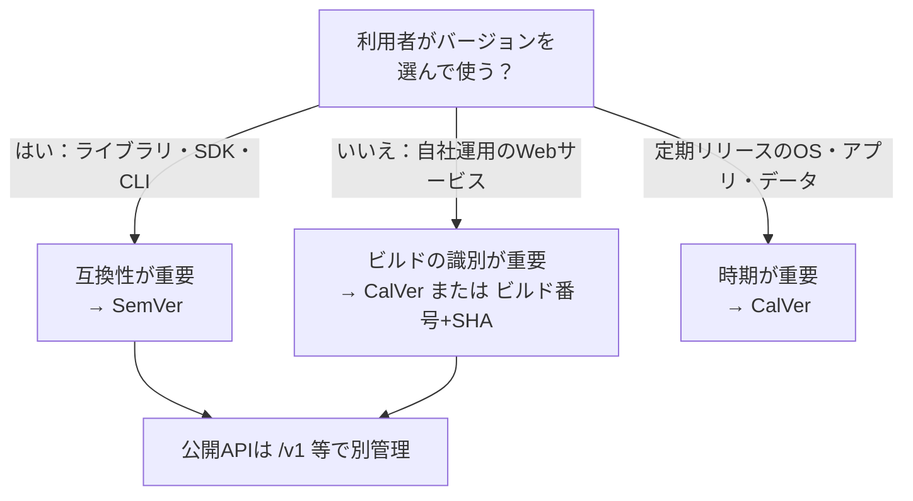
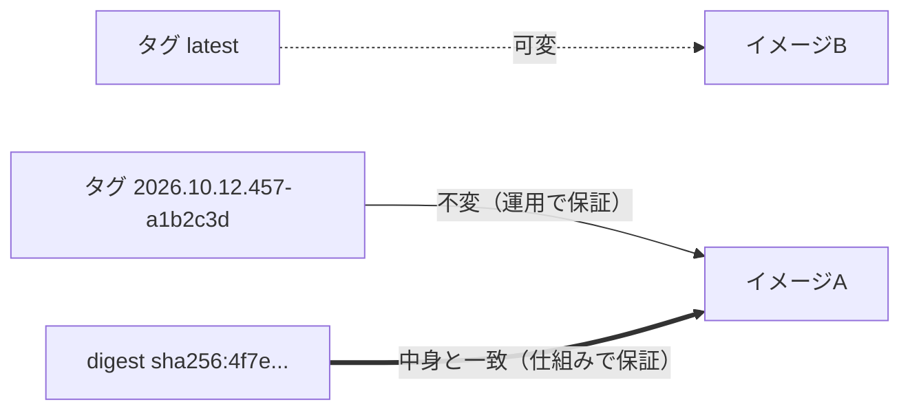

# カレンダーバージョニング

[[MOC_リリース・デプロイ体系|📚 目次]] ｜ [[01_セマンティックバージョニング|← 前へ]] ｜ [[03_gitタグとリリースの作り方|次へ →]]

> [!abstract] この記事で分かること
> - カレンダーバージョニング（CalVer）の書式（`YYYY.0M.0D`、`YY.0M` など）と実例（Ubuntu、pip ほか）
> - SemVer と CalVer の違いと、どちらを選ぶべきかの判断基準
> - ビルド番号・コミット SHA で「どのビルドか」を特定する方法
> - コンテナイメージのタグ付け戦略：`latest` を本番で使わない、不変タグ、digest 指定
>
> **前提**：[[01_セマンティックバージョニング]] を読んでいると理解しやすいです。

## 1. ひとことで言うと

雑誌は「第 3 巻第 12 号」より「2026 年 10 月号」と書いてあるほうが、どれくらい古いかすぐ分かります。**カレンダーバージョニング（Calendar Versioning, CalVer）** は、バージョン番号に **日付** を入れる方式です。

- `24.04`（Ubuntu）→「2024 年 4 月のリリース」と一目で分かる
- SemVer が「互換性」を伝えるのに対し、CalVer は **「いつの版か」** を伝える
- 定期的にリリースするソフトや、常に最新を使うのが前提の Web サービスと相性が良い

ただし Web サービスの運用では、番号以上に「**今動いているのはどのビルドか**を確実に特定できること」が大切です。この記事の後半では、その実務（ビルド番号、コミット SHA、コンテナイメージのタグ）を扱います。

## 2. CalVer の書式

[calver.org](https://calver.org/) は、日付部分を次のトークンで表すことを提案しています。

| トークン | 意味 | 例 |
|---|---|---|
| `YYYY` | 西暦 4 桁 | 2026 |
| `YY` | 西暦の下 2 桁（ゼロ埋めなし） | 6, 16, 26 |
| `0Y` | 西暦の下 2 桁（ゼロ埋め） | 06, 26 |
| `M` / `0M` | 月（ゼロ埋めなし／あり） | 1〜12 ／ 01〜12 |
| `W` / `0W` | 年初からの週 | 1〜52 ／ 01〜52 |
| `D` / `0D` | 日 | 1〜31 ／ 01〜31 |

日付以外に、SemVer 由来の `MAJOR` / `MINOR` / `MICRO`（= PATCH）や任意のラベル（`dev`, `rc` など）を組み合わせます。省略可能な部分は `YYYY.0M.0D[.MICRO]` のように角括弧で書きます。

> [!note] `MM` `DD` は非推奨の表記
> calver.org では `MM`・`WW`・`DD` は旧表記で、ゼロ埋めの有無が紛らわしいため `M`・`W`・`D`（ゼロ埋めなら `0M` など）が推奨されています（2026 年時点）。

### 実例

calver.org に掲載されている主な採用例です（2026 年時点）。

| プロジェクト | 書式 | 例 | ポイント |
|---|---|---|---|
| Ubuntu | `YY.0M[.MICRO]` | `24.04`, `24.04.1` | 4 月と 10 月の年 2 回。偶数年の 4 月が LTS |
| pip | `YY.MINOR.MICRO` | `24.0`, `25.1` | 年が先頭、その年の何回目かが MINOR |
| Twisted | `YY.M.MICRO` | `24.3.0` | |
| yt-dlp | `YYYY.0M.0D[.MICRO]` | `2026.08.19` | 頻繁にリリース。同日に複数なら MICRO |
| Home Assistant | `YYYY.M.MICRO` | `2025.10.2` | 月例リリース + 修正版 |
| JetBrains IDE | `YYYY.MINOR.MICRO` | `2025.2.1` | 年に数回のメジャー更新 |
| certifi | `YYYY.0M.0D` | — | 証明書バンドル。「いつのデータか」が重要 |
| Stripe API | `YYYY-0M-0D.MODIFIER` | `2024-09-30.acacia` | API バージョンを日付で表す |

> [!warning] PyPI ではゼロ埋めが消える
> Python のバージョン正規化（PEP 440）により、yt-dlp の `2026.08.19` は PyPI 上では `2026.8.19` として扱われます。ツールによってゼロ埋めが保持されない場合があるので、ゼロ埋めの有無は最初に決めて統一しましょう。

## 3. SemVer と CalVer の比較と使い分け

| 観点 | SemVer | CalVer |
|---|---|---|
| 番号が伝えるもの | 互換性（壊れるかどうか） | 時期（どれくらい新しいか） |
| 番号の決め方 | 変更内容を見て人（またはツール）が判断 | 日付で機械的に決まる |
| 向いているもの | ライブラリ、SDK、公開 API、CLI | OS・ディストリビューション、定期リリースのアプリ、Web サービス、データ（証明書、タイムゾーン DB） |
| 弱点 | 「破壊的か」の判断がぶれる。MAJOR を上げるのをためらいがち | 互換性の情報がない。日付だけでは破壊的変更に気づけない |
| サポート期間の伝えやすさ | 伝えにくい | 「2 年前の版は古い」と直感的に分かる |

選び方の目安：



**組み合わせることもよくあります。** たとえば Shop では次のように使い分けられます。

| 対象 | 方式 | 例 |
|---|---|---|
| Shop API（サービス本体） | CalVer + 連番 | `2026.10.12.1` |
| 公開 API の互換性 | API バージョン | `/v1/orders` |
| 社内共有の npm パッケージ（`@shop/api-client`） | SemVer | `3.4.0` |
| モバイルアプリ | ストア表示は SemVer 風、内部はビルド番号 | `4.2.0 (1532)` |

## 4. ビルド番号とコミット SHA による識別

Web サービスで本当に必要なのは、**「本番で動いているものが、どのソースから、いつ、どのパイプラインでビルドされたか」を即座に辿れること** です。障害時に「今動いているのはどのコミット？」に答えられないと、ロールバック先も原因も特定できません。

識別子の候補：

| 識別子 | 例 | 長所 | 短所 |
|---|---|---|---|
| コミット SHA | `a1b2c3d`（短縮）／40 桁 | ソースと 1 対 1。必ず一意 | 人間には新旧が分からない |
| CI のビルド番号 | `GITHUB_RUN_NUMBER=457` | 増え続けるので新旧が分かる | CI を移行するとリセットされる |
| 日付 + 連番 | `2026.10.12.1` | 人間に読みやすい | 単体ではソースを特定できない |

実務では **「人間向けのバージョン」+「機械向けの SHA」** を両方残すのが定番です。GitHub Actions なら次のように生成できます。

```yaml
# .github/workflows/build.yml（抜粋）
- name: バージョン文字列を作る
  id: ver
  run: |
    echo "version=$(date -u +%Y.%m.%d).${GITHUB_RUN_NUMBER}" >> "$GITHUB_OUTPUT"
    echo "sha=${GITHUB_SHA::7}" >> "$GITHUB_OUTPUT"
# 例: version=2026.10.12.457, sha=a1b2c3d
```

そして、**アプリ自身が自分のバージョンを答えられるように** しておきます。

```ts
// Shop API: GET /version（ビルド時に環境変数として埋め込む）
app.get("/version", (_req, res) => {
  res.json({
    version: process.env.APP_VERSION,   // 2026.10.12.457
    commit: process.env.GIT_SHA,        // a1b2c3d...
    builtAt: process.env.BUILD_TIME,    // 2026-10-12T03:15:00Z
  });
});
```

ログやメトリクス、エラートラッキング（Sentry の release など）にも同じバージョンをラベルとして付けると、「新バージョンからエラー率が上がった」を比較しやすくなります（[[01_リリース後の重点監視]]）。

## 5. コンテナイメージのタグ付け戦略

Shop API はコンテナイメージとしてレジストリに push し、Kubernetes / ECS で動かしています。ここでのバージョン管理は **イメージのタグ** で行います。

### 5.1 `latest` を本番で使わない

`latest` は「最後に push されたもの」を指すだけの **ただの可変ラベル** です。特別な意味はありません。

```
9:00  shop-api:latest → イメージA を push
10:00 Pod 1, 2 を起動 → イメージA
11:00 shop-api:latest → イメージB を push（誰かが別ブランチから）
12:00 Pod 3 が再起動 → イメージB を取得
      → 同じ Deployment の中で A と B が混在
```

Kubernetes の公式ドキュメントも「本番では `:latest` タグを避けるべき。どのバージョンが動いているか追いにくく、正しくロールバックするのも難しくなる」と述べています。さらに Kubernetes では、タグが `latest`（または省略）だと `imagePullPolicy` の既定値が `Always` になり、再起動のたびに最新を取りに行くので混在が起きやすくなります。

### 5.2 不変タグ（immutable tag）

**一度 push したタグは二度と別のイメージに付け替えない** のが原則です。

```bash
# 良い例：コミットごとにユニークなタグ
docker build -t ghcr.io/shop/shop-api:2026.10.12.457-a1b2c3d .
docker push ghcr.io/shop/shop-api:2026.10.12.457-a1b2c3d

# 付け加えて「人間用の可変タグ」を付けるのは OK（デプロイには使わない）
docker tag ghcr.io/shop/shop-api:2026.10.12.457-a1b2c3d ghcr.io/shop/shop-api:main
```

> [!tip] レジストリ側でも上書きを禁止する
> Amazon ECR にはリポジトリ単位の **タグの不変性（tag immutability）** 設定があり、同じタグの再 push を拒否できます。人の注意に頼らず、仕組みで守るのが確実です。

タグに使える文字は英数字と `_` `.` `-` のみで（最大 128 文字）、SemVer のビルドメタデータに使う `+` は使えません。`1.4.0+a1b2c3d` は `1.4.0-a1b2c3d` などに置き換えます。

### 5.3 digest による指定

タグはレジストリ上で付け替えが可能な「名札」ですが、**digest**（`sha256:...`）はイメージの中身から計算されたハッシュで、**中身が同じなら必ず同じ値、違えば必ず違う値** になります。

```yaml
# Kubernetes Deployment（抜粋）
spec:
  template:
    spec:
      containers:
        - name: shop-api
          # タグは人間向けの目印、digest が実際に使われる
          image: ghcr.io/shop/shop-api:2026.10.12.457-a1b2c3d@sha256:4f7e9c...（64桁）
```

`タグ@digest` と書くと、タグは読みやすさのために残しつつ、実際には digest で指定したイメージが使われます。



| 指定方法 | 再現性 | 読みやすさ | 推奨用途 |
|---|---|---|---|
| `:latest` | ✕ | ○ | ローカルでの試用のみ |
| 不変タグ `:2026.10.12.457-a1b2c3d` | ○（運用次第） | ○ | 通常のデプロイ |
| digest `@sha256:...` | ◎ | ✕ | 本番・監査が必要な環境（タグと併記） |

このように一意に特定できるイメージを、ステージングから本番まで **同じものを昇格させる** のが次回のテーマです（[[03_gitタグとリリースの作り方]]）。

## よくある誤解・つまずき

- ❌ CalVer は日付なので、互換性の問題とは無縁
  ✅ CalVer は互換性について何も語りません。破壊的変更はリリースノートや API バージョンで別途伝える必要があります。
- ❌ `latest` タグは自動的に「最新の安定版」になる
  ✅ `latest` は「タグを指定せずに push したときに付く名前」にすぎず、最後に push されたものを指すだけです。安定版の保証はありません。
- ❌ タグを付け替えれば、同じタグ名でロールバックできて便利
  ✅ タグを付け替えると「そのタグが過去に何を指していたか」が失われ、再起動時に別物が動きます。ロールバックは「前の不変タグ（digest）に戻す」で行います。
- ❌ 日付だけのバージョンで十分
  ✅ 日付からはソースが特定できません。コミット SHA を必ずセットで記録しましょう。

## まとめ

- CalVer は `YYYY.0M.0D` や `YY.0M` など日付を番号に入れる方式。Ubuntu（`24.04`）や pip（`24.0`）などが採用
- SemVer は「互換性」、CalVer は「時期」を伝える。利用者が版を選ぶならSemVer、自社運用サービスならCalVerやビルド番号で十分なことが多い
- 「人間向けの番号」+「コミット SHA」をセットで残し、アプリの `/version`・ログ・メトリクスにも埋め込む
- コンテナは `latest` を本番で使わず、**不変タグ** と **digest** で一意に指定する
- 不変性はレジストリ設定（ECR のタグ不変性など）で仕組みとして守る

## 確認クイズ

1. Shop の本番で、Pod によって動いているイメージが違う現象が起きました。マニフェストには `image: shop-api:latest` と書かれています。原因と対策は？
> [!tip]- 答え
> `latest` が途中で別イメージに付け替えられ、再起動した Pod だけが新しいイメージを取得したためです（`latest` の既定 `imagePullPolicy` は `Always`）。対策は、コミットごとの不変タグを使い、可能なら `@sha256:...` の digest で指定すること、レジストリでタグの上書きを禁止することです。

2. 社内で共有している TypeScript の API クライアントライブラリと、自社運用の Shop API 本体。それぞれに向いているバージョニング方式は？
> [!tip]- 答え
> ライブラリは利用者が版を選んで使うので SemVer（互換性を伝える）。Shop API 本体は常に最新が動くので、CalVer やビルド番号 + コミット SHA による識別で十分です（公開 API の互換性は `/v1` などで別管理）。

3. `ghcr.io/shop/shop-api:1.4.0+a1b2c3d` というタグを付けようとしたらエラーになりました。なぜ？
> [!tip]- 答え
> コンテナイメージのタグには `+` が使えないためです（使えるのは英数字・`_`・`.`・`-`）。`1.4.0-a1b2c3d` などに置き換えます。

## 関連ノート

- [[01_セマンティックバージョニング]] — 互換性を伝えるバージョニング
- [[03_gitタグとリリースの作り方]] — タグからビルドし、同じアーティファクトを全環境に昇格させる
- [[01_リリース後の重点監視]] — バージョンをラベルにしてリリース前後を比較する
- [[10-Kubernetes]] — Deployment とイメージ指定の基本
- [[本番向けベストプラクティス]] — コンテナを本番で動かすときの注意点

## 参考

- [Calendar Versioning（calver.org）](https://calver.org/)
- [Kubernetes Docs: Images（latest タグの回避、digest 指定、imagePullPolicy）](https://kubernetes.io/docs/concepts/containers/images/)
- [Semantic Versioning 2.0.0](https://semver.org/)
