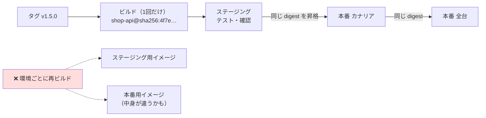

# gitタグとリリースの作り方

[[MOC_リリース・デプロイ体系|📚 目次]] ｜ [[02_カレンダーバージョニング|← 前へ]] ｜ [[04_変更履歴とリリースノートの書き方|次へ →]]

> [!abstract] この記事で分かること
> - 軽量タグ・注釈付きタグ・署名付きタグの違いと、リリースにどれを使うべきか
> - タグの push と GitHub Releases（`gh release create`）でリリースを公開する方法
> - タグを起点にビルドし、アーティファクト（成果物）とソースを紐付ける仕組み
> - 「一度だけビルドし、同じアーティファクトを全環境に昇格させる」原則
>
> **前提**：[[01_セマンティックバージョニング]] を読んでいると理解しやすいです。git タグのコマンド一覧は [[04-タグとリリース管理]] にまとまっています。

## 1. ひとことで言うと

本にしおりを挟むと、何ページ目だったかを後からすぐ開けます。**git タグ（tag）** は、リポジトリの歴史の中の「このコミットが v1.5.0 です」という **動かないしおり** です。ブランチが新しいコミットとともに先へ進んでいくのに対し、タグは同じコミットを指し続けます。

そしてリリースとは、このしおりに **「何が変わったか（リリースノート）」と「実際に配る成果物（アーティファクト）」を結び付けたもの** です。

- タグ = ソースのどの時点か
- アーティファクト = そのソースから作ったもの（コンテナイメージ、バイナリ、npm パッケージ）
- リリース = タグ + アーティファクト + リリースノート

この 3 つが確実につながっていれば、「本番で動いている v1.5.0 はどのソースから来たのか」をいつでも答えられます。

## 2. タグの種類：リリースには注釈付きタグ

git のタグには大きく 2 種類あり、さらに注釈付きタグには署名を付けられます。コマンドの詳細は [[04-タグとリリース管理]] を参照してください。ここではリリース運用の観点で違いを整理します。

| 種類 | 作り方 | 中身 | リリース用途 |
|---|---|---|---|
| 軽量タグ（lightweight tag） | `git tag v1.5.0` | コミットへの参照だけ | ✕ 個人用の目印向け |
| 注釈付きタグ（annotated tag） | `git tag -a v1.5.0 -m "..."` | 作成者・日時・メッセージを持つ独立したオブジェクト | ◎ 標準 |
| 署名付きタグ（signed tag） | `git tag -s v1.5.0 -m "..."` | 注釈付きタグ + GPG / SSH 署名 | ◎ 改ざん検知が必要な場合 |

注釈付きタグを使う理由：

- **誰が・いつ** リリースを切ったかが記録される（`git show v1.5.0` で確認できる）
- `git describe` は既定で注釈付きタグだけを対象にする（`v1.5.0-3-ga1b2c3d` のような「v1.5.0 から 3 コミット先」という表示の起点になる）
- `git push --follow-tags` は注釈付きタグだけを push するので、作業用の軽量タグを誤って公開しにくい

### 署名付きタグ

署名付きタグは「このタグは確かにリリース担当者が作った」ことを暗号的に証明します。近年は GPG 鍵より手軽な **SSH 鍵での署名** もよく使われます。

```bash
# SSH 鍵で署名する設定（一度だけ）
git config --global gpg.format ssh
git config --global user.signingkey ~/.ssh/id_ed25519.pub

# 署名付きタグを作成・検証
git tag -s v1.5.0 -m "Shop API v1.5.0: クーポン機能"
git tag -v v1.5.0
```

GitHub に公開鍵を「Signing key」として登録しておくと、タグやコミットに **Verified** バッジが表示されます。

## 3. タグを打って公開する流れ

Shop の「注文確定 API にクーポン機能を追加する」リリースを例に、手作業でリリースを作る流れを見ます（自動化は [[05_リリースの自動化]]）。

```bash
# 1. リリースするコミットを確認（main の最新、CI がすべて緑であること）
git switch main
git pull --ff-only
git log --oneline -5

# 2. 注釈付きタグを作成
git tag -a v1.5.0 -m "v1.5.0: 注文確定APIにクーポン機能を追加"

# 3. タグを push（タグはブランチを push しただけでは送られない）
git push origin v1.5.0
#   または、到達可能な注釈付きタグをまとめて送る
git push --follow-tags
```

> [!warning] `git push --tags` に注意
> `--tags` はローカルにある **すべての** タグ（試しに作った軽量タグも含む）を送ります。リリース用途では、タグ名を指定して push するか `--follow-tags` を使うほうが安全です。

### 公開したタグは動かさない

一度 push したタグを削除して別のコミットに付け直すと、すでに取得した人の手元・CI のキャッシュ・ビルド済みアーティファクトと **食い違い** が生まれます。間違えたら **新しいバージョン（v1.5.1）を出す** のが原則です。

### GitHub Releases

タグは git の機能ですが、**GitHub Releases** はそこにリリースノートと配布ファイルを添えて公開する GitHub の機能です。GitHub CLI（`gh`）で作れます（2026 年時点）。

```bash
# リリースノートを自動生成してリリースを作成
gh release create v1.5.0 --verify-tag --generate-notes --title "v1.5.0"

# 自分で書いたノートを使う
gh release create v1.5.0 --verify-tag -F release-notes.md

# プレリリース（rc など）として公開。Latest にはしない
gh release create v1.6.0-rc.1 --verify-tag --prerelease --generate-notes

# 下書きで作り、成果物を添付してから公開する
gh release create v1.5.0 --verify-tag --draft ./dist/*.tgz
```

| オプション | 意味 |
|---|---|
| `--verify-tag` | リモートにタグがなければ中止する（タグの自動作成を防ぐ） |
| `--generate-notes` | 前回リリースからのマージ済み PR などからノートを自動生成 |
| `-F, --notes-file` | ファイルからノートを読む |
| `-p, --prerelease` | プレリリースとしてマーク |
| `-d, --draft` | 下書きとして保存（公開しない） |
| `--latest=false` | 「Latest」表示にしない（古い系列の修正版を出すとき） |

`--verify-tag` を付けないと、存在しないタグ名を指定したときに GitHub 側で既定ブランチの先端にタグが自動作成されます。「意図しないコミットがリリースになる」事故を防ぐため、付けておくのがおすすめです。

> [!tip] Immutable releases
> GitHub には、公開後のリリースのタグと添付ファイルを変更・削除できなくする **immutable releases** の設定があります（2026 年時点）。有効にすると、タグが別コミットへ動かされたり、配布物がすり替えられたりする供給網攻撃を防げます。添付ファイルを揃えてから公開できるよう、下書き（`--draft`）で作ってから公開する流れが推奨されています。

## 4. タグからビルドし、アーティファクトを紐付ける

リリースの信頼性は「**タグ → ビルド → アーティファクト**」の対応が機械的に保証されているかで決まります。開発者の PC でビルドして手でアップロードすると、「本当にそのタグのソースから作ったのか」を誰も証明できません。

GitHub Actions で、`v*` タグの push を起点にイメージをビルドし、リリースを作る例です。

```yaml
# .github/workflows/release.yml
name: Release
on:
  push:
    tags: ["v*.*.*"]

permissions:
  contents: write   # GitHub Release の作成
  packages: write   # ghcr.io への push

jobs:
  build:
    runs-on: ubuntu-latest
    steps:
      - uses: actions/checkout@v4

      - uses: docker/login-action@v3
        with:
          registry: ghcr.io
          username: ${{ github.actor }}
          password: ${{ secrets.GITHUB_TOKEN }}

      # タグ名からイメージタグとラベル（ソースの SHA など）を生成
      - id: meta
        uses: docker/metadata-action@v5
        with:
          images: ghcr.io/shop/shop-api
          tags: |
            type=semver,pattern={{version}}
            type=sha,format=long

      - id: build
        uses: docker/build-push-action@v6
        with:
          push: true
          tags: ${{ steps.meta.outputs.tags }}
          labels: ${{ steps.meta.outputs.labels }}
          build-args: |
            APP_VERSION=${{ github.ref_name }}
            GIT_SHA=${{ github.sha }}

      - name: GitHub Release を作成（digest をノートに記録）
        env:
          GH_TOKEN: ${{ secrets.GITHUB_TOKEN }}
        run: |
          gh release create "${GITHUB_REF_NAME}" --verify-tag --generate-notes \
            --notes "Image: ghcr.io/shop/shop-api@${{ steps.build.outputs.digest }}"
```

これで、次の対応がすべて自動で記録されます。

```
git タグ v1.5.0 ──→ コミット a1b2c3d…
      │
      └─ GitHub Actions run #457
            └─ イメージ ghcr.io/shop/shop-api:1.5.0
                  digest sha256:4f7e…  ← GitHub Release のノートに記載
                  ラベル org.opencontainers.image.revision = a1b2c3d…
```

`docker/metadata-action` が付ける OCI ラベル（`org.opencontainers.image.revision` や `.version`）により、イメージ側から逆にソースのコミットを辿ることもできます。さらに厳密にしたい場合は、ビルドの出所証明（provenance / attestation）を付ける方法もあります。

## 5. 同じアーティファクトを全環境に昇格させる

リリース運用で最も重要な原則の一つが **「Build once, deploy many（一度だけビルドし、何度もデプロイする）」** です。



**なぜ環境ごとにビルドし直してはいけないのか：**

- ビルドのたびに依存パッケージやベースイメージの解決結果が変わりうる（ロックファイルがあっても、ベースイメージのタグは動く）
- ステージングで検証したのは「ステージング用にビルドしたもの」であり、本番用に再ビルドしたものは **検証されていない別物**
- 障害時に「ステージングでは問題なかった」が意味を持たなくなる

**環境ごとの違いはどう扱うか：** アーティファクトの中には環境固有の値を焼き込まず、**実行時に設定（環境変数、ConfigMap、Secrets Manager など）として注入** します。

| 焼き込んでよいもの（全環境共通） | 実行時に注入するもの（環境ごと） |
|---|---|
| アプリのコード、依存ライブラリ | DB の接続先、API キー |
| バージョン番号、コミット SHA | ログレベル、外部サービスの URL |
| | フィーチャーフラグの値（[[06_フィーチャーフラグ]]） |

> [!warning] フロントエンドのビルド時変数
> Next.js の `NEXT_PUBLIC_*` のような **ビルド時に埋め込まれる環境変数** は、この原則と衝突します。環境ごとに値が違うと再ビルドが必要になるため、実行時に設定を取得する仕組みにするか、環境非依存の値だけを使う設計にしておくと、昇格の原則を守れます。

昇格は「デプロイ先のマニフェストの digest を書き換える」だけになります。Kubernetes なら、本番用マニフェストの `image:` を、ステージングで検証済みの `@sha256:...` に更新する PR を作ってマージする、という形が典型です。ECS や CodeDeploy でも「同じイメージ URI を別環境のタスク定義に渡す」形で同じことができます（[[06_CodePipelineとは]]）。

## よくある誤解・つまずき

- ❌ ブランチを push すればタグも一緒に送られる
  ✅ タグは明示的に push が必要です（`git push origin v1.5.0` または `--follow-tags`）。
- ❌ タグを間違えたら、削除して付け直せばよい
  ✅ 公開済みのタグを動かすと、取得済みの環境やビルド済みの成果物と食い違います。新しいバージョンを出しましょう。
- ❌ GitHub Releases に載せるファイルは手元でビルドしてアップロードすればよい
  ✅ CI でタグからビルドし、自動で添付するのが原則です。手元ビルドではソースとの対応を証明できません。
- ❌ 本番用は本番の設定でビルドし直すほうが安全
  ✅ 逆です。検証済みのアーティファクトをそのまま昇格させ、環境差は実行時の設定で吸収します。

## まとめ

- リリースには **注釈付きタグ**（必要なら署名付き）を使う。公開したタグは動かさない
- タグは明示的に push する。`--tags` より、タグ名指定か `--follow-tags` が安全
- `gh release create <tag> --verify-tag --generate-notes` で GitHub Releases を作成。immutable releases で改ざんを防げる
- タグの push を起点に CI でビルドし、**タグ ↔ コミット ↔ イメージ digest** の対応を自動で記録する
- **一度だけビルドし、同じ digest を全環境に昇格させる**。環境差は実行時設定で注入する

## 確認クイズ

1. リリース用のタグに軽量タグではなく注釈付きタグを使う理由を 2 つ挙げてください。
> [!tip]- 答え
> (1) 作成者・日時・メッセージが記録され、誰がいつリリースを切ったか追える。(2) `git describe` や `git push --follow-tags` が注釈付きタグを対象にするため、リリース用と作業用のタグを区別できる。署名を付けられる点も挙げられます。

2. 「ステージングで検証したので、本番用には本番の設定でもう一度ビルドしてデプロイする」という手順の問題点は？
> [!tip]- 答え
> 本番に出るのはステージングで検証したものとは別のビルドで、依存やベースイメージの差が入り得るため、検証が無意味になります。ステージングでビルドした同じ digest を本番に昇格させ、環境差は実行時の設定で注入すべきです。

3. `gh release create v1.5.0` に `--verify-tag` を付けるのはなぜ？
> [!tip]- 答え
> リモートに `v1.5.0` タグが存在しない場合に中止させるためです。付けないと既定ブランチの先端にタグが自動作成され、意図しないコミットがリリースになる恐れがあります。

## 関連ノート

- [[04-タグとリリース管理]] — git タグのコマンド（作成・削除・一覧・比較）の詳細
- [[02_カレンダーバージョニング]] — イメージの不変タグと digest
- [[04_変更履歴とリリースノートの書き方]] — リリースに添えるノートの書き方
- [[05_リリースの自動化]] — タグ付けとリリース作成を自動化する
- [[04-GitHub-Actionsによる自動化]] — GitHub Actions の基本
- [[06_CodePipelineとは]] — AWS で同じアーティファクトを環境間で受け渡す
- [[MOC_CI-CD体系]] — CI/CD 全体の目次

## 参考

- [GitHub CLI manual: gh release create](https://cli.github.com/manual/gh_release_create)
- [GitHub Docs: Immutable releases](https://docs.github.com/en/code-security/supply-chain-security/understanding-your-software-supply-chain/immutable-releases)
- [Git Book: Tagging](https://git-scm.com/book/en/v2/Git-Basics-Tagging)
- [docker/metadata-action](https://github.com/docker/metadata-action)
- [Kubernetes Docs: Images](https://kubernetes.io/docs/concepts/containers/images/)
