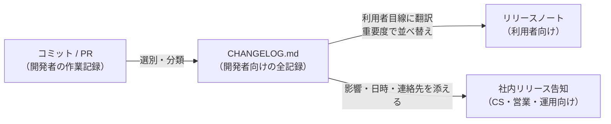

# 変更履歴とリリースノートの書き方

[[MOC_リリース・デプロイ体系|📚 目次]] ｜ [[03_gitタグとリリースの作り方|← 前へ]] ｜ [[05_リリースの自動化|次へ →]]

> [!abstract] この記事で分かること
> - CHANGELOG（変更履歴）とリリースノートの違い：誰に向けて書くのか
> - Keep a Changelog の形式（Added / Changed / Deprecated / Removed / Fixed / Security、Unreleased）
> - 良いリリースノートと悪いリリースノートの具体例
> - 破壊的変更と移行手順の書き方、社内向けリリース告知のテンプレート
>
> **前提**：[[01_セマンティックバージョニング]]、[[03_gitタグとリリースの作り方]] を読んでいると理解しやすいです。

## 1. ひとことで言うと

スマホのアプリ更新画面で「バグを修正しました」としか書いていないと、何が変わったのか分からずモヤモヤします。逆に「注文画面でクーポンが使えるようになりました」と書いてあれば、すぐ試したくなります。

**変更履歴（CHANGELOG）** と **リリースノート（release notes）** は、どちらも「何が変わったか」を伝える文書ですが、**読む人が違います**。

- **CHANGELOG**：リポジトリに置く、全バージョンの変更の記録。主な読者は **開発者・ライブラリの利用者**
- **リリースノート**：1 回のリリースについて、**そのリリースの利用者** に向けて「何が変わり、何をすればよいか」を伝える文書

どちらも「コミットログをそのまま貼る」ものではありません。**読み手が知りたいこと** に翻訳するのが書き手の仕事です。

## 2. CHANGELOG とリリースノートの違い

| 観点 | CHANGELOG | リリースノート |
|---|---|---|
| 主な読者 | 開発者、ライブラリ利用者、将来の自分たち | エンドユーザー、顧客、CS・営業、社内の他チーム |
| 置き場所 | リポジトリの `CHANGELOG.md` | GitHub Releases、ヘルプセンター、アプリストア、ブログ、社内チャット |
| 範囲 | 全バージョンを 1 ファイルに蓄積 | 1 リリース分 |
| 粒度 | 変更を漏れなく、種類ごとに分類 | 利用者に影響するものを、重要度順に |
| 言葉 | 技術用語 OK（API 名、設定キー） | 利用者の言葉（画面名、できるようになること） |



Shop で言えば、Shop API の CHANGELOG には「`POST /orders` に `couponCode` を追加」と書き、利用者向けのお知らせには「ご注文時にクーポンコードが使えるようになりました」と書きます。

## 3. Keep a Changelog の形式

[Keep a Changelog](https://keepachangelog.com/ja/1.1.0/) は、CHANGELOG の書き方として広く使われている慣例です。基本原則は次のとおりです。

- **人間のために書く**（機械向けではない）
- すべてのバージョンにエントリーを作る
- 同じ種類の変更をまとめる
- 新しいバージョンを上に書く
- 各バージョンのリリース日を書く（`YYYY-MM-DD` の ISO 8601 形式）
- Semantic Versioning に従っているかを明記する

変更は次の 6 種類に分類します。

| 種類 | 意味 | Shop での例 |
|---|---|---|
| **Added** | 新機能 | 注文確定 API でクーポンコードを受け付ける |
| **Changed** | 既存機能の変更 | 注文一覧の既定の並び順を新しい順に |
| **Deprecated** | 近いうちに削除される機能 | `GET /orders?page=` を非推奨に |
| **Removed** | 削除された機能 | 旧決済 API を削除 |
| **Fixed** | バグ修正 | 在庫 0 の商品が注文できた問題を修正 |
| **Security** | 脆弱性への対応 | 依存ライブラリの脆弱性（CVE-2026-XXXX）に対応 |

### 実例：Shop API の CHANGELOG.md

```markdown
# Changelog

このプロジェクトの主な変更はすべてこのファイルに記録します。
形式は [Keep a Changelog](https://keepachangelog.com/ja/1.1.0/) に基づき、
バージョンは [Semantic Versioning](https://semver.org/lang/ja/) に従います。

## [Unreleased]

### Added
- 注文履歴の CSV エクスポート API `GET /orders/export`

## [1.5.0] - 2026-10-12

### Added
- `POST /orders` に任意パラメータ `couponCode` を追加。割引後の金額が `discount` として返る (#412)

### Deprecated
- `GET /orders` の `page` パラメータ。`cursor` を使ってください。2027-03-31 に削除予定 (#418)

### Fixed
- 在庫 0 の商品を同時に注文すると、在庫がマイナスになる問題を修正 (#405)

### Security
- `jsonwebtoken` を 9.0.2 に更新 (#420)

## [1.4.1] - 2026-09-28

### Fixed
- 注文確定メールの合計金額に送料が含まれていなかった問題を修正 (#398)

[Unreleased]: https://github.com/shop/shop-api/compare/v1.5.0...HEAD
[1.5.0]: https://github.com/shop/shop-api/compare/v1.4.1...v1.5.0
[1.4.1]: https://github.com/shop/shop-api/compare/v1.4.0...v1.4.1
```

ポイント：

- **`[Unreleased]` セクション** を一番上に置き、PR をマージするたびにここへ追記する。リリース時にこの内容を新しいバージョンの見出しに移す
- 末尾のリンクで、各バージョン間の差分（`compare`）を開けるようにする
- PR 番号（`#412`）を付けておくと、詳細を知りたい人が辿れる
- Deprecated には **代替手段と削除予定日** を必ず書く

Keep a Changelog は、避けるべき書き方として **コミットログの差分をそのまま貼る**、**非推奨の告知を省く**、**曖昧な日付形式**、**一部の変更しか書かない**（利用者が「ここに全部書いてある」と信じるので、ないのと同じくらい有害）を挙げています。

## 4. 良いリリースノート・悪いリリースノート

### 悪い例

```markdown
## v1.5.0
- Merge pull request #412 from feature/coupon
- fix typo
- refactor order service
- update deps
- WIP
- fix bug
```

何が悪いか：

- コミットログを貼っただけで、**利用者に関係あるものとないものが混在**
- 「fix bug」では **何が直ったのか分からない**
- 破壊的変更や非推奨があっても気づけない
- 利用者が **何をすればよいか**（対応が必要か不要か）が書かれていない

### 良い例

```markdown
## Shop API v1.5.0（2026-10-12）

### ハイライト
注文確定時にクーポンコードを使えるようになりました。
`POST /orders` のリクエストに `couponCode` を指定すると、割引が適用されます。

### 対応が必要な変更
- なし（このリリースは後方互換です）

### 非推奨（2027-03-31 に削除予定）
- `GET /orders` の `page` パラメータ → `cursor` に移行してください。
  移行方法：[ページネーション移行ガイド](https://docs.shop.example.com/migrate-cursor)

### 新機能
- クーポンコードによる割引（`couponCode`、レスポンスに `discount` を追加）

### 不具合の修正
- 在庫が残り 1 個の商品を複数人が同時に注文すると、両方の注文が成立してしまう問題を修正しました。

### セキュリティ
- 依存ライブラリを更新し、既知の脆弱性に対応しました。
```

良いリリースノートの条件：

1. **最初に「対応が必要か」が分かる**（読者が一番知りたいのはここ）
2. **利用者の言葉** で「何ができるようになったか」「どんな症状が直ったか」を書く
3. 重要なものから順に並べる（ハイライト → 対応が必要な変更 → 新機能 → 修正）
4. 内部のリファクタリングやテストの変更は **書かない**（CHANGELOG にも原則不要）
5. 詳細へのリンク（ドキュメント、PR、移行ガイド）を添える

## 5. 破壊的変更と移行手順の書き方

破壊的変更は、リリースノートの中で **最も丁寧に書くべき部分** です。次の 4 点を必ず含めます。

| 項目 | 書く内容 |
|---|---|
| 何が変わるか | 変更前と変更後を並べて示す |
| 誰が影響を受けるか | 影響を受ける利用条件（「`total` を数値として読んでいる場合」など） |
| いつまでに何をすればよいか | 期限と、具体的な移行手順（コード例） |
| 移行できたかの確かめ方 | テスト方法、ログ・ダッシュボードでの確認方法 |

### 例：Shop API v2.0.0 の破壊的変更

````markdown
## ⚠️ 破壊的変更：`total` がオブジェクトになります

### 何が変わるか
注文レスポンスの `total` が、数値から金額と通貨のオブジェクトに変わります。

```diff
- "total": 3980
+ "total": { "amount": 3980, "currency": "JPY" }
```

### 影響を受ける方
`/v1/orders` から `/v2/orders` に切り替える際、`total` を数値として扱っているコードは修正が必要です。
`/v1` は 2027-03-31 まで従来どおり動作します。

### 移行手順
1. `total` を参照している箇所を `total.amount` に置き換える
2. 通貨を表示している場合は `total.currency` を使う
3. ステージング環境（`https://staging-api.shop.example.com/v2`）で動作を確認する
4. リクエスト先を `/v1` から `/v2` に切り替える

### 確認方法
レスポンスヘッダー `Deprecation` が返らなくなれば、`/v1` の利用がなくなっています。
````

> [!tip] 非推奨は「告知 → 期間 → 削除」の 3 段階で
> いきなり削除せず、(1) MINOR リリースで Deprecated として告知し、(2) 移行期間中は利用状況を計測し、(3) 利用がなくなってから MAJOR リリースで Removed にします。告知のたびに CHANGELOG とリリースノートの両方に載せましょう。

## 6. 社内向けリリース告知

利用者向けのノートとは別に、**社内の関係者**（カスタマーサポート、営業、運用当番、他チーム）向けの告知も必要です。彼らが知りたいのは「いつ、何が起き、問い合わせが来たらどうするか」です。

```markdown
📦 【リリース告知】Shop API v1.5.0（クーポン機能）

■ 日時：2026-10-14（水）10:00〜11:00 カナリア → 問題なければ 14:00 に全体へ
■ 内容：注文確定時にクーポンコードが使えるようになります
■ 影響：
  - Web（Next.js）：同時リリース。注文画面にクーポン入力欄が出ます
  - モバイルアプリ：v4.3.0 以降で入力欄が表示（ストア審査済み、10/15 公開予定）
  - ダウンタイム：なし
■ CS 向け：
  - 想定問い合わせ「クーポンが使えない」→ 有効期限・対象商品を確認。FAQ：<リンク>
■ 監視・連絡先：
  - リリース担当：@sato　当番：@suzuki
  - ダッシュボード：<リンク>　ロールバック判断：注文成功率が 99% を下回ったら
■ リリースノート：<GitHub Release のリンク>
```

社内告知に入れるとよい項目：

- **日時と段階**（カナリアから全体へなど。[[05_カナリアリリース]]）
- **影響範囲**（どのクライアントで何が変わるか、ダウンタイムの有無）
- **問い合わせ対応**（CS が答えられるように FAQ を用意）
- **連絡先と判断基準**（何かあったら誰に、どうなったら戻すか。[[04_ロールバック判断基準]]）
- フィーチャーフラグで段階公開するなら「デプロイ日」と「機能公開日」を分けて書く（[[06_フィーチャーフラグ]]）

リリース手順全体のテンプレートは [[03_リリース手順書とチェックリスト]] で扱います。

## よくある誤解・つまずき

- ❌ コミットログを自動で並べれば CHANGELOG になる
  ✅ コミットは作業記録、CHANGELOG は利用者への説明です。自動生成する場合も、コミットメッセージ自体を利用者が読める品質にする必要があります（[[05_リリースの自動化]]）。
- ❌ CHANGELOG があればリリースノートは不要
  ✅ 読者が違います。エンドユーザーや CS には、利用者の言葉で「何ができるようになったか」「対応が必要か」を伝えるノートが必要です。
- ❌ 小さな修正なので「バグ修正」とだけ書けば十分
  ✅ どんな症状が直ったのかを書かないと、利用者は自分に関係あるか判断できません。
- ❌ 非推奨の告知は、削除するときにまとめて書けばよい
  ✅ 削除の時点で初めて知らされると移行が間に合いません。非推奨にした時点で、代替手段と削除予定日を告知します。

## まとめ

- CHANGELOG は開発者向けの全記録、リリースノートは利用者向けの「何が変わり、何をすればよいか」
- Keep a Changelog の 6 分類（Added / Changed / Deprecated / Removed / Fixed / Security）と `[Unreleased]` セクションで整理し、日付は `YYYY-MM-DD`
- 良いリリースノートは「対応が必要か」が最初に分かり、利用者の言葉で、重要度順に書かれている
- 破壊的変更は「何が・誰に・いつまでに何を・どう確かめるか」を移行手順付きで書く
- 社内告知には日時・影響範囲・問い合わせ対応・連絡先とロールバック基準を入れる

## 確認クイズ

1. 次の変更を Keep a Changelog のどの分類に入れますか？ (a) `GET /orders?page=` を将来削除する予定と告知、(b) 依存ライブラリの脆弱性に対応、(c) 旧決済 API を削除
> [!tip]- 答え
> (a) Deprecated、(b) Security、(c) Removed。Deprecated には代替手段と削除予定日も書きます。

2. 「fix bug」「refactor」「update deps」と並んだリリースノートの問題点を 2 つ挙げてください。
> [!tip]- 答え
> 何の症状が直ったのか利用者に分からないこと、利用者に無関係な内部変更（リファクタリング等）が混ざっていること。さらに、対応が必要かどうか（破壊的変更・非推奨の有無）が判断できないことも問題です。

3. 社内向けのリリース告知に、利用者向けのリリースノートにはない項目として何を入れるべきですか？
> [!tip]- 答え
> 実施日時と段階（カナリア → 全体）、影響範囲とダウンタイムの有無、CS 向けの想定問い合わせと回答、リリース担当・当番の連絡先、ロールバックの判断基準などです。

## 関連ノート

- [[01_セマンティックバージョニング]] — どの変更が破壊的かの判断
- [[05_リリースの自動化]] — Conventional Commits から CHANGELOG とリリースノートを自動生成する
- [[03_リリース手順書とチェックリスト]] — リリース手順全体のテンプレート
- [[06_フィーチャーフラグ]] — デプロイと機能公開を分けたときの告知
- [[04_ロールバック判断基準]] — 告知に書く「戻す基準」
- [[04-タグとリリース管理]] — GitHub Releases との連携

## 参考

- [Keep a Changelog 1.1.0（日本語版）](https://keepachangelog.com/ja/1.1.0/)
- [Keep a Changelog 1.1.0（英語版）](https://keepachangelog.com/en/1.1.0/)
- [Semantic Versioning 2.0.0](https://semver.org/)
