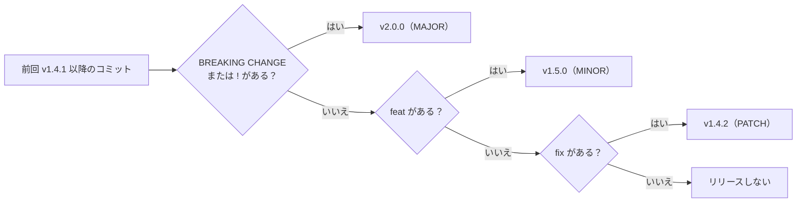
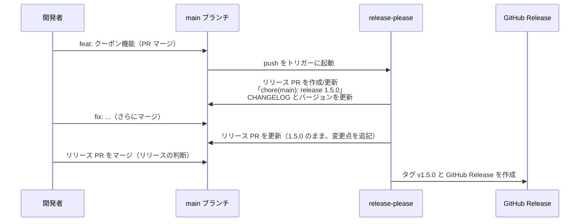

# リリースの自動化

[[MOC_リリース・デプロイ体系|📚 目次]] ｜ [[04_変更履歴とリリースノートの書き方|← 前へ]] ｜ [[01_リリースサイクルとブランチ戦略|次へ →]]

> [!abstract] この記事で分かること
> - Conventional Commits の書き方と、`feat` / `fix` / `BREAKING CHANGE` からバージョンを自動で決める仕組み
> - commitlint でコミットメッセージの形式を強制する方法
> - semantic-release / release-please / Changesets の違いと GitHub Actions の設定例
> - GitHub の自動生成リリースノート（`.github/release.yml`）とモノレポでのバージョン管理
>
> **前提**：[[01_セマンティックバージョニング]]、[[03_gitタグとリリースの作り方]]、[[04_変更履歴とリリースノートの書き方]] を読んでいると理解しやすいです。CI/CD の基本は [[MOC_CI-CD体系]] を参照してください。

## 1. ひとことで言うと

レジで商品のバーコードを読み取ると、合計金額とレシートが自動で出てきます。店員が暗算で合計を出し、手書きでレシートを書くことはありません。

リリースの自動化も同じで、**コミットメッセージに決まった「バーコード」（`feat:` や `fix:`）を付けておけば、ツールが次のバージョン番号を計算し、CHANGELOG とリリースノートを書き、タグと GitHub Release を作ってくれます**。

- 人が「次は 1.5.0 か 2.0.0 か」を悩まない（判断ミスや付け忘れがなくなる）
- CHANGELOG の書き忘れがなくなる
- その代わり、**コミットメッセージ（または PR タイトル）を正しく書くこと** が全員の責任になる

## 2. Conventional Commits：バージョンを決める「バーコード」

[Conventional Commits 1.0.0](https://www.conventionalcommits.org/ja/v1.0.0/) は、コミットメッセージの書式を決めた仕様です。

```
<type>[(scope)][!]: <description>

[body]

[footer(s)]
```

| type | 意味 | バージョンへの影響 |
|---|---|---|
| `fix` | バグ修正 | **PATCH** |
| `feat` | 新機能 | **MINOR** |
| `BREAKING CHANGE:` フッター、または type の後ろの `!` | 破壊的変更（type は何でもよい） | **MAJOR** |
| `docs`, `chore`, `refactor`, `test`, `ci`, `perf`, `build`, `style` など | その他 | 原則なし（破壊的変更を含まなければ） |

Shop の例：

```text
fix(orders): 在庫0の商品を同時注文すると在庫がマイナスになる問題を修正

feat(orders): 注文確定APIでクーポンコードを受け付ける

feat(orders)!: 注文レスポンスの total を金額と通貨のオブジェクトに変更

BREAKING CHANGE: total は数値ではなく { amount, currency } になります。
クライアントは total.amount を参照してください。
```

`!` とフッター `BREAKING CHANGE:` はどちらか一方でも、両方でも構いません。フッターのトークン `BREAKING CHANGE` は大文字で書く必要があります（`BREAKING-CHANGE` も同義）。

複数のコミットがあるときは **最も強いものが勝ちます**。



> [!tip] スカッシュマージなら「PR タイトル」がコミットになる
> GitHub で Squash and merge を使うと、PR タイトルが main のコミットメッセージになります。その場合は **PR タイトルを Conventional Commits 形式にする** ことだけを徹底すればよく、ブランチ内の作業コミットは自由に書けます。

## 3. commitlint で形式を強制する

ルールは守られないと意味がありません。**commitlint** は、コミットメッセージが規約に沿っているかを検査するツールです（2026 年時点）。

```bash
npm install -D @commitlint/cli @commitlint/config-conventional
echo "export default { extends: ['@commitlint/config-conventional'] };" > commitlint.config.js
```

**ローカル（Husky でコミット時に検査）：**

```bash
npm install -D husky
npx husky init
echo 'npx --no -- commitlint --edit "$1"' > .husky/commit-msg
```

```text
$ git commit -m "クーポン追加"
⧗   input: クーポン追加
✖   subject may not be empty [subject-empty]
✖   type may not be empty [type-empty]
```

**CI（PR のコミットを検査）：** ローカルのフックは `--no-verify` で飛ばせるので、CI でも検査します。

```yaml
# .github/workflows/commitlint.yml
name: Commitlint
on: [pull_request]
jobs:
  commitlint:
    runs-on: ubuntu-latest
    steps:
      - uses: actions/checkout@v4
        with:
          fetch-depth: 0
      - uses: actions/setup-node@v4
        with:
          node-version: lts/*
      - run: npm ci
      - run: npx commitlint --from ${{ github.event.pull_request.base.sha }} --to ${{ github.event.pull_request.head.sha }} --verbose
```

スカッシュマージ運用なら、コミットではなく **PR タイトルを検査** するアクション（`amannn/action-semantic-pull-request` など）を使う方法もあります。

## 4. 3 つの自動化ツールの比較

代表的なツールは 3 つあり、**「いつ、誰がリリースを決めるか」** が大きく違います。

| 観点 | semantic-release | release-please | Changesets |
|---|---|---|---|
| 開発元 | コミュニティ | Google | コミュニティ |
| バージョンの決め方 | コミットメッセージ（Conventional Commits） | コミットメッセージ（Conventional Commits） | 開発者が PR ごとに書く「changeset ファイル」 |
| リリースのタイミング | main にマージされるたびに **即リリース** | **リリース PR** をマージしたとき | **Version Packages PR** をマージしたとき |
| 人の確認 | なし（完全自動） | リリース PR で内容とバージョンを確認できる | Version PR で確認できる |
| CHANGELOG | プラグインで生成 | 自動生成してリリース PR に含める | changeset の記述から生成 |
| モノレポ | 標準では非対応（コミュニティ製の拡張あり） | 対応（manifest 設定） | **得意**（npm/pnpm workspaces 前提） |
| 言語 | npm 中心（プラグインで他も可） | Node, Python, Java, Go, Rust など多数 | JavaScript / TypeScript |
| 向いている場面 | ライブラリを常に最新で出し続けたい | アプリやサービスで、リリースのタイミングを人が決めたい | JS モノレポで複数パッケージを管理 |



### 4.1 semantic-release

main への push ごとに、前回のタグ以降のコミットを解析してリリースします。既定のプラグインは次の 4 つで、この順に動きます。

1. `@semantic-release/commit-analyzer` — コミットから次のバージョンを決める
2. `@semantic-release/release-notes-generator` — リリースノートを作る
3. `@semantic-release/npm` — npm に publish する
4. `@semantic-release/github` — GitHub Release を作る

```yaml
# .github/workflows/release.yml（semantic-release 公式レシピに基づく）
name: Release
on:
  push:
    branches: [main]
permissions:
  contents: read
jobs:
  release:
    runs-on: ubuntu-latest
    permissions:
      contents: write        # GitHub Release の作成
      issues: write          # リリースされた Issue へのコメント
      pull-requests: write   # リリースされた PR へのコメント
      id-token: write        # npm の trusted publishing / provenance
    steps:
      - uses: actions/checkout@v4
        with:
          fetch-depth: 0     # 過去のタグとコミットを解析するため全履歴が必要
      - uses: actions/setup-node@v4
        with:
          node-version: lts/*
      - run: npm clean-install
      - run: npx semantic-release
        env:
          GITHUB_TOKEN: ${{ secrets.GITHUB_TOKEN }}
```

npm に公開しないアプリ（Shop API など）の場合は、設定ファイルで `plugins` を指定して npm プラグインを外します。`plugins` を書くと既定のリストは **置き換え** になる点に注意してください。

```json
// .releaserc.json
{
  "branches": ["main"],
  "plugins": [
    "@semantic-release/commit-analyzer",
    "@semantic-release/release-notes-generator",
    "@semantic-release/github"
  ]
}
```

### 4.2 release-please

main への push のたびに **リリース PR**（バージョン番号と CHANGELOG の更新を含む PR）を作成・更新し、**その PR をマージした時点でタグと GitHub Release を作ります**。「リリースのタイミングは人が決めたい」チームに向いています。

```yaml
# .github/workflows/release-please.yml
name: release-please
on:
  push:
    branches: [main]
permissions:
  contents: write
  issues: write
  pull-requests: write
jobs:
  release-please:
    runs-on: ubuntu-latest
    outputs:
      release_created: ${{ steps.rp.outputs.release_created }}
      tag_name: ${{ steps.rp.outputs.tag_name }}
    steps:
      - id: rp
        uses: googleapis/release-please-action@v4
        with:
          release-type: node   # package.json と CHANGELOG.md を更新

  # リリースが作られたときだけ、タグのコードでイメージをビルド
  build-image:
    needs: release-please
    if: ${{ needs.release-please.outputs.release_created == 'true' }}
    runs-on: ubuntu-latest
    steps:
      - uses: actions/checkout@v4
        with:
          ref: ${{ needs.release-please.outputs.tag_name }}
      - run: echo "ここで ${{ needs.release-please.outputs.tag_name }} のイメージをビルドして push"
```

> [!warning] GITHUB_TOKEN で作ったタグは他のワークフローを起動しない
> `GITHUB_TOKEN` によるイベント（タグの作成など）は、無限ループ防止のため **別のワークフローをトリガーしません**。そのため、「タグ push で動くリリース用ワークフロー」（[[03_gitタグとリリースの作り方]] の例）は起動しません。上の例のように同じワークフロー内で後続ジョブを動かすか、GitHub App のトークンや PAT を使います。

### 4.3 Changesets

コミットメッセージではなく、**開発者が PR ごとに「この変更はどのパッケージを、どれだけ上げるか」を書いたファイル** をコミットします。

```bash
npx changeset   # 対話式で対象パッケージと major/minor/patch を選ぶ
```

```markdown
<!-- .changeset/brave-coupons-sing.md（自動生成されたファイル名） -->
---
"@shop/api-client": minor
"@shop/ui": patch
---

注文確定 API のクーポンコードに対応しました。
```

GitHub Actions の `changesets/action` は、changeset ファイルがたまっていると **「Version Packages」PR** を作成・更新し、それをマージするとバージョン更新・CHANGELOG 反映（必要なら npm publish）を行います。2026 年時点の公式ガイドでは `changesets/action@v2` を使い、npm への公開は trusted publishing を推奨しています。ワークフローの構成はバージョンによって変わっているため、[公式ガイド](https://changesets.dev/guide/automating) の最新例をコピーして使ってください。

利点は、**コミット履歴をきれいに保つ必要がなく、利用者向けの説明文を PR の時点で書ける** ことです。changeset ファイルがない PR を CI で警告する仕組み（changeset bot）も用意されています。

## 5. GitHub の自動生成リリースノート

ツールを入れなくても、GitHub 自体に **マージ済み PR からリリースノートを生成する機能** があります。`gh release create --generate-notes` や、Web UI の「Generate release notes」ボタンで使えます。`.github/release.yml` で、PR のラベルに応じて分類できます。

```yaml
# .github/release.yml
changelog:
  exclude:
    labels:
      - ignore-for-release     # このラベルの PR は載せない
    authors:
      - shop-release-bot       # 除外したいアカウント（bot など）のログイン名
  categories:
    - title: ⚠️ 破壊的変更
      labels:
        - breaking-change
    - title: 🎉 新機能
      labels:
        - enhancement
    - title: 🐛 不具合の修正
      labels:
        - bug
    - title: その他の変更
      labels:
        - "*"                  # 上のどれにも当てはまらない PR
```

- `categories[*].title` と `labels` は必須。`"*"` はそれまでのカテゴリに当てはまらない PR すべてを受け止める
- 生成されるのは「PR タイトル + 作成者 + PR リンク」の一覧と、新しいコントリビューター、差分リンク

**PR タイトルとラベルの質がそのままノートの質になる** ため、PR テンプレートやラベル付けの自動化（`actions/labeler` など）と組み合わせるのが効果的です。ただし PR タイトルの羅列は開発者向けの情報なので、利用者向けのリリースノートは別途書き直すか、ハイライトを手で追記します（[[04_変更履歴とリリースノートの書き方]]）。

## 6. モノレポでのバージョン管理

Shop のリポジトリが次のようなモノレポだとします。

```
shop/
├── apps/
│   ├── api/          ← Shop API（コンテナとしてデプロイ）
│   └── web/          ← Next.js フロントエンド
└── packages/
    ├── api-client/   ← npm パッケージとして社内配布（SemVer）
    └── ui/           ← 共有 UI コンポーネント
```

まず決めるのは **「全部同じバージョンにするか、パッケージごとに別にするか」** です。

| 方式 | 内容 | 長所 | 短所 |
|---|---|---|---|
| 固定（fixed / locked） | 全パッケージが常に同じ番号 | 組み合わせが分かりやすい | 変更のないパッケージも番号が上がる |
| 独立（independent） | パッケージごとに別の番号 | 変更があったものだけ上がる | どの組み合わせが動くかの管理が必要 |

ツールの対応：

- **Changesets**：独立が基本。`fixed` / `linked` 設定で同時に上げるグループも作れる。内部依存（`api-client` に依存する `web`）のバージョンも自動で更新する
- **release-please**：manifest 方式でパッケージごとに管理。タグは `api-client-v1.2.0` のようにパッケージ名付きになる

```json
// release-please-config.json
{
  "packages": {
    "apps/api": { "release-type": "node" },
    "packages/api-client": { "release-type": "node" }
  }
}
```

```json
// .release-please-manifest.json（現在のバージョンを記録。release-please が更新する）
{
  "apps/api": "1.4.1",
  "packages/api-client": "3.3.0"
}
```

既定では全パッケージをまとめた 1 つのリリース PR が作られ、`"separate-pull-requests": true` でパッケージごとの PR に分けられます。コミットがどのパッケージに属するかは、**変更されたファイルのパス** で判定されます。

> [!note] サービスとライブラリで番号の役割が違う
> モノレポでは `packages/api-client` は利用者が版を選ぶので SemVer が重要ですが、`apps/api` は常に最新が動くサービスなので、番号は識別用です（[[02_カレンダーバージョニング]]）。デプロイの単位は「バージョン番号」ではなく「イメージ digest」で管理しましょう。

## よくある誤解・つまずき

- ❌ 自動化すれば CHANGELOG の質も自動で上がる
  ✅ 生成される内容はコミットメッセージや PR タイトルの質そのものです。「fix bug」のようなメッセージからは「fix bug」というノートしか生まれません。
- ❌ `feat` を付ければ何でも MINOR なので安心
  ✅ 破壊的な変更に `!` や `BREAKING CHANGE` を付け忘れると、MAJOR であるべき変更が MINOR として出てしまいます。レビューで確認する項目にしましょう。
- ❌ semantic-release を入れれば、モノレポの全パッケージも自動でリリースされる
  ✅ semantic-release は標準では 1 リポジトリ 1 パッケージ前提です。モノレポなら Changesets や release-please の manifest 方式が向いています。
- ❌ 自動で作ったタグの push で、タグ起点のデプロイワークフローも動くはず
  ✅ `GITHUB_TOKEN` で作られたイベントは他のワークフローを起動しません。同じワークフロー内で続けるか、別のトークンを使います。

## まとめ

- Conventional Commits の `fix` → PATCH、`feat` → MINOR、`!` / `BREAKING CHANGE` → MAJOR で、次のバージョンを機械的に決められる
- commitlint（ローカルの Husky + CI）で形式を強制する。スカッシュマージなら PR タイトルを検査する
- semantic-release は「マージ即リリース」、release-please は「リリース PR のマージでリリース」、Changesets は「changeset ファイルで宣言」— チームが **いつ・誰がリリースを決めたいか** で選ぶ
- `.github/release.yml` で、PR ラベルに基づくリリースノートの自動生成を分類できる
- モノレポは固定か独立かを決め、Changesets や release-please の manifest で管理する

## 確認クイズ

1. 前回のリリース v2.3.4 以降に、`docs: README 修正`、`fix: 送料計算の誤り`、`feat: お気に入り機能` の 3 コミットがあります。Conventional Commits に基づく次のバージョンは？
> [!tip]- 答え
> `v2.4.0` です。最も強い `feat` が MINOR を上げ、PATCH は 0 に戻ります。`docs` はバージョンに影響しません。

2. 「リリースのタイミングはプロダクトオーナーが決めたいが、バージョン番号と CHANGELOG は自動で作りたい」チームには、semantic-release と release-please のどちらが向いていますか？
> [!tip]- 答え
> release-please です。変更をためたリリース PR が自動で作られ、それをマージした時点でリリースされるため、タイミングを人が決められます。semantic-release は main へのマージごとに即リリースします。

3. `.github/release.yml` の `labels: ["*"]` は何を意味しますか？
> [!tip]- 答え
> それより前のカテゴリのどれにも当てはまらない PR をすべて受け止める「その他」カテゴリです。

## 関連ノート

- [[01_セマンティックバージョニング]] — 自動化が計算しているバージョンの規則
- [[03_gitタグとリリースの作り方]] — 自動化ツールが作るタグとリリースの中身
- [[04_変更履歴とリリースノートの書き方]] — 自動生成のあとに人が手を入れるべきところ
- [[01_リリースサイクルとブランチ戦略]] — どのブランチから、どの頻度でリリースするか
- [[04-GitHub-Actionsによる自動化]] — GitHub Actions の基本
- [[MOC_CI-CD体系]] — CI/CD 全体の目次

## 参考

- [Conventional Commits 1.0.0](https://www.conventionalcommits.org/en/v1.0.0/)
- [commitlint: Getting started](https://commitlint.js.org/guides/getting-started.html)
- [semantic-release: GitHub Actions レシピ](https://semantic-release.gitbook.io/semantic-release/recipes/ci-configurations/github-actions)
- [semantic-release: Plugins](https://semantic-release.gitbook.io/semantic-release/usage/plugins)
- [googleapis/release-please-action](https://github.com/googleapis/release-please-action)
- [release-please: Manifest releaser](https://github.com/googleapis/release-please/blob/main/docs/manifest-releaser.md)
- [Changesets: Automating Changesets](https://changesets.dev/guide/automating)
- [changesets/action](https://github.com/changesets/action)
- [GitHub Docs: Automatically generated release notes](https://docs.github.com/en/repositories/releasing-projects-on-github/automatically-generated-release-notes)
