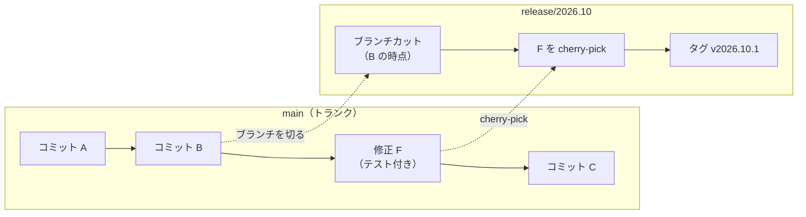

# リリースサイクルとブランチ戦略

[[MOC_リリース・デプロイ体系|📚 目次]] ｜ [[05_リリースの自動化|← 前へ]] ｜ [[02_リリース可否の基準とGo-No-Go判断|次へ →]]

> [!abstract] この記事で分かること
> - 「いつリリースするか」の 3 つの型（オンデマンド／定期リリース＝リリーストレイン／継続的デプロイ）と向き不向き
> - リリースの型とブランチ戦略（Git Flow・GitHub Flow・トランクベース開発）がどう結びつくか
> - リリースブランチへのホットフィックスを「トランクで直してから cherry-pick する」理由
> - Web とモバイルアプリでリリースの考え方が大きく違う理由（ストア審査・段階的公開）
> - 1 回のリリースに含める変更量（バッチサイズ）とリスクの関係
>
> **前提**：[[01_リリースとデプロイの違い]]、[[03_gitタグとリリースの作り方]] を読んでいると理解しやすいです。

## 1. ひとことで言うと

リリースサイクルは「バスの運行ダイヤ」に似ています。乗客（変更）が集まったら出発するタクシー型（オンデマンド）、時刻表どおりに出るバス型（リリーストレイン）、乗客が来るたびにすぐ出る動く歩道型（継続的デプロイ）があります。どれを選ぶかで、ブランチの切り方も、テストの仕方も、事故の大きさも変わります。

- **リリースサイクル（release cadence）**：どんな間隔・きっかけで本番に出すかのルール
- **ブランチ戦略（branching strategy）**：そのサイクルを実現するための Git ブランチの使い方
- 共通の原則：**1 回に出す変更は小さいほど安全**（Google SRE 本も「頻繁なリリースはバージョン間の変更を少なくする」と述べています）

## 2. リリースサイクルの 3 つの型

### 2.1 オンデマンドリリース

「機能ができたら、その都度リリース日を決めて出す」方式です。小さなチームや、リリース作業が手作業中心の段階でよく見られます。

- 👍 柔軟。急ぎの機能もすぐ出せる
- 👎 リリースが不定期なので手順が習熟しない。「ついでにこれも」で変更が膨らみやすい

### 2.2 定期リリース（リリーストレイン）

**リリーストレイン（release train）** は「毎週火曜」「2 週間ごと」のように **発車時刻を固定** し、締め切り（ブランチカット）までに間に合った変更だけを載せる方式です。間に合わない機能は次の列車を待ちます。列車が機能を待つことはありません。

- 👍 予定が読めるので、QA・サポート・マーケティングと調整しやすい
- 👍 毎回同じ手順を繰り返すので、手順書やチェックリストが育つ
- 👎 締め切り直前に駆け込みマージが集中しやすい
- 👎 次の列車まで最大で 1 サイクル分待たされる

モバイルアプリや、大きな組織の B2B 製品、Chrome のような大規模ソフトウェアでよく使われます。

### 2.3 継続的デプロイ

**継続的デプロイ（Continuous Deployment）** は、main にマージされ、自動テストに通った変更を **人の承認なしに自動で本番へ出す** 方式です。Google SRE 本では、テストに通ったビルドをすべてデプロイする方式を「Push on Green」と紹介しています。

- 👍 1 回の変更が小さく、問題が出ても原因の特定と切り戻しが簡単
- 👍 「リリース作業」という特別なイベントがなくなる
- 👎 自動テスト・監視・自動ロールバックが揃っていないと、壊れたものがそのまま出る
- 👎 「未完成の機能を隠す」仕組み（フィーチャーフラグ）がほぼ必須

> [!note] 継続的デリバリーとの違い
> **継続的デリバリー（Continuous Delivery）** は「いつでも本番に出せる状態を保つ」こと。最後の本番反映ボタンは人が押してもかまいません。**継続的デプロイ** はそのボタンも自動にしたものです。詳しくは [[MOC_CI-CD体系]] を参照してください。

### 2.4 比較表

| 観点 | オンデマンド | リリーストレイン | 継続的デプロイ |
| --- | --- | --- | --- |
| 頻度 | 不定期 | 週 1〜月 1 など固定 | 1 日に何回も |
| 1 回の変更量 | 大きくなりがち | 中 | 小さい |
| 必要な自動化 | 少なくても回る | 中（CI・ステージング） | 多い（テスト・監視・自動ロールバック） |
| 合うブランチ戦略 | Git Flow / GitHub Flow | Git Flow（release ブランチ）/ トランク＋リリースブランチ | GitHub Flow / トランクベース＋フラグ |
| 向いている例 | 小規模サービスの初期 | モバイルアプリ、パッケージ製品 | Web サービス、API |

## 3. ブランチ戦略との関係

ブランチ戦略そのものの詳細は Git のノート（[[01-Git-Flow]]、[[02-GitHub-Flow]]、[[03-Trunk-Based-Development]]）にあります。ここでは「リリースの視点」で何が違うかだけを見ます。

### 3.1 Git Flow：release ブランチで「出荷前の調整」をする

Git Flow では `develop` から `release/1.4.0` を切り、そこでバグ修正だけを行って安定させ、`main` にマージしてタグを打ちます。

- release ブランチを切った瞬間が **機能の締め切り（コードフリーズ）**
- その間も `develop` では次の開発が進められる
- リリーストレイン型と相性がよい

ただし、ブランチが長生きするほど `develop` との差分が大きくなり、マージの苦労が増えます。

### 3.2 GitHub Flow：main が常にデプロイ可能

GitHub Flow は `main` と短命なフィーチャーブランチだけを使います。プルリクエストをマージしたら（あるいはマージ前にプレビュー環境で確認してから）すぐデプロイする、オンデマンド〜継続的デプロイ向きのシンプルな形です。

### 3.3 トランクベース開発＋フィーチャーフラグ

トランクベース開発（Trunk-Based Development）では、全員が `main`（トランク）に 1 日 1 回以上小さくマージします。未完成の機能は [[06_フィーチャーフラグ]] で隠したまま本番に出しておき、準備ができたらフラグを ON にして「リリース」します。つまり **デプロイとリリースを分離** します（[[01_リリースとデプロイの違い]]）。

### 3.4 リリースブランチとホットフィックスの cherry-pick

トランクベースでも、定期リリースをする場合は「出荷用のリリースブランチ」を切ることがあります。ここで大事なのが **修正の流し方** です。



- **原則：まずトランクで直し、それをリリースブランチへ cherry-pick する**
- 逆に「リリースブランチだけで直す」と、修正がトランクに戻らず、次のリリースで同じバグが復活（リグレッション）します
- Google SRE 本も、リリースブランチは main にマージし戻さず、修正は main に入れてから cherry-pick すると説明しています。これにより「各リリースの中身が正確に分かる」のが利点です
- トランクで再現できない場合だけ、例外的にブランチ側で先に直します

```bash
# 1. main で修正をマージ済み（コミット abc1234）
git switch release/2026.10
git cherry-pick -x abc1234   # -x で「どのコミットから持ってきたか」をメッセージに残す
git push origin release/2026.10
# 2. リリースブランチ側の CI が通ったらタグを打つ
git tag -a v2026.10.1 -m "hotfix: クーポン割引額の丸め誤差"
git push origin v2026.10.1
```

> [!tip] `-x` を付ける理由
> `cherry-pick -x` はコミットメッセージに `(cherry picked from commit abc1234)` を追記します。後から「この修正は main のどれと同じか」を追跡でき、リリースノート作成（[[04_変更履歴とリリースノートの書き方]]）にも役立ちます。

## 4. Web とモバイルの違い

Shop には Web（Next.js）とモバイルアプリがあります。同じ「クーポン機能」でも、出し方はまったく違います。

| 観点 | Web（Shop API / Next.js） | モバイルアプリ（iOS / Android） |
| --- | --- | --- |
| 誰が反映するか | 自分たちがサーバーに出す | ストア審査を通ったあと、ユーザーが更新する |
| 反映までの時間 | 数分 | 審査待ち＋ユーザーの更新待ち（数日〜数週間） |
| 切り戻し | 前のバージョンを再デプロイすればよい | 配布済みのアプリは戻せない。修正版を再審査に出す |
| 旧バージョンの残存 | ほぼない | 古いバージョンが何か月も使われ続ける |
| 向くサイクル | 継続的デプロイ | リリーストレイン（例：隔週） |

### 4.1 ストア審査

Apple は「平均で 90% の申請が 24 時間以内に審査される」と案内していますが、保証ではなく、内容によっては数日かかることもあります（2026 年時点）。**審査待ちがあるため、モバイルの緊急修正は Web よりずっと遅い** と考えておきます。

### 4.2 段階的公開

どちらのストアにも、一部のユーザーから順に配る仕組みがあります（2026 年時点）。

- **App Store の段階的リリース（Phased Release）**：自動アップデートの対象を 7 日間で 1% → 2% → 5% → 10% → 20% → 50% → 100% と広げる。一時停止は合計 30 日まで。ただし **手動でストアから更新する人には最初から配られる**
- **Google Play の段階的公開（Staged rollout）**：公開する割合を自分で指定して段階的に上げる。問題があれば「停止（halt）」できるが、すでに受け取ったユーザーはそのバージョンのまま。直すには修正版を新しく出す

> [!warning] モバイルは「戻せない」前提で設計する
> 配ってしまったアプリは回収できません。だから Shop では、新しいクーポン画面も **サーバー側のフィーチャーフラグで表示を切り替えられる** ようにしておき、問題が出たらアプリ更新なしで機能を止められるようにします。API 側も、古いアプリが呼ぶ旧形式のリクエストを当分受け付け続ける必要があります（[[03_ロールバックできない変更]]）。

## 5. バッチサイズとリスク

**バッチサイズ（batch size）** は「1 回のリリースに含まれる変更の量」です。

```
変更 50 件を月 1 回まとめて出す          変更 2〜3 件を毎日出す
┌────────────────────────┐            ┌──┐┌──┐┌──┐┌──┐┌──┐
│ ■■■■■■■■■■■■■■■■■■■■■■ │            │■■││■ ││■■││■■││■ │ ...
└────────────────────────┘            └──┘└──┘└──┘└──┘└──┘
 障害時：50 件のどれが原因？             障害時：直前の 2〜3 件のどれか
 切り戻すと 50 件ぶん全部戻る            戻すのは小さな 1 回だけ
 手順は月 1 回なので忘れる               毎日やるので手順が身につく
```

Martin Fowler は「つらいことほど頻繁にやれ（if it hurts, do it more often）」と書いています。統合の痛みは間隔が空くほど指数的に増える、という考え方です。リリースも同じで、**怖いから回数を減らすと、1 回が大きくなってさらに怖くなる** という悪循環に陥ります。

DORA（DevOps Research and Assessment）の調査でも、デプロイ頻度が高いチームのほうが変更失敗率や復旧時間でも優れている傾向が示されています（指標の詳細は [[04_リリースのふりかえりとDORA指標]]）。

### Shop での選び方の例

- **Shop API・Web フロント**：GitHub Flow ＋ フィーチャーフラグで、main へのマージごとに自動デプロイ（継続的デプロイ）。クーポン機能はフラグ OFF のまま何度もデプロイし、準備ができたら社員 → 5% → 全員と ON にする
- **モバイルアプリ**：隔週火曜のリリーストレイン。水曜にリリースブランチを切り、翌週月曜に審査提出、通ったら段階的リリース開始。緊急修正は main で直して cherry-pick

## よくある誤解・つまずき

- ❌ 「リリースを月 1 回に減らせば事故も減る」
  ✅ 1 回の変更量が増え、原因特定も切り戻しも難しくなります。回数を減らすより、1 回を小さくして自動化するほうが安全です。
- ❌ 「ホットフィックスはリリースブランチで直せば十分」
  ✅ main に戻し忘れると次のリリースで同じバグが復活します。main で直してから cherry-pick するのが原則です。
- ❌ 「トランクベース開発なら未完成の機能は出せない」
  ✅ フィーチャーフラグで隠せば、未完成のコードも安全に本番へデプロイできます。デプロイとリリースは別物です。
- ❌ 「モバイルも Web と同じく、まずければすぐ戻せる」
  ✅ 配布済みのアプリは戻せません。段階的公開・サーバー側フラグ・後方互換な API で被害を抑える設計が必要です。

## まとめ

- リリースサイクルには、オンデマンド・リリーストレイン（定期）・継続的デプロイの 3 型がある
- リリーストレインは「時刻表を守り、間に合わない機能は次へ回す」。予定が読みやすくモバイル向き
- 継続的デプロイには自動テスト・監視・フィーチャーフラグが欠かせない
- リリースブランチへの修正は「main で直して `cherry-pick -x`」が原則
- モバイルはストア審査と「配ったら戻せない」性質があるため、段階的公開とサーバー側フラグで守る
- バッチサイズを小さくするほど、原因特定も切り戻しも楽になる

## 確認クイズ

1. リリーストレインで、締め切りに間に合わなかった機能はどう扱いますか？
> [!tip]- 答え
> 列車（リリース）を遅らせず、その機能は次の便に回します。発車時刻を守ることで予定が読めるようになるのが、リリーストレインの価値です。

2. リリースブランチで見つかったバグを、リリースブランチだけで直してはいけないのはなぜですか？
> [!tip]- 答え
> 修正が main（トランク）に入らないと、次のリリースで同じバグが復活するからです。main でテスト付きで直し、リリースブランチへ cherry-pick します。

3. App Store の段階的リリース中でも、新バージョンを受け取るユーザーがいるのはどんな場合ですか？
> [!tip]- 答え
> 段階的リリースは自動アップデートだけに効きます。App Store で手動で更新したユーザーは、段階に関係なく最初から新バージョンを入手できます。

## 関連ノート

- [[01-Git-Flow]] — release ブランチ・hotfix ブランチの詳細
- [[02-GitHub-Flow]] — main を常にデプロイ可能に保つ軽量なフロー
- [[03-Trunk-Based-Development]] — トランクベース開発の詳細
- [[06_フィーチャーフラグ]] — デプロイとリリースを分離する仕組み
- [[03_gitタグとリリースの作り方]] — タグを打ってリリースを作る手順
- [[02_リリース可否の基準とGo-No-Go判断]] — 列車に乗せてよいかを判断する基準
- [[05_信頼性とスピードの両立]] — リリース頻度と信頼性のバランス

## 参考

- [Google SRE Book - Release Engineering](https://sre.google/sre-book/release-engineering/)
- [Trunk Based Development - Branch for release](https://trunkbaseddevelopment.com/branch-for-release/)
- [Martin Fowler - Frequency Reduces Difficulty](https://martinfowler.com/bliki/FrequencyReducesDifficulty.html)
- [Apple - Release a version update in phases](https://developer.apple.com/help/app-store-connect/update-your-app/release-a-version-update-in-phases/)
- [Google Play Console Help - Release app updates with staged rollouts](https://support.google.com/googleplay/android-developer/answer/6346149)
- [DORA](https://dora.dev)
