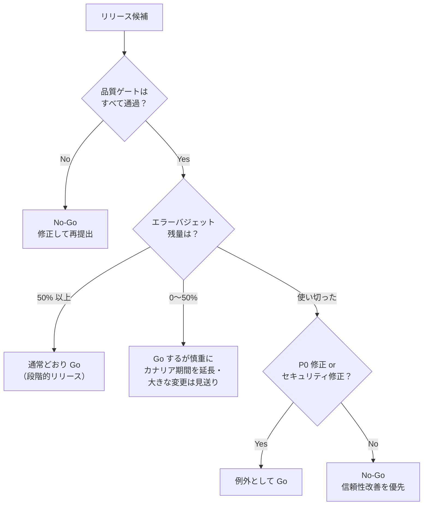

# リリース可否の基準とGo-No-Go判断

[[MOC_リリース・デプロイ体系|📚 目次]] ｜ [[01_リリースサイクルとブランチ戦略|← 前へ]] ｜ [[03_リリース手順書とチェックリスト|次へ →]]

> [!abstract] この記事で分かること
> - 品質ゲート（テスト・静的解析・セキュリティスキャン・性能）で「機械的に止める」仕組み
> - リリース判定基準を「合否が誰にでも分かる形」で書く方法
> - エラーバジェットの残量でリリースを止める・進めるという考え方
> - Go/No-Go 会議の参加者・確認項目・決定の記録の仕方
> - 自動ゲートと人の判断の役割分担
>
> **前提**：[[01_リリースサイクルとブランチ戦略]]、[[01_SLI・SLOの設計]] を読んでいると理解しやすいです。

## 1. ひとことで言うと

ロケットの打ち上げ前、管制室では各担当が順に「推進系 Go」「気象 Go」「通信 Go」と答え、一人でも「No-Go」なら打ち上げを延期します。ソフトウェアのリリース判定も同じで、**事前に決めた基準を一つずつ確認し、満たさなければ止める** 仕組みです。

- **品質ゲート（quality gate）**：基準を満たさないと次の段階へ進めない関門。多くは CI で自動化する
- **Go/No-Go 判断**：自動ゲートでは測れないこと（業務上のリスク、体制、タイミング）を人が確認して「出す／出さない」を決めること
- 大切なのは「その場の雰囲気」で決めないこと。**基準は事前に、合否は誰が見ても同じになる形で** 書いておきます

## 2. 品質ゲート：機械に任せられることは機械で止める

### 2.1 代表的なゲート

| ゲート | 何を確認するか | Shop での例 | 止める条件の例 |
| --- | --- | --- | --- |
| 自動テスト | 機能が壊れていないか | 単体・結合・E2E テスト | 1 件でも失敗 |
| カバレッジ | テストの抜け | 変更行のカバレッジ | 新規コードが 80% 未満 |
| 静的解析（lint・型検査） | バグの温床になる書き方 | ESLint、`tsc --noEmit` | エラー 1 件以上 |
| セキュリティスキャン | 既知の脆弱性・秘密情報の混入 | 依存パッケージ・コンテナイメージのスキャン | Critical / High が未対応 |
| 性能テスト | 遅くなっていないか | 注文確定 API の負荷試験 | p95 レイテンシが前回比 +20% 超 |
| マイグレーション検証 | DB 変更が安全か | ステージングでの適用・ロールバック | 失敗、またはロックが一定時間超 |

性能や DB 変更のように重いゲートは、毎コミットではなくリリース候補（タグやリリースブランチ）に対してだけ実行する、という使い分けもよく行われます。Web サイト全般の品質ゲートは [[00_Webサイト品質ゲート_目次]] にまとまっています。

### 2.2 GitHub Actions で「ゲート → 承認 → 本番」をつなぐ

下は Shop API の例です。テスト・静的解析・脆弱性スキャンが通らないと `deploy-production` に進めず、さらに GitHub の **Environment（環境）保護ルール** で人の承認を挟みます。

```yaml
# .github/workflows/release.yml
name: release
on:
  push:
    tags: ["v*"]

jobs:
  quality-gate:
    runs-on: ubuntu-latest
    steps:
      - uses: actions/checkout@v4
      - uses: actions/setup-node@v4
        with:
          node-version: 22
          cache: npm
      - run: npm ci
      - run: npm run lint            # 静的解析
      - run: npx tsc --noEmit        # 型検査
      - run: npm test -- --coverage  # 自動テスト
      - run: npm audit --audit-level=high   # High 以上の脆弱性があれば失敗

  deploy-staging:
    needs: quality-gate
    runs-on: ubuntu-latest
    environment: staging
    steps:
      - run: echo "ステージングへデプロイし、スモークテストを実行"

  deploy-production:
    needs: deploy-staging
    runs-on: ubuntu-latest
    environment: production   # ← ここで承認待ちになる
    steps:
      - run: echo "本番へデプロイ"
```

`production` 環境には、リポジトリの Settings → Environments で次のような保護ルールを設定します（2026 年時点の GitHub の仕様）。

- **Required reviewers**：承認者を最大 6 人（またはチーム）指定。誰か 1 人が承認すると進む
- **Prevent self-review**：デプロイを始めた本人は承認できないようにする
- **Wait timer**：開始後に 1〜43,200 分（30 日）待たせる
- **Deployment branches and tags**：`v*` タグなど、決まった ref からしか本番に出せないよう制限

> [!note] プランによる違い
> Required reviewers と Wait timer は、Free / Pro / Team プランではパブリックリポジトリでのみ使えます（プライベートリポジトリで使うには Enterprise が必要。2026 年時点）。

## 3. リリース判定基準の書き方

基準は「良さそうなら OK」ではなく、**数値か Yes/No で答えられる形** にします。

| 悪い書き方 | 良い書き方 |
| --- | --- |
| テストが十分に通っている | CI の全テストが成功し、E2E の「注文確定」シナリオが成功している |
| 性能に問題がない | ステージングの負荷試験で注文確定 API の p95 が 300ms 以下 |
| 重大なバグがない | 未解決の P1（重大度 1）バグが 0 件 |
| 切り戻しできる | 切り戻し手順がランブックにあり、ステージングで実施済み |
| 体制は大丈夫 | リリース後 2 時間、オンコール担当と開発者が 1 名ずつ待機している |

基準は大きく次の 4 つに分けると漏れにくくなります。

1. **品質**：テスト、既知バグ、性能、セキュリティ
2. **運用準備**：監視・アラート、ダッシュボード、ランブック、切り戻し手順（[[03_リリース手順書とチェックリスト]]）
3. **システムの状態**：エラーバジェット残量、進行中のインシデント、凍結期間かどうか（[[05_凍結期間とメンテナンス窓]]）
4. **周辺の準備**：サポート窓口への共有、告知、法務・決済代行など外部との調整

## 4. エラーバジェット残量で判断する

**エラーバジェット（error budget）** は「SLO を守りつつ、あとどれだけ失敗してよいか」の残高です（SLO 99.9% なら 0.1% が予算）。リリースは障害の主な原因の一つなので、**残高が少ないときは攻めた変更を控える** のが自然な判断になります。

Google SRE ワークブックのエラーバジェット方針の例では、「直近 4 週間でエラーバジェットを使い切ったら、P0 の問題とセキュリティ修正を除く変更とリリースをすべて止め、SLO の範囲内に戻るまで続ける」と定めています。



しきい値（50% など）はチームで決めて文書にしておきます。方針の作り方は [[03_エラーバジェット方針]]、残量の監視は [[03_バーンレートアラート]] を参照してください。

> [!tip] 「止める」だけでなく「進める」根拠にもなる
> 予算が十分に残っているなら、「慎重すぎて出せない」状態から抜け出す根拠になります。エラーバジェットは、開発チームと運用チームが感情ではなく数字で話すための共通言語です（[[05_信頼性とスピードの両立]]）。

## 5. Go/No-Go 会議の進め方

継続的デプロイの小さな変更に毎回会議は不要です。会議を開くのは、**大きな機能のリリース、DB の大きな変更、モバイルの審査提出、大型セール直前** など、自動ゲートだけでは判断しきれないリリースです。

### 5.1 参加者と役割

| 役割 | 主に答えること |
| --- | --- |
| リリース責任者（進行役・最終決定者） | 全員の Go/No-Go を集め、最終判断を宣言する |
| 開発リード | 変更内容・既知の問題・切り戻し方法 |
| QA | テスト結果・未解決バグ |
| SRE / オンコール担当 | 監視・アラートの準備、エラーバジェット、当日の体制 |
| プロダクトオーナー | 業務上の締め切り、出さない場合の影響 |
| サポート・CS（必要に応じて） | 問い合わせ対応の準備 |

### 5.2 進め方（15〜30 分）

1. **変更の概要**（開発リード、2 分）：何が変わるか、影響範囲、戻せない変更があるか
2. **基準の読み上げ**（進行役）：判定チェック表を上から順に確認。各項目の担当が「Go」「No-Go」「条件付き Go」で答える
3. **リスクの確認**：未解決の懸念と、その対策・判断理由
4. **最終判断**：進行役が「Go」「No-Go」「条件付き Go（例：クーポンのフラグは社員のみ ON）」を宣言
5. **記録**：決定と理由を残す

> [!warning] 「声の大きい人が決める」を防ぐ
> 一人でも No-Go を出したら、理由を聞いてから判断します。No-Go を出した人を責めない雰囲気が重要です。止める勇気がないと、品質ゲートは形だけになります。

### 5.3 決定の記録

決定は Issue やリリース用のチケットに残します。後から [[01_ポストモーテムとは|ポストモーテム]] で「なぜ Go と判断したか」を振り返るためです。

```markdown
## Go/No-Go 記録：Shop API v2.8.0（クーポン機能）
- 日時：2026-10-20 10:00〜10:20
- 参加者：山田（リリース責任者）、佐藤（開発）、鈴木（QA）、高橋（SRE）、伊藤（PO）
- 判断：**条件付き Go**
- 条件：coupon-checkout フラグは社員アカウントのみ ON。一般公開は 10/21 に再判定
- 懸念と対応：
  - 割引額の丸め処理の E2E が 1 件不安定 → 手動で確認済み、テスト修正は別 Issue #1234
- エラーバジェット残量：72%
- 切り戻し方法：フラグ OFF（即時）／イメージを v2.7.3 に戻す（約 5 分）
```

## 6. 自動ゲートと人の判断の分担

```
           ┌──────────── 自動ゲート（CI/CD）────────────┐   ┌──── 人の判断 ────┐
 コミット → │ lint・型 → テスト → スキャン → 性能 → ステージング │ → │ Go/No-Go         │ → 本番
           └──────────────────────────────────────────────┘   └──────────────────┘
             ・毎回同じ基準で、速く、疲れない                       ・業務上の事情
             ・数値で表せることはすべてこちらへ                     ・タイミング（セール前など）
                                                                    ・例外を認めるかどうか
```

- **機械に任せる**：数値で判定できるもの（テスト成否、脆弱性の件数、レイテンシ）。人が毎回確認すると見落とすうえに遅い
- **人が判断する**：数値にしにくいもの（「この週末に出してよいか」「この既知バグは許容できるか」「例外として通すか」）
- **人の判断を減らしていく**：会議で毎回同じ質問が出るなら、それはゲートとして自動化できるサインです

## 7. Shop の判定チェック表

クーポン機能のような「通常の機能リリース」で使う表の例です。

| # | 区分 | 項目 | 担当 | 判定 |
| --- | --- | --- | --- | --- |
| 1 | 品質 | CI（lint・型・テスト・`npm audit`）がすべて成功 | 自動 | ☐ |
| 2 | 品質 | E2E「カート → クーポン適用 → 注文確定」が成功 | QA | ☐ |
| 3 | 品質 | 未解決の P1 バグ 0 件、P2 は回避策あり | QA | ☐ |
| 4 | 品質 | 負荷試験で注文確定 API の p95 ≤ 300ms、エラー率 ≤ 0.1% | SRE | ☐ |
| 5 | DB | マイグレーションがステージングで成功し、後方互換である | 開発 | ☐ |
| 6 | 運用 | 新機能のメトリクスとアラートがダッシュボードにある | SRE | ☐ |
| 7 | 運用 | 切り戻し手順がランブックにあり、リハーサル済み | 開発 | ☐ |
| 8 | 状態 | エラーバジェット残量 ≥ 50%（未満なら条件付き） | SRE | ☐ |
| 9 | 状態 | 進行中のインシデントがない／凍結期間ではない | SRE | ☐ |
| 10 | 体制 | リリース後 2 時間の待機者（開発 1・オンコール 1）がいる | リリース責任者 | ☐ |
| 11 | 周辺 | CS へ変更内容と FAQ を共有済み | PO | ☐ |

すべて ☑ なら Go、1 つでも ☐ なら No-Go か条件付き Go です。

## よくある誤解・つまずき

- ❌ 「Go/No-Go 会議は毎回のリリースで開くべき」
  ✅ 小さな変更は自動ゲートに任せます。会議はリスクの大きいリリースに絞らないと、形だけの儀式になります。
- ❌ 「テストが全部通ったから、出して大丈夫」
  ✅ テストはステージングでの確認にすぎません。監視・切り戻し・体制の準備も基準に含めます。
- ❌ 「基準を満たさないけれど、締め切りだから今回は特別に」
  ✅ 例外を認めること自体は可能ですが、誰が、何を理由に、どの条件で認めたかを必ず記録します。記録のない例外は基準を形骸化させます。
- ❌ 「エラーバジェットは運用チームだけの指標」
  ✅ リリースの可否を決める共通の物差しです。開発側も残量を見て計画を立てます。

## まとめ

- 品質ゲートで「数値で判定できること」は CI に任せ、満たさなければ自動で止める
- 判定基準は数値か Yes/No で書き、品質・運用準備・システム状態・周辺準備の 4 区分で漏れを防ぐ
- エラーバジェットを使い切ったら、P0・セキュリティ修正以外のリリースを止めるのが代表的な方針
- Go/No-Go 会議は大きなリリースに絞り、役割ごとに Go/No-Go を答え、決定と理由を記録する
- GitHub Actions の Environment 保護ルールで、人の承認を本番デプロイの前に挟める

## 確認クイズ

1. 「性能に問題がないこと」を判定基準として書き直してください。
> [!tip]- 答え
> 例：「ステージングの負荷試験で注文確定 API の p95 レイテンシが 300ms 以下、エラー率が 0.1% 以下」。誰が見ても合否が同じになるように、対象・指標・しきい値を数値で書きます。

2. エラーバジェットを使い切った状態で、セキュリティ修正のリリースはどう扱うのが一般的ですか？
> [!tip]- 答え
> Google SRE ワークブックの方針例では、P0 の問題とセキュリティ修正は凍結の例外として出してよいとされています。ただし例外として認めたことは記録します。

3. Go/No-Go 会議で毎回「監視ダッシュボードはできていますか？」と聞いている場合、どう改善できますか？
> [!tip]- 答え
> 毎回同じ確認は自動化の候補です。たとえばダッシュボードやアラート定義をコードで管理し、新しいエンドポイントにアラートがなければ CI で失敗させるなど、人の判断から自動ゲートへ移します。

## 関連ノート

- [[01_リリースサイクルとブランチ戦略]] — どのリリースに判定が必要かはサイクルで変わる
- [[03_リリース手順書とチェックリスト]] — Go の後に実行する手順書
- [[03_エラーバジェット方針]] — エラーバジェット方針の作り方
- [[05_凍結期間とメンテナンス窓]] — 凍結中の例外承認
- [[04_ロールバック判断基準]] — リリース後に「戻す」判断の基準
- [[00_Webサイト品質ゲート_目次]] — Web サイトの品質ゲート全般
- [[MOC_QAプロセス]] — テスト・QA プロセス

## 参考

- [Google SRE Workbook - Example Error Budget Policy](https://sre.google/workbook/error-budget-policy/)
- [Google SRE Book - Release Engineering](https://sre.google/sre-book/release-engineering/)
- [GitHub Docs - Deployments and environments](https://docs.github.com/en/actions/reference/workflows-and-actions/deployments-and-environments)
- [npm Docs - npm audit](https://docs.npmjs.com/cli/commands/npm-audit)
