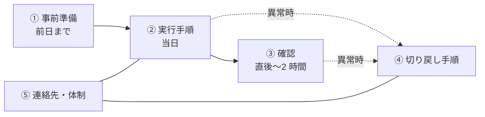

# リリース手順書とチェックリスト

[[MOC_リリース・デプロイ体系|📚 目次]] ｜ [[02_リリース可否の基準とGo-No-Go判断|← 前へ]] ｜ [[04_リハーサルとステージング環境|次へ →]]

> [!abstract] この記事で分かること
> - リリース手順書（ランブック）に入れるべき 5 つの部品：事前準備・実行手順・確認・切り戻し・連絡先
> - 各ステップに「期待結果」と「所要時間」を書く理由
> - チェックリストがなぜミスを減らすのか（医療・航空の知見）
> - 手順書を少しずつコード（自動化）に置き換えていく流れ
> - リリース前後に関係者へ送る告知のテンプレート
>
> **前提**：[[02_リリース可否の基準とGo-No-Go判断]] を読んでいると理解しやすいです。ランブック一般の書き方は [[02_ランブックの書き方]] にあります。

## 1. ひとことで言うと

料理のレシピを思い浮かべてください。良いレシピには「材料（事前準備）」「手順」「焼き上がりの目安（期待結果）」「所要時間」が書いてあり、「焦げたらこうする」というコツまで載っています。リリース手順書も同じで、**初めての人でも、深夜で疲れていても、同じ結果を出せる** ことが目的です。

- **リリース手順書（release runbook）**：リリースの実行手順を、確認方法・切り戻し方法まで含めて書いた文書
- **チェックリスト（checklist）**：見落としやすい重要項目だけを短くまとめた確認表
- 手順書は「何をどうやるか」、チェックリストは「大事なことを忘れていないか」。役割が違います

## 2. 手順書の構成

Shop のリリース手順書は、次の 5 部構成にします。



| 部 | 書くこと | 書き忘れると起きること |
| --- | --- | --- |
| ① 事前準備 | 承認の取得、告知、バックアップ、権限の確認、リリース対象のバージョン | 当日に「権限がない」「バックアップがない」で止まる |
| ② 実行手順 | コマンドや操作を順番どおりに。1 ステップ 1 操作 | 人によって順番が変わる、手順を飛ばす |
| ③ 確認 | 何を見れば成功と言えるか（ダッシュボード、スモークテスト） | 「たぶん大丈夫」で終わり、異常に気づかない |
| ④ 切り戻し手順 | どの状態になったら戻すか、戻すコマンド、所要時間 | 障害中に戻し方を調べ始めて時間を失う |
| ⑤ 連絡先・体制 | 責任者、各担当、エスカレーション先、外部ベンダーの窓口 | 誰に連絡すればよいか分からない |

### 2.1 各ステップに「期待結果」と「所要時間」を書く

手順書でいちばん大事なのは、**コマンドの後に「何が見えれば正しいか」を書くこと** です。期待結果がないと、実行した人は成功か失敗かを判断できません。所要時間は「いつまで待ってよいか」「いつ異常と判断するか」の目安になり、全体の時間見積もりにも使えます。

## 3. 具体例：Shop API v2.8.0（クーポン機能）の手順書

```markdown
# リリース手順書：Shop API v2.8.0（クーポン機能）

- リリース責任者：山田　実行者：佐藤　確認者：高橋（SRE）
- 予定：2026-10-21（火）10:00〜11:00（所要 60 分、うち待機監視 30 分）
- Go/No-Go 記録：Issue #1250

## ① 事前準備（前日 17:00 までに完了）
- [ ] Go/No-Go で Go の判断を得ている（Issue #1250）
- [ ] イメージ `shop-api:v2.8.0` がレジストリにある
- [ ] DB スナップショットの自動取得が有効（直近の取得時刻を確認）
- [ ] 実行者が本番クラスタの kubectl 権限を持っている（`kubectl auth can-i update deployment -n shop` → yes）
- [ ] 社内・CS への事前告知を送った（テンプレート A）

## ② 実行手順
| # | 操作 | 期待結果 | 所要 |
|---|------|----------|------|
| 1 | `#release` に「開始します」と投稿 | — | 1 分 |
| 2 | `kubectl -n shop set image deployment/shop-api api=registry.example.com/shop-api:v2.8.0` | `deployment.apps/shop-api image updated` | 1 分 |
| 3 | `kubectl -n shop rollout status deployment/shop-api --timeout=10m` | `successfully rolled out`。4 Pod すべて Ready | 5 分 |
| 4 | `curl -fsS https://api.shop.example.com/healthz` | HTTP 200 と `{"status":"ok","version":"2.8.0"}` | 1 分 |
| 5 | スモークテスト `npm run smoke -- --env=production` | 全 12 件成功 | 3 分 |
| 6 | フラグ `coupon-checkout` を社員セグメントのみ ON | 社員アカウントでクーポン欄が表示される | 2 分 |

## ③ 確認（手順 6 の後 30 分間）
- [ ] 5xx エラー率 < 0.1%（ダッシュボード「Shop API / Golden Signals」）
- [ ] 注文確定 API の p95 < 300ms
- [ ] 注文数が前週同時刻比 −20% 以内
- [ ] 新しいエラーログ（`coupon` を含む）が増えていない

## ④ 切り戻し手順
**判断基準**：③のいずれかを 5 分以上連続で外れたら、責任者の判断を待たずに実行者が切り戻してよい。
1. フラグ `coupon-checkout` を OFF（即時、1 分）→ 改善すれば様子見
2. 改善しなければ `kubectl -n shop rollout undo deployment/shop-api`（約 5 分）
3. `kubectl -n shop rollout status deployment/shop-api` で完了を確認し、②-4 のヘルスチェック
4. `#release` と `#incident` に報告し、[[01_インシデント対応の基本フロー]] に移る

※ v2.8.0 のマイグレーションは列追加のみ（後方互換）なので、DB は戻さない。

## ⑤ 連絡先
| 役割 | 名前 | 連絡手段 |
|------|------|----------|
| リリース責任者 | 山田 | Slack @yamada / 電話 090-xxxx |
| オンコール（SRE） | 高橋 | PagerDuty「shop-primary」 |
| 決済代行の障害窓口 | ○○ペイメント | 03-xxxx（24h） |
```

> [!tip] 切り戻しの「判断基準」と「誰が決めてよいか」を書いておく
> 障害中は「戻すべきか」で議論して時間を失いがちです。数値の基準と「実行者の判断で戻してよい」という権限を事前に書いておくと、迷わず動けます。判断基準の考え方は [[04_ロールバック判断基準]] で詳しく扱います。

## 4. チェックリストの効用

### 4.1 なぜ専門家でもチェックリストが要るのか

外科医アトゥール・ガワンデの著書『アナタはなぜチェックリストを使わないのか？』（原題 *The Checklist Manifesto*、晋遊舎）は、医療・航空・建築の事例から「熟練者のミスの多くは、知識不足ではなく、分かっているはずの手順の **うっかり抜け** から起きる」と論じています。

その代表例が、WHO の専門家チームが作った 19 項目の手術安全チェックリストです。2009 年に NEJM（New England Journal of Medicine）に掲載された 8 か国 8 病院の研究では、導入前後で死亡率が 1.5% → 0.8%、合併症が 11.0% → 7.0% に下がりました。

リリースも同じです。経験豊富なエンジニアほど「いつもやっているから」と確認を省き、「バックアップの確認を忘れた」「告知を送っていなかった」といった単純な漏れで事故を起こします。

### 4.2 良いチェックリストの条件

ガワンデはパイロットのチェックリスト作りの知見として、次のような点を挙げています。

- **短く**：1 つの区切りで 5〜9 項目程度。全部を書くのではなく、**抜けると致命的な項目（killer items）だけ** に絞る
- **区切り（pause point）で使う**：「デプロイ開始前」「フラグ ON 前」「作業終了時」など、決まったタイミングで読む
- **2 つの型を使い分ける**
  - **Do-Confirm（やってから確認）**：各自が手順どおり作業し、区切りで声に出して漏れがないか確認する。慣れた作業向き
  - **Read-Do（読みながらやる）**：1 項目読んでは実行する。めったにやらない作業（切り戻し、DB 復旧）向き
- **実際に試して直す**：使いにくいチェックリストは使われなくなる

Shop では、手順書全体とは別に、次のような短いチェックリストを区切りごとに用意します。

```markdown
### デプロイ開始前（Do-Confirm、声に出して確認）
- [ ] Go の判断が記録されている
- [ ] 対象バージョンは v2.8.0 で、イメージがある
- [ ] 切り戻し手順を今ここで開いている
- [ ] オンコール担当がこの場にいる
- [ ] 凍結期間・他チームのリリースと重なっていない
```

## 5. 手順書をコード化していく流れ

手順書は「完成形」ではなく、**自動化の設計図** です。毎回同じことを手でやっているなら、それはスクリプトや CI にできるサインです。

```
レベル 0       レベル 1           レベル 2              レベル 3
口頭・記憶 → 手順書（文書） → 手順書＋スクリプト → パイプラインで自動実行
                                （一部を自動化）       人は承認と監視だけ
```

1. **文書化**：まず手順書を書き、実際にその通りにやってみる
2. **部分的にスクリプト化**：コマンドの羅列をシェルスクリプトにまとめる。期待結果のチェックもスクリプトに入れる（`rollout status` が失敗したら止まるなど）
3. **パイプライン化**：GitHub Actions のワークフローに移す。承認は Environment 保護ルール（[[02_リリース可否の基準とGo-No-Go判断]]）、段階的な展開と自動判定は Argo Rollouts などに任せる（[[02_段階的トラフィック移行と自動分析]]）
4. **手順書は残す**：自動化しても、「パイプラインが止まったときにどうするか」「手で切り戻す方法」は文書として残します

たとえば手順 2〜5 は次のようにまとめられます。

```bash
#!/usr/bin/env bash
# scripts/release.sh v2.8.0
set -euo pipefail
VERSION="$1"
NS=shop

kubectl -n "$NS" set image deployment/shop-api api="registry.example.com/shop-api:${VERSION}"
kubectl -n "$NS" rollout status deployment/shop-api --timeout=10m   # 失敗したら set -e で停止

# 期待結果の確認：ヘルスチェックのバージョンが一致するか
actual=$(curl -fsS https://api.shop.example.com/healthz | jq -r .version)
if [ "$actual" != "${VERSION#v}" ]; then
  echo "期待バージョン ${VERSION#v} ではなく ${actual} が応答しています" >&2
  exit 1
fi

npm run smoke -- --env=production
echo "OK: ${VERSION} のデプロイとスモークテストが完了しました"
```

> [!note] 自動化の順番
> いきなり全部を自動化しようとせず、**失敗が多い手順・時間がかかる手順・深夜にやる手順** から自動化すると効果が大きいです。自動化の全体像は [[05_リリースの自動化]] と [[04-GitHub-Actionsによる自動化]] を参照してください。

## 6. 関係者への告知テンプレート

リリースの事故には「技術的には成功したのに、CS が知らずに問い合わせに答えられなかった」という種類もあります。告知もテンプレート化しておきます。

### テンプレート A：事前告知（社内・前日）

```markdown
【リリース予定】Shop API v2.8.0（クーポン機能）
- 日時：10/21（火）10:00〜11:00
- 内容：注文確定画面でクーポンコードを入力できるようになります（最初は社員のみ）
- お客様への影響：停止なし。一般公開は 10/22 以降に別途お知らせします
- CS の方へ：FAQ はこちら → <リンク>
- 問い合わせ先：#release（責任者：山田）
```

### テンプレート B：開始・完了・中止の連絡（当日、`#release` に投稿）

```markdown
🟡 開始：Shop API v2.8.0 のリリースを開始します（10:00）
🟢 完了：v2.8.0 のリリースが完了しました。30 分間監視を続けます（10:15）
🔴 中止：エラー率上昇のため v2.7.3 に切り戻しました。影響と原因は #incident で共有します（10:20）
```

### テンプレート C：完了報告（社内・当日中）

```markdown
【リリース完了】Shop API v2.8.0
- 結果：成功（切り戻しなし）
- 実施時間：10:00〜10:45（予定 60 分）
- 監視結果：エラー率 0.02%、p95 210ms（いずれも基準内）
- 次の予定：10/22 に 5% のユーザーへ公開（再判定あり）
- 気づいた点：手順 5 のスモークテストに 6 分かかった → 手順書の所要時間を更新
```

最後の「気づいた点」が大切です。**リリースのたびに手順書を直す** ことで、手順書は現実とずれずに育っていきます（[[04_リリースのふりかえりとDORA指標]]）。

## よくある誤解・つまずき

- ❌ 「手順書は詳しければ詳しいほど良い」
  ✅ 実行中に読む部分は「1 ステップ 1 操作＋期待結果」で簡潔にします。背景説明は別の節やリンクに分けます。
- ❌ 「ベテランならチェックリストは要らない」
  ✅ 熟練者のミスの多くは「分かっているのに抜けた」ものです。チェックリストは知識ではなく注意力を補う道具です。
- ❌ 「自動化したら手順書は不要」
  ✅ パイプラインが止まったときの対処や手動での切り戻し方法は、文書として残しておく必要があります。
- ❌ 「切り戻し手順は書いておけば使える」
  ✅ 一度も試していない切り戻し手順は動かないことが多いです。リハーサルで実際に試します（[[04_リハーサルとステージング環境]]）。

## まとめ

- 手順書は「事前準備・実行手順・確認・切り戻し・連絡先」の 5 部構成にする
- 各ステップに期待結果と所要時間を書き、成功・失敗を誰でも判断できるようにする
- 切り戻しは「数値の判断基準」と「誰が戻してよいか」まで書いておく
- チェックリストは短く、区切りで使い、Do-Confirm と Read-Do を使い分ける
- 手順書は自動化の設計図。よく使う・失敗しやすい手順からスクリプトやパイプラインに置き換える
- 告知もテンプレート化し、リリース後の「気づいた点」で手順書を更新し続ける

## 確認クイズ

1. 手順「`kubectl rollout status` を実行する」に足りない情報は何ですか？
> [!tip]- 答え
> 期待結果（`successfully rolled out` と表示され、4 Pod すべてが Ready になる）と所要時間（約 5 分、10 分でタイムアウト）です。これがないと、成功したのか、いつまで待てばよいのかが分かりません。

2. 年に 1 回しか行わない DB の復旧手順には、Do-Confirm と Read-Do のどちらが向いていますか？
> [!tip]- 答え
> Read-Do です。めったにやらない作業は記憶に頼れないため、1 項目ずつ読みながら実行します。

3. 手順書を自動化するとき、最初に対象にするとよい手順の特徴を挙げてください。
> [!tip]- 答え
> 失敗が多い手順、時間がかかる手順、深夜など疲れているときに行う手順、毎回まったく同じコマンドを打っている手順です。

## 関連ノート

- [[02_ランブックの書き方]] — 運用ランブック全般の書き方
- [[02_リリース可否の基準とGo-No-Go判断]] — 手順書を実行する前の判定
- [[04_リハーサルとステージング環境]] — 手順書と切り戻し手順を事前に試す
- [[05_リリースの自動化]] — 手順をパイプラインに置き換える
- [[04_ロールバック判断基準]] — 切り戻しを決める基準
- [[01_デプロイ直後の異常]] — リリース直後に異常が出たときの対応
- [[01_インシデント対応の基本フロー]] — 切り戻し後のインシデント対応

## 参考

- [Google SRE Book - Release Engineering](https://sre.google/sre-book/release-engineering/)
- [Harvard Gazette - Surgical safety checklist drops deaths and complications by more than one third (2009)](https://news.harvard.edu/gazette/story/2009/01/surgical-safety-checklist-drops-deaths-and-complications-by-more-than-one-third/)
- [Haynes et al., A Surgical Safety Checklist to Reduce Morbidity and Mortality in a Global Population (NEJM 2009, PMC)](https://pmc.ncbi.nlm.nih.gov/articles/PMC2810011)
- [版元ドットコム - アナタはなぜチェックリストを使わないのか？](https://www.hanmoto.com/bd/isbn/9784863912809)
- [Kubernetes Docs - kubectl rollout](https://kubernetes.io/docs/reference/kubectl/generated/kubectl_rollout/)
