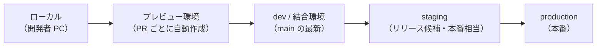

# リハーサルとステージング環境

[[MOC_リリース・デプロイ体系|📚 目次]] ｜ [[03_リリース手順書とチェックリスト|← 前へ]] ｜ [[05_凍結期間とメンテナンス窓|次へ →]]

> [!abstract] この記事で分かること
> - 環境の種類（開発 dev・ステージング staging・本番 production・プレビュー環境）と役割
> - 本番との「差分」（データ量・設定・外部連携）が事故を生む仕組み
> - リハーサルで確認すること（手順・所要時間・切り戻し）
> - 本番データを匿名化してステージングで使う方法と、Infrastructure as Code で環境差分を減らす方法
> - 「ステージングは本番ではない」という限界と、本番での段階的リリースが必要な理由
>
> **前提**：[[03_リリース手順書とチェックリスト]] を読んでいると理解しやすいです。

## 1. ひとことで言うと

ステージング環境は、演劇の **ゲネプロ（本番と同じ舞台・衣装・照明で行う通し稽古）** です。台本（手順書）どおりに動けるか、場面転換に何分かかるか、トラブル時にどう立て直すかを、お客さんのいない舞台で確かめます。ただし、満席の客席の熱気や咳払いまでは再現できません。だから初日（本番リリース）も、少しずつ客を入れながら（段階的リリースで）慎重に進めます。

- **ステージング環境（staging environment）**：本番にできるだけ似せた、リリース前の最終確認用の環境
- **リハーサル（rehearsal / dry run）**：本番と同じ手順書を、ステージングで実際に最後まで実行してみること
- 鉄則：**本番との差分が小さいほど、ステージングの確認は信頼できる**

## 2. 環境の種類



| 環境 | 目的 | データ | 本番との近さ | Shop での例 |
| --- | --- | --- | --- | --- |
| ローカル | 個人の開発 | ダミー | 低い | Docker Compose で API と PostgreSQL |
| プレビュー環境 | PR ごとの動作確認・レビュー | ダミー（シード） | 低〜中 | PR を作ると Next.js の確認用 URL が自動で発行される |
| dev（結合環境） | main の最新を常に動かす | ダミー | 中 | 小さな構成の Kubernetes 名前空間 |
| staging | リリース候補の最終確認・リハーサル | 匿名化した本番コピー | 高い | 本番と同じ Terraform モジュール・同じ Pod 構成 |
| production | お客様が使う | 本物 | — | ALB の後ろで 4 Pod、本番 PostgreSQL |

**プレビュー環境（preview environment / ephemeral environment）** は、プルリクエストごとに一時的な環境を自動で作り、マージ後に消す仕組みです。Vercel や Netlify のようなフロントエンド向けホスティングではよく使われ、Kubernetes でも PR ごとに名前空間を作る方法があります。レビューのしやすさは上がりますが、データや外部連携はダミーなので、リリース判定の代わりにはなりません。

## 3. 本番との差分が事故を生む

「ステージングでは動いたのに、本番で壊れた」の原因は、ほとんどが **環境の差分** です。

| 差分 | 起きる事故の例（Shop） |
| --- | --- |
| **データ量** | ステージングの `orders` は 1 万行、本番は 5,000 万行。インデックス作成のマイグレーションが本番だけ 40 分テーブルをロックした |
| **データの中身** | 本番には古いアプリが作った「クーポン列が NULL の注文」があり、新コードが NULL を想定せず 500 エラー |
| **設定** | 本番だけ環境変数 `COUPON_MAX_DISCOUNT` が未設定。ステージングでは手で入れていた |
| **構成・規模** | ステージングは 1 Pod なので、Pod 間でキャッシュがずれる問題が出なかった |
| **外部連携** | 決済代行のサンドボックスは即時応答、本番は混雑時に 3 秒かかりタイムアウト |
| **バージョン** | ステージングの PostgreSQL は 17、本番は 16。使った SQL 関数が本番にない |
| **トラフィック** | ステージングでは同時アクセスがほぼゼロで、ロック競合が再現しなかった |

The Twelve-Factor App も「**開発・本番一致（Dev/prod parity）**」として、時間・担当者・ツールの差を小さく保つことを勧めています。特に「ローカルは SQLite、本番は PostgreSQL」のように **種類の違うバックエンドを使うこと** は避けるべきだとしています。

> [!warning] いちばん危ないのは「手で直した差分」
> 「ステージングで動かなかったので、サーバーに入って設定を手で変えた」は、本番との差分を黙って増やします。手で直したら、必ずコード（IaC・マニフェスト）にも反映します。

## 4. リハーサルで確認すること

リハーサルは「動くか」だけでなく、**手順書そのものが正しいか** を確かめる場です。

```mermaid
gantt
    title Shop API v2.8.0 リハーサル（ステージング）
    dateFormat HH:mm
    axisFormat %H:%M
    section 準備
    ステージングを本番相当に同期     :a1, 14:00, 20m
    section 本番と同じ手順
    手順 1〜6 を手順書どおり実行     :a2, after a1, 15m
    確認項目のチェック               :a3, after a2, 10m
    section 切り戻し
    切り戻し手順を実行               :a4, after a3, 10m
    切り戻し後の確認                 :a5, after a4, 5m
    section 振り返り
    手順書の修正                     :a6, after a5, 15m
```



| 確認すること | 具体的に見る点 |
| --- | --- |
| **手順** | 手順書を **書いた人以外** が、書かれたとおりに実行できるか。省略された前提（権限・ツール）はないか |
| **所要時間** | 各ステップの実測値。手順書の所要時間を実測で更新する。特にマイグレーションの時間 |
| **期待結果** | 書かれた期待結果が実際の出力と一致するか（メッセージの文言、Pod 数） |
| **切り戻し** | 実際に戻してみて、元の状態に戻るか。所要時間は何分か。データは壊れないか |
| **監視** | ダッシュボードとアラートが新バージョンの指標を拾えているか |

> [!tip] 切り戻しは「必ず」リハーサルする
> 実行手順は毎回使うので自然と磨かれますが、切り戻し手順は使う機会が少なく、いざというときに動かないことが多いです。「戻せることを確認した」をリリース判定の条件に入れておきます（[[02_リリース可否の基準とGo-No-Go判断]]）。

### マイグレーションの所要時間を本番相当で測る

データ量の差による事故を防ぐには、本番に近い量のデータでマイグレーションを試すのがいちばん確実です。

```bash
# ステージング（本番の匿名化コピー）で、実行時間とロックを測る
psql "$STAGING_DATABASE_URL" -c '\timing on' \
  -c "CREATE INDEX CONCURRENTLY idx_orders_coupon_id ON orders (coupon_id);"
```

`CREATE INDEX CONCURRENTLY` のようなロックを避ける書き方や、長時間かかる変更の進め方は [[07_ゼロダウンタイムのスキーマ変更]] と [[03_長時間DDLとデータ移行のリリース]] で扱います。

## 5. 本番データの匿名化コピー

本番に近いデータで試したい、でも個人情報をステージングに置くのは危険です。そこで **匿名化（anonymization）** したコピーを使います。

- **マスキング（masking）**：氏名・メール・住所・電話番号を、形式だけ保ったダミー値に置き換える
- **データ量と分布は保つ**：行数、NULL の割合、値の偏り（人気商品に注文が集中しているなど）は残す。これが本番再現の肝です
- **残してはいけないもの**：パスワードハッシュ、決済トークン、API キー、本番の外部サービスの接続先

PostgreSQL では拡張機能 **PostgreSQL Anonymizer** を使うと、列ごとにマスキングのルールを宣言できます（2026 年時点）。

```sql
-- ステージング用の匿名化ルール（PostgreSQL Anonymizer）
CREATE EXTENSION IF NOT EXISTS anon;

SECURITY LABEL FOR anon ON COLUMN users.name
  IS 'MASKED WITH FUNCTION anon.dummy_last_name()';
SECURITY LABEL FOR anon ON COLUMN users.email
  IS 'MASKED WITH FUNCTION anon.dummy_free_email()';
SECURITY LABEL FOR anon ON COLUMN users.phone
  IS 'MASKED WITH VALUE NULL';
```

この定義をもとに、匿名化済みのダンプを作ってステージングに流し込む、という流れを定期ジョブにしておくと、ステージングのデータが古くなりません。

> [!warning] 匿名化は法務・セキュリティと相談する
> 「名前を消したから大丈夫」とは限りません。郵便番号＋生年月日＋性別のような組み合わせで個人が特定できる場合もあります。どの列をどう扱うかは、社内の個人情報の方針に従って決めます。

## 6. Infrastructure as Code で環境差分をなくす

**Infrastructure as Code（IaC）** は、サーバーやネットワーク、DB などの構成をコードで書き、同じコードから環境を作る方法です。環境ごとの違いを **変数ファイルに閉じ込める** ことで、「どこが違うか」がコードの差分として見えるようになります。

```
infra/
├── modules/shop/          # ALB・ECS/EKS・RDS などの定義（全環境で共通）
└── envs/
    ├── staging.tfvars     # 環境ごとの違いだけを書く
    └── production.tfvars
```

```hcl
# envs/staging.tfvars
env               = "staging"
api_replicas      = 4               # 本番と同じ台数にしておく
db_instance_class = "db.r6g.large"  # 本番より小さくするなら、性能差を理解した上で
postgres_version  = "16"            # バージョンは本番と必ず揃える
payment_endpoint  = "https://sandbox.payment.example.com"
```

```bash
# 同じモジュールを、変数ファイルだけ変えて適用する
terraform plan  -var-file=envs/staging.tfvars
terraform apply -var-file=envs/staging.tfvars
```

- アプリの設定（環境変数）も、Kubernetes の ConfigMap や Kustomize の overlay などでコード管理する
- **「本番とステージングの `.tfvars` の差分」がそのまま環境差分の一覧になる**。レビューで「なぜここが違うのか」を説明できない差分は消す
- コストの都合でステージングを小さくするのは現実的な判断ですが、その場合は「性能はステージングでは保証できない」と判定基準に明記します

## 7. 「ステージングは本番ではない」という限界

どれだけ似せても、ステージングでは再現できないものがあります。

- **本物のユーザーの行動**：想定外の入力、古いモバイルアプリからのリクエスト、ブラウザ拡張
- **本物のトラフィック**：ピーク時の同時アクセス、ボット、地域ごとの偏り
- **本物の外部サービス**：決済代行・配送業者の本番の応答時間やエラー
- **長い時間で現れる問題**：メモリリーク、日付をまたぐ処理、月末の締め処理

だから、ステージングでの確認は **「本番で試してもよい状態か」を判断する材料** と位置づけます。最後の確認は、本番で小さく始めて広げる段階的リリースで行います。

```
ステージング               本番
┌──────────────┐          ┌───────────────────────────────────┐
│ 手順・時間・  │  Go →   │ 社員のみ → 1% → 5% → 25% → 100%  │
│ 切り戻しの確認 │          │ （各段階で指標を見て、悪ければ戻す） │
└──────────────┘          └───────────────────────────────────┘
  「出してよいか」を確かめる   「本当に大丈夫か」を小さく確かめる
```

- [[05_カナリアリリース]]：一部のサーバー・トラフィックだけに新バージョンを出す
- [[06_フィーチャーフラグ]]：コードは全台に出し、機能だけを一部のユーザーに ON にする
- [[07_シャドウデプロイとダークローンチ]]：本番トラフィックを複製して、ユーザーに影響なく新バージョンを試す

## よくある誤解・つまずき

- ❌ 「ステージングで全部確認したから、本番は一気に出してよい」
  ✅ ステージングでは本物のユーザー・トラフィック・外部連携を再現できません。本番でも段階的に広げます。
- ❌ 「ステージングは安く済ませるため、DB も小さいものとダミーデータで十分」
  ✅ データ量と分布の差は、マイグレーション事故の最大の原因です。少なくともリリース前のリハーサルは本番相当のデータで行います。
- ❌ 「本番データをそのままコピーすれば本番を再現できる」
  ✅ 個人情報や秘密情報を持ち込む危険があります。匿名化し、外部サービスの接続先も必ず切り替えます。
- ❌ 「プレビュー環境があるからステージングは不要」
  ✅ プレビュー環境は PR 単位の確認用で、データも構成も本番とは違います。リリース候補をまとめて確認する場は別に必要です。

## まとめ

- 環境はローカル → プレビュー → dev → staging → production と、本番に近づくほど確認の信頼度が上がる
- 事故の原因の多くは、データ量・データの中身・設定・外部連携・バージョンなどの環境差分
- リハーサルでは手順・所要時間・期待結果・切り戻しを実際に確かめ、手順書を実測で更新する
- 本番データは匿名化してから使い、量と分布は保つ
- IaC で同じコードから環境を作り、差分は変数ファイルに閉じ込めて見える化する
- ステージングは「出してよいか」の判断材料。最終確認は本番での段階的リリースで行う

## 確認クイズ

1. ステージングでは 2 秒で終わったマイグレーションが、本番では 40 分かかってしまいました。最も考えられる原因と対策は何ですか？
> [!tip]- 答え
> データ量の差です。ステージングのテーブルが小さかったため問題が見えませんでした。本番相当の行数を持つ匿名化コピーでリハーサルして所要時間を実測し、必要ならロックを避ける方法（`CONCURRENTLY` など）や段階的な移行に変えます。

2. リハーサルで「切り戻し」まで実施すべき理由は何ですか？
> [!tip]- 答え
> 切り戻し手順は普段使わないため、権限不足やコマンドの誤り、データが戻らないといった問題に気づきにくいからです。障害中に初めて試すのは危険なので、事前に実行して所要時間と結果を確かめます。

3. IaC を使うと、環境差分の管理はどう楽になりますか？
> [!tip]- 答え
> 共通のモジュールから全環境を作り、違いを変数ファイルだけに閉じ込めるので、ステージングと本番の差分がコードの差分として一覧できます。手作業による「見えない差分」も生まれにくくなります。

## 関連ノート

- [[03_リリース手順書とチェックリスト]] — リハーサルで試す手順書
- [[05_カナリアリリース]] — 本番で小さく始める方法
- [[06_フィーチャーフラグ]] — 機能単位で段階的に公開する
- [[07_シャドウデプロイとダークローンチ]] — ユーザーに影響を出さずに本番で試す
- [[07_ゼロダウンタイムのスキーマ変更]] — 本番相当データで試すべき DB 変更の書き方
- [[03_長時間DDLとデータ移行のリリース]] — 時間のかかる DB 変更のリリース
- [[本番向けベストプラクティス]] — コンテナを本番で動かす際の注意
- [[MOC_CI-CD体系]] — CI/CD とプレビュー環境

## 参考

- [The Twelve-Factor App - X. Dev/prod parity](https://12factor.net/dev-prod-parity)
- [PostgreSQL Anonymizer ドキュメント](https://postgresql-anonymizer.readthedocs.io/)
- [Terraform - Input Variables（変数ファイル）](https://developer.hashicorp.com/terraform/language/values/variables)
- [Google SRE Book - Release Engineering](https://sre.google/sre-book/release-engineering/)
