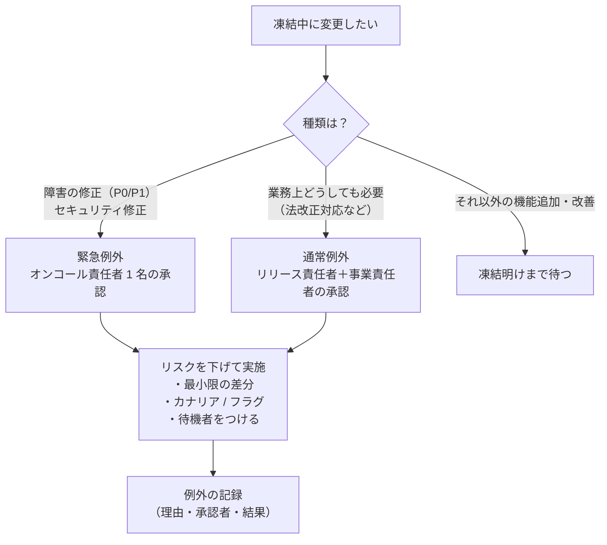
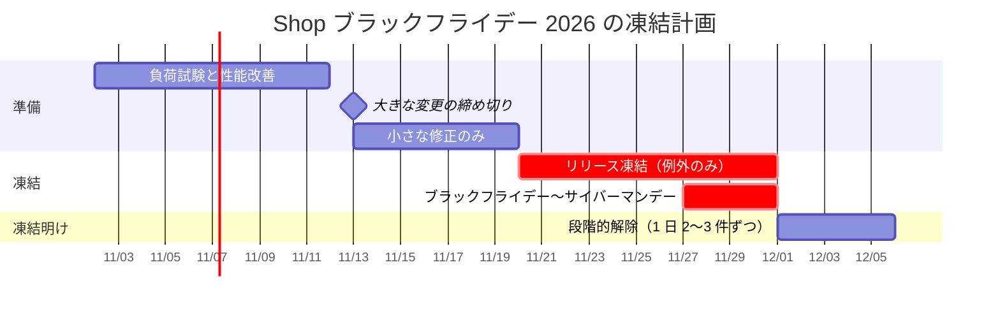

# 凍結期間とメンテナンス窓

[[MOC_リリース・デプロイ体系|📚 目次]] ｜ [[04_リハーサルとステージング環境|← 前へ]] ｜ [[01_ロールバック戦略|次へ →]]

> [!abstract] この記事で分かること
> - リリース凍結（年末・大型セール・決算期など）の目的と、変更が溜まることによる副作用
> - 凍結中にどうしても出したい変更を通す「例外承認プロセス」
> - メンテナンス窓（計画停止の時間枠）の設計：告知・時間帯・SLA/SLO への影響
> - 計画停止そのものを減らしていく方向性
> - Shop のブラックフライデー凍結の具体例
>
> **前提**：[[02_リリース可否の基準とGo-No-Go判断]]、[[01_SLI・SLOの設計]] を読んでいると理解しやすいです。

## 1. ひとことで言うと

**リリース凍結** は、デパートが年末商戦の間は売り場の改装工事をしないのと同じです。いちばん稼ぐ時期・いちばん人が多い時期に、わざわざ工事の事故リスクを持ち込まない、という判断です。一方の **メンテナンス窓** は、「毎月第 2 火曜の深夜 2〜4 時は改装工事の時間」と決めて、事前にお客様へ知らせておく枠です。

- **リリース凍結（release freeze / change freeze）**：一定期間、本番への変更を原則として止めること
- **メンテナンス窓（maintenance window）**：計画的な作業や停止を行ってよいと、あらかじめ決めて告知した時間枠
- どちらも「リスクを避ける時間」と「リスクを取る時間」を分ける道具です。ただし、使い方を誤ると逆に危険を増やします

## 2. リリース凍結の目的

凍結期間を設ける主な理由は次のとおりです。

| 凍結の例 | 理由 |
| --- | --- |
| **年末年始** | 担当者が休暇で手薄になり、障害時の対応が遅れる。外部サービス側も体制が薄い |
| **大型セール**（ブラックフライデーなど） | 売上と負荷が最大。1 時間の障害の損失が普段の何倍にもなる |
| **決算期・監査期間** | 会計データや請求処理の正確さが特に求められる。変更履歴の説明責任も重い |
| **大型イベント・キャンペーン** | テレビ放映や広告で一時的にアクセスが急増する |
| **エラーバジェット枯渇時** | 信頼性が SLO を下回っているので、回復するまで機能追加を止める（[[03_エラーバジェット方針]]） |

凍結の本質は、**「変更」が障害の大きな原因である** という事実です。変更しなければ、少なくとも変更による障害は起きません。

## 3. 凍結の副作用：凍結明けが危ない

凍結には見落とされがちな副作用があります。**凍結中も開発は止まらない** ので、出せない変更が溜まっていきます。

```
変更の溜まり具合
  ▲
  │                      ┌─────┐
  │                   ┌──┘     │ ← 凍結明け初日に 3 週間分をまとめて出す
  │                ┌──┘        │   ＝ 巨大なバッチサイズ
  │             ┌──┘           │
  │          ┌──┘              │
  │ ▪ ▪ ▪ ▪ ┘                 └ ▪ ▪ ▪ ▪
  └──────────┬────────────────┬──────────▶ 時間
          凍結開始          凍結明け
```

- **凍結明けに変更がまとめて出る**：1 回のリリースが大きくなり、原因特定も切り戻しも難しくなる（[[01_リリースサイクルとブランチ戦略]] のバッチサイズの話）
- **凍結前の駆け込み**：「凍結に間に合わせたい」と、十分に確認していない変更が凍結直前に集中する。凍結直前こそ事故が多い、ということが起きがちです
- **手順の錆びつき**：数週間リリースしないと、手順や権限が変わっていても気づかない
- **緊急修正が出しにくい**：「凍結中だから」と、出すべきセキュリティ修正まで遅れる

### 副作用を抑える工夫

1. **凍結期間を必要最小限にする**：「11 月まるごと」ではなく「セール前日〜セール終了翌日」など
2. **駆け込み締め切りを凍結の数日前に置く**：凍結直前の 2〜3 日は「小さな修正のみ」とし、大きな変更は早めに出し切る
3. **凍結明けは段階的に解除する**：初日は溜まった変更を 1 つずつ、小さい順に出す。全部を一度にまとめない
4. **フィーチャーフラグで「デプロイ」と「公開」を分ける**：凍結前にコードはデプロイしておき、凍結明けにフラグを順に ON にする（[[06_フィーチャーフラグ]]）
5. **凍結の対象を絞る**：決済・注文など重要な経路だけを凍結し、社内ツールや文言修正は通常どおり出す、という段階的な凍結もあり得ます

## 4. 例外承認プロセス

凍結中でも、出さないほうが危険な変更はあります。その道を事前に用意しておきます。



申請には次の項目を書いてもらいます。

```markdown
## 凍結中の変更申請
- 変更内容：注文確定 API の在庫引当てで二重引当てが起きるバグの修正（PR #1302）
- 区分：緊急例外（P1 障害の修正）
- 出さない場合の影響：セール中、1 時間あたり約 20 件の在庫ずれが発生し続ける
- 変更の大きさ：1 ファイル・12 行。DB 変更なし
- リスク低減策：カナリア 1 Pod で 15 分観察 → 全台。フラグで旧ロジックに戻せる
- 切り戻し方法：フラグ `inventory-v2` を OFF（即時）／`rollout undo`（約 5 分）
- 実施者・待機者：佐藤（実施）、高橋（SRE 待機）
- 承認者：山田（リリース責任者）、木村（EC 事業責任者）
```

- 承認者を **事前に名前で決めておく**（深夜・休日にも連絡がつく人）
- 例外は必ず記録し、凍結明けのふりかえりで「例外が多すぎなかったか」「凍結の範囲は適切だったか」を見直す
- Google SRE ワークブックのエラーバジェット方針の例でも、凍結中の例外として「P0 の問題とセキュリティ修正」を挙げています

## 5. メンテナンス窓の設計

**メンテナンス窓** は、停止や性能低下を伴う作業（DB のメジャーバージョンアップ、大きなデータ移行、ネットワーク機器の交換など）を行う時間枠です。

### 5.1 時間帯を決める

- **トラフィックが最も少ない時間**を、実データで選ぶ（Shop なら火〜木の深夜 2〜5 時など）。「深夜なら空いているはず」と思い込まず、アクセス数のグラフを確認する
- **担当者が対応できる時間** であること。疲れた深夜作業はミスの元なので、可能なら早朝や平日昼の少ない時間帯も検討する
- **海外ユーザー・外部連携** がある場合は、相手のピーク時間や相手側のメンテナンス窓と重ならないようにする
- **決まった枠（定期）** にしておくと、ユーザーも社内も予定を立てやすい（例：毎月第 2 火曜 2:00〜4:00）

### 5.2 告知する

| タイミング | 相手 | 内容 |
| --- | --- | --- |
| 1〜2 週間前 | お客様（サイト上のお知らせ、メール）、取引先 | 日時、影響（停止 or 一部機能の制限）、代替手段 |
| 前日 | 社内・CS | 手順書、体制、問い合わせへの回答例 |
| 開始時・終了時 | お客様（ステータスページ）、社内 | 開始・完了・延長のお知らせ |

作業中のサイトには、メンテナンス中であることを示すページを出し、HTTP ステータスは **503 Service Unavailable** と、再開見込みを伝える `Retry-After` ヘッダーを返すのが一般的です。検索エンジンやクライアントに「一時的な停止」であることが伝わります。

```nginx
# メンテナンス中フラグファイルがあれば 503 を返す（nginx の例）
location / {
    if (-f /etc/nginx/maintenance.on) {
        return 503;
    }
    proxy_pass http://shop_frontend;
}
error_page 503 @maintenance;
location @maintenance {
    add_header Retry-After 7200 always;
    root /usr/share/nginx/html;
    rewrite ^ /maintenance.html break;
}
```

### 5.3 SLA / SLO への影響

- **SLA（Service Level Agreement）**：お客様と契約で約束する水準。多くの SLA は「事前告知した計画メンテナンスは稼働率の計算から除く」と定めていますが、**契約書に書いてある場合だけ** です。自社の SLA の文言を必ず確認します
- **SLO（Service Level Objective）**：社内の目標。計画停止を SLO の計算に含めるかどうかはチームの方針次第です。ユーザーから見れば計画停止も「使えない時間」なので、**含めて数える** チームも少なくありません
- 例：月間 SLO 99.9% の許容停止時間は約 43 分です。2 時間のメンテナンス窓を SLO に含めると、それだけで予算を大きく超えます。「計画停止を減らすべき理由」が数字で見えるようになります

## 6. 計画停止を減らす方向性

メンテナンス窓は便利ですが、**「止めてよい時間がある」こと自体が、止めずに済む設計の工夫を遅らせる** 面があります。世界中にユーザーがいれば「誰も使っていない時間」は存在しません。

| 以前は停止していた作業 | 停止しない方法 |
| --- | --- |
| アプリの入れ替え | ローリングアップデート、Blue-Green（[[08_ゼロダウンタイムデプロイの条件]]） |
| DB のスキーマ変更 | Expand-Contract（[[02_Expand-Contractのリリース計画]]、[[07_ゼロダウンタイムのスキーマ変更]]） |
| 大量データの移行 | 小分けにしたバックグラウンド移行（[[03_長時間DDLとデータ移行のリリース]]） |
| DB のバージョンアップ | レプリカを先に上げて切り替える、Blue-Green 型の DB 切り替え機能を使う |

目標は「メンテナンス窓をゼロにする」ことではなく、**メンテナンス窓を使う作業を年に数回の本当に必要なものだけに減らしていく** ことです。

## 7. Shop のブラックフライデー凍結例

2026 年のブラックフライデーは 11 月 27 日（金）です。Shop では次のように計画しました。



| 期間 | ルール |
| --- | --- |
| 11/2〜11/12 | 負荷試験。想定ピーク（平常時の 8 倍）で注文確定 API の p95 が 300ms 以下か確認。足りなければ性能改善と Pod 数の上限見直し |
| 11/13 | 大きな変更の締め切り。クーポン機能はここまでに全ユーザーへ公開済みにする |
| 11/13〜11/19 | 小さな修正のみ。DB のスキーマ変更は禁止 |
| 11/20〜11/30 | **リリース凍結**。緊急例外（P0/P1・セキュリティ）のみ。事前に Pod 数を増やしておき、オートスケールの上限も引き上げる |
| 11/27〜11/30 | セール本番。オンコールを 2 名体制に。ダッシュボードを常時表示 |
| 12/1〜12/5 | 段階的解除。溜まった変更を小さい順に 1 日 2〜3 件ずつ出す。12/1 午前はふりかえり |

GitHub Actions では、凍結期間中に本番デプロイのジョブが動かないようにしておくと、うっかり事故を防げます。

```yaml
# .github/workflows/release.yml（抜粋）
jobs:
  freeze-check:
    runs-on: ubuntu-latest
    steps:
      - name: リリース凍結期間の確認
        env:
          FREEZE_START: "2026-11-20"
          FREEZE_END: "2026-11-30"
          # 例外承認済みの PR には "freeze-exception" ラベルを付ける運用
          HAS_EXCEPTION: ${{ contains(github.event.pull_request.labels.*.name, 'freeze-exception') }}
        run: |
          today=$(TZ=Asia/Tokyo date +%F)
          if [[ "$today" > "$FREEZE_START" || "$today" == "$FREEZE_START" ]] \
             && [[ "$today" < "$FREEZE_END" || "$today" == "$FREEZE_END" ]] \
             && [[ "$HAS_EXCEPTION" != "true" ]]; then
            echo "::error::リリース凍結期間中です（${FREEZE_START}〜${FREEZE_END}）。例外承認を得てください。"
            exit 1
          fi

  deploy-production:
    needs: freeze-check
    environment: production
    runs-on: ubuntu-latest
    steps:
      - run: echo "本番へデプロイ"
```

> [!note] ラベルによる例外の扱い
> この例は、プルリクエストのマージをきっかけに動くワークフローを想定しています。タグの push で動く場合は PR のラベルを参照できないため、凍結期間の定義をリポジトリの変数（`vars`）に置き、例外時は Environment の承認者が判断する、などの方法に置き換えます。

## よくある誤解・つまずき

- ❌ 「凍結期間は長いほど安全」
  ✅ 凍結が長いほど変更が溜まり、凍結明けのリリースが大きく危険になります。期間は最小限にし、明けは段階的に解除します。
- ❌ 「凍結中は一切何も出してはいけない」
  ✅ セキュリティ修正や重大な障害の修正は、出さないほうが危険です。例外承認の道を事前に用意しておきます。
- ❌ 「計画メンテナンスなら SLA に影響しない」
  ✅ 除外されるのは契約にそう書いてある場合だけです。ユーザーにとっては計画停止も「使えない時間」です。
- ❌ 「深夜ならユーザーはいない」
  ✅ 実際のアクセスデータで確かめます。海外ユーザーや外部連携のバッチが深夜に動いていることもあります。

## まとめ

- リリース凍結は、繁忙期や体制が薄い時期に「変更による障害」を避けるための仕組み
- 凍結には、駆け込みリリースと凍結明けの大量リリースという副作用がある。期間を絞り、締め切りを前倒しし、明けは段階的に解除する
- 凍結中の例外は、区分・承認者・リスク低減策・切り戻し方法を決めた申請で通し、必ず記録する
- メンテナンス窓は、実データに基づく時間帯選び、段階的な告知、503 と Retry-After による一時停止の表示で設計する
- SLA・SLO で計画停止をどう扱うかを明確にし、ゼロダウンタイムの技術で計画停止そのものを減らしていく

## 確認クイズ

1. 凍結期間を 1 か月から 2 週間に短くすると、どんな良い点がありますか？
> [!tip]- 答え
> 凍結中に溜まる変更が減り、凍結明けのリリースが小さくなります。手順の錆びつきも起きにくく、緊急でない改善もユーザーに早く届けられます。

2. 凍結中に重大なセキュリティ脆弱性の修正が必要になりました。どう進めますか？
> [!tip]- 答え
> 事前に決めた緊急例外のプロセスで承認を得て、差分を最小限にし、カナリアやフラグでリスクを下げ、待機者をつけて実施します。理由・承認者・結果は記録し、凍結明けのふりかえりで見直します。

3. 月間 SLO 99.9% のサービスで、毎月 2 時間のメンテナンス窓を設けると何が問題になりますか？
> [!tip]- 答え
> 99.9% の月間許容停止時間は約 43 分なので、計画停止を SLO に含めるなら、それだけで予算を大きく超えます。計画停止の扱いを方針として明確にし、ゼロダウンタイムの手法で停止を減らすことを検討します。

## 関連ノート

- [[01_リリースサイクルとブランチ戦略]] — バッチサイズとリスクの関係
- [[02_リリース可否の基準とGo-No-Go判断]] — 凍結・エラーバジェットを判定に組み込む
- [[03_エラーバジェット方針]] — エラーバジェット枯渇時の凍結
- [[08_ゼロダウンタイムデプロイの条件]] — 計画停止を減らすための条件
- [[02_Expand-Contractのリリース計画]] — 止めずに DB を変える計画
- [[01_SLI・SLOの設計]] — SLO の設計と計画停止の扱い
- [[05_信頼性とスピードの両立]] — 凍結と開発スピードのバランス
- [[01_ロールバック戦略]] — 次の章：問題が起きたときの戻し方

## 参考

- [Google SRE Workbook - Example Error Budget Policy](https://sre.google/workbook/error-budget-policy/)
- [Google SRE Book - Release Engineering](https://sre.google/sre-book/release-engineering/)
- [MDN - 503 Service Unavailable](https://developer.mozilla.org/en-US/docs/Web/HTTP/Reference/Status/503)
- [MDN - Retry-After](https://developer.mozilla.org/en-US/docs/Web/HTTP/Reference/Headers/Retry-After)
- [Martin Fowler - Frequency Reduces Difficulty](https://martinfowler.com/bliki/FrequencyReducesDifficulty.html)
