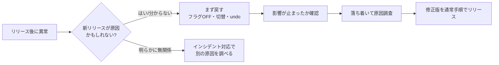

# ロールバック戦略

[[MOC_リリース・デプロイ体系|📚 目次]] ｜ [[05_凍結期間とメンテナンス窓|← 前へ]] ｜ [[02_ロールフォワード（前方修正）|次へ →]]

> [!abstract] この記事で分かること
> - ロールバック（rollback）の主な手段 6 つと、それぞれの「速さ」と「確実さ」
> - Kubernetes / Amazon ECS / Vercel / Netlify で実際に戻す操作
> - ロールバックを「いつでもできる」状態にしておくための 3 つの前提
> - Google SRE の「まず戻してから調べる」という原則とその理由
>
> **前提**：[[02_デプロイ戦略の全体像と選び方]]、[[04_Blue-Greenデプロイ]]、[[06_フィーチャーフラグ]] を読んでいると理解しやすいです。

## 1. ひとことで言うと

ロールバックは **「さっきまで正常に動いていた状態に戻すこと」** です。
例えるなら、文書作成ソフトの「元に戻す（Ctrl+Z）」です。新しく書いた段落がおかしいと気づいたら、まず Ctrl+Z で元に戻し、落ち着いてから書き直しますよね。本番サービスでも同じで、新しいリリースで障害が起きたら **原因を突き止める前に、まず正常だった状態に戻す** のが基本です。

ただし本番環境の Ctrl+Z は、ソフトのように 1 種類ではありません。「どこを戻すか（コード？トラフィック？設定？）」によって手段が変わり、速さも確実さも違います。この記事では、その手段を一覧にして、事前に何を用意しておけばよいかを整理します。

> [!note] 要点
> - ロールバック ＝ 既知の正常状態（known-good state）へ戻すこと
> - 手段は複数あり、**速い順に用意しておき、速いものから使う**
> - 戻せるかどうかは「障害が起きる前」の準備で決まる

## 2. ロールバックの手段一覧

Shop の「注文確定 API にクーポン機能を追加する」リリース（v1.8.0）で、注文確定のエラー率が急上昇したとします。戻し方は次の 6 通りが考えられます。

| # | 手段 | 何を戻すか | 速さの目安 | 確実さ | 使える条件 |
|---|---|---|---|---|---|
| 1 | フィーチャーフラグ OFF | 機能の有効/無効だけ | 数秒〜数十秒 | 高（コードは無変更） | その機能がフラグで包まれている |
| 2 | トラフィック切替（Blue-Green） | ロードバランサーの向き先 | 数秒〜1 分 | 高（旧環境がまだ生きている） | 旧環境（Blue）を残している |
| 3 | カナリア中止（abort） | 新バージョンへ流す割合 | 数秒〜数分 | 高 | カナリア中で全台に広がる前 |
| 4 | 前のアーティファクトを再デプロイ | 動いているバイナリ/イメージ | 数分〜十数分 | 中〜高 | 前のイメージがレジストリに残っている |
| 5 | git revert して再デプロイ | ソースコード | 十数分〜数十分（CI 次第） | 中（新しいビルドになる） | CI/CD が動く |
| 6 | 設定の巻き戻し | 環境変数・設定ファイル・インフラ設定 | 手段による | 中 | 設定がバージョン管理されている |

### 2.1 速さと確実さのイメージ

```
速い ◀──────────────────────────────────────────────▶ 遅い
 フラグOFF   トラフィック切替   カナリア中止   前イメージ再デプロイ   git revert→CI→デプロイ
  (秒)         (秒〜分)          (秒〜分)         (分)                   (十数分〜)

確実さ：「すでに本番で動いていた物」に戻すほど高い
        ・フラグOFF / 切替 / 再デプロイ → 実績のある物に戻る
        ・git revert → "新しくビルドした物" なので、ビルドの差で別の問題が出る余地がある
```

ポイントは 2 つです。

- **速さ**：ビルドやテストを経由しない手段ほど速い。フラグやロードバランサーの切替は「すでにある物の使い方を変えるだけ」なので秒単位です。
- **確実さ**：**本番で実際に動いていたアーティファクト（成果物）** に戻す手段ほど確実です。`git revert` は「直前のコードと同じ内容をもう一度ビルドする」ので、依存ライブラリの解決結果やベースイメージが変わっていれば、厳密には前と同じ物になりません。

### 2.2 各手段の中身

**① フィーチャーフラグ OFF**
クーポン機能が `coupon-on-checkout` のようなフラグで包まれていれば、管理画面で OFF にするだけで旧ロジックに戻ります。デプロイ自体はそのままなので、最速です。詳しくは [[06_フィーチャーフラグ]]。

**② トラフィック切替（Blue-Green）**
旧環境（Blue）を残しておき、ALB のリスナールールやターゲットグループの重みを Blue に戻します。旧環境が「温まった」状態で待機しているので速く確実ですが、旧環境を残しておく費用がかかります。詳しくは [[04_Blue-Greenデプロイ]]。

**③ カナリア中止**
新バージョンにまだ 5% だけ流している段階なら、カナリアを中止して 0% に戻します。影響を受けたのは一部のユーザーだけで済みます。詳しくは [[05_カナリアリリース]]。

**④ 前のアーティファクトを再デプロイ**
コンテナイメージ `shop-api:1.7.3` をもう一度デプロイします。Kubernetes の `kubectl rollout undo` や ECS で前のタスク定義リビジョンを指定するのがこれです。

**⑤ git revert して再デプロイ**
問題のコミットを打ち消すコミットを作り、通常のパイプラインで流します。履歴が残るので監査上は分かりやすいですが、CI の時間ぶん遅くなります。どうしても④が使えないときや、④で戻した後に「ソースの状態」も揃えるために使うのが一般的です。

**⑥ 設定の巻き戻し**
原因がコードではなく設定（タイムアウト値、接続先、環境変数、IaC の変更）にある場合です。設定も Git で管理し、コードと同じように「前のバージョンに戻せる」ようにしておく必要があります。

## 3. 実際の戻し方（ツール別）

### 3.1 Kubernetes Deployment：`kubectl rollout undo`

Kubernetes の Deployment は、Pod テンプレート（`.spec.template`）が変わるたびに「リビジョン」を記録し、古い ReplicaSet を残しておきます。これを使って戻します。

```bash
# 履歴を確認（どのリビジョンが何か）
kubectl rollout history deployment/shop-api

# リビジョン 7 の中身を確認
kubectl rollout history deployment/shop-api --revision=7

# 直前のリビジョンへ戻す
kubectl rollout undo deployment/shop-api

# 特定リビジョンへ戻す
kubectl rollout undo deployment/shop-api --to-revision=7

# 戻り切ったか確認
kubectl rollout status deployment/shop-api
```

```yaml
apiVersion: apps/v1
kind: Deployment
metadata:
  name: shop-api
spec:
  replicas: 4
  revisionHistoryLimit: 10   # 残す古い ReplicaSet の数（既定値 10）。0 にすると undo できない
  template:
    spec:
      containers:
        - name: shop-api
          image: registry.example.com/shop-api:1.8.0
```

> [!warning] 注意点
> - リビジョンが作られるのは **Pod テンプレートが変わったときだけ** です。レプリカ数の変更などは記録されず、undo で戻るのも Pod テンプレート部分だけです（Kubernetes 公式ドキュメント）。
> - ConfigMap や Secret を「別リソース」として書き換えた場合、それは undo の対象外です（⑥設定の巻き戻しが別途必要）。
> - GitOps（Argo CD など）を使っている場合、`kubectl rollout undo` で戻しても、Git の内容と食い違うため自動同期で再び新バージョンに戻される可能性があります。**GitOps では Git 側を戻す（revert）か、同期を一時停止する** のが正しい手順です。

Argo Rollouts でカナリア中なら `kubectl argo rollouts abort shop-api` で中止できます。中止すると旧 ReplicaSet に戻りますが、`spec.template` は新バージョンのままなので、完全に戻すにはマニフェスト側も旧バージョンに戻す必要があります（Argo Rollouts 公式ドキュメント）。

### 3.2 Amazon ECS：前のタスク定義 / サーキットブレーカー

手動で戻すなら、前のタスク定義リビジョンを指定してサービスを更新します。

```bash
# shop-api:41 が 1 つ前の正常なリビジョンだとする
aws ecs update-service \
  --cluster shop \
  --service shop-api \
  --task-definition shop-api:41
```

自動で戻すには **デプロイサーキットブレーカー（deployment circuit breaker）** を有効にします。タスクが起動しない・ヘルスチェックに落ち続ける場合に、デプロイを `FAILED` にし、直近の `COMPLETED` 状態のデプロイへ自動で戻します（ローリング更新＝`ECS` デプロイコントローラーのみ対応、2026 年時点）。

```bash
aws ecs update-service \
  --cluster shop --service shop-api \
  --deployment-configuration "deploymentCircuitBreaker={enable=true,rollback=true}"
```

サーキットブレーカーが見るのは「起動できるか・ヘルスチェックが通るか」までです。**「起動はするがクーポン計算が間違っている」ような業務的な不具合は検知できません**。メトリクスで判断する仕組みは [[03_ヘルスチェックと自動ロールバック]] で扱います。

### 3.3 Vercel / Netlify：Instant Rollback

フロントエンド（Next.js）を Vercel に置いている場合、**Instant Rollback** で過去の本番デプロイへ即座に向き先を戻せます。再ビルドしないので数秒で終わります。

- Pro / Enterprise プランでは過去に本番ドメインへ割り当てたデプロイならどれにでも、Hobby プランでは直前のデプロイにのみ戻せます（2026 年時点）。
- ロールバック後は **本番ドメインの自動割り当てが OFF** になり、main に push しても本番に出なくなります。直したら「Undo Rollback」または `vercel promote <deployment>` で通常状態へ戻します。
- 環境変数はロールバックされません（戻したデプロイのビルド時の値のまま動く）。外部 API や DB の変更も当然戻りません。

Netlify でも、Deploys 一覧から過去の成功デプロイを開いて **Publish deploy** を押せば、再ビルドなしで本番が切り替わります。続けて **Lock**（自動公開の停止）しておくと、後続の push で上書きされるのを防げます。

## 4. ロールバックを可能にする 3 つの前提

ロールバックは「障害が起きてから考える」ものではありません。次の 3 つが揃っていないと、いざというときに戻せません。

### 4.1 不変アーティファクト（immutable artifact）

一度ビルドしたイメージは **二度と中身を変えない** ことです。

- ❌ `shop-api:latest` を上書きし続ける → 「前の latest」はもう存在しない
- ✅ `shop-api:1.7.3` やコミット SHA タグ `shop-api:3f2a9c1` で push し、上書きしない（レジストリのタグ不変設定を有効にする。ECR なら Tag immutability）
- ✅ 古いイメージをライフサイクルポリシーで消しすぎない（少なくとも直近数リリース分は残す）

### 4.2 後方互換（backward compatibility）

新バージョンが行った変更を、**旧バージョンが受け入れられる** ことです。たとえば v1.8.0 が `orders` に `coupon_code` 列を追加し、そこに書き込んだとします。v1.7.3 に戻したとき、旧コードがその列の存在でエラーにならなければ戻せます。逆に v1.8.0 が列を削除していたら、旧コードはもう動きません。

これが成り立たない変更は [[03_ロールバックできない変更]] で詳しく扱います。Google の CRE チームも、スキーマ変更は「新スキーマも扱えるだけで機能は変えないリリース → スキーマ変更 → 新機能のリリース」の 3 段階に分けることで、各段階で単独に戻せるようにすると勧めています。

### 4.3 ロールバック手順の定期テスト

使ったことのない非常口は、いざというときに開きません。Google CRE の記事は「数週間ロールバックしていなければ、**理由がなくても一度ロールバックしてみる**」ことを勧めています。正常なときに試せば、互換性の罠や壊れた自動化を落ち着いて見つけられるからです。

具体的には次のようにします。

- ステージングで毎リリース「デプロイ → ロールバック → 再デプロイ」を流す（[[04_リハーサルとステージング環境]]）
- ランブック（[[02_ランブックの書き方]]）にコマンドを貼り、新人が手順どおりに実行できるか確認する
- ロールバックにかかった時間を記録し、目標（例：5 分以内）と比べる

## 5. 「まず戻してから調べる」の原則

Google は **「ロールバックは普通のこと（rollbacks are normal）」** という考え方をとっており、新しいリリースにエラーが見つかった、または疑わしいときは **まず戻し、調査はその後** に行います（Google Cloud CRE life lessons）。



なぜ「調べてから」ではいけないのでしょうか。

- **調査中も被害は続く**：原因の特定に 30 分かかれば、その 30 分間ずっと注文が失敗します。戻すのに 3 分なら、先に戻せば被害は 3 分で止まります。
- **戻せば調査の時間的プレッシャーが消える**：ユーザー影響が止まれば、ログやトレースを冷静に読めます。
- **戻すことで原因の切り分けにもなる**：戻して直れば「新リリースが原因」とほぼ確定し、戻しても直らなければ別の原因（インフラ、外部サービス）を疑えます。

> [!important] 文化として大切なこと
> ロールバックを「失敗」「誰かの責任」として扱うと、人は戻すのをためらいます。Google CRE の記事も、ロールバック要求はリリースした人への攻撃ではなく、ユーザーのために正しいことだと理解されている、と述べています。「戻した理由をコミットメッセージや記録に書く」ことさえすれば、誰でも気軽に戻せる雰囲気を作りましょう。

いつ戻すかの基準は [[04_ロールバック判断基準]]、戻さずに直す選択肢は [[02_ロールフォワード（前方修正）]] で扱います。

## よくある誤解・つまずき

❌ **誤解**：`git revert` すればいつでも元に戻せる
✅ **実際**：`git revert` が戻すのはソースコードだけです。DB に書かれたデータ、送ったメール、配布済みのアプリは戻りません。またビルドを経由するので遅く、ビルド結果が前と完全に同じとも限りません。

❌ **誤解**：`kubectl rollout undo` すれば設定も全部戻る
✅ **実際**：戻るのは Deployment の Pod テンプレートだけです。別リソースの ConfigMap / Secret、Service、Ingress などは戻りません。GitOps 環境では Git 側も戻さないと再同期で上書きされます。

❌ **誤解**：ロールバックは障害時だけ使う特別な操作
✅ **実際**：定期的に試していない手順は、本番の障害時に高確率で失敗します。普段から「戻す練習」をしておくことで、初めて信頼できる手段になります。

❌ **誤解**：原因が分かるまで戻すべきではない（戻すと証拠が消える）
✅ **実際**：ログ・メトリクス・トレースは残ります。必要なら戻す前に問題の Pod を 1 台だけ隔離（ラベルを外してロードバランサーから外す）して調べることもできます。ユーザー影響を止めることが最優先です。

## まとめ

- ロールバックは「既知の正常状態」へ戻すこと。手段はフラグ OFF・トラフィック切替・カナリア中止・前イメージ再デプロイ・git revert・設定巻き戻しの 6 つ
- ビルドを経由しない手段ほど速く、本番で動いていた物に戻す手段ほど確実
- `kubectl rollout undo`、ECS のサーキットブレーカー、Vercel / Netlify の Instant Rollback など、ツールごとに「何が戻り、何が戻らないか」を把握しておく
- 前提は「不変アーティファクト」「後方互換」「ロールバックの定期テスト」の 3 つ
- 新リリースが疑わしければ **まず戻してから調べる**。ロールバックを責めない文化を作る

## 確認クイズ

1. Shop API のコンテナイメージを毎回 `shop-api:latest` タグで上書き push しています。ロールバックの観点で何が問題でしょうか。
> [!tip]- 答え
> 前のバージョンのイメージを特定できなくなる（タグが新しい物に付け替えられる）ため、「前のアーティファクトを再デプロイ」が確実にできません。バージョン番号やコミット SHA のタグで push し、上書きを禁止する（タグ不変設定）ことで、いつでも同じ物に戻せるようにします。

2. Vercel で Instant Rollback した後、修正コミットを main に push しましたが本番に反映されません。なぜでしょうか。
> [!tip]- 答え
> Instant Rollback をすると、本番ドメインの自動割り当てが OFF になるためです。修正版のデプロイを「Undo Rollback」や `vercel promote` で昇格させると、通常の自動反映に戻ります。

3. 注文エラー率が急上昇し、直前にリリースがありました。原因はまだ分かりません。最初にとるべき行動は何で、その理由は何でしょうか。
> [!tip]- 答え
> まずロールバック（フラグ OFF やトラフィック切替など最速の手段）を行います。調査中も被害は続くため、先に影響を止めた方が損害が小さく、戻して直るかどうかで原因の切り分けもできるからです。

## 関連ノート

- [[02_ロールフォワード（前方修正）]] — 戻さずに直す選択肢
- [[03_ロールバックできない変更]] — そもそも戻せない変更と事前対策
- [[04_ロールバック判断基準]] — いつ戻すかを事前に決める
- [[04_Blue-Greenデプロイ]] / [[05_カナリアリリース]] / [[06_フィーチャーフラグ]] — 速いロールバックを可能にするデプロイ戦略
- [[03_ヘルスチェックと自動ロールバック]] — ロールバックの自動化
- [[03_マイグレーションの実行とロールバック]] — DB マイグレーション側のロールバック
- [[10-Kubernetes]] — Kubernetes の基本
- [[01_デプロイ直後の異常]] — SRE 側から見たデプロイ起因の障害対応

## 参考

- [Deployments | Kubernetes（Rolling Back a Deployment / Revision History Limit）](https://kubernetes.io/docs/concepts/workloads/controllers/deployment/)
- [kubectl argo rollouts abort | Argo Rollouts](https://argo-rollouts.readthedocs.io/en/stable/generated/kubectl-argo-rollouts/kubectl-argo-rollouts_abort/)
- [How the Amazon ECS deployment circuit breaker detects failures | AWS](https://docs.aws.amazon.com/AmazonECS/latest/developerguide/deployment-circuit-breaker.html)
- [Performing an Instant Rollback on a Deployment | Vercel](https://vercel.com/docs/instant-rollback)
- [Manage deploys | Netlify Docs](https://docs.netlify.com/deploy/manage-deploys/manage-deploys-overview)
- [Reliable releases and rollbacks — CRE life lessons | Google Cloud Blog](https://cloud.google.com/blog/products/gcp/reliable-releases-and-rollbacks-cre-life-lessons/)
- [Release Engineering | Google SRE Book](https://sre.google/sre-book/release-engineering/)
