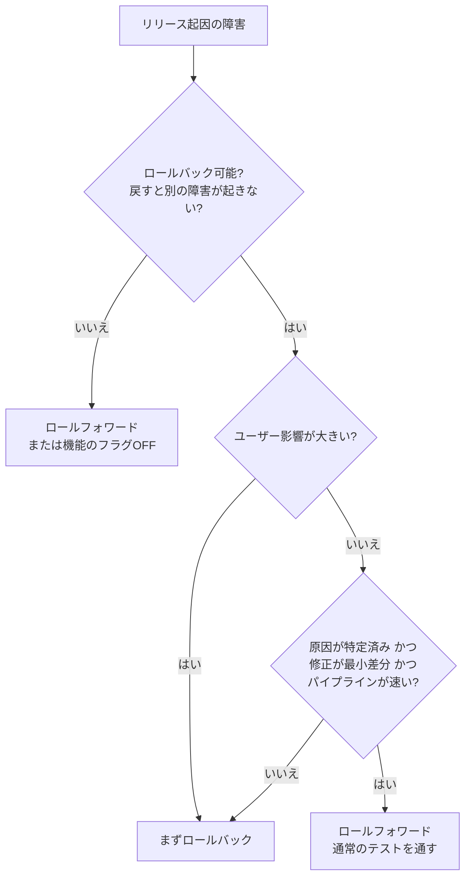
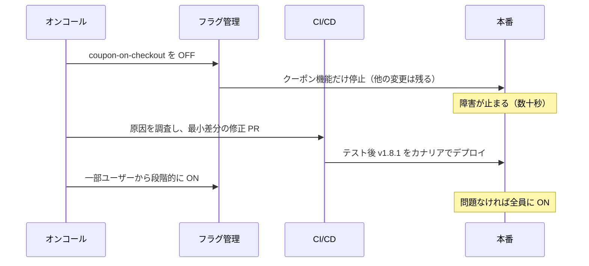

# ロールフォワード（前方修正）

[[MOC_リリース・デプロイ体系|📚 目次]] ｜ [[01_ロールバック戦略|← 前へ]] ｜ [[03_ロールバックできない変更|次へ →]]

> [!abstract] この記事で分かること
> - ロールフォワード（roll forward / fix forward）とは何か、ロールバックとどう違うか
> - 「戻すより直す方が良い」ケースと「直すのは危ない」ケースの見分け方
> - ホットフィックス（hotfix）の安全な流れ：ブランチ・最小差分・テストを省かない
> - 速いデプロイパイプラインとフィーチャーフラグが前方修正を安全にする理由
> - 判断を急かされたときに陥りやすい落とし穴
>
> **前提**：[[01_ロールバック戦略]] を読んでいると理解しやすいです。

## 1. ひとことで言うと

ロールフォワード（前方修正）は、**問題のあるリリースを元に戻すのではなく、修正版をさらに上から出して直すこと** です。

道に迷ったときに例えると、ロールバックは「知っている交差点まで引き返す」、ロールフォワードは「地図を見て、ここから目的地への近道を進む」です。近道がはっきり見えていれば進んだ方が早いこともありますが、焦って知らない道に入ると、さらに迷子になります。Google の CRE チームも、急いで出した前方修正が元の問題を直せなかったり、かえって悪化させたりする例を何度も見てきたと述べ、ユーザーに見える不具合では基本的にまず戻すことを勧めています。

> [!note] 要点
> - 既定の選択肢は **ロールバック**。ロールフォワードは「戻せない・戻す方が危ない」ときの選択肢
> - 前方修正をするなら、**最小差分・通常のテスト・速いパイプライン** が条件
> - 「すぐ直せそう」という感覚は、障害中はたいてい楽観的すぎる

## 2. ロールフォワードとロールバックの違い

```
時間 ─────────────────────────────────────────▶

ロールバック：
  v1.7.3(正常) ─▶ v1.8.0(障害) ─▶ v1.7.3(正常に戻る) ─▶ …後で v1.8.1 を通常リリース

ロールフォワード：
  v1.7.3(正常) ─▶ v1.8.0(障害) ─────────────▶ v1.8.1(修正版)
                     └─ 修正を書いてテスト・デプロイする間、障害は続く
```

| 観点 | ロールバック | ロールフォワード |
|---|---|---|
| 行き先 | 既知の正常状態（本番実績あり） | 未知の新しい状態（本番実績なし） |
| 障害が続く時間 | 戻す操作の時間（秒〜分） | 原因特定 + 修正 + テスト + デプロイの時間 |
| 新たな不具合のリスク | 低い（互換性の罠がなければ） | 高め（急いだ修正が新たなバグを生む） |
| 前提条件 | 戻せる変更であること | 原因が特定済みで修正が小さいこと |

## 3. 戻すより直す方が良いケース / 悪いケース

### 3.1 直す方が良い（ロールフォワードが妥当な）ケース

1. **戻せない変更が含まれている**
   新しい形式でデータを書き込んでしまい、旧コードが読めない、DB の列をすでに削除した、など。戻すと別の障害が起きる場合は前へ進むしかありません（[[03_ロールバックできない変更]]）。
2. **影響が小さく、原因が明確で、修正が 1〜数行**
   たとえば管理画面の表示文言の誤り、ログの出しすぎ程度。ユーザー影響がほぼなく、急ぐ必要もないなら、通常のフローで修正版を出せば十分です。
3. **ロールバックすると大事な修正も一緒に消える**
   v1.8.0 にセキュリティ修正が含まれていて、戻すと脆弱性が復活する場合。この場合も「問題の機能だけフラグで OFF にする」方がより良い選択です（後述）。
4. **モバイルアプリなど、そもそも戻す手段がない**
   配布済みのアプリは回収できないので、修正版を出すかサーバー側で吸収するしかありません。

### 3.2 直すのが危ない（まず戻すべき）ケース

1. **ユーザーへの影響が大きい**（注文できない、ログインできない、データが壊れ続けている）
2. **原因がまだ特定できていない**（「たぶんここ」は特定ではありません）
3. **修正が大きい、または複数箇所にまたがる**
4. **デプロイパイプラインが遅い**（ビルド〜本番反映に 30 分以上かかる）
5. **夜間・少人数で、レビューできる人がいない**



## 4. ホットフィックスの流れ

ホットフィックスは「本番の緊急不具合を直すための、通常サイクル外のリリース」です。急いでいるときほど、手順を省くと事故になります。

### 4.1 ブランチの切り方

トランクベース開発（[[03-Trunk-Based-Development]]）や GitHub Flow（[[02-GitHub-Flow]]）なら、main に修正 PR を出して通常どおりデプロイします。main にすでに次のリリース予定の変更が積まれている場合は、**本番で動いているタグ** からブランチを切ります。

```bash
# 本番で動いている v1.8.0 から hotfix ブランチを作る
git fetch --tags
git switch -c hotfix/1.8.1 v1.8.0

# 最小限の修正だけをコミット
git commit -am "fix(checkout): クーポン未指定時に null 参照で 500 になる問題を修正"

# PR を出して CI を通し、レビュー後にタグ付け・デプロイ
git push -u origin hotfix/1.8.1
gh pr create --base main --title "hotfix: 1.8.1 クーポン未指定時の 500 を修正"
```

```
main     ──●──●──●(v1.8.0)──●──●(未リリースの変更)──────●(cherry-pick/マージで取り込み)
                     \                                  /
hotfix/1.8.1          ●(修正) ── タグ v1.8.1 ── デプロイ
```

> [!warning] 修正を main にも必ず戻す
> hotfix ブランチだけに修正を入れて main に取り込み忘れると、次の通常リリース（v1.9.0）で **同じバグが復活** します（リグレッション）。PR を main 向けに出すか、マージ後すぐ cherry-pick します。ブランチ戦略の詳細は [[01_リリースサイクルとブランチ戦略]]。

### 4.2 最小差分にする

ホットフィックスには **障害を止めるのに必要な変更だけ** を入れます。

- ❌ 「ついでに」リファクタリング、ライブラリ更新、別のバグ修正を混ぜる
- ✅ 1 つの原因に対して 1 つの修正。差分は数行〜数十行に収める

差分が小さければレビューも速く確実になり、もしホットフィックス自体が失敗しても原因がすぐ分かります。

### 4.3 テストを省略しない

「急いでいるから CI をスキップしてデプロイ」は最も危険な判断です。障害中は集中力が落ちており、普段よりミスしやすい状態だからです。

- ユニットテスト・型チェック・ビルドは **必ず通す**（これが遅いなら、平常時にパイプラインを速くしておく）
- 修正したバグを再現するテストを 1 つ追加する（直ったことの証明、再発防止）
- 長い E2E テストは、影響範囲に絞った「スモークテスト」に置き換えることはあっても、ゼロにはしない
- デプロイもカナリアで段階的に出す（ホットフィックス自体が壊れている可能性があるため）

## 5. デプロイパイプラインが速いことの重要性

前方修正が現実的な選択肢になるかどうかは、**コミットから本番反映までの時間** で決まります。

| パイプラインの所要時間 | 前方修正のしやすさ |
|---|---|
| 10 分以内 | 原因が明確なら有力な選択肢になる |
| 30 分〜1 時間 | 影響が小さい場合に限られる。基本は先に戻す |
| 数時間以上 / 手作業あり | 緊急時の前方修正は事実上不可能。必ず戻す |

DORA（DevOps Research and Assessment）の指標でも、**変更のリードタイム（change lead time）** と **失敗したデプロイからの復旧時間（failed deployment recovery time）** は重要な指標とされています。パイプラインが速いチームほど、復旧の選択肢が増えます。DORA 指標については [[04_リリースのふりかえりとDORA指標]] で扱います。

速くするための主な手段は次のとおりです。

- 依存関係とビルドのキャッシュ（GitHub Actions の `actions/cache`、Docker のレイヤーキャッシュ）
- テストの並列化と、遅いテストの整理
- 手作業の承認やコマンド実行を自動化する（[[04-GitHub-Actionsによる自動化]]）

> [!tip] それでも「戻す」が最速
> どれだけパイプラインが速くても、ビルドとテストを通す以上、フラグ OFF やトラフィック切替より速くなることはありません。**速いパイプラインは「戻した後の修正版」を早く出すためにも役立つ** と考えましょう。

## 6. フィーチャーフラグとの組み合わせ

実務で最も多いのは「ロールバックかロールフォワードか」の二択ではなく、**フラグで問題の機能だけ止めてから、落ち着いて前方修正する** パターンです。



この方法の利点は次のとおりです。

- 影響は秒単位で止まる（ロールバックと同じ速さ）
- v1.8.0 に含まれる他の変更（セキュリティ修正など）は残せる
- 修正版を急がずに、通常のレビューとテストで出せる

前提として、新機能をフラグで包んでおく必要があります。詳しくは [[06_フィーチャーフラグ]]。

## 7. 判断を急がされるときの落とし穴

障害対応中は、上司や関係者から「いつ直るの？」と聞かれ続け、判断が歪みやすくなります。

- **「あと 5 分で直せそう」の罠**：障害中の見積もりは楽観的になりがちです。5 分が 30 分になり、その間ずっと被害が続きます。対策として「**15 分で直らなければ戻す**」のように **時間の上限を先に決めて** から前方修正を始めます。
- **サンクコスト（埋没費用）の罠**：「ここまで調べたのだから直したい」という気持ちで戻す判断が遅れます。調べた時間は戻しても無駄になりません。
- **ヒーロー化の罠**：一人で修正して一人でデプロイすると、レビューの目がなくなります。ホットフィックスでも最低 1 人のレビューを入れます。
- **連鎖ホットフィックス**：修正が新たなバグを生み、ホットフィックスのホットフィックスが続く状態。2 回目の修正が必要になった時点で、いったん戻すのが原則です。
- **戻せない変更を見落とす**：「戻せば済む」と思って戻したら、新形式のデータを旧コードが読めず別の障害になる。戻す前に [[03_ロールバックできない変更]] に該当しないかを確認します。

こうした判断をその場で迷わないために、基準を事前に決めておくのが [[04_ロールバック判断基準]] です。

## よくある誤解・つまずき

❌ **誤解**：前方修正の方が「ちゃんと直している」ので、ロールバックより良い対応だ
✅ **実際**：ユーザーから見れば、早く正常に戻る方が良い対応です。戻してから修正版を出せば、結果的に「ちゃんと直す」も達成できます。

❌ **誤解**：ホットフィックスは緊急なのでテストやレビューを省略してよい
✅ **実際**：障害中こそミスが起きやすく、省略は二次障害の原因になります。省略したくなるほどパイプラインが遅いなら、平常時に改善すべき課題です。

❌ **誤解**：hotfix ブランチで直してデプロイしたら完了
✅ **実際**：main に修正を取り込まないと、次のリリースでバグが復活します。取り込みまでがホットフィックスです。

❌ **誤解**：ロールバックできない変更なら、もう前方修正しか選択肢はない
✅ **実際**：フラグ OFF や、旧コードと新コードの両方の形式を読める「互換版」を出すなど、中間の選択肢があります。事前の設計で選択肢を増やしておくことが大切です。

## まとめ

- ロールフォワードは「修正版を上から出して直す」こと。既定はロールバックで、前方修正は条件が揃ったときの選択肢
- 前方修正が妥当なのは、戻せない変更がある・影響が小さく原因と修正が明確・戻すと大事な修正も消える、などのとき
- ホットフィックスは本番タグからブランチを切り、最小差分・テスト必須・main への取り込みを忘れない
- 速いデプロイパイプラインが前方修正を現実的にするが、それでもフラグ OFF や切替の方が速い
- 「フラグで止める → 落ち着いて前方修正」が実務で最も安全な組み合わせ
- 「15 分で直らなければ戻す」のように時間の上限を先に決め、焦りによる判断ミスを防ぐ

## 確認クイズ

1. クーポン機能のリリース後、注文確定の 30% が失敗しています。原因は「たぶんクーポン計算の null チェック漏れ」で、パイプラインは 40 分かかります。ロールバックとロールフォワード、どちらを選ぶべきでしょうか。
> [!tip]- 答え
> ロールバック（またはフラグ OFF）です。ユーザー影響が大きく、原因は「たぶん」で特定できておらず、パイプラインも遅いため、前方修正の条件を満たしていません。戻した後に原因を確定し、修正版を通常の手順で出します。

2. hotfix ブランチで修正して v1.8.1 をリリースしました。その後の v1.9.0 で同じバグが再発しました。何が原因と考えられますか。
> [!tip]- 答え
> hotfix の修正を main に取り込み忘れたためです。hotfix ブランチだけに修正があり、main から作った v1.9.0 には修正が入っていませんでした。hotfix の PR を main 向けにするか、マージ後に cherry-pick する手順をチェックリストに入れて防ぎます。

3. 前方修正を始めるとき、事前に決めておくと良い「1 つのルール」は何でしょうか。
> [!tip]- 答え
> 「〇分以内に直らなければロールバックする」という時間の上限です。障害中の見積もりは楽観的になりやすく、サンクコストで戻す判断が遅れるのを防げます。

## 関連ノート

- [[01_ロールバック戦略]] — 戻す手段の一覧と前提
- [[03_ロールバックできない変更]] — 前方修正しか選べない状況を生む変更
- [[04_ロールバック判断基準]] — 戻すか直すかを事前に決める
- [[06_フィーチャーフラグ]] — 機能だけを止める手段
- [[01_リリースサイクルとブランチ戦略]] — hotfix ブランチの位置づけ
- [[03-Trunk-Based-Development]] / [[01-Git-Flow]] — ブランチ戦略ごとの hotfix の扱い
- [[04_リリースのふりかえりとDORA指標]] — リードタイムと復旧時間
- [[01_インシデント対応の基本フロー]] — 障害対応全体の流れ

## 参考

- [Reliable releases and rollbacks — CRE life lessons | Google Cloud Blog](https://cloud.google.com/blog/products/gcp/reliable-releases-and-rollbacks-cre-life-lessons/)
- [DORA's software delivery performance metrics | dora.dev](https://dora.dev/guides/dora-metrics/)
- [Release Engineering | Google SRE Book](https://sre.google/sre-book/release-engineering/)
