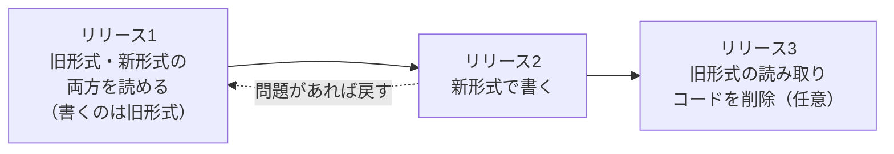

# ロールバックできない変更

[[MOC_リリース・デプロイ体系|📚 目次]] ｜ [[02_ロールフォワード（前方修正）|← 前へ]] ｜ [[04_ロールバック判断基準|次へ →]]

> [!abstract] この記事で分かること
> - コードを戻しても「元に戻らない」変更にはどんな種類があるか
> - DB・外部への副作用・データ形式・キャッシュ・モバイルアプリ・公開 API・鍵と設定、それぞれで何が起きるか
> - 共通の事前対策：二段階リリース、読み取り側を先に、フラグ、互換期間
> - リリース前に「この変更は戻せるか？」を確認するチェックリスト
>
> **前提**：[[01_ロールバック戦略]] を読んでいると理解しやすいです。

## 1. ひとことで言うと

ロールバックで戻せるのは、基本的に **「サーバーで動いているプログラム」だけ** です。プログラムが外の世界に残した痕跡は戻りません。

例えるなら、料理のレシピを書き換えて失敗したとき、レシピは元に戻せても、**すでに作ってお客さんに出した料理は戻せません**。冷蔵庫の食材を新しいレシピ用に切ってしまったら、古いレシピでは使えないかもしれません。リリースも同じで、DB に書いたデータ、送ったメール、ユーザーのスマホに入ったアプリは、コードを戻しても残り続けます。

> [!note] 要点
> - 「戻せない変更」は、**状態（state）を外に残す変更** と **他人の手元に届いてしまう変更**
> - 戻せない変更は禁止するのではなく、**戻せる単位に分割してリリースする**
> - 合言葉は「先に読めるようにし、後から書く」「消すのは最後」

## 2. 戻せない変更の全体像

```
              ┌────────── ロールバックで戻る範囲 ──────────┐
              │  コンテナイメージ / Pod テンプレート / 静的ファイル │
              └───────────────────────────────────────────┘
                         │ プログラムが外に残すもの（戻らない）
   ┌──────────┬──────────┼──────────┬──────────┬──────────┐
   ▼          ▼          ▼          ▼          ▼          ▼
 DBスキーマ  外部への   新形式の    キャッシュ  配布済み   公開API・
 データ変換  副作用     データ      CDN/ブラウザ アプリ     鍵・設定
            (メール/決済)
```

| 分類 | Shop での例 | 戻すと何が起きるか | 主な事前対策 |
|---|---|---|---|
| DB スキーマの破壊的変更 | `orders.discount` 列を削除 | 旧コードが列を参照して 500 | Expand-Contract（二段階） |
| データ変換 | 金額を円→銭の整数に一括変換 | 旧コードが 100 倍の金額を表示 | 新列に書き、旧列も残す |
| 外部への副作用 | クーポン付き確認メール送信、決済 | 送った物・請求は取り消せない | フラグ、少量から、補償処理 |
| 新形式で書いたデータ | `orders.metadata` に v2 形式 JSON | 旧コードがパースに失敗 | 読み取り側を先にリリース |
| キャッシュ・CDN・ブラウザ | 新 HTML が古い JS を参照 | 画面が壊れる、404 | 資産のハッシュ名、旧資産を残す |
| モバイルアプリ | v3.0 でクーポン API を呼ぶ | 配布済みアプリは回収不可 | サーバー側フラグ、強制アップデート |
| 公開 API の削除 | `/v1/coupons` を削除 | 外部の利用者がすでに移行・障害 | 非推奨期間、Sunset ヘッダー |
| 暗号鍵・設定 | 署名鍵を交換し旧鍵を破棄 | 旧コードが新トークンを検証できない | 鍵の重複期間、設定のバージョン管理 |

以下、それぞれを詳しく見ていきます。

## 3. データに関する変更

### 3.1 DB スキーマの破壊的変更とデータ変換

クーポン機能で `orders.discount` を `orders.coupon_discount` に **リネーム** したとします。新コードは問題なく動きますが、旧コードに戻すと `discount` 列がないためすべての注文確定が失敗します。リネーム・削除・型変更・NOT NULL 制約の追加は、いずれも旧コードを壊す「破壊的変更」です。

データ変換も同じです。全行の値を書き換える UPDATE は、元の値をどこかに残していなければ戻せません。DB のバックアップから復元する手もありますが、**復元時点以降の新しい注文が消える** ため、本番では最後の手段です。

**事前対策：Expand-Contract（拡張と縮小）**

```
① Expand   ：新しい列を「追加」する（旧列は残す）       → 旧コードは影響なし
② 両方書く ：アプリが旧列と新列の両方に書く             → どちらのコードにも戻せる
③ 移行     ：既存データを新列へコピー（旧列は消さない）
④ 読み替え ：アプリが新列から読む
⑤ Contract ：十分な期間の後、旧列を削除                → ここだけは戻せない。最後に回す
```

各段階を **別々のリリース** にすると、どの段階でも 1 つ前に戻せます。SQL の書き方やロックの注意点は [[07_ゼロダウンタイムのスキーマ変更]]、リリース計画としての進め方は 50 章の [[01_アプリとDB変更のリリース順序]] と [[02_Expand-Contractのリリース計画]] で扱います。

### 3.2 新形式で書き込まれたデータ（旧コードが読めない）

スキーマを変えなくても、データの **中身の形式** を変えると同じ問題が起きます。

```jsonc
// v1.7（旧）が書く形式
{ "discount": 500 }
// v1.8（新）が書く形式
{ "discount": { "type": "coupon", "code": "AUTUMN", "amount": 500 } }
```

v1.8 を 1 時間動かすと、その間の注文は新形式で保存されます。v1.7 に戻すと、旧コードは `discount` を数値として扱うので、新形式の注文を開いた瞬間にエラーになります。JSON 列、Redis のキャッシュ値、キュー（SQS / Kafka）のメッセージ、セッション Cookie でも同じことが起きます。

**事前対策：読み取り側を先にリリースする**



リリース 1 が全台に行き渡ってからリリース 2 を出せば、リリース 2 を戻しても、戻り先（リリース 1）は新形式を読めます。これは「**寛容な読み手（tolerant reader）**」と呼ばれる考え方で、形式の互換性については [[08_データのエンコードとスキーマ進化]] も参考になります。

## 4. 外の世界への副作用

### 4.1 送ってしまったメール・決済・外部 API 呼び出し

クーポン機能のバグで、割引額が 0 円の注文に「500 円割引されました」というメールを 3,000 人に送ってしまったとします。コードを戻してもメールは取り消せません。同様に、

- 決済代行（Stripe など）への請求、返金
- 配送業者への出荷指示
- 外部 SaaS への Webhook 送信、SMS、プッシュ通知

は、相手のシステムに記録が残ります。戻すには **補償処理（compensating action）**、つまり「返金する」「お詫びメールを送る」「出荷をキャンセルする」といった、反対の意味を持つ新しい操作を実行するしかありません。

**事前対策**

- 副作用のある新機能は **フィーチャーフラグで包み、社内ユーザー → 1% → 全体** と少しずつ広げる（[[06_フィーチャーフラグ]]）
- メールや通知は「送信キュー」に積んでから送る設計にし、異常時にキューを止められるようにする
- 外部 API のテスト用環境（Stripe のテストモードなど）で十分に確認し、本番では少額・少件数から始める
- シャドウデプロイで新コードを動かすときは、**外部への書き込みを必ず無効化** する（[[07_シャドウデプロイとダークローンチ]]）
- 補償処理の手順（返金スクリプト、お詫び文面のテンプレート）をランブックに用意しておく

## 5. 他人の手元に届いてしまう変更

### 5.1 キャッシュ・CDN・ブラウザに残る資産

フロントエンド（Next.js）では、**HTML と JS/CSS のバージョンがずれる「バージョンスキュー（version skew）」** が起きます。

```
デプロイ v2 → v1 にロールバックした場合
  ブラウザ：v2 の HTML を開いたまま（タブを開きっぱなし）
     │ クリックで v2 用の JS チャンク /_next/static/chunks/abc123.js を要求
     ▼
  CDN / サーバー：v1 に戻っているので abc123.js が存在しない → 404 → 画面が壊れる
```

逆方向（古い HTML がキャッシュに残り、新しいサーバーに古い JS を要求する）も起きます。さらに CDN が古い（または新しい）HTML を TTL の間キャッシュし続けたり、Service Worker がブラウザ内に古い資産を保持したりします。

**事前対策**

- JS/CSS はファイル名にハッシュを含め（Next.js は既定でそうなる）、`Cache-Control: public, max-age=31536000, immutable` で配る。HTML は短い TTL にする
- **古いバージョンの資産をしばらく残す**：同じバケットに複数バージョンの資産を置き、デプロイで削除しない
- Next.js の `deploymentId`（または `NEXT_DEPLOYMENT_ID`）を設定し、Vercel などのスキュー保護（Skew Protection）を有効にする（2026 年時点）
- ロールバック時は CDN のキャッシュ無効化（CloudFront の invalidation など）を手順に入れる

### 5.2 モバイルアプリ（ストアの配布済みバイナリ）

モバイルアプリは **最も戻せない変更** です。ストアで公開したバイナリは、ユーザーの端末にインストールされた時点でこちらの管理外になります。

- Google Play の段階的公開（staged rollout）は途中で **停止（halt）** できますが、すでに受け取ったユーザーはそのバージョンのままです（Google Play Console ヘルプ）
- App Store の段階的リリース（phased release）は 7 日間かけて 1% → 100% と自動更新の対象を広げ、途中で一時停止できます。ただしストアから手動でダウンロードする人には最初から配布されます（App Store Connect ヘルプ、2026 年時点）
- 古いバージョンのアプリは、何か月も何年も使われ続けます

**事前対策**

- 新機能はアプリにコードを入れておき、**サーバー側のフラグ（リモート設定）で ON/OFF** する。不具合時はフラグ OFF で止める
- サーバー API は **古いアプリのバージョンも長期間サポート** する（API を壊さない）
- 「最低サポートバージョン」をサーバーから返し、致命的な不具合のあるバージョンには強制アップデート画面を出せるようにしておく
- 段階的公開を必ず使い、クラッシュ率を見ながら広げる

### 5.3 公開 API の削除

Shop が外部パートナー向けに `/v1/coupons` を公開していたとします。v2 に移行したので v1 を削除すると、まだ v1 を使っているパートナーが壊れます。慌てて v1 を戻しても、その間にパートナーが障害対応やコード変更をしてしまえば、信頼は戻りません。

**事前対策**

- 削除の前に **非推奨（deprecation）期間** を設け、告知する（例：6 か月）
- レスポンスに `Deprecation`（RFC 9745）や `Sunset`（RFC 8594）ヘッダーを付けて機械的にも知らせる
- アクセスログで v1 の利用者がゼロ（または合意済みの少数）になったことを確認してから削除する
- いきなり削除せず、まず「ブラウンアウト（一定時間だけ意図的にエラーを返す）」で気づいてもらう方法もある

API のバージョン付けは [[01_セマンティックバージョニング]] も参照してください。

## 6. 暗号鍵・設定の変更

### 6.1 暗号鍵

JWT の署名鍵を新しい鍵に交換し、古い鍵を削除したとします。新コードは新しい鍵で署名したトークンを発行します。ここで旧コード（旧鍵しか知らない）に戻すと、すでに発行された新トークンを検証できず、**全員がログアウト** されます。暗号化データでも同じで、新しい鍵で暗号化したデータは旧コードでは復号できません。

**事前対策：鍵の重複期間（キーローテーションの段階化）**

```
① 新しい鍵を「検証用」に追加（署名はまだ旧鍵）   … JWKS に両方の公開鍵を載せる
② 全台に行き渡ったら、署名を新しい鍵に切り替え     … 戻しても①の状態なら検証できる
③ 旧鍵で署名したトークンの有効期限が切れるまで待つ
④ 旧鍵を削除
```

### 6.2 設定の変更

環境変数・接続先・タイムアウト値・IAM ポリシーなどの変更は、コードとは別の場所で管理されていることが多く、**コードを戻しても設定は戻らない** という事故が起きがちです。Vercel の Instant Rollback も環境変数は戻しません（[[01_ロールバック戦略]]）。

**事前対策**

- 設定もコードと同じリポジトリ、または IaC（Terraform など）で Git 管理し、変更履歴から戻せるようにする
- コードの変更と設定の変更を **同じリリースに混ぜない**。どちらが原因か切り分けられなくなるため
- 新コードが新しい設定キーを必要とする場合、**設定を先に追加し、旧キーは残す**（旧コードも新コードも動く状態を作る）

## 7. 共通の事前対策とリリース前チェックリスト

ここまでの対策は、次の 4 つの原則にまとめられます。

| 原則 | 意味 | 例 |
|---|---|---|
| 二段階リリース | 戻せない変更を「戻せる変更 2 つ」に分ける | Expand-Contract、鍵の追加→切替 |
| 読み取り側を先に | 新形式を読めるコードを先に全台へ | tolerant reader、検証用の鍵を先に追加 |
| フラグ | コードは出しても、動作は後から ON/OFF | 副作用・モバイル・新形式の書き込み |
| 互換期間 | 古い物を消すのは十分に待ってから | 旧列、旧 API、旧資産、旧鍵 |

> [!example] リリース前チェックリスト（「この変更は戻せるか？」）
> - [ ] DB の列・テーブルの削除、リネーム、型変更、制約追加を含まないか
> - [ ] 既存データを書き換える処理（バックフィル・変換）を含まないか
> - [ ] 新しい形式でデータ（JSON、キャッシュ、キュー、Cookie）を書き込まないか。旧バージョンはそれを読めるか
> - [ ] メール・決済・外部 API など、外部への副作用を新たに発生させないか。フラグで止められるか
> - [ ] フロントエンドの資産は旧バージョン分も残るか
> - [ ] モバイルアプリの新バージョンが前提とするサーバー API は、戻した後も動くか
> - [ ] 公開 API や鍵・設定を削除していないか
> - [ ] 1 つでも該当したら：分割できないか？ 分割できないなら、戻せない前提で前方修正の手順を準備したか

1 つでも当てはまるなら、リリース可否判定（[[02_リリース可否の基準とGo-No-Go判断]]）でその旨を明記し、「戻せないリリース」として慎重に扱います。

## よくある誤解・つまずき

❌ **誤解**：DB マイグレーションには down（ロールバック用）スクリプトがあるので戻せる
✅ **実際**：down スクリプトは列を作り直せても、**消えたデータは戻せません**。また down の実行中も旧コードとの不整合が起きます。本番では down に頼らず、Expand-Contract で「戻す必要がない」形にするのが基本です（[[03_マイグレーションの実行とロールバック]]）。

❌ **誤解**：新しい列を「追加」するだけなら絶対に安全
✅ **実際**：追加自体は旧コードを壊しませんが、新コードがその列に **書いたデータ** は旧コードに戻すと更新されなくなります。戻して再び進めたとき、その期間のデータが欠けていないかに注意します。

❌ **誤解**：Web アプリならデプロイし直せばユーザー全員が即座に新しい（または古い）バージョンになる
✅ **実際**：ブラウザのタブ、CDN キャッシュ、Service Worker に古い資産が残ります。複数バージョンが同時に存在する前提で設計します。

❌ **誤解**：戻せない変更は危ないのでやってはいけない
✅ **実際**：戻せない変更は必ず必要になります。禁止ではなく、**戻せる単位に分割する** か、**戻せない部分を最後に、小さく** 行うのが正解です。

## まとめ

- ロールバックで戻るのはプログラムだけ。DB のデータ、外部への副作用、配布済みのアプリや資産は戻らない
- 代表例は、DB の破壊的変更とデータ変換、メール・決済、新形式のデータ、キャッシュ/CDN、モバイルアプリ、公開 API の削除、鍵・設定の変更
- 共通の対策は「二段階リリース」「読み取り側を先に」「フラグ」「互換期間」
- 消す・壊す操作は最後に、十分に待ってから行う
- リリース前に「戻せるか？」をチェックリストで確認し、戻せないなら前方修正の準備をしておく
- DB 変更の詳細は [[07_ゼロダウンタイムのスキーマ変更]] と 50 章で扱う

## 確認クイズ

1. v1.8 で注文の `metadata` JSON を新形式で書き込むようにしたところ、障害が起きて v1.7 に戻しました。すると今度は「注文詳細画面」でエラーが出始めました。原因と、本来どうすべきだったかを答えてください。
> [!tip]- 答え
> v1.8 が新形式で書き込んだ注文データを、v1.7 が読めないためです。本来は「新旧両方の形式を読めるが、書くのは旧形式」のリリースを先に出し、全台に行き渡ってから新形式で書くリリースを出すべきでした（読み取り側を先に）。

2. JWT の署名鍵を交換するとき、ロールバックできるようにするための手順を説明してください。
> [!tip]- 答え
> まず新しい鍵を「検証用」として追加し（署名は旧鍵のまま）、全台に行き渡ってから署名を新しい鍵に切り替えます。旧鍵で署名したトークンの有効期限が切れた後で旧鍵を削除します。こうすれば署名切替を戻しても、新旧どちらのトークンも検証できます。

3. モバイルアプリ v3.0 に重大なバグが見つかりました。Google Play の段階的公開を停止しましたが、まだ問題が続いています。なぜでしょうか。また、事前にどんな対策ができたでしょうか。
> [!tip]- 答え
> 段階的公開を停止しても、すでに v3.0 を受け取ったユーザーはそのバージョンのままだからです。事前対策としては、新機能をサーバー側のフラグ（リモート設定）で ON/OFF できるようにしておく、強制アップデートの仕組みを用意しておく、などがあります。

## 関連ノート

- [[01_ロールバック戦略]] — 戻せる変更の戻し方
- [[02_ロールフォワード（前方修正）]] — 戻せないときの選択肢
- [[04_ロールバック判断基準]] — 戻すかどうかの判断
- [[01_アプリとDB変更のリリース順序]] / [[02_Expand-Contractのリリース計画]] / [[03_長時間DDLとデータ移行のリリース]] — DB 変更のリリース計画（50 章）
- [[07_ゼロダウンタイムのスキーマ変更]] — スキーマ変更の SQL とロックの詳細
- [[08_データのエンコードとスキーマ進化]] — データ形式の互換性
- [[03_マイグレーションの実行とロールバック]] / [[05_マイグレーションのよくある問題と対処法]] — マイグレーションのロールバック
- [[06_フィーチャーフラグ]] / [[07_シャドウデプロイとダークローンチ]] — 副作用を制御するリリース手法

## 参考

- [Reliable releases and rollbacks — CRE life lessons | Google Cloud Blog](https://cloud.google.com/blog/products/gcp/reliable-releases-and-rollbacks-cre-life-lessons/)
- [ParallelChange | Martin Fowler](https://martinfowler.com/bliki/ParallelChange.html)
- [deploymentId | Next.js](https://nextjs.org/docs/app/api-reference/config/next-config-js/deploymentId)
- [Skew Protection | Vercel](https://vercel.com/docs/skew-protection)
- [Release app updates with staged rollouts | Google Play Console Help](https://support.google.com/googleplay/android-developer/answer/6346149)
- [Release a version update in phases | App Store Connect Help](https://developer.apple.com/help/app-store-connect/update-your-app/release-a-version-update-in-phases)
- [RFC 9745: The Deprecation HTTP Response Header Field](https://www.rfc-editor.org/rfc/rfc9745.html)
- [RFC 8594: The Sunset HTTP Header Field](https://www.rfc-editor.org/rfc/rfc8594.html)
- [TolerantReader | Martin Fowler](https://martinfowler.com/bliki/TolerantReader.html)
