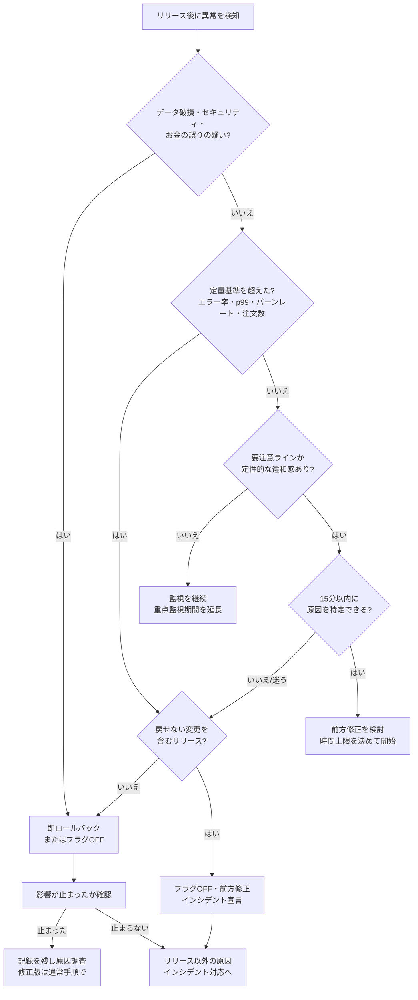

# ロールバック判断基準

[[MOC_リリース・デプロイ体系|📚 目次]] ｜ [[03_ロールバックできない変更|← 前へ]] ｜ [[01_アプリとDB変更のリリース順序|次へ →]]

> [!abstract] この記事で分かること
> - ロールバックの判断基準を「事前に」決めておくべき理由
> - 定量基準の例：エラー率、p99 レイテンシ、SLO バーンレート、ビジネス指標
> - 数字に表れない定性基準と、誰が戻す判断をするか（権限の明確化）
> - 判断フローチャートと、自動ロールバック・インシデント対応へのつなぎ方
>
> **前提**：[[01_ロールバック戦略]]、[[02_ロールフォワード（前方修正）]] を読んでいると理解しやすいです。

## 1. ひとことで言うと

ロールバック判断基準は、**「こうなったら迷わず戻す」という約束を、リリース前に書いておくこと** です。

飛行機のパイロットは、離陸前に「この速度に達するまでに異常があれば離陸を中止する（V1 速度）」と決めています。滑走中に「どうしよう、まだ行けるかな」と考えている時間はないからです。リリースも同じで、障害が起きてから「戻すべきか、もう少し様子を見るか」と話し合っている間にも、注文は失敗し続けます。

> [!note] 要点
> - 判断に迷う時間そのものが被害を広げる。**基準は平常時に、冷静な頭で決める**
> - 基準は「ベースラインとの比較」で書く（絶対値だけだと誤判断しやすい）
> - **誰が戻してよいか** を明確にし、「戻す」には誰の許可もいらないようにする

## 2. なぜ事前に決めておくのか

障害中の判断を難しくする要因は、だいたい次の 3 つです。

1. **時間の圧力**：エラーアラートが鳴り、チャットが騒がしくなり、関係者から状況を聞かれる。考える余裕がなくなります。
2. **心理的なバイアス**：「自分のリリースが原因だと思いたくない」「もう少し待てば落ち着くかも」という気持ちが判断を遅らせます。
3. **責任のあいまいさ**：「戻していいのは誰？」「戻したら怒られない？」と誰も決めないまま時間が過ぎます。

事前に基準を決めておけば、障害中にやることは「**基準に当てはまるか確認する → 当てはまれば戻す**」だけになります。これは [[02_リリース可否の基準とGo-No-Go判断]] で決める「出してよいかの基準」と対になる、「戻すべきかの基準」です。

```
障害の被害 ＝ 影響の大きさ × 続いた時間

続いた時間 ＝ 検知までの時間 ＋ 判断までの時間 ＋ 戻す操作の時間
                  ↑ 監視で短縮      ↑ この記事で短縮   ↑ 01_ロールバック戦略で短縮
```

## 3. 定量基準：数字で決める

### 3.1 基準の例（Shop API の場合）

Shop の「クーポン機能」リリースに向けた、ロールバック基準の例です。数値はサービスごとに調整します。

| 指標 | 見るもの | 「即ロールバック」の例 | 「要注意（様子見・追加調査）」の例 |
|---|---|---|---|
| エラー率 | 5xx の割合 | ベースラインの **3 倍以上** が 5 分継続、または 2% 超 | ベースラインの 1.5〜3 倍 |
| レイテンシ | p99（遅い方から 1% のリクエスト） | ベースラインの **2 倍以上** が 10 分継続 | 1.3〜2 倍 |
| SLO バーンレート | エラーバジェットの消費速度 | 1 時間窓で **14.4 倍以上**（短い窓 5 分でも超過） | 6 時間窓で 6 倍以上 |
| ビジネス指標 | 注文確定数 / 分 | 前週同時刻比で **30% 以上減少** が 10 分継続 | 10〜30% 減少 |
| 飽和 | CPU・メモリ・DB コネクション | OOM による再起動の発生、コネクション枯渇 | 使用率がリリース前より大幅増 |

### 3.2 ベースラインと比べる理由

「エラー率 1% を超えたら戻す」のような絶対値だけの基準は、次のような誤判断を生みます。

- 普段からエラー率 0.8% のサービスでは、少し揺れただけで戻してしまう
- 普段 0.01% のサービスでは、エラーが 50 倍（0.5%）に増えても戻さない

そこで **「リリース前の同じ時間帯」や「旧バージョンのグループ」と比べた倍率** を基準にします。カナリアリリースなら、同時刻に動いている旧バージョン（ベースライン）と新バージョン（カナリア）を比べられるので、時間帯による変動の影響を受けにくく最も正確です（[[05_カナリアリリース]]、[[02_段階的トラフィック移行と自動分析]]）。

### 3.3 SLO バーンレート

**SLO（Service Level Objective：サービスレベル目標）** が「注文確定の成功率 99.9%（30 日）」なら、許される失敗（エラーバジェット）は 0.1% です。**バーンレート（burn rate）** は、このバジェットを「予定の何倍の速さで使っているか」を表します。

Google SRE ワークブックは、99.9% の SLO に対して次の組み合わせを推奨しています。

| バジェット消費量 | 長い窓 | 短い窓 | バーンレート | 通知 |
|---|---|---|---|---|
| 2% | 1 時間 | 5 分 | 14.4 | 呼び出し（page） |
| 5% | 6 時間 | 30 分 | 6 | 呼び出し（page） |
| 10% | 3 日 | 6 時間 | 1 | チケット |

リリース直後に 14.4 倍のアラートが発火したら、それはロールバックを検討すべき強いシグナルです。バーンレートの仕組みは [[03_バーンレートアラート]]、SLO の設計は [[01_SLI・SLOの設計]] を参照してください。

### 3.4 ビジネス指標を入れる理由

エラー率もレイテンシも正常なのに、**注文数だけが急に減る** ことがあります。たとえば「クーポン入力欄が表示されず、ユーザーが購入をやめている」「割引が正しく適用されず、カートを放棄している」など、技術的にはエラーになっていない不具合です。

- 注文確定数 / 分、カート投入数、ログイン成功数、決済成功率
- 前週同曜日・同時刻との比較（曜日や時間帯で大きく変わるため）

技術指標とビジネス指標の両方を、リリース用ダッシュボード（[[05_ダッシュボード設計]]）に並べておきます。

## 4. 定性基準：数字に表れないもの

数字に出ない、または数字に出るのが遅い問題もあります。次のいずれかに当てはまれば、**数値基準を満たしていなくても戻してよい** とあらかじめ決めておきます。

- **データの破損・不整合が疑われる**（金額が合わない、注文が二重登録される）。時間が経つほど修復が大変になるため、最優先で戻します
- **セキュリティ・個人情報に関わる**（他人の注文履歴が見える、認可チェック漏れ）
- **お金に関わる誤り**（割引額の計算ミス、二重決済）
- **問い合わせ・SNS での報告が急増**している
- **主要機能が特定の条件で使えない**（特定のブラウザ、特定の支払い方法だけ失敗）
- **原因不明の異常が、リリース直後から始まっている**（「関係なさそう」でもリリースを疑う）

> [!important] 迷ったら戻す
> 基準に「微妙に届かない」ケースでは、**迷った時点で戻す** をデフォルトにします。戻すコストは数分ですが、迷って様子を見たコストは被害の拡大です。ただし [[03_ロールバックできない変更]] を含むリリースは、戻すことで別の障害が起きないかを先に確認します。

## 5. 誰が決めるか：権限の明確化

基準を決めても、「誰が戻すボタンを押すのか」があいまいだと結局迷います。

| 役割 | 権限 |
|---|---|
| リリース担当者（デプロイした人） | 基準に当てはまれば **誰の許可も得ずに** 戻してよい |
| オンコール担当者 | 同上。リリース担当者と連絡が取れなくても戻してよい |
| インシデントコマンダー（IC） | インシデント宣言後は、戻す/直すの最終判断を行う |
| プロダクトオーナー・上司 | 判断は事後報告でよい。「戻すな」と止める権限は原則持たない |

ポイントは次のとおりです。

- **戻すのに承認は不要、進めるのには承認が必要** という非対称なルールにする。ロールバックは「安全側への操作」だからです
- 戻した人を責めない（[[01_ロールバック戦略]] の「ロールバックは普通のこと」）
- 判断者と連絡先を、リリース手順書（[[03_リリース手順書とチェックリスト]]）の冒頭に書いておく

## 6. 判断フローチャート

リリース後の監視中に異常を見つけたときの判断の流れです。リリース手順書やランブック（[[02_ランブックの書き方]]）に貼っておきます。



このフローでは、迷う分岐（「15 分以内に原因を特定できる？」で「迷う」）はロールバック側に倒しています。前方修正の判断については [[02_ロールフォワード（前方修正）]] を参照してください。

## 7. 自動ロールバックとインシデント対応への接続

### 7.1 自動ロールバックへ

定量基準は、そのまま **自動ロールバックの条件** にできます。たとえば Argo Rollouts の AnalysisTemplate に「エラー率がしきい値を超えたら失敗」と書けば、カナリアが自動で中止されます。

```yaml
# イメージ：基準「エラー率 2% 超で失敗」を Argo Rollouts の分析に落とし込む
apiVersion: argoproj.io/v1alpha1
kind: AnalysisTemplate
metadata:
  name: shop-api-error-rate
spec:
  metrics:
    - name: error-rate
      interval: 1m
      failureLimit: 3            # 3 回失敗したらロールアウトを中止
      successCondition: result[0] < 0.02
      provider:
        prometheus:
          address: http://prometheus.monitoring:9090
          query: |
            sum(rate(http_requests_total{app="shop-api",status=~"5.."}[5m]))
            /
            sum(rate(http_requests_total{app="shop-api"}[5m]))
```

ただし、すべてを自動化できるわけではありません。

- **自動化に向く**：エラー率、レイテンシ、ヘルスチェック、クラッシュループなど、すぐに数値で判定できるもの
- **人が判断する**：定性基準、戻せない変更を含むリリース、ビジネス指標の解釈（キャンペーンの影響など）

詳しい設定は [[03_ヘルスチェックと自動ロールバック]] と [[02_段階的トラフィック移行と自動分析]] で扱います。

### 7.2 インシデント対応との関係

ロールバック判断はインシデント対応の一部です。

- リリース直後の異常の見分け方と初動は [[01_デプロイ直後の異常]]
- 影響が大きい、戻しても止まらない、戻せない変更が絡む場合は **インシデントを宣言** し、[[01_インシデント対応の基本フロー]] に従って役割（IC、連絡担当など）を分担します
- 戻して収まった場合も、基準に当てはまったのであれば記録を残し、必要に応じてポストモーテム（[[01_ポストモーテムとは]]）で「なぜリリース前に検知できなかったか」をふりかえります

また、ロールバックが発生したリリースは DORA の **変更失敗率（change fail rate）** にカウントされます。失敗率と復旧時間を追うことで、判断基準そのものの改善にもつながります（[[04_リリースのふりかえりとDORA指標]]）。

> [!example] リリース手順書に書くロールバック基準のテンプレート
> ```
> ## ロールバック基準（v1.8.0 クーポン機能）
> - 監視期間：デプロイ完了から 60 分（重点監視）
> - 即ロールバック：
>   - 5xx 率がベースラインの 3 倍以上 or 2% 超が 5 分継続
>   - p99 がベースラインの 2 倍以上が 10 分継続
>   - 注文確定数が前週同時刻比 30% 以上減少が 10 分継続
>   - 割引額の誤り・二重決済・他人の情報表示の疑い（数値に関係なく）
> - 戻し方：① フラグ coupon-on-checkout を OFF → ② 改善しなければ kubectl rollout undo
> - 戻せない変更：なし（orders.coupon_code は追加のみ）
> - 判断者：リリース担当 @alice / オンコール @bob（どちらも単独で実行可）
> ```

## よくある誤解・つまずき

❌ **誤解**：基準はベテランの経験と勘で十分。数字にするのは窮屈だ
✅ **実際**：経験豊富な人ほど「もう少し様子を見よう」と判断を遅らせることがあります。数字の基準があれば、新人でも夜間でも同じ判断ができ、判断の言い訳も不要になります。

❌ **誤解**：エラー率が正常なら、リリースは問題ない
✅ **実際**：注文数の減少やデータの不整合のように、エラーにならない不具合があります。ビジネス指標と定性基準も必ず入れます。

❌ **誤解**：戻すには上司やプロダクトオーナーの承認が必要
✅ **実際**：承認待ちの時間がそのまま被害になります。「戻すのは承認不要、事後報告でよい」と事前に合意しておきます。

❌ **誤解**：自動ロールバックを入れたら、判断基準を考えなくてよい
✅ **実際**：自動ロールバックは「判断基準をコードにしたもの」です。基準が適切でなければ、誤って戻したり、戻すべきときに戻さなかったりします。

## まとめ

- 判断に迷う時間は被害を広げるので、ロールバック基準はリリース前に決めておく
- 定量基準はベースラインとの倍率で書く：エラー率、p99 レイテンシ、SLO バーンレート、ビジネス指標
- データ破損・セキュリティ・お金の誤りなどの定性基準は、数値に関係なく即ロールバック
- 「戻すのは承認不要、進めるのは承認必要」という非対称な権限ルールにする
- 迷ったら戻す。ただし戻せない変更を含むリリースは先に確認する
- 定量基準は自動ロールバックに、重大な場合はインシデント対応につなげる

## 確認クイズ

1. 普段のエラー率が 0.02% の Shop API で、リリース後にエラー率が 0.3% になりました。基準が「エラー率 1% 超で戻す」だけだった場合、何が問題でしょうか。
> [!tip]- 答え
> 0.3% はベースラインの 15 倍という大きな悪化ですが、絶対値の基準 1% を下回るため戻す判断になりません。ベースラインとの倍率（例：3 倍以上）でも基準を書いておくべきです。

2. エラー率もレイテンシも正常ですが、注文確定数が前週同時刻比で 40% 減っています。どう判断すべきでしょうか。
> [!tip]- 答え
> ビジネス指標の基準（例：30% 以上減少）に当てはまるため、ロールバック（またはクーポン機能のフラグ OFF）を行います。クーポン入力欄が壊れているなど、エラーにならない不具合の可能性があるためです。外部要因（キャンペーン終了など）の確認は、戻した後に行います。

3. 深夜にオンコール担当者が基準超過に気づきましたが、リリースした本人とプロダクトオーナーに連絡がつきません。どうすべきでしょうか。また、そのために事前に何を決めておくべきでしょうか。
> [!tip]- 答え
> オンコール担当者が単独でロールバックし、事後に報告します。そのために「基準に当てはまれば、オンコール担当者も誰の許可も得ずに戻してよい」という権限ルールを、リリース手順書などに明記して合意しておきます。

## 関連ノート

- [[01_ロールバック戦略]] — 戻す手段と速さ
- [[02_ロールフォワード（前方修正）]] — 戻さずに直す判断
- [[03_ロールバックできない変更]] — 判断の前に確認すること
- [[02_リリース可否の基準とGo-No-Go判断]] — 「出してよいか」の基準（対になる判断）
- [[03_ヘルスチェックと自動ロールバック]] / [[02_段階的トラフィック移行と自動分析]] — 基準の自動化
- [[01_リリース後の重点監視]] — リリース後に何を見るか
- [[01_デプロイ直後の異常]] / [[01_インシデント対応の基本フロー]] — インシデント対応との接続
- [[03_バーンレートアラート]] / [[01_SLI・SLOの設計]] / [[03_ゴールデンシグナル]] — 定量基準の土台
- [[03_エラーバジェット方針]] — バジェットを使い切ったときのリリース方針

## 参考

- [Alerting on SLOs | Google SRE Workbook](https://sre.google/workbook/alerting-on-slos/)
- [Reliable releases and rollbacks — CRE life lessons | Google Cloud Blog](https://cloud.google.com/blog/products/gcp/reliable-releases-and-rollbacks-cre-life-lessons/)
- [Analysis & Progressive Delivery | Argo Rollouts](https://argo-rollouts.readthedocs.io/en/stable/features/analysis/)
- [DORA's software delivery performance metrics | dora.dev](https://dora.dev/guides/dora-metrics/)
- [Managing Incidents | Google SRE Book](https://sre.google/sre-book/managing-incidents/)
