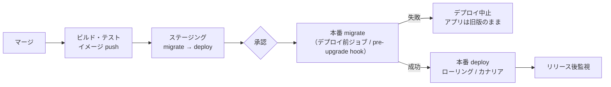

# アプリとDB変更のリリース順序

[[MOC_リリース・デプロイ体系|📚 目次]] ｜ [[04_ロールバック判断基準|← 前へ]] ｜ [[02_Expand-Contractのリリース計画|次へ →]]

> [!abstract] この記事で分かること
> - アプリとDBを一緒に変えるとき、なぜ「どちらを先に出すか」で障害が起きるのか
> - 列追加・列削除・リネーム・NOT NULL 化・テーブル削除で「マイグレーション先行」と「アプリ先行」のどちらが正しいか
> - パイプラインのどこでマイグレーションを流すか（デプロイ前ジョブ、Kubernetes Job、initContainer、Helm hook、起動時実行）
> - 「マイグレーションとデプロイは別リリース」という原則と、ロールバックするときの扱い
>
> **前提**：[[03_ローリングアップデート]] と [[03_マイグレーションの実行とロールバック]] を読んでいると理解しやすいです。

## 1. ひとことで言うと

お店のレイアウト変更にたとえます。店員が 4 人いて、1 人ずつ新しいマニュアルに切り替えていくとします。棚（DB）を先に動かすと、まだ古いマニュアルを持っている店員が「いつもの棚がない」と困ります。逆に、マニュアル（アプリ）を先に配ると、新しいマニュアルの店員が「書いてある棚がまだない」と困ります。だから**「棚の追加は先、棚の撤去は全員がマニュアルを持ち替えた後」**という順番を決めておく必要があります。

要点は次の 3 つです。

- ローリングデプロイ中は、**新旧 2 つのバージョンのアプリが同じ DB を同時に使う**
- だから DB のスキーマは、常に「**今動いている全バージョン（N と N-1）**」と互換でなければならない
- 追加系はマイグレーション先行、削除系はアプリ先行。そして**マイグレーションとアプリのデプロイは別のリリースとして扱う**

SQL の書き方（ロック、`NOT VALID`、`CONCURRENTLY` など）は DB 章の [[07_ゼロダウンタイムのスキーマ変更]] が本拠地です。この記事は「**いつ・どの順で・どのパイプラインから流すか**」というリリースの側を扱います。

## 2. なぜ順序が問題になるのか

### 2.1 新旧のアプリが同じ DB を使う時間がある

Shop API は 4 Pod で動いています。ローリングアップデートでは 1 Pod ずつ入れ替えるので、数分間は新旧のコードが混在します。

```
時間 →
DB      : [スキーマ S1] ──migrate──▶ [スキーマ S2] ─────────────────────────────
Pod 1   : [v1] ───────────────────────────── [v2] ───────────────────────────
Pod 2   : [v1] ───────────────────────────────────── [v2] ───────────────────
Pod 3   : [v1] ───────────────────────────────────────────── [v2] ───────────
Pod 4   : [v1] ───────────────────────────────────────────────────── [v2] ───
                          ↑                ↑
               v1 が S2 で動く時間     v1 と v2 が S2 を同時に使う時間
```

この図で危ない時間帯は 2 つあります。

1. **マイグレーション完了〜デプロイ開始**：古いアプリ v1 が新しいスキーマ S2 の上で動く
2. **デプロイ中**：v1 と v2 が S2 を同時に読み書きする

さらに、デプロイ後に v2 で障害が起きて v1 に戻すと、**v1 が S2 の上で動き続けます**。つまり S2 は v2 だけでなく v1 とも互換でなければなりません。

> [!important] 原則：スキーマは「N と N-1 の両方」と互換にする
> どの瞬間でも、DB スキーマは「今動いている可能性のある全バージョンのアプリ」と互換でなければなりません。ローリング中の混在、カナリアでの並走、ロールバック後の旧版、すべてを含みます。

### 2.2 Blue-Green やカナリアでも同じ

[[04_Blue-Greenデプロイ]] では Blue と Green の 2 環境を用意しますが、**DB は 1 つを共有する**のが普通です。切り替え直後に Blue へ戻す可能性を残すなら、Blue（旧版）も新スキーマで動けなければなりません。[[05_カナリアリリース]] は新旧が並走する時間がさらに長くなります。デプロイ戦略が何であれ、「アプリは一瞬で入れ替わらない」という前提で考えます。

## 3. マイグレーション先行か、アプリ先行か

変更の種類ごとに、どちらを先に出すかが決まります。ここでは Shop の `users` テーブルを例にします。

| 変更 | 先に出すもの | 理由 | 逆にするとどうなるか |
|---|---|---|---|
| 列追加（NULL 可 / 定数デフォルトあり）<br/>例：`users.phone` | **マイグレーション先行** | 旧アプリは知らない列を無視するので安全。新アプリは列があることを前提にできる | 新アプリが存在しない列を読み書きして `column does not exist` エラー |
| 列追加（NOT NULL・デフォルトなし） | そもそも 1 回でやらない | 旧アプリの INSERT は新しい列に値を入れないので失敗する | — |
| 列削除<br/>例：`users.legacy_code` | **アプリ先行**（列を使わないアプリを出し切ってから、次のリリースで削除） | 旧アプリがまだ列を参照しているかもしれない | 列を消した瞬間に旧アプリの `SELECT` / `INSERT` が失敗 |
| リネーム<br/>例：`users.name` → `display_name` | どちらを先にしても壊れる → **Expand/Contract で分解** | 旧アプリは旧名、新アプリは新名を要求する | 一方が必ず壊れる |
| NOT NULL 化<br/>例：`users.email` | **アプリ先行**（必ず値を書くアプリを出し切る）→ バックフィル → 制約追加 | 旧アプリが NULL を書く可能性がある | 制約追加後、旧アプリの INSERT が制約違反で失敗 |
| テーブル追加<br/>例：`coupons` | **マイグレーション先行** | 旧アプリは新テーブルを知らないだけ | 新アプリがテーブルなしで失敗 |
| テーブル削除<br/>例：`legacy_points` | **アプリ先行**（参照ゼロを確認してから、別リリースで削除） | 旧アプリや別システム（バッチ・BI）が参照しているかもしれない | 参照元が一斉にエラー。データも戻らない |
| インデックス追加 | **マイグレーション先行**（どちらでも壊れないが、新クエリが遅くならないよう先に） | アプリの正しさには影響しない | 新アプリのクエリが遅く、負荷が上がる |

覚え方は単純で、**「足すのは先、消すのは後、変えるのは分解」**です。

- **足す**（列・テーブル・インデックス追加）：マイグレーション → アプリ
- **消す**（列・テーブル削除）：アプリ → （別リリースで）マイグレーション
- **変える**（リネーム・型変更・NOT NULL 化）：複数リリースに分解する。具体的な計画は次回 [[02_Expand-Contractのリリース計画]] で扱います

各変更の SQL 手順は [[04_マイグレーションの実践例]]、ロックの危険性は [[07_ゼロダウンタイムのスキーマ変更]] を参照してください。

## 4. パイプラインのどこでマイグレーションを流すか

### 4.1 選択肢の比較

| 方式 | 動き | 1 回だけ実行される？ | 失敗時にデプロイを止められる？ | 評価 |
|---|---|---|---|---|
| **CI/CD のデプロイ前ジョブ** | GitHub Actions の `migrate` ジョブが成功したら `deploy` ジョブへ | ○ | ○ | **第一候補** |
| **Kubernetes Job**（デプロイ前に作成し完了を待つ） | アプリと同じイメージで `migrate` コマンドだけ実行する Pod | ○ | ○（Job の完了を待つ処理が必要） | 良い |
| **Helm hook**（`pre-upgrade`）/ Argo CD `PreSync` | Helm / Argo CD がアプリ更新の前に Job を実行し、完了を待つ | ○ | ○（hook 失敗でリリース失敗） | 良い。K8s + Helm / GitOps ならこれ |
| **initContainer** | 各 Pod の起動前にマイグレーションを実行 | **×（Pod の数だけ実行される）** | △（Pod が起動しないだけ） | 非推奨 |
| **アプリ起動時に実行** | `migrate deploy && node server.js` | **×（台数分）** | △（アプリが起動しない） | 非推奨 |

### 4.2 起動時実行・initContainer が危ない理由

「起動時にマイグレーションを流す」は手軽ですが、本番では次の問題が起きます。

- **多重実行**：4 Pod が同時に起動すると、4 つのプロセスが同時に同じマイグレーションを流そうとします。Prisma（アドバイザリーロック）や Knex（ロックテーブル）などは同時実行を防ぐ仕組みを持っていますが、残りの Pod はロック待ちで起動が遅れます。ロック機構がないツールや手書きスクリプトでは、二重に実行されて失敗することもあります
- **スケールアウトのたびに走る**：オートスケールで Pod が増えるたびにマイグレーションのチェックが走ります
- **長いマイグレーションで起動が止まる**：数分かかる DDL を流すと、その間 Pod は Ready にならず、ヘルスチェック（liveness probe）に失敗して再起動を繰り返すことがあります
- **順序を制御できない**：「マイグレーション → 全台デプロイ」ではなく、「1 台目が起動しながらマイグレーション、2〜4 台目はまだ旧版」という混在状態になり、どのタイミングで DB が変わったか分かりにくくなります
- **権限が広くなる**：アプリの DB ユーザーに `ALTER TABLE` の権限を与える必要が出ます。マイグレーション専用ユーザーを分けられません

> [!warning] 起動時実行は「開発環境だけ」にする
> ローカルや PR ごとのプレビュー環境では起動時実行が便利です。本番では**デプロイ前の 1 回だけの実行**に分けます。

### 4.3 例：GitHub Actions でデプロイ前ジョブにする

```yaml
# .github/workflows/deploy.yml（抜粋）
jobs:
  migrate:
    runs-on: ubuntu-latest
    environment: production          # 本番環境の承認・シークレットを使う
    concurrency: migrate-production  # 同時に 2 本走らせない
    steps:
      - uses: actions/checkout@v4
      - uses: actions/setup-node@v4
        with:
          node-version: 22
      - run: npm ci
      - name: Run migrations
        run: npx prisma migrate deploy
        env:
          DATABASE_URL: ${{ secrets.MIGRATION_DATABASE_URL }}  # DDL 権限を持つ専用ユーザー

  deploy:
    needs: migrate                   # マイグレーションが成功したときだけデプロイ
    runs-on: ubuntu-latest
    environment: production
    steps:
      - run: echo "kubectl / helm / aws ecs update-service などでアプリを更新"
```

ポイントは `needs: migrate` で順序を固定していることと、`concurrency` で同時実行を防いでいることです。

### 4.4 例：Helm の pre-upgrade hook

Kubernetes に Helm でデプロイしているなら、マイグレーション Job を hook にできます。Helm は `Job` の hook について**完了するまで待ち、失敗したらリリースを失敗にします**。

```yaml
# templates/migrate-job.yaml
apiVersion: batch/v1
kind: Job
metadata:
  name: shop-api-migrate
  annotations:
    "helm.sh/hook": pre-install,pre-upgrade
    "helm.sh/hook-weight": "-5"
    "helm.sh/hook-delete-policy": before-hook-creation,hook-succeeded
spec:
  backoffLimit: 0                 # 勝手に再実行しない（再実行は人が判断）
  activeDeadlineSeconds: 900      # 15 分で打ち切る
  template:
    spec:
      restartPolicy: Never
      containers:
        - name: migrate
          image: registry.example.com/shop-api:{{ .Values.image.tag }}  # アプリと同じイメージ
          command: ["npx", "prisma", "migrate", "deploy"]
          envFrom:
            - secretRef:
                name: shop-api-migration-db
```

注意点です。

- hook のリソースは**リリースの管理対象外**です。`helm uninstall` でも消えないので、`hook-delete-policy` で掃除します（既定は `before-hook-creation`）
- `helm rollback` は **hook でマイグレーションを巻き戻してはくれません**。アプリのマニフェストだけが戻ります（6 章）
- Argo CD を使っている場合は、`argocd.argoproj.io/hook: PreSync` を付けた Job が同じ役割を果たします

### 4.5 パイプライン全体の流れ



マイグレーションが失敗しても、アプリは旧版のまま動き続けます。追加系マイグレーションなら、失敗しても旧版には影響しません。この「**失敗しても誰も困らない**」状態を作れることが、デプロイ前ジョブ方式の最大の利点です。

## 5. マイグレーションとデプロイを別リリースにする原則

### 5.1 原則

**スキーマ変更と、そのスキーマ変更に依存するアプリ変更は、別のリリースとして出す**——これが基本の考え方です。

- **リリース A**：マイグレーションだけ（旧アプリと互換なもの）
- **リリース B**：新しい列を使うアプリ

なぜ分けるのかというと、次の利点があるからです。

| 利点 | 説明 |
|---|---|
| 原因の切り分けが楽 | 障害が起きたとき「DB 変更のせいか、コードのせいか」がすぐ分かる |
| アプリだけを戻せる | リリース B を戻しても、リリース A のスキーマは旧アプリと互換なのでそのまま残せる |
| 長いマイグレーションがデプロイを止めない | インデックス作成に 30 分かかっても、アプリのリリースは待たされない（[[03_長時間DDLとデータ移行のリリース]]） |
| レビューの観点が分かれる | DB 担当は SQL とロックを、アプリ担当はロジックを集中して見られる |

### 5.2 どこまで厳密に分けるか

毎回 PR もデプロイも分けるのは大変です。実務では次のように使い分けるのが現実的です。

| 変更 | 分け方 |
|---|---|
| 列・テーブル・インデックスの**追加**（小さなテーブル） | 同じ PR・同じパイプラインで可。ただし**順序は「migrate ジョブ → deploy ジョブ」**、マイグレーションは旧アプリと互換にする |
| 大きなテーブルへの変更、長時間 DDL | **マイグレーションだけを先に別リリース**で出す |
| 列・テーブルの**削除**、NOT NULL 化 | **必ず別リリース**。アプリ側のリリースが全台に行き渡り、戻す可能性がなくなってから |
| リネーム・型変更 | Expand/Contract で 4〜5 回のリリースに分解（[[02_Expand-Contractのリリース計画]]） |

同じパイプラインに入れる場合でも、「**マイグレーションを適用した後、デプロイせずに止めても安全か？**」を自問してください。答えが Yes なら、そのマイグレーションは独立したリリースとして成立しています。

## 6. ロールバック時の扱い

### 6.1 アプリを戻しても DB は戻らない

`kubectl rollout undo` や `helm rollback`、ECS のロールバックは**アプリ（コンテナイメージ）だけ**を戻します。DB スキーマとデータは新しいままです。だからこそ 2 章の「N-1 互換」が重要になります。

| 状況 | 対応 |
|---|---|
| アプリ v2 に不具合。スキーマは追加系のみ | **アプリだけ v1 に戻す**。スキーマはそのまま（v1 は新しい列を無視する） |
| マイグレーションが途中で失敗 | デプロイは始まっていない。原因を調べて**直したマイグレーションを再実行**（ロールフォワード） |
| 追加したインデックスが負荷を上げている | インデックスを `DROP INDEX CONCURRENTLY` する**新しいマイグレーション**を出す |
| 列を削除した後に問題が発覚 | スキーマを戻してもデータは戻らない。**バックアップから必要な列のデータを復元**する |

### 6.2 down マイグレーションを本番で自動実行しない

多くのマイグレーションツールは「down（巻き戻し）」を書けますが、本番のロールバックで自動的に down を流すのは危険です。

- 列を足す up の逆は列を消す down。**v2 が書いたデータが消えます**
- down 自体がロックを取り、障害対応中にさらに障害を起こすことがあります

本番では、**アプリはロールバック、DB はロールフォワード（直すマイグレーションを新しく出す）**が基本です。戻し方の 3 種類（down / ロールフォワード / バックアップ復元）は [[03_マイグレーションの実行とロールバック]]、戻せない変更の見分け方は [[03_ロールバックできない変更]]、アプリのロールフォワードは [[02_ロールフォワード（前方修正）]] を参照してください。

> [!tip] リリース手順書に「戻し方」を書く
> 手順書には「アプリをどのバージョンに戻すか」と「スキーマをどうするか（そのまま / 修正マイグレーション / 復元）」を**別々に**書いておきます（[[03_リリース手順書とチェックリスト]]）。

## よくある誤解・つまずき

- ❌ 「マイグレーションを流してからデプロイすれば、順序の問題は起きない」
  ✅ マイグレーション後からデプロイ完了までは、**旧アプリが新スキーマで動きます**。列削除やリネームはこの順でも壊れます。

- ❌ 「アプリを戻せば DB も元に戻る」
  ✅ `helm rollback` も `kubectl rollout undo` も、スキーマとデータには触れません。スキーマを N-1 互換にしておくことで、アプリだけ戻しても動くようにします。

- ❌ 「起動時にマイグレーションを流せば、デプロイと必ず同期するので安全」
  ✅ Pod の数だけ実行が試みられ、ロック待ちや起動遅延、ヘルスチェック失敗を招きます。本番ではデプロイ前ジョブか hook で 1 回だけ流します。

- ❌ 「列削除は、コードから参照を消した PR と同じリリースで流せばよい」
  ✅ 同じリリースだと、デプロイ中の旧 Pod やロールバック後の旧版が列を参照して壊れます。**全台が新コードになり、戻す可能性がなくなった後の別リリース**で消します。

## まとめ

- ローリング・Blue-Green・カナリアのどれでも、**新旧アプリが同じ DB を使う時間**がある。スキーマは常に N と N-1 の両方と互換にする
- **足すのは先（マイグレーション先行）、消すのは後（アプリ先行）、変えるのは分解（Expand/Contract）**
- 本番のマイグレーションは**デプロイ前ジョブ / K8s Job / Helm pre-upgrade hook / Argo CD PreSync** で 1 回だけ流す。initContainer や起動時実行は避ける
- マイグレーションとそれに依存するアプリ変更は**別リリース**。「マイグレーションだけ適用して止めても安全か」で判断する
- ロールバックでは**アプリは戻し、DB はロールフォワード**。down を本番で自動実行しない

## 確認クイズ

1. `users.legacy_code` を削除したい。アプリから参照を消すコードと、`DROP COLUMN` のマイグレーションを同じリリースに入れ、「migrate → deploy」の順で流しました。何が起きますか？

> [!tip]- 答え
> マイグレーション完了からデプロイ完了までの間、旧アプリ（`legacy_code` を参照するコード）が動いているので、その SELECT / INSERT がエラーになります。削除は「参照を消したアプリを全台に出し切る」→「別のリリースで DROP」の順にします。

2. マイグレーションを initContainer で流す構成の問題点を 2 つ挙げてください。

> [!tip]- 答え
> 例：① Pod の数だけ実行が試みられ、ロック待ちや二重実行のリスクがある（スケールアウトのたびにも走る）。② 長い DDL の間 Pod が起動せず、デプロイが止まったり、旧版と新版の混在のタイミングが制御できなくなる。ほかに、アプリ用のコンテナに DDL 権限が必要になる点も問題です。

3. 列追加のマイグレーションとアプリ v2 をリリースした直後、v2 にバグが見つかりました。DB とアプリはそれぞれどうしますか？

> [!tip]- 答え
> アプリは v1 にロールバックします。追加した列は v1 が無視するので、スキーマはそのままにします（down で列を消すと v2 が書いたデータが失われるうえ、再リリース時に再度追加が必要になります）。

## 関連ノート
- [[02_Expand-Contractのリリース計画]] — 「変える」変更を複数リリースに分解する計画の立て方
- [[03_長時間DDLとデータ移行のリリース]] — 時間のかかるマイグレーションの運用
- [[03_ローリングアップデート]] — 新旧混在が生まれる仕組み
- [[08_ゼロダウンタイムデプロイの条件]] — DB 互換性はゼロダウンタイムの条件の 1 つ
- [[03_ロールバックできない変更]] — DB 変更が「戻せない変更」になる理由
- [[07_ゼロダウンタイムのスキーマ変更]] — ロックと安全な SQL の書き方（DB 章）
- [[03_マイグレーションの実行とロールバック]] — 実行場所の比較と戻し方の 3 種類（DB 章）
- [[04_マイグレーションの実践例]] — 列追加・削除・リネームの具体的な SQL（DB 章）
- [[04-GitHub-Actionsによる自動化]] — GitHub Actions の基本
- [[10-Kubernetes]] — Job / initContainer の基本

## 参考
- [Helm: Chart Hooks](https://helm.sh/docs/topics/charts_hooks/)
- [Argo CD: Sync Phases and Waves（Resource Hooks）](https://argo-cd.readthedocs.io/en/stable/user-guide/sync-waves/)
- [Kubernetes: Jobs](https://kubernetes.io/docs/concepts/workloads/controllers/job/)
- [Kubernetes: Init Containers](https://kubernetes.io/docs/concepts/workloads/pods/init-containers/)
- [Prisma: Deploying database changes with Prisma Migrate](https://www.prisma.io/docs/orm/prisma-client/deployment/deploy-database-changes-with-prisma-migrate)
- [Martin Fowler's bliki: ParallelChange](https://martinfowler.com/bliki/ParallelChange.html)
