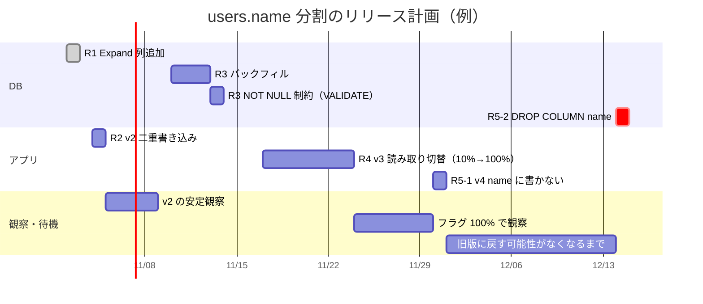

# Expand-Contractのリリース計画

[[MOC_リリース・デプロイ体系|📚 目次]] ｜ [[01_アプリとDB変更のリリース順序|← 前へ]] ｜ [[03_長時間DDLとデータ移行のリリース|次へ →]]

> [!abstract] この記事で分かること
> - Expand-Contract（Parallel Change）を「何回のリリースに分け、どの順で出すか」という計画として組み立てる方法
> - Shop の `users.name` を `first_name` / `last_name` に分ける 5 段階のリリース計画と、各段階のロールバック可能性
> - フィーチャーフラグとの組み合わせ方、チケットと PR の切り方
> - 「Contract を忘れる」問題と、それを防ぐ追跡の仕組み
>
> **前提**：[[01_アプリとDB変更のリリース順序]] と [[06_フィーチャーフラグ]] を読んでいると理解しやすいです。

## 1. ひとことで言うと

古い橋を架け替える工事にたとえます。いきなり古い橋を壊すと、向こう岸に渡れなくなります。そこで、①隣に新しい橋を架ける → ②両方の橋を通れるようにする → ③車を少しずつ新しい橋に誘導する → ④全部が新しい橋を通るようになったら → ⑤古い橋を撤去する、という順番で進めます。工事の各段階で「何かあったら古い橋に戻せる」ことが大切で、そして**最後の撤去を忘れると、古い橋の維持費がずっとかかり続けます**。

要点は次のとおりです。

- 互換性を壊す変更を、**それぞれ単独でロールバックできる小さなリリース**に分ける
- Expand（追加）→ 移行（二重書き込み・バックフィル・読み取り切替）→ Contract（削除）の順に、**1 リリースずつ**出す
- 計画の最初に **Contract のチケットまで作り、期日を決める**

Expand-Contract の考え方と SQL の詳細は [[07_ゼロダウンタイムのスキーマ変更]]（DB 章）で扱っています。この記事はそれを**リリース計画とチーム運用**に落とし込みます。

## 2. Parallel Change とは

**Parallel Change（並行変更）**は、Martin Fowler のサイト（bliki）に Danilo Sato が 2014 年に書いた記事で紹介されているパターンで、**expand and contract** とも呼ばれます。互換性を壊すインターフェースの変更を、次の 3 フェーズに分けます。

| フェーズ | 意味 | DB での例 |
|---|---|---|
| **Expand（拡張）** | 古いものを残したまま、新しいものを追加する | 新しい列を追加 |
| **Migrate（移行）** | 利用者を少しずつ新しいものへ移す | 両方に書く、既存データをコピー、読み先を切り替え |
| **Contract（縮小）** | 誰も古いものを使わなくなったら削除する | 古い列を削除 |

記事では、データベースのリファクタリングの多くがこのパターンに従い、Migrate フェーズが「古いスキーマと新しいスキーマの移行期間」にあたると説明されています。

リリースの観点で大事なのは、**各フェーズが別々のリリースになる**ことです。そして各リリースは、前回 [[01_アプリとDB変更のリリース順序]] で見た「スキーマは N と N-1 の両方と互換」という条件を満たします。

## 3. 例：users.name を first_name / last_name に分ける

### 3.1 要件

Shop では会員の氏名を `users.name`（例：`山田 太郎`）の 1 列で持っていました。配送伝票やメールの宛名で「姓」と「名」を分けて使いたいので、`first_name`（名）と `last_name`（姓）の 2 列に分けます。条件は次のとおりです。

- `users` は 500 万行。サービスは止めない
- Shop API は 4 Pod でローリングアップデート
- Next.js のフロントエンドと**モバイルアプリ**が API を呼ぶ。モバイルアプリの古いバージョンは、しばらく `name` だけを送ってくる

> [!note] データの分け方を先に決める
> 「`山田 太郎` を空白で分ける」というルールは、空白のない名前や外国籍の名前でうまくいきません。**分割できない行をどう扱うか**（例：`last_name` に全体を入れ、`first_name` は空文字にする）を、計画の最初に業務側と決めておきます。技術よりも、ここで揉めることが多いです。

### 3.2 リリース計画表

| リリース | 内容 | DB | アプリの書き込み | アプリの読み取り | ロールバック |
|---|---|---|---|---|---|
| **R1 Expand** | マイグレーション：`first_name` / `last_name` を NULL 可で追加 | `name`, `first_name`, `last_name` | `name` | `name` | ◎ アプリは変わらない。列は残しておいて害がない |
| **R2 二重書き込み** | アプリ v2：`name` と `first_name` / `last_name` の**両方に書く**。`name` だけ送ってくる旧クライアントには分割ルールで補う | 同上 | **`name` ＋ 新 2 列** | `name` | ◎ v1 に戻せる。戻している間に書かれた行は新 2 列が NULL になるが、R3 のバックフィルで埋まる |
| **R3 バックフィル** | バッチジョブ：既存行の新 2 列を埋める。完了後に NOT NULL 制約を追加 | 新 2 列が全行埋まる | `name` ＋ 新 2 列 | `name` | ◎ ジョブを止めるだけ。埋めたデータは誰も読んでいないので無害 |
| **R4 読み取り切替** | アプリ v3：読み取りを新 2 列に切り替える（フィーチャーフラグで段階的に） | 同上 | `name` ＋ 新 2 列 | **新 2 列** | ◎ フラグを OFF にするだけ。`name` も書き続けているので v2 にも戻せる |
| **R5 Contract** | ① マイグレーション：`name` の NOT NULL を外す → アプリ v4：`name` に書かない<br/>② 観察期間の後、マイグレーション：`DROP COLUMN name` | `first_name`, `last_name` | **新 2 列のみ** | 新 2 列 | ① の後：v3 には戻せるが、v2 以前には戻せない（`name` が空の行がある）<br/>② の後：**戻せない**。データの復元はバックアップから |

R5 の Contract もそれ自体が「消す」変更なので、[[01_アプリとDB変更のリリース順序]] の原則どおり**アプリ先行（①）→ 別リリースで削除（②）**の 2 段にしています。

各段階の SQL（`lock_timeout`、バックフィルの分割、`NOT VALID` → `VALIDATE` で NOT NULL を付ける手順）は [[07_ゼロダウンタイムのスキーマ変更]] と [[04_マイグレーションの実践例]] にあるので、ここでは繰り返しません。

### 3.3 スケジュール（gantt）



ポイントは、**リリースとリリースの間に観察期間を置いている**ことです。各リリースが本番で問題なく動き、「ひとつ前に戻す必要がない」と判断できてから次へ進みます。特に最後の `DROP COLUMN` は戻せないので、余裕を持たせています。

### 3.4 各リリースで確認すること

| リリース | 次に進む前の確認（Go 条件の例） |
|---|---|
| R1 | 列が追加されている。アプリのエラー率・レイテンシに変化なし |
| R2 | 新規・更新された行で新 2 列が埋まっている（`SELECT count(*) FROM users WHERE updated_at > :R2時刻 AND first_name IS NULL` が 0） |
| R3 | `first_name IS NULL` の行が 0。分割ルールで扱えなかった行の件数を業務側が確認済み |
| R4 | フラグ 100% で数日間、宛名の表示に関する問い合わせ・エラーなし。`name` と新 2 列の内容が一致しているかのサンプル比較 OK |
| R5-1 | v4 が全台に行き渡り、v3 以前に戻す可能性がない。`name` を読むクエリがない（後述の追跡で確認） |

Go/No-Go 判断の考え方は [[02_リリース可否の基準とGo-No-Go判断]] を参照してください。

## 4. フィーチャーフラグとの併用

### 4.1 何をフラグにするか

DB スキーマはフラグで切り替えられませんが、**アプリの振る舞い**はフラグで切り替えられます。Expand-Contract では次の 2 か所がフラグに向いています。

| フラグ | 使う段階 | 効果 |
|---|---|---|
| `users-split-name-write` | R2 | 二重書き込みの ON/OFF。分割処理にバグがあったとき、デプロイし直さずに止められる |
| `users-split-name-read` | R4 | 読み取り先の切り替え。10% → 50% → 100% と段階的に広げ、問題があれば即 OFF |

```typescript
// Shop API：OpenFeature で読み取り先を切り替える（R4）
import { OpenFeature } from "@openfeature/server-sdk";

const client = OpenFeature.getClient();

export async function getRecipientName(user: UserRow, ctx: { userId: string }) {
  const readSplit = await client.getBooleanValue(
    "users-split-name-read", // フラグ名
    false,                   // 取得に失敗したら旧動作（安全側）に倒す
    { targetingKey: ctx.userId },
  );
  if (readSplit && user.last_name !== null) {
    return `${user.last_name} ${user.first_name ?? ""}`.trim();
  }
  return user.name; // 旧ロジック。R5 で削除する
}
```

### 4.2 フラグを使う利点と注意

- **デプロイとリリースを分けられる**：v3 は「読み取り切替のコードを含むが、まだ OFF」の状態でデプロイし、切り替えは業務時間中に少しずつ行えます（[[01_リリースとデプロイの違い]]）
- **ロールバックが速い**：コンテナを戻すより、フラグを OFF にする方が数秒で済みます
- **ただしフラグ自体も Contract の対象**：R5 で旧ロジックを消すときに、フラグとその分岐も一緒に消します。フラグの掃除を忘れると、「どちらのコードが動いているか分からない」状態が残ります

フラグの基本と運用は [[06_フィーチャーフラグ]] で扱っています。

## 5. チケットと PR の切り方

### 5.1 1 リリース = 1 チケット = 1 PR

Expand-Contract は数週間にまたがるので、**親チケット（エピック）の下に、リリース単位の子チケットを最初に全部作ります**。

```
SHOP-500 【エピック】users.name を first_name / last_name に分割
├── SHOP-501 R1 Expand：列追加マイグレーション
├── SHOP-502 R2 二重書き込み（フラグ users-split-name-write）
├── SHOP-503 R3 バックフィルジョブ ＋ NOT NULL 制約
├── SHOP-504 R4 読み取り切替（フラグ users-split-name-read）
├── SHOP-505 R5-1 name への書き込み停止・旧ロジックとフラグ削除   期日: 2026-11-30
└── SHOP-506 R5-2 DROP COLUMN name                                期日: 2026-12-14
```

PR の切り方のルールです。

- **マイグレーションの PR とアプリの PR を分ける**（R1 と R2 は別 PR）。前回の「別リリースの原則」をそのまま PR に反映します
- **PR 説明に「この PR は何番目のリリースか」「1 つ前に戻せるか」を書く**
- **R5 の PR は最初の時点で下書き（Draft）として作っておく**と、存在を忘れにくくなります

### 5.2 PR テンプレートに入れるチェック項目

```markdown
## DB 変更チェック（該当する場合）
- [ ] この PR は Expand-Contract のどの段階か：R__ / 親チケット：SHOP-___
- [ ] 1 つ前のアプリのバージョンは、この変更後のスキーマで動くか
- [ ] この PR をロールバックしたとき、データは失われないか
- [ ] Contract のチケットは作成済みで、期日が入っているか
```

## 6. 「Contract を忘れる」問題

### 6.1 何が起きるか

R4 まで終わると、機能としては完成して見えます。ユーザーにも見た目の変化はありません。そのため、**R5（後片付け）は優先度が下がり、そのまま放置されがち**です。放置すると次のような問題が残ります。

- 二重書き込みのコードが残り、**書き込みのたびに無駄な処理**と、両者が食い違うバグの温床になる
- 新しく入ったメンバーが `name` と `first_name` のどちらを使えばよいか分からない。新しいコードが再び `name` を読み始めることもある
- フィーチャーフラグが残り続け、分岐が増えていく
- 次のスキーマ変更のとき、「この列は本当に使われていないのか」の調査からやり直しになる

### 6.2 追跡する仕組み

人の記憶に頼らず、**仕組みで思い出させる**のがコツです。

| 方法 | 内容 |
|---|---|
| **最初に Contract チケットを作る** | 5.1 のとおり、計画の時点で R5 のチケットを期日付きで作る。スプリント計画で必ず目に入るようにする |
| **コードに期限付き TODO を書き、CI で検出する** | 旧ロジックに `// CONTRACT(SHOP-505, 2026-11-30): ...` と書き、期日を過ぎたら CI を失敗させる |
| **DB の列にコメントを付ける** | `COMMENT ON COLUMN users.name IS 'DEPRECATED: SHOP-506 で削除予定。first_name/last_name を使う';` と書いておくと、DB を見た人にも伝わる |
| **使用状況を観測する** | `pg_stat_statements` で `users.name` を参照するクエリが残っていないか確認する。アプリ側でも旧ロジックの分岐を通った回数をメトリクスにする |
| **フラグの期限管理** | フラグ管理ツールの「古いフラグ」一覧や、フラグに有効期限を設定する機能を使う |

期限付き TODO を CI で検出する簡単なスクリプトの例です。

```bash
#!/usr/bin/env bash
# scripts/check-contract-todos.sh
# CONTRACT(チケット, YYYY-MM-DD) の期日を過ぎたものがあれば失敗させる
today=$(date +%F)
overdue=0
while IFS= read -r line; do
  due=$(echo "$line" | sed -E 's/.*CONTRACT\([A-Z]+-[0-9]+, ([0-9-]{10})\).*/\1/')
  if [[ "$due" < "$today" ]]; then
    echo "期限切れの Contract: $line"
    overdue=1
  fi
done < <(grep -rnE 'CONTRACT\([A-Z]+-[0-9]+, [0-9-]{10}\)' src/ || true)
exit $overdue
```

> [!tip] Contract も「リリース」として扱う
> Contract を「時間があればやる掃除」ではなく、**計画に入ったリリースの 1 つ**として扱います。エピックは R5-2 が終わるまでクローズしない、というルールにすると効果的です。

### 6.3 API の Contract は DB の Contract と別に考える

モバイルアプリの古いバージョンは、何か月も `name` だけを送ってくることがあります。DB から `name` 列を消しても、**API が `name` を受け付けて分割する処理**は残す必要があるかもしれません。DB の Contract と API の Contract（古いリクエスト形式の廃止）は、別々の期日で管理します。API の互換性については [[03_ロールバックできない変更]] も参照してください。

## よくある誤解・つまずき

- ❌ 「Expand-Contract は 1 回のリリースで全部やるテクニック」
  ✅ 各段階を**別々のリリース**として出し、間に観察期間を置くのが本質です。1 回で全部出すと、途中で戻せる利点がなくなります。

- ❌ 「バックフィルが終われば、すぐ読み取りを切り替えてよい」
  ✅ 二重書き込み（R2）が全台に行き渡ってからバックフィルしないと、その間に書かれた行が漏れます。順序は「二重書き込み → バックフィル → 読み取り切替」です。

- ❌ 「R4 まで終われば完了」
  ✅ R5（Contract）まで終わらないと、二重書き込みのコード、使われない列、残ったフラグという負債が残ります。最初から期日付きのチケットにしておきます。

- ❌ 「どの段階でも、1 つ前に戻せる」
  ✅ R5 以降は戻せる範囲が狭くなり、`DROP COLUMN` の後は戻せません。だからこそ、最後のリリースの前に十分な観察期間を置きます。

## まとめ

- Parallel Change（expand and contract）は、互換性を壊す変更を **Expand → Migrate → Contract** に分けるパターン。リリース計画では**各段階を別リリース**にする
- `users.name` の分割は **R1 列追加 → R2 二重書き込み → R3 バックフィル → R4 読み取り切替 → R5 Contract** の 5 リリース。R4 まではいつでも 1 つ前に戻せる
- フィーチャーフラグで二重書き込みと読み取り切替を制御すると、ロールバックが速く、段階的に広げられる。ただしフラグも Contract で消す
- **1 リリース = 1 チケット = 1 PR**。エピックの下に R5 まで最初に作り、期日を入れる
- 「Contract を忘れる」問題は、期限付き TODO の CI 検出、列コメント、使用状況の観測で**仕組みとして**防ぐ

## 確認クイズ

1. R2（二重書き込み）を飛ばして、R1 の直後に R3（バックフィル）を実行し、R4 で読み取りを切り替えました。何が起きますか？

> [!tip]- 答え
> バックフィル実行中・実行後に旧アプリが登録・更新した行は、`name` だけが書かれ、新 2 列は NULL（または古い値）のままです。R4 で読み取りを切り替えると、それらのユーザーの宛名が空になったり古くなったりします。二重書き込みを全台に出してからバックフィルする必要があります。

2. R4 の読み取り切替で問題が見つかりました。最も速い戻し方と、それが安全な理由を答えてください。

> [!tip]- 答え
> フィーチャーフラグ `users-split-name-read` を OFF にします。R4 の時点でもアプリは `name` に書き続けているので、`name` は最新の状態に保たれており、旧ロジックに戻しても正しく表示されます。

3. Contract（R5）を忘れないための仕組みを 2 つ挙げてください。

> [!tip]- 答え
> 例：① 計画の最初に R5 のチケットを期日付きで作り、エピックを R5 完了までクローズしない。② 旧ロジックに期限付き TODO（`CONTRACT(SHOP-505, 2026-11-30)`）を書き、期日を過ぎたら CI を失敗させる。ほかに、列に DEPRECATED コメントを付ける、`pg_stat_statements` で旧列の参照を監視する、なども有効です。

## 関連ノート
- [[01_アプリとDB変更のリリース順序]] — 足すのは先・消すのは後、という順序の原則
- [[03_長時間DDLとデータ移行のリリース]] — R3 のバックフィルを本番で安全に流す運用
- [[06_フィーチャーフラグ]] — フラグの種類と掃除
- [[02_リリース可否の基準とGo-No-Go判断]] — 次の段階へ進む判断
- [[03_ロールバックできない変更]] — DROP COLUMN や API 互換性
- [[07_ゼロダウンタイムのスキーマ変更]] — Expand/Contract の SQL 手順（DB 章）
- [[04_マイグレーションの実践例]] — 列名変更・テーブル分割の具体例（DB 章）
- [[08_データのエンコードとスキーマ進化]] — 新旧のコードが同時に動くときの互換性（DB 章）

## 参考
- [Martin Fowler's bliki: ParallelChange（Danilo Sato, 2014）](https://martinfowler.com/bliki/ParallelChange.html)
- [OpenFeature: Evaluation API](https://openfeature.dev/docs/reference/concepts/evaluation-api)
- [PostgreSQL Documentation: COMMENT](https://www.postgresql.org/docs/current/sql-comment.html)
- [PostgreSQL Documentation: pg_stat_statements](https://www.postgresql.org/docs/current/pgstatstatements.html)
