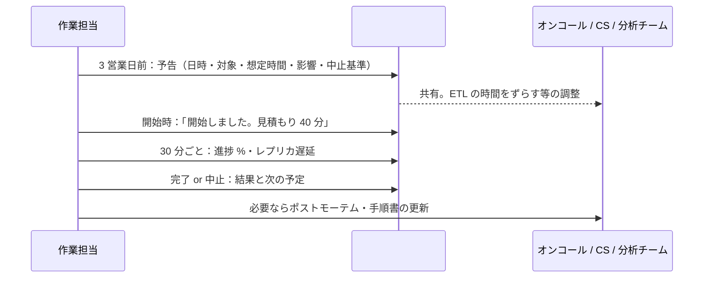

# 長時間DDLとデータ移行のリリース

[[MOC_リリース・デプロイ体系|📚 目次]] ｜ [[02_Expand-Contractのリリース計画|← 前へ]] ｜ [[01_リリース後の重点監視|次へ →]]

> [!abstract] この記事で分かること
> - 大きなテーブルへのインデックス作成・型変更・バックフィルなど、時間のかかる DB 変更をリリースとしてどう運用するか
> - 本番相当データでの所要時間の計測、実行時間帯の選び方、`lock_timeout` とリトライ
> - 進捗の監視と、レプリケーション遅延・IO を見ながらのスロットリング
> - gh-ost / pt-online-schema-change / pg_repack の位置づけ、中断と再開、関係者への告知
>
> **前提**：[[01_アプリとDB変更のリリース順序]] と [[07_ゼロダウンタイムのスキーマ変更]] を読んでいると理解しやすいです。

## 1. ひとことで言うと

幹線道路の工事にたとえます。工事の前に「何時間かかるか」を見積もり、交通量の少ない夜間に車線を規制し、渋滞がひどくなったら作業を一時止めて車を流します。工事が途中で終わらなければ、安全な状態にして翌日に続きをします。そして近隣の住民やバス会社には、事前に「この日のこの時間に工事します」と知らせておきます。

長時間 DDL（Data Definition Language：テーブル定義を変える SQL）やデータ移行のリリースも同じです。

- **見積もる**：本番相当のデータで所要時間を測っておく
- **時間帯を選ぶ**：負荷の低い時間に、人がそろっているときに流す
- **渋滞を見て加減する**：レプリケーション遅延や IO を見ながら速度を落とす（スロットリング）
- **止められるようにする**：中断しても安全で、続きから再開できる作りにする
- **知らせる**：影響を受ける人に事前・実行中・完了後に連絡する

SQL の書き方（`CONCURRENTLY`、`NOT VALID`、バッチ分割など）は [[07_ゼロダウンタイムのスキーマ変更]] にあるので、この記事では**運用（いつ・どう流し・どう見守るか）**に絞ります。

## 2. 何が「長時間」になるのか

Shop の `orders`（1 億行、80 GB）や `order_items`（3 億行）のような大きなテーブルでは、次の変更が数分〜数時間かかります。

| 変更 | 安全なやり方（詳細は DB 章） | 時間がかかる理由 | リリース上の注意 |
|---|---|---|---|
| インデックス作成 | `CREATE INDEX CONCURRENTLY` | テーブルを 2 回スキャンし、既存トランザクションの終了を待つ | 失敗すると `INVALID` なインデックスが残る |
| 列の型変更（`INTEGER` → `BIGINT`） | 新しい列を追加してバックフィル、または MySQL ならオンラインスキーマ変更ツール | 全行の書き換え | 実質的に Expand-Contract（[[02_Expand-Contractのリリース計画]]） |
| バックフィル | 主キー範囲で分割し、バッチごとにコミット | 全行の UPDATE、WAL（変更ログ）の大量生成 | レプリカ遅延、ディスク、autovacuum への影響 |
| 制約の検証 | `NOT VALID` → `VALIDATE CONSTRAINT` | 全行のスキャン | 読み書きは止めないが IO を使う |
| 肥大化したテーブルの再編成 | `pg_repack` | テーブル全体のコピー | テーブルとインデックスの約 2 倍の空きディスクが必要 |

これらは**アプリのデプロイパイプラインに混ぜない**のが原則です。数十分かかる処理をデプロイ前ジョブに入れると、その間アプリのリリースがすべて止まり、ジョブのタイムアウト（GitHub Actions のジョブは既定で 360 分）にも引っかかります。前回までの「マイグレーションとデプロイは別リリース」をさらに進めて、**長時間の変更は独立した作業として計画・実行**します。

## 3. 事前に所要時間を計測する

### 3.1 本番相当のデータで測る

開発環境の 1000 行では一瞬でも、本番の 1 億行では 40 分かかることがあります。**本番のスナップショットから復元した環境**で、実際に流して測ります。

```bash
# 例：AWS RDS のスナップショットから検証用インスタンスを復元
aws rds restore-db-instance-from-db-snapshot \
  --db-instance-identifier shop-ddl-rehearsal \
  --db-snapshot-identifier rds:shop-prod-2026-10-11-03-00 \
  --db-instance-class db.r6g.2xlarge   # 本番と同じクラスにする
```

```sql
-- 検証環境で：対象テーブルの大きさを確認
SELECT pg_size_pretty(pg_total_relation_size('orders')) AS total,
       (SELECT reltuples::bigint FROM pg_class WHERE relname = 'orders') AS approx_rows;

-- 実行時間を測る（psql）
\timing on
CREATE INDEX CONCURRENTLY orders_coupon_id_idx ON orders (coupon_id);
```

### 3.2 測った値をそのまま信じない

検証環境は本番と条件が違います。

- **本番には同時にアプリの負荷がある**：IO や CPU を取り合うので遅くなる
- **キャッシュの状態が違う**：復元直後はディスクから読むので遅く、逆に本番より速く見えることもある
- **`CONCURRENTLY` は既存トランザクションを待つ**：本番で長いトランザクションがあると、その分だけ待たされる

目安として、**計測値の 1.5〜2 倍**を見積もりとして手順書に書き、「この時間を大きく超えたら中断を検討する」という基準も一緒に決めておきます。リハーサル環境の作り方は [[04_リハーサルとステージング環境]] を参照してください。

## 4. 実行時間帯と実行方法

### 4.1 時間帯を選ぶ

| 観点 | 考えること |
|---|---|
| アプリの負荷 | ダッシュボードで 1 週間分のリクエスト数・DB の CPU を見て、谷の時間を選ぶ（Shop なら平日の早朝など） |
| 他のバッチ | 夜間の集計バッチ、バックアップ、ETL（分析基盤へのデータ転送）と重ならないか |
| 人がいるか | 問題が起きたとき、DB に詳しい人とオンコール担当が対応できるか。**深夜に 1 人で流さない** |
| 業務イベント | セールやキャンペーンの前後、月末の締め処理を避ける。凍結期間との関係は [[05_凍結期間とメンテナンス窓]] |

「深夜なら負荷が低い」は正しいことが多いですが、人の判断力も落ちます。`CONCURRENTLY` やバッチ分割で**サービスを止めない方法**を取れるなら、負荷が低めの**平日の業務時間の始め**を選ぶチームも多いです。

### 4.2 どこから流すか

- **手元の PC から流さない**：Wi-Fi が切れたり PC がスリープしたりすると、セッションが切れて処理が中断します
- 踏み台サーバー上の `tmux` / `screen`、または **Kubernetes Job** として流します。Job ならログも残り、誰が何を流したかも追えます
- 実行用の DB ユーザーは、アプリ用とは別の**マイグレーション専用ユーザー**にします

### 4.3 lock_timeout とリトライ

`CREATE INDEX CONCURRENTLY` や `ADD COLUMN` も、最初と最後に一瞬だけ強いロックを必要とします。長いクエリが走っていると、そのロック待ちの後ろにアプリのクエリが並んでしまいます（仕組みは [[07_ゼロダウンタイムのスキーマ変更]]）。そこで **`lock_timeout` で短く諦め、時間を置いてリトライ**します。

インデックス作成のリトライで注意したいのは、**失敗すると `INVALID` なインデックスが残る**ことです。リトライの前に必ず掃除します。

```bash
#!/usr/bin/env bash
# scripts/create-index-with-retry.sh
set -u
INDEX=orders_coupon_id_idx
for attempt in 1 2 3 4 5; do
  echo "[$(date +%T)] attempt $attempt"
  # 前回失敗して INVALID なインデックスが残っていたら削除
  invalid=$(psql "$DATABASE_URL" -tAc "
    SELECT count(*) FROM pg_index i JOIN pg_class c ON c.oid = i.indexrelid
    WHERE c.relname = '$INDEX' AND NOT i.indisvalid;")
  if [ "$invalid" != "0" ]; then
    echo "INVALID な $INDEX を削除します"
    psql "$DATABASE_URL" -v ON_ERROR_STOP=1 -c "DROP INDEX CONCURRENTLY $INDEX;"
  fi

  if psql "$DATABASE_URL" -v ON_ERROR_STOP=1 <<SQL
SET lock_timeout = '5s';      -- ロック待ちは 5 秒で諦める
SET statement_timeout = 0;    -- 本体は長時間かかるので文の時間制限は外す
CREATE INDEX CONCURRENTLY IF NOT EXISTS $INDEX ON orders (coupon_id);
SQL
  then
    echo "done"; exit 0
  fi
  sleep $((attempt * 60))      # 1 分、2 分、3 分…と間隔を広げる
done
echo "giving up"; exit 1
```

> [!warning] 「既にあるインデックス」を消さないように
> 上のスクリプトは「このリリースで新しく作るインデックス」専用です。既存のインデックスを作り直す場合は、`REINDEX INDEX CONCURRENTLY` を使うなど別の手順にします。

## 5. 進捗監視とスロットリング

### 5.1 何を見るか

長時間の作業中は、**作業そのものの進捗**と**本番への影響**の 2 つを並べて見ます。

| 種類 | 指標 | どこで見るか（PostgreSQL / AWS の例） |
|---|---|---|
| 進捗 | インデックス作成のフェーズと処理済みブロック数 | `pg_stat_progress_create_index` |
| 進捗 | バックフィルの処理済み ID / 最大 ID | ジョブが出すログ・メトリクス |
| 影響 | レプリケーション遅延 | `pg_stat_replication` の `replay_lag`、RDS の `ReplicaLag` |
| 影響 | DB の IO・CPU | RDS の `ReadIOPS` / `WriteIOPS` / `CPUUtilization` |
| 影響 | ロック待ち | `pg_stat_activity` の `wait_event_type = 'Lock'` |
| 影響 | アプリのレイテンシ・エラー率 | APM、ゴールデンシグナルのダッシュボード（[[03_ゴールデンシグナル]]） |

```sql
-- インデックス作成の進捗（PostgreSQL 12 以降）
SELECT relid::regclass AS table_name, phase,
       round(100.0 * blocks_done / nullif(blocks_total, 0), 1) AS pct_blocks,
       tuples_done, tuples_total
FROM pg_stat_progress_create_index;

-- レプリカの遅延（プライマリで実行）
SELECT application_name, replay_lag FROM pg_stat_replication;
```

### 5.2 中断の基準を先に決める

作業中に慌てないよう、**「これを超えたら一時停止 / 中止」の基準**を手順書に書いておきます。

| 状況 | 判断の例 |
|---|---|
| レプリカ遅延が 30 秒を超えた | 一時停止（スロットリング）。読み取りをレプリカに振っていると古いデータが返るため |
| アプリの p99 レイテンシが平常の 2 倍を超えた | 一時停止し、原因を確認 |
| 見積もり時間の 2 倍を超えた | 中止を検討。条件を見直して日を改める |
| ディスクの空きが 20% を切った | 中止（バックフィルの WAL やインデックスでディスクが埋まると DB 全体が止まる） |

### 5.3 バックフィルを負荷に応じて減速する

バックフィルは自前のジョブで書くことが多いので、**レプリカ遅延を見て自動で休む**仕組みを入れておきます。

```typescript
// jobs/backfill-orders-total-bigint.ts（Shop の例：orders.total を BIGINT の新列へコピー）
import { Pool } from "pg";

const pool = new Pool({ connectionString: process.env.MIGRATION_DATABASE_URL });
const BATCH = 5_000;
const MAX_LAG_SEC = 10;

async function replicaLagSeconds(): Promise<number> {
  const r = await pool.query(
    "SELECT coalesce(max(extract(epoch FROM replay_lag)), 0) AS lag FROM pg_stat_replication",
  );
  return Number(r.rows[0].lag);
}

async function main() {
  // 再開できるよう、進捗をテーブルに記録しておく
  const { rows } = await pool.query(
    "SELECT last_id FROM backfill_progress WHERE job = 'orders_total_bigint'",
  );
  let lastId = rows[0]?.last_id ?? 0;
  const { rows: [{ max }] } = await pool.query("SELECT max(id) FROM orders");

  while (lastId < max) {
    if (process.env.BACKFILL_PAUSED === "1") break;           // 手動停止スイッチ
    const lag = await replicaLagSeconds();
    if (lag > MAX_LAG_SEC) {                                  // 遅れていたら待つ
      console.log(`replica lag ${lag}s > ${MAX_LAG_SEC}s, sleeping`);
      await new Promise((r) => setTimeout(r, 30_000));
      continue;
    }
    await pool.query(
      `UPDATE orders SET total_v2 = total
       WHERE id > $1 AND id <= $2 AND total_v2 IS NULL`,      // 冪等：やり直しても安全
      [lastId, lastId + BATCH],
    );
    lastId += BATCH;
    await pool.query(
      `INSERT INTO backfill_progress (job, last_id) VALUES ('orders_total_bigint', $1)
       ON CONFLICT (job) DO UPDATE SET last_id = EXCLUDED.last_id`,
      [lastId],
    );
    console.log(`progress ${lastId}/${max} (${((lastId / max) * 100).toFixed(1)}%)`);
    await new Promise((r) => setTimeout(r, 50));             // 平常時も少し休む
  }
  await pool.end();
}
main();
```

ポイントは、**進捗の記録（再開用）、冪等な UPDATE、レプリカ遅延での自動減速、手動の停止スイッチ**の 4 つです。分割の考え方そのものは [[07_ゼロダウンタイムのスキーマ変更]] の 6 章を参照してください。

## 6. オンラインスキーマ変更ツールの位置づけ

MySQL では、型変更など「テーブルのコピーが必要な変更」を止めずに行うために、専用ツールを使うのが定番です。PostgreSQL では `CONCURRENTLY` / `NOT VALID` / Expand-Contract の組み合わせが基本で、`pg_repack` は主に**テーブルの肥大化（bloat）の解消**に使います。

| ツール | 対象 | 何をするか | リリース運用で効く機能（2026 年時点） |
|---|---|---|---|
| **gh-ost**（GitHub） | MySQL | 新構造のゴーストテーブルにコピーし、binlog から変更を追従、最後に入れ替え（cut-over） | `--max-lag-millis` / `--max-load` で自動スロットル、`--throttle-flag-file` で手動停止、`--postpone-cut-over-flag-file` で**入れ替えのタイミングを人が決める**、`--execute` を付けないと検証のみ |
| **pt-online-schema-change**（Percona） | MySQL | 元テーブルのトリガーで変更を追従しながらコピー | `--max-lag`（既定 1 秒）で一時停止、`--max-load`（既定 `Threads_running=25`）で一時停止、`--critical-load`（既定 `Threads_running=50`）で中止、`--dry-run` / `--execute` |
| **pg_repack** | PostgreSQL | トリガーで変更を記録しながらテーブルを作り直し、カタログ上で入れ替える | 強いロックは開始時と入れ替え時の短時間だけ。`--wait-timeout` でロック待ちの上限、`--dry-run`。主キー（または NOT NULL の一意インデックス）が必要 |

リリースの観点で特に便利なのが、gh-ost の**「コピーは先に進めておき、入れ替えだけを承認後に行う」**運用です。

```bash
# 前日の夕方に開始：コピーと追従を進めるが、入れ替えはしない
touch /tmp/ghost.postpone.flag
gh-ost \
  --host=shop-mysql-replica --database=shop --table=orders \
  --alter="MODIFY total BIGINT NOT NULL" \
  --max-lag-millis=1500 --max-load=Threads_running=25 \
  --throttle-flag-file=/tmp/ghost.throttle \
  --postpone-cut-over-flag-file=/tmp/ghost.postpone.flag \
  --execute

# 翌朝、関係者がそろってから入れ替え
rm /tmp/ghost.postpone.flag
# 負荷が高いときは一時停止
touch /tmp/ghost.throttle
```

> [!note] Shop は PostgreSQL
> Shop の DB は PostgreSQL なので、gh-ost / pt-online-schema-change は使いません。MySQL を使う別サービスがある場合の参考として知っておけば十分です。MySQL の Online DDL（`ALGORITHM=INSTANT/INPLACE`）との使い分けは [[07_ゼロダウンタイムのスキーマ変更]] の 8 章を参照してください。

## 7. 中断と再開

長時間の作業は「途中で止めることがある」前提で作ります。

| 作業 | 中断したときの状態 | 再開の方法 |
|---|---|---|
| `CREATE INDEX CONCURRENTLY` | `INVALID` なインデックスが残る（検索には使われないが、書き込みのたびに更新コストがかかる） | `DROP INDEX CONCURRENTLY` してから最初からやり直す（4.3 のスクリプト） |
| 分割バックフィル | 途中までコミット済み | 進捗テーブルの `last_id` から、または `IS NULL` 条件で続きから |
| `VALIDATE CONSTRAINT` | 制約は `NOT VALID` のまま（新しい行には効いている） | もう一度 `VALIDATE` を実行 |
| gh-ost / pt-osc | ゴーストテーブル・トリガーが残ることがある | ツールの後片付け手順に従って削除し、やり直す（再開機能の有無はバージョンで違うので確認する） |
| pg_repack | 一時オブジェクトが残ることがある | 公式ドキュメントの手順で拡張を入れ直して掃除する |

**「中断しても本番の正しさは壊れない」**ことを、リハーサルで実際に途中で止めて確認しておくと安心です。

## 8. 関係者への告知

長時間の変更は、サービスを止めなくても**誰かに影響する**ことがあります。

| 相手 | なぜ知らせるか |
|---|---|
| オンコール担当・SRE | 作業中にアラート（レプリカ遅延など）が出る可能性がある |
| 開発者全員 | 作業中は対象テーブルへの別の DDL をマージしない（`pg_repack` 中は DDL がブロックされる） |
| データ分析チーム | レプリカからデータを取っている ETL や BI が、遅延の影響を受ける |
| カスタマーサポート | 「一部の画面が遅い」問い合わせが来たときに、原因を把握できる |



告知文の例です。

```text
【DB 作業予告】orders へのインデックス追加（SHOP-612）
日時  : 10/20（火）10:00〜11:30（見積もり 40 分、余裕込み 90 分）
内容  : CREATE INDEX CONCURRENTLY orders_coupon_id_idx
影響  : サービス停止なし。DB の IO が上がり、レプリカ遅延が数十秒出る可能性
お願い: 作業中は orders への DDL を含む PR をマージしないでください
        分析チームは 10:00〜11:30 のレプリカからの抽出を避けてください
中止基準: レプリカ遅延 60 秒超が 5 分継続 / API p99 が平常の 2 倍
担当  : @kai（オンコール：@sre-oncall）
```

手順書とチェックリストの書き方は [[03_リリース手順書とチェックリスト]] を参照してください。

## よくある誤解・つまずき

- ❌ 「`CONCURRENTLY` を付けたので、いつ流しても影響はない」
  ✅ 書き込みは止めませんが、テーブルを 2 回スキャンするので **IO と CPU を使い、レプリカ遅延も起きます**。負荷の低い時間帯を選び、監視しながら流します。

- ❌ 「検証環境で 10 分だったので、本番も 10 分」
  ✅ 本番にはアプリの負荷や長いトランザクションがあり、遅くなるのが普通です。1.5〜2 倍で見積もり、中断基準も決めておきます。

- ❌ 「長いマイグレーションもデプロイパイプラインで一緒に流せばよい」
  ✅ その間アプリのリリースが止まり、ジョブのタイムアウトにも当たります。長時間の変更は独立した作業として計画します。

- ❌ 「失敗したら、同じコマンドをもう一度流せばよい」
  ✅ `CREATE INDEX CONCURRENTLY` は失敗すると `INVALID` なインデックスが残るので、先に削除が必要です。バックフィルは冪等に書いておかないと、二重更新が起きます。

## まとめ

- 大きなテーブルへのインデックス作成・型変更・バックフィルは、**アプリのデプロイから切り離した独立した作業**としてリリースする
- **本番のスナップショットで所要時間を計測**し、1.5〜2 倍で見積もる。中断基準も先に決める
- 負荷の谷で、人がそろっている時間に、手元の PC ではなく踏み台や Job から流す。**`lock_timeout` で短く諦めてリトライ**
- 進捗（`pg_stat_progress_create_index`、バックフィルのログ）と影響（レプリカ遅延・IO・レイテンシ）を並べて見て、**負荷に応じてスロットリング**する
- MySQL は gh-ost / pt-online-schema-change、PostgreSQL の肥大化解消は pg_repack。どれも**中断・再開と後片付け**を想定しておく
- オンコール・開発者・分析チーム・CS に**事前・実行中・完了後**に告知する

## 確認クイズ

1. 検証環境で 12 分だったインデックス作成を本番で流す計画を立てます。手順書に書いておくべきことを 3 つ挙げてください。

> [!tip]- 答え
> 例：① 見積もり時間（12 分 × 1.5〜2 倍 = 20〜25 分程度）と、それを大きく超えたときの判断。② 中断基準（レプリカ遅延、API レイテンシ、ディスク空き）。③ 失敗時の後片付け（`INVALID` インデックスの削除）と再実行の手順。ほかに、実行時間帯、実行場所、告知先なども書きます。

2. バックフィルジョブが途中で止まっても安全に再開できるようにするための工夫を 2 つ挙げてください。

> [!tip]- 答え
> ① UPDATE を冪等にする（`WHERE 新列 IS NULL` などの条件を付け、何度流しても結果が同じになるようにする）。② 進捗（処理済みの最終 ID）をテーブルやログに記録し、そこから再開できるようにする。

3. gh-ost の `--postpone-cut-over-flag-file` は、リリース運用でどう役立ちますか？

> [!tip]- 答え
> 時間のかかるデータのコピーと追従は先に進めておき、最後のテーブル入れ替え（cut-over）だけを、関係者がそろった時間に人の判断で行えます。フラグファイルを削除すると入れ替えが実行されます。

## 関連ノート
- [[01_アプリとDB変更のリリース順序]] — マイグレーションとデプロイを別リリースにする原則
- [[02_Expand-Contractのリリース計画]] — バックフィルを含む複数リリースの計画
- [[04_リハーサルとステージング環境]] — 本番相当データでのリハーサル
- [[05_凍結期間とメンテナンス窓]] — 作業時間帯の決め方
- [[03_リリース手順書とチェックリスト]] — 中断基準や告知を手順書にする
- [[01_リリース後の重点監視]] — 作業後の監視
- [[07_ゼロダウンタイムのスキーマ変更]] — `CONCURRENTLY`・`NOT VALID`・バッチ分割の SQL（DB 章）
- [[05_マイグレーションのよくある問題と対処法]] — ロック待ちや INVALID インデックスの後始末（DB 章）
- [[03_ゴールデンシグナル]] — 作業中に見るアプリ側の指標
- [[02_ランブックの書き方]] — 中断・再開手順をランブックにする

## 参考
- [PostgreSQL Documentation: Progress Reporting（pg_stat_progress_create_index）](https://www.postgresql.org/docs/current/progress-reporting.html)
- [PostgreSQL Documentation: CREATE INDEX（Building Indexes Concurrently）](https://www.postgresql.org/docs/current/sql-createindex.html)
- [PostgreSQL Documentation: Client Connection Defaults（lock_timeout / statement_timeout）](https://www.postgresql.org/docs/current/runtime-config-client.html)
- [gh-ost: Throttle](https://github.com/github/gh-ost/blob/master/doc/throttle.md)
- [gh-ost: Command line flags](https://github.com/github/gh-ost/blob/master/doc/command-line-flags.md)
- [Percona Toolkit: pt-online-schema-change](https://docs.percona.com/percona-toolkit/pt-online-schema-change.html)
- [pg_repack](https://reorg.github.io/pg_repack/)
- [GitHub Docs: Workflow syntax（jobs.<job_id>.timeout-minutes）](https://docs.github.com/en/actions/writing-workflows/workflow-syntax-for-github-actions)
