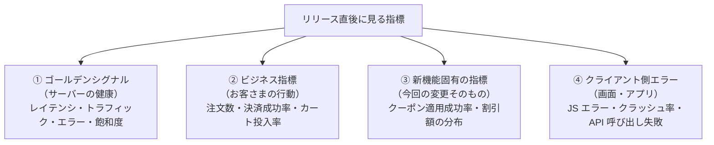

# リリース後の重点監視

[[MOC_リリース・デプロイ体系|📚 目次]] ｜ [[03_長時間DDLとデータ移行のリリース|← 前へ]] ｜ [[02_段階的トラフィック移行と自動分析|次へ →]]

> [!abstract] この記事で分かること
> - リリース直後に「何を」「どれだけの時間」見ればよいか
> - 見るべき指標の 4 分類（ゴールデンシグナル／ビジネス指標／新機能固有の指標／クライアント側エラー）
> - デプロイマーカー（Grafana のアノテーション、Datadog のイベント）でグラフに「ここでリリースした」と印を付ける方法
> - バージョン別にメトリクスを分ける（`version` ラベル）ことで新旧を比べられるようにする方法
> - リリース担当（当番）の役割と、リリース監視用ダッシュボードの例
>
> **前提**：[[04_ロールバック判断基準]] と [[03_ゴールデンシグナル]] を読んでいると理解しやすいです。

## 1. ひとことで言うと

手術が終わった患者さんは、すぐ一般病棟には戻らず、しばらく回復室で心拍や血圧を集中的に見守られます。手術そのものが成功しても、合併症が出やすいのは「直後」だからです。リリースも同じで、**デプロイが完了した瞬間がゴールではなく、そこから一定時間は「回復室」で集中的に見守る**必要があります。

- 障害の多くは「変更の直後」に起きる（Google SRE 本でも、障害の大きな割合が変更に起因すると述べられています）
- 普段の監視（アラート）は「しきい値を超えたら呼ぶ」仕組みなので、**小さいけれど確実な悪化**は見逃しがち
- だからリリース直後だけは、人が（または自動分析が）**新旧の比較**という目線で能動的に見る

> [!note] 可観測性そのもの（メトリクス・ログ・トレースの仕組み、SLO の設計など）は [[MOC_可観測性体系]] で扱います。この回は「リリースという出来事に合わせて、それをどう使うか」に絞ります。

## 2. 何を、どれだけの時間見るか

### 2.1 時間の目安（監視ウィンドウ）

「どれだけ見るか」は、問題が表に出るまでの時間で決めます。Shop の「注文確定 API にクーポン機能を追加する」リリースを例にすると、次のように段階を分けると考えやすくなります。

```mermaid
gantt
    title リリース後の監視ウィンドウ（例：Shop クーポン機能）
    dateFormat HH:mm
    axisFormat %H:%M
    section デプロイ
    デプロイ実行（ローリング/カナリア）   :a1, 14:00, 20m
    section 集中監視（当番が画面に張り付く）
    起動直後の異常（5xx・再起動・遅延）     :crit, b1, 14:00, 30m
    主要フローの確認（注文・決済）         :b2, after b1, 30m
    section 警戒監視（アラート＋定期確認）
    トラフィックのピークを1回経験          :c1, 15:00, 180m
    section 翌日以降
    バッチ・日次集計・週次処理の初回       :d1, 18:00, 360m
```



| フェーズ | 時間の目安 | 主に見つかるもの |
|---|---|---|
| 起動直後 | デプロイ中〜15 分 | 起動失敗、設定ミス、接続先間違い、5xx の急増 |
| 集中監視 | 〜1 時間程度 | 一部の機能だけのエラー、レイテンシ悪化、ビジネス指標の落ち込み |
| 警戒監視 | 最初のピーク時間帯を 1 回越えるまで | 負荷が上がったときだけ出る問題（コネクション枯渇、メモリリーク） |
| 翌日以降 | 日次バッチや週次処理の初回まで | 夜間バッチ、日付またぎ、月末処理などの「たまにしか通らない道」 |

数字はあくまで目安です。大事なのは **「どの種類の問題が、いつ表に出るか」を考えて監視の終わりを決める**ことです。たとえばメモリリークは数時間かけて効いてくるので、15 分見て「問題なし」としても安心できません。

### 2.2 「いつ監視を終えてよいか」をあらかじめ決める

監視の終わりがあいまいだと、「なんとなく大丈夫そう」で解散してしまいます。手順書（[[03_リリース手順書とチェックリスト]]）に、次のような **終了条件** を書いておくのがおすすめです。

- デプロイ完了から 60 分経過し、その間の 5xx 率が旧バージョンと同等（差が 0.1 ポイント以内など）
- 注文確定数が先週同曜日・同時刻の ±10% 以内
- 新機能固有の指標（クーポン適用成功率）が 99% 以上
- 未解決のアラートがない

## 3. 見る指標の 4 分類

リリース後に見る指標は、次の 4 つに分けて考えると漏れが減ります。



### ① ゴールデンシグナル（Golden Signals）

Google SRE 本が「最低限これを見よ」と挙げる 4 つの指標です。詳しくは [[03_ゴールデンシグナル]] を参照してください。

| シグナル | Shop API での例 | リリース後に見るポイント |
|---|---|---|
| レイテンシ（Latency：応答時間） | 注文確定 API の p99 応答時間 | 平均ではなく **p95/p99**。一部だけ遅くなる劣化は平均に出にくい |
| トラフィック（Traffic：流量） | リクエスト数/秒 | 急に減ったら「エラーで離脱」や「ルーティングミス」を疑う |
| エラー（Errors） | 5xx 率、タイムアウト率 | **成功したように見える失敗**（200 だが中身が空）にも注意 |
| 飽和度（Saturation：どれだけ余裕がないか） | CPU、メモリ、DB コネクション数 | リリース前より **右肩上がり** になっていないか |

### ② ビジネス指標（Business Metrics）

サーバーは元気でも、お客さまが注文できていなければ失敗です。たとえば「クーポン入力欄の追加でボタンが画面外に押し出された」ような不具合は、5xx にはまったく出ません。

- 注文確定数／分、決済成功率、カート投入数
- **先週の同じ曜日・同じ時刻** と比べる（EC は時間帯で大きく変わるため、「1 時間前」と比べても意味が薄い）

### ③ 新機能固有の指標

今回の変更が「ちゃんと動いているか」を直接示す指標です。**リリース前にコードに仕込んでおかないと、リリース後には見られません**。

- クーポン適用リクエスト数、適用成功率、適用失敗の理由別件数
- 割引額の分布（0 円割引ばかり、あるいは異常に大きい割引が出ていないか）

### ④ クライアント側エラー

フロントエンド（Next.js）やモバイルアプリで起きるエラーは、サーバーのメトリクスからは見えません。

- ブラウザの JavaScript エラー件数（Sentry などのエラートラッキング）
- モバイルアプリのクラッシュ率（Firebase Crashlytics など）
- クライアントから見た API 呼び出しの失敗率（RUM：Real User Monitoring＝実ユーザーの体験計測）

> [!warning] API の変更がアプリを壊すことがある
> API のレスポンス形式を少し変えただけで、古いバージョンのモバイルアプリがクラッシュすることがあります。サーバーのエラー率は 0% のまま、アプリのクラッシュ率だけが上がる、というパターンです。詳しくは [[03_ロールバックできない変更]] も参照してください。

## 4. デプロイマーカー：グラフに「ここでリリースした」と印を付ける

### 4.1 なぜ必要か

グラフで 14:05 からエラーが増えているのを見つけたとき、まず知りたいのは「その時刻に何が変わったか」です。チャットの履歴をさかのぼって探すのでは遅すぎます。**デプロイマーカー**（Deploy Marker）は、グラフ上にデプロイ時刻の縦線を引いて、変化とリリースの関係をひと目で分かるようにするものです。

```
エラー率
  │                         ┆ v2.4.0 デプロイ
  │                         ┆
  │                         ┆     ╭──╮
  │                         ┆  ╭──╯  ╰──
  │─────────────────────────┆──╯
  └─────────────────────────┴──────────────→ 時刻
                          14:00
```

### 4.2 Grafana のアノテーション（Annotations）

Grafana では HTTP API `POST /api/annotations` でアノテーション（グラフ上の注釈）を作れます。`dashboardUID` を省略すると **組織全体のアノテーション** になり、どのダッシュボードからでもタグで呼び出せます（2026 年時点）。

GitHub Actions のデプロイジョブの最後に、次のステップを足します。

```yaml
# .github/workflows/deploy.yml（抜粋）
      - name: Grafana にデプロイマーカーを付ける
        if: success()
        env:
          GRAFANA_URL: ${{ vars.GRAFANA_URL }}
          GRAFANA_TOKEN: ${{ secrets.GRAFANA_SA_TOKEN }}  # annotations:create 権限のサービスアカウント
        run: |
          curl -sS -X POST "$GRAFANA_URL/api/annotations" \
            -H "Authorization: Bearer $GRAFANA_TOKEN" \
            -H "Content-Type: application/json" \
            -d "{
                  \"time\": $(date +%s%3N),
                  \"tags\": [\"deploy\", \"shop-api\", \"production\"],
                  \"text\": \"shop-api ${GITHUB_REF_NAME} deployed by ${GITHUB_ACTOR} (${GITHUB_SHA::7})\"
                }"
```

ダッシュボード側では、設定の Annotations で「Grafana」データソースを選び、タグ `deploy` と `shop-api` で絞り込むと、すべてのパネルに縦線が表示されます。

> [!tip] 開始と終了の両方を記録する
> カナリアやローリングで 20 分かかるデプロイなら、`time` と `timeEnd` を両方入れた **範囲アノテーション**（region annotation）にすると、「デプロイ中」の時間帯が帯で表示されて分かりやすくなります。

### 4.3 Datadog のイベント

Datadog ではイベント（Events）を送ると、ダッシュボードのグラフにオーバーレイ表示できます。Events API v1 の例です（2026 年時点。v2 の Event Management API もあります）。

```bash
curl -sS -X POST "https://api.datadoghq.com/api/v1/events" \
  -H "DD-API-KEY: ${DD_API_KEY}" \
  -H "Content-Type: application/json" \
  -d '{
        "title": "Deploy shop-api v2.4.0",
        "text": "クーポン機能を追加 (commit abc1234)",
        "tags": ["service:shop-api", "env:production", "version:2.4.0", "event_type:deploy"],
        "alert_type": "info"
      }'
```

さらに Datadog APM では、アプリに `DD_VERSION`（統合サービスタグの `version`）を設定しておくと、**デプロイ追跡（Deployment Tracking）** 機能でバージョンごとのエラー率やレイテンシを自動で比較してくれます。

## 5. バージョン別にメトリクスを分ける

### 5.1 マーカーだけでは足りない理由

ローリングアップデートやカナリアでは、**新旧のバージョンが同時に動いている時間** があります（[[03_ローリングアップデート]]、[[05_カナリアリリース]]）。全体のエラー率だけを見ていると、新バージョンが 10% のトラフィックしか受けていない段階では、新バージョンのエラーが薄まって見えなくなります。

```
全体のエラー率 = 0.9 × 旧(0.1%) + 0.1 × 新(2.0%) = 0.29%
                                     ↑ 新だけ見ると 20 倍悪化しているのに
                                       全体では「ちょっと上がった」程度にしか見えない
```

### 5.2 `version` ラベルを付ける

メトリクスに **バージョンのラベル**（タグ）を付けておけば、新旧を並べて比較できます。Shop API（Node.js / TypeScript、prom-client）での例です。

```typescript
// metrics.ts
import client from "prom-client";

const APP_VERSION = process.env.APP_VERSION ?? "unknown"; // CI でイメージに埋め込む

// すべてのメトリクスに共通ラベルとして付与する
client.register.setDefaultLabels({ app: "shop-api", version: APP_VERSION });

export const httpRequests = new client.Counter({
  name: "http_requests_total",
  help: "HTTP リクエスト数",
  labelNames: ["route", "method", "status"],
});

export const couponApplied = new client.Counter({
  name: "shop_coupon_apply_total",
  help: "クーポン適用の試行数",
  labelNames: ["result"], // success / invalid / expired / error
});
```

Kubernetes の場合は、Pod のラベルにバージョンを入れ、環境変数として渡すのが定番です。

```yaml
# Deployment（抜粋）
  template:
    metadata:
      labels:
        app: shop-api
        version: "2.4.0"
    spec:
      containers:
        - name: shop-api
          image: ghcr.io/example/shop-api:2.4.0
          env:
            - name: APP_VERSION
              valueFrom:
                fieldRef:
                  fieldPath: metadata.labels['version']
```

これで、PromQL で **バージョン別のエラー率** が出せます。

```promql
sum by (version) (rate(http_requests_total{app="shop-api", status=~"5.."}[5m]))
/
sum by (version) (rate(http_requests_total{app="shop-api"}[5m]))
```

> [!warning] ラベルの数（カーディナリティ）に注意
> `version` のように値の種類が少ないラベルは問題ありませんが、コミット SHA を毎回ラベルにして古い値が消えないと、時系列の数が増え続けます。また、ユーザー ID や注文 ID をラベルにしてはいけません。

## 6. リリース担当（当番）と監視ダッシュボード

### 6.1 リリース担当の役割

「みんなで見ている」は「誰も見ていない」と同じです。リリースごとに **担当者（Release Captain / リリース当番）** を 1 人決め、次の責任を持たせます。

| 役割 | 内容 |
|---|---|
| 監視 | 監視ウィンドウの間、リリース用ダッシュボードを見る |
| 判断 | 異常時に「様子見／ロールバック／ロールフォワード」を決める（基準は [[04_ロールバック判断基準]]） |
| 連絡 | 開始・完了・異常をチャンネルに報告する。オンコール担当に引き継ぐ |
| 記録 | 何が起きたかをメモし、ふりかえり（[[04_リリースのふりかえりとDORA指標]]）の材料にする |

- **ロールバックの権限を持っていること** が重要です。「上の人に確認しないと戻せない」では手遅れになります。
- リリースの時間帯は、オンコール担当（[[01_インシデント対応の基本フロー]]）と被るように設定すると、エスカレーションがスムーズです。
- 金曜の夕方など、監視ウィンドウを最後まで見届けられない時間にはリリースしないのが原則です（[[05_凍結期間とメンテナンス窓]]）。

### 6.2 リリース監視用ダッシュボードの例

普段のダッシュボード（[[05_ダッシュボード設計]]）とは別に、**リリース直後に 1 画面で判断できる** ダッシュボードを用意しておくと便利です。

```
┌──────────────────────── Shop リリース監視 ─────────────────────────┐
│ [変数] version: 2.3.1 vs 2.4.0     期間: デプロイ前 1h 〜 現在      │
├───────────────────────┬───────────────────────┬────────────────────┤
│ 5xx 率（バージョン別）  │ p99 レイテンシ（別）   │ Pod 再起動回数      │
│  旧 ── 0.1%           │  旧 ── 320ms          │  0 / 0 / 0 / 1     │
│  新 ── 0.1%           │  新 ── 340ms          │                    │
├───────────────────────┼───────────────────────┼────────────────────┤
│ 注文確定数/分          │ 決済成功率             │ クーポン適用成功率   │
│ （今週 vs 先週同時刻）   │                       │ 理由別の失敗件数     │
├───────────────────────┴───────────────────────┴────────────────────┤
│ フロント JS エラー数 / アプリクラッシュ率 / DB コネクション使用率        │
├────────────────────────────────────────────────────────────────────┤
│ ┆ ← 全パネル共通：デプロイマーカー（tag: deploy, shop-api）          │
└────────────────────────────────────────────────────────────────────┘
```

設計のポイントは次のとおりです。

- **上段に「すぐ戻すべきか」を判断する指標**（エラー・レイテンシ・再起動）、中段に「お客さまへの影響」、下段に周辺指標
- 新旧を **同じグラフに重ねる**（別々のグラフにすると縦軸の違いで見誤る）
- 比較対象（先週同時刻）を最初から表示しておく
- 手順書からこのダッシュボードへ **直リンク** しておく

## よくある誤解・つまずき

- ❌ デプロイが「成功」と表示されたらリリースは終わり
  ✅ デプロイツールの「成功」は「新しいプロセスが起動した」という意味にすぎません。お客さまが問題なく使えているかは、監視ウィンドウを越えて初めて分かります。
- ❌ エラー率が全体で少ししか上がっていないなら問題ない
  ✅ カナリアやローリング中は新バージョンの悪化が薄まって見えます。必ずバージョン別に見ましょう。
- ❌ サーバーのメトリクスが正常ならお客さまも正常
  ✅ 画面崩れやアプリのクラッシュはサーバー側に出ません。ビジネス指標とクライアント側エラーもセットで見ます。
- ❌ 新機能の指標はリリース後に必要になったら足せばよい
  ✅ 計測コードはリリースに含めておかないと、最初の大事な数時間のデータが残りません。
- ❌ 前の 1 時間と比べて注文数が減ったので異常だ
  ✅ EC の流量は時間帯や曜日で大きく変わります。先週の同じ曜日・時刻と比べるのが基本です。

## まとめ

- リリース直後は「回復室」。問題の種類ごとに表に出る時間が違うので、監視ウィンドウと終了条件を事前に決める
- 見る指標は ①ゴールデンシグナル ②ビジネス指標 ③新機能固有の指標 ④クライアント側エラー の 4 分類
- デプロイマーカー（Grafana アノテーション／Datadog イベント）を CI から自動で付け、変化と変更を結び付ける
- メトリクスに `version` ラベルを付け、新旧を同じグラフで比較する
- リリース担当を 1 人決め、監視・判断（ロールバック権限）・連絡・記録の責任を持たせる

## 確認クイズ

1. カナリアで新バージョンに 5% のトラフィックを流しています。全体の 5xx 率はほとんど変わっていません。「問題なし」と判断してよいでしょうか。
> [!tip]- 答え
> まだ判断できません。新バージョンの 5xx 率が旧の何倍も悪化していても、5% しか流れていないと全体の数字ではほとんど見えません。`version` ラベルでバージョン別に 5xx 率を比べてから判断します。

2. デプロイマーカーがあると、障害対応のどの場面で役立ちますか。
> [!tip]- 答え
> グラフ上で異常が始まった時刻とデプロイ時刻が一致しているかがひと目で分かり、「原因はリリースか、それ以外か」の切り分けが速くなります。チャットやデプロイ履歴を探す手間が省けます。

3. クーポン機能のリリース後、5xx もレイテンシも正常なのに、注文確定数が先週同時刻より 15% 少なくなっています。何を疑いますか。
> [!tip]- 答え
> サーバーでは成功扱いになる不具合（画面崩れ、ボタンが押せない、クライアントの JS エラー、古いアプリのクラッシュなど）を疑い、クライアント側エラーや新機能固有の指標（クーポン適用の失敗理由）を確認します。

## 関連ノート

- [[02_段階的トラフィック移行と自動分析]] — この回の「新旧比較」を自動化する
- [[03_ヘルスチェックと自動ロールバック]] — 起動直後の異常を機械が検知して戻す
- [[04_ロールバック判断基準]] — 監視で異常を見つけたあとの判断
- [[05_カナリアリリース]] — 新旧が同時に動く代表的なデプロイ戦略
- [[MOC_可観測性体系]] — メトリクス・ログ・トレースの仕組み全般
- [[03_ゴールデンシグナル]] — 4 つのシグナルの詳しい解説
- [[05_ダッシュボード設計]] — ダッシュボードづくりの原則
- [[01_デプロイ直後の異常]] — デプロイ直後に障害が起きたときのランブック

## 参考

- [Google SRE Book: Monitoring Distributed Systems（The Four Golden Signals）](https://sre.google/sre-book/monitoring-distributed-systems/)
- [Google SRE Book: Release Engineering](https://sre.google/sre-book/release-engineering/)
- [Grafana: Annotations HTTP API](https://grafana.com/docs/grafana/latest/developers/http_api/annotations/)
- [Datadog: Events API](https://docs.datadoghq.com/api/latest/events/)
- [Datadog: Deployment Tracking](https://docs.datadoghq.com/tracing/services/deployment_tracking/)
