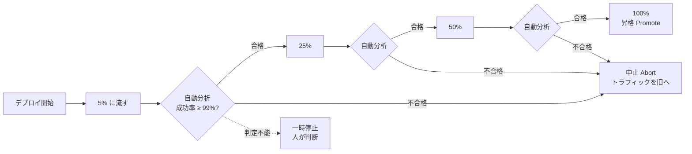

# 段階的トラフィック移行と自動分析

[[MOC_リリース・デプロイ体系|📚 目次]] ｜ [[01_リリース後の重点監視|← 前へ]] ｜ [[03_ヘルスチェックと自動ロールバック|次へ →]]

> [!abstract] この記事で分かること
> - プログレッシブデリバリー（Progressive Delivery）とは何か、カナリアリリースとどう違うか
> - Argo Rollouts の AnalysisTemplate で、Prometheus の成功率を使ってカナリアを自動判定する設定
> - Flagger と Kayenta（Spinnaker）による自動分析の考え方
> - ベースラインとカナリアを比べるときの注意（同じ時刻・同じ規模で比べる）
> - 判定に使う指標と閾値の決め方
>
> **前提**：[[05_カナリアリリース]] と [[01_リリース後の重点監視]] を読んでいると理解しやすいです。

## 1. ひとことで言うと

新しいレシピを店のメニューに載せるとき、いきなり全員に出すのではなく、まず常連さん数人に出して「おいしい？」と反応を見て、評判がよければ少しずつ出す数を増やしていきます。ただ、反応を見るのが店長の「勘」だと、忙しい日には見落とします。そこで「10 人中 1 人でも残したら中止」のように **ルールを決めて、判定を機械に任せる** のがこの回のテーマです。

- **段階的トラフィック移行**：新バージョンに流すトラフィックを 5% → 25% → 50% → 100% と少しずつ増やす
- **自動分析**：各段階でメトリクスを自動で評価し、「進める／止める／戻す」を機械が判断する
- 人が画面に張り付く [[01_リリース後の重点監視]] の一部を、確実で疲れない仕組みに置き換える

## 2. プログレッシブデリバリーとは

### 2.1 定義

**プログレッシブデリバリー（Progressive Delivery）** は、新しいバージョンの影響範囲（ブラスト半径：Blast Radius、問題が起きたときに影響を受ける範囲）を **少しずつ広げながら、各段階で検証してから次へ進む** リリースのやり方の総称です。RedMonk のアナリスト James Governor が 2018 年に提唱した言葉で、カナリアリリース、ブルーグリーン、フィーチャーフラグ（[[06_フィーチャーフラグ]]）による段階公開などを含みます。

### 2.2 カナリアリリースとの違い

| | 昔ながらのカナリア | プログレッシブデリバリー |
|---|---|---|
| 進め方 | 人が手で比率を変える | 段階をコード（YAML）で定義 |
| 判定 | 人がダッシュボードを見て判断 | **メトリクスを自動分析**して判定 |
| 失敗時 | 人が気づいて戻す | 自動で中止・トラフィックを旧へ戻す |
| 記録 | 人の記憶やチャット | 分析結果がリソースとして残る |



ポイントは **「判定不能（Inconclusive）」という第 3 の結果** があることです。データが少なすぎるなど、機械が自信を持てないときは人にバトンを渡します。

## 3. Argo Rollouts の AnalysisTemplate

**Argo Rollouts** は、Kubernetes の Deployment の代わりに `Rollout` というリソースを使い、カナリアやブルーグリーンを段階的に実行するコントローラーです。分析は **AnalysisTemplate**（分析のひな形）に定義し、Rollout から参照します（以下は 2026 年時点の `argoproj.io/v1alpha1`）。

### 3.1 AnalysisTemplate：成功率を Prometheus で判定する

Shop API はメトリクスに `version` ラベルを付けていますが（[[01_リリース後の重点監視]]）、Argo Rollouts では Pod に自動で付く `rollouts-pod-template-hash` ラベルを使うと、**カナリアの ReplicaSet だけ** を正確に絞り込めます。Prometheus のスクレイプ設定で Pod ラベルをメトリクスのラベルにコピー（relabel）しておく前提です。

```yaml
apiVersion: argoproj.io/v1alpha1
kind: AnalysisTemplate
metadata:
  name: shop-api-success-rate
spec:
  args:
    - name: canary-hash        # Rollout から渡される
  metrics:
    - name: success-rate
      interval: 1m             # 1 分ごとに測る
      count: 10                # 10 回測る（= 約 10 分）
      failureLimit: 2          # 不合格が 2 回を超えたら（3 回目で）失敗
      successCondition: len(result) > 0 && result[0] >= 0.99
      provider:
        prometheus:
          address: http://prometheus.monitoring.svc:9090
          query: |
            sum(rate(http_requests_total{
                  app="shop-api",
                  rollouts_pod_template_hash="{{args.canary-hash}}",
                  status!~"5.."}[2m]))
            /
            sum(rate(http_requests_total{
                  app="shop-api",
                  rollouts_pod_template_hash="{{args.canary-hash}}"}[2m]))
    - name: p99-latency
      interval: 1m
      count: 10
      failureLimit: 2
      successCondition: len(result) > 0 && result[0] <= 0.5   # 500ms 以下
      provider:
        prometheus:
          address: http://prometheus.monitoring.svc:9090
          query: |
            histogram_quantile(0.99, sum by (le) (rate(
              http_request_duration_seconds_bucket{
                app="shop-api",
                rollouts_pod_template_hash="{{args.canary-hash}}"}[2m])))
```

| フィールド | 意味 |
|---|---|
| `interval` | 何秒/分ごとに測るか |
| `count` | 何回測るか。省略すると（バックグラウンド分析では）Rollout が終わるまで測り続ける |
| `successCondition` | 合格条件。Prometheus の結果はベクトルなので `result[0]` で値を取り出す |
| `failureLimit` | 許容する不合格回数。**既定値は 0**（1 回でも不合格なら失敗） |
| `failureCondition` | 「これを満たしたら不合格」と明示したい場合に使う。成功・失敗どちらにも当てはまらない結果は **判定不能（Inconclusive）** になる |

> [!warning] `len(result) > 0` を忘れない
> カナリアにまだリクエストが来ていないと、Prometheus の結果が空になります。その場合の扱いを決めておかないと、評価エラーになったり、意図せず合格・不合格になったりします。

### 3.2 Rollout から参照する

```yaml
apiVersion: argoproj.io/v1alpha1
kind: Rollout
metadata:
  name: shop-api
spec:
  replicas: 4
  selector:
    matchLabels:
      app: shop-api
  template:
    metadata:
      labels:
        app: shop-api
    spec:
      containers:
        - name: shop-api
          image: ghcr.io/example/shop-api:2.4.0
  strategy:
    canary:
      canaryService: shop-api-canary
      stableService: shop-api-stable
      trafficRouting:
        alb:                       # AWS ALB で重み付けする例
          ingress: shop-api
          servicePort: 80
      steps:
        - setWeight: 5
        - pause: {duration: 5m}
        - analysis:                # インライン分析：合格するまで次へ進まない
            templates:
              - templateName: shop-api-success-rate
            args:
              - name: canary-hash
                valueFrom:
                  podTemplateHashValue: Latest   # 新しい ReplicaSet のハッシュ
        - setWeight: 25
        - pause: {duration: 10m}
        - setWeight: 50
        - pause: {duration: 10m}
```

- **インライン分析**（steps の中の `analysis`）：その段階で分析を走らせ、**合格すれば次の step へ、不合格なら Rollout 全体を中止** します。
- **バックグラウンド分析**（`strategy.canary.analysis`）：カナリア期間中ずっと裏で分析を続け、どこかで失敗したら中止します。中止されると **カナリアの重みは 0 に戻り**、Rollout は `Degraded` 状態になります。
- 判定不能の場合は **その step で一時停止** し、人が `kubectl argo rollouts promote` または `abort` で判断します。

両方を組み合わせて、「各段階の関門はインライン、全期間の見張りはバックグラウンド」とするのがよく使われる形です。

## 4. Flagger と Kayenta

### 4.1 Flagger

**Flagger** は Flux プロジェクト（CNCF）のプログレッシブデリバリー用コントローラーです。既存の Deployment をそのまま使い、`Canary` リソースを追加するとサービスメッシュ（Istio、Linkerd など）やイングレス（NGINX、Contour など）の重みを自動で操作します。

```yaml
apiVersion: flagger.app/v1beta1
kind: Canary
metadata:
  name: shop-api
spec:
  targetRef:
    apiVersion: apps/v1
    kind: Deployment
    name: shop-api
  service:
    port: 80
    targetPort: 3000
  analysis:
    interval: 1m       # 1 分ごとに評価
    threshold: 5       # 不合格が 5 回に達したらロールバック
    stepWeight: 10     # 10% ずつ増やす
    maxWeight: 50      # 50% まで来て合格なら昇格
    metrics:
      - name: request-success-rate   # 組み込み：非 5xx の割合（%）
        interval: 1m
        thresholdRange:
          min: 99
      - name: request-duration       # 組み込み：P99 応答時間（ms）
        interval: 1m
        thresholdRange:
          max: 500
```

Argo Rollouts との大きな違いは、**Deployment を書き換えずに済む** 点と、**メッシュ／イングレスごとに組み込みメトリクスが用意されている** 点です。一方、段階の細かい制御は Argo Rollouts のほうが柔軟です。

### 4.2 Kayenta（Spinnaker）：統計的な比較

ここまでの例は「成功率 ≥ 99%」のような **固定の閾値** でした。しかし閾値は、季節やトラフィックで変わる指標には向きません。**Kayenta** は Netflix と Google が開発した自動カナリア分析（ACA：Automated Canary Analysis）のツールで、Spinnaker に組み込まれています。

Kayenta の既定の判定器（NetflixACAJudge）は、次のように **ベースラインとカナリアの分布を統計的に比べます**。

1. 各メトリクスについて、カナリアとベースラインの時系列データを取得する
2. **Mann-Whitney U 検定**（2 つのグループの値の分布がずれているかを調べるノンパラメトリック検定）で、有意に高い（High）・低い（Low）・差なし（Pass）に分類する
3. 合格したメトリクスの割合をグループごとに出し、重み付き平均で **0〜100 のスコア** にする
4. スコアを `passThreshold`（合格）・`marginalThreshold`（要注意）と比べて、合格／要注意／不合格を決める
5. 「重大（critical）」に指定したメトリクスが悪化していたら、スコアに関係なく 0 点＝不合格

```
メトリクス           ベースライン vs カナリア   判定
5xx 率               差なし                      Pass
p99 レイテンシ        カナリアが有意に高い        High（悪化）
CPU 使用率           差なし                      Pass
注文確定数           差なし                      Pass
                     → スコア 75 点（4 個中 3 個 Pass）
```

固定閾値を考えなくてよい反面、Google の解説では **メトリクスごとに少なくとも 50 個程度の時系列データ点** が必要とされ、粒度によっては分析に数時間かかることがあります。

## 5. ベースラインとカナリアの比較の注意

### 5.1 「本番全体」と比べてはいけない

カナリアを本番の旧バージョン全体と比べたくなりますが、これには落とし穴があります。Google と Waze の解説では、次の理由で **本番ではなく専用のベースラインと比べる** よう勧めています。

- 新しく起動したカナリアは **キャッシュが温まっていない**、JIT やコネクションプールがまだ育っていない
- 何日も動いている本番の Pod は **メモリ使用量やヒープの状態** が違う
- 台数が違うと、ロードバランサーの振り分けや統計のばらつきが違う

```
悪い比較                           良い比較
┌────────────────────────┐         ┌──────────────────────────────┐
│ 本番（旧）4 台・3 日稼働  │         │ 本番（旧）4 台  ← 比較に使わない │
│ キャッシュ温まり済み      │         ├──────────────────────────────┤
├────────────────────────┤         │ ベースライン（旧）1 台・今起動   │
│ カナリア（新）1 台・今起動 │         │ カナリア（新）  1 台・今起動    │
└────────────────────────┘         └──────────────────────────────┘
→ 差が出ても「新旧の差」か            → 違いは「バージョン」だけ
  「起動直後かどうか」か分からない
```

### 5.2 揃えるべき条件

ベースラインは **旧バージョン・旧設定** で、それ以外はカナリアと同じにします。

| 揃える条件 | 理由 |
|---|---|
| **起動時刻** | 起動直後の特性（ウォームアップ）を揃える |
| **台数（インスタンス数）** | 統計のばらつきと負荷分散を揃える |
| **トラフィックの種類と量** | 同じ時間帯・同じ割合のリクエストを受けさせる |

Argo Rollouts では `Experiment` 機能や、canary step の `experiment` を使うと、ベースラインとカナリアの ReplicaSet を **同時に同じ台数で** 起動できます。

### 5.3 A/A テストで分析そのものを検証する

導入時は、カナリアにも **旧バージョンと同じもの** を出して分析を走らせる **A/A テスト** をしてみましょう。同じものどうしなら必ず合格するはずなので、もし不合格が出るなら、閾値やクエリの設定が厳しすぎる（誤検知する）ことが分かります。

## 6. 判定指標と閾値の決め方

### 6.1 指標の選び方

- **少なくとも 2〜3 種類** を組み合わせる：エラー（成功率）、レイテンシ（p99）、飽和度（CPU・メモリ）。1 つだけだと「速いけど全部エラー」のような失敗を見逃す
- **カナリアに流れている量で意味のある指標** を選ぶ。5% のトラフィックでは注文数のようなビジネス指標は件数が少なすぎてぶれやすい
- **ノイズが少ない指標** を選ぶ。外部 API の気まぐれな遅延に左右される指標は誤判定の元

### 6.2 閾値の決め方

1. **過去データを見る**：直近 2〜4 週間の成功率・p99 の分布を見て、「普段の悪い日」がどこまで行くかを確認する
2. **SLO から逆算する**：SLO が 99.9% なら、カナリアの合格ラインは少なくとも 99.9%（[[01_SLI・SLOの設計]]）
3. **相対比較を検討する**：「ベースライン + 0.5 ポイント以内」のように、絶対値でなく差で判定すると季節変動に強い
4. **`failureLimit` で一時的なぶれを許す**：1 回の不合格で即中止にすると、短いスパイクで誤ロールバックが起きる
5. **最初は `dryRun` で試す**：Argo Rollouts の `dryRun` に指定したメトリクスは、失敗しても Rollout の結果に影響しません。数回のリリースで結果を観察してから本番の判定に使う

> [!tip] 誤検知と見逃しのバランス
> 閾値を厳しくすると **誤検知（問題ないのに中止）** が増え、ゆるくすると **見逃し** が増えます。誤検知が多いとチームは自動分析を信用しなくなり、無効化してしまいがちです。最初はややゆるめに始め、見逃した事例をふりかえり（[[04_リリースのふりかえりとDORA指標]]）で拾って締めていくのが現実的です。

## よくある誤解・つまずき

- ❌ 自動分析を入れれば監視は不要になる
  ✅ 自動分析は「決めた指標」しか見ません。ビジネス指標やクライアント側エラーなど、分析に入れていない問題は人の監視（[[01_リリース後の重点監視]]）で拾います。
- ❌ カナリアは本番の旧バージョン全体と比べればよい
  ✅ 起動時刻・台数・キャッシュの状態が違うため、差が「バージョンの差」か分かりません。同時刻・同規模のベースラインと比べます。
- ❌ カナリアは 5 分見れば十分
  ✅ リクエスト数が少ないと統計的に意味のある判断ができません。トラフィック量から「何件集まれば判断できるか」を考えて時間を決めます。
- ❌ 分析が失敗したら全部自動でロールバックされるから安心
  ✅ トラフィックは戻りますが、その間に書き込まれたデータや送ったメールは戻りません（[[03_ロールバックできない変更]]）。
- ❌ 閾値は一度決めたら終わり
  ✅ サービスの成長や依存先の変化で「普段の値」は変わります。誤検知・見逃しを見ながら定期的に見直します。

## まとめ

- プログレッシブデリバリーは「少しずつ広げて、各段階を検証してから進む」リリースの考え方
- Argo Rollouts は AnalysisTemplate に Prometheus クエリと合格条件を書き、インライン／バックグラウンドで自動判定する
- Flagger は既存 Deployment に `Canary` を足して、組み込みメトリクスで判定できる
- Kayenta は Mann-Whitney U 検定でベースラインとカナリアを統計的に比べ、スコアで判定する
- 比較相手は「本番全体」ではなく、同時刻・同台数・同トラフィックのベースライン
- 指標は複数組み合わせ、過去データと SLO から閾値を決め、dryRun と A/A テストで調整する

## 確認クイズ

1. Argo Rollouts の AnalysisTemplate で `failureLimit` を省略するとどうなりますか。
> [!tip]- 答え
> 既定値は 0 なので、1 回でも合格条件を満たさない測定があると分析は失敗し、Rollout が中止されます。一時的なスパイクで誤って中止しないよう、`failureLimit` を 1〜3 程度に設定することが多いです。

2. カナリア 1 台を、3 日間動いている本番 4 台と比べたところ、カナリアの p99 レイテンシだけ高く出ました。この比較の問題点は何ですか。
> [!tip]- 答え
> 起動時刻（キャッシュやコネクションプールの温まり具合）と台数が違うため、差がバージョンによるものか起動直後だからなのか区別できません。旧バージョンのベースラインを同時刻・同台数で起動し、それと比べるべきです。

3. 自動分析を導入したばかりで、閾値が適切か自信がありません。安全に導入する方法を 2 つ挙げてください。
> [!tip]- 答え
> ①メトリクスを `dryRun` にして、判定結果を記録するだけで Rollout には影響させずに数回観察する。②カナリアにも旧と同じバージョンを出す A/A テストを行い、不合格が出ないか（誤検知しないか）を確かめる。

## 関連ノート

- [[01_リリース後の重点監視]] — 人が見る監視と、新旧比較の基本
- [[03_ヘルスチェックと自動ロールバック]] — もっと単純な「起動できたか」の自動判定
- [[05_カナリアリリース]] — カナリアそのものの仕組み
- [[06_フィーチャーフラグ]] — コードのデプロイと公開範囲を分ける別のやり方
- [[04_ロールバック判断基準]] — 自動判定の基準づくりの土台
- [[01_SLI・SLOの設計]] — 閾値を SLO から決めるときに
- [[10-Kubernetes]] — Rollout / Deployment の前提知識

## 参考

- [Argo Rollouts: Analysis & Progressive Delivery](https://argo-rollouts.readthedocs.io/en/stable/features/analysis/)
- [Flagger: Metrics Analysis](https://docs.flagger.app/usage/metrics)
- [Spinnaker: How canary judgment works](https://spinnaker.io/docs/guides/user/canary/judge)
- [Google Cloud Blog: Introducing Kayenta](https://cloud.google.com/blog/products/gcp/introducing-kayenta-an-open-automated-canary-analysis-tool-from-google-and-netflix)
- [Google Cloud Blog: Canary analysis: Lessons learned and best practices from Google and Waze](https://cloud.google.com/blog/products/devops-sre/canary-analysis-lessons-learned-and-best-practices-from-google-and-waze)
- [InfoQ: Progressive Delivery（James Governor の講演）](https://www.infoq.com/presentations/progressive-delivery)
