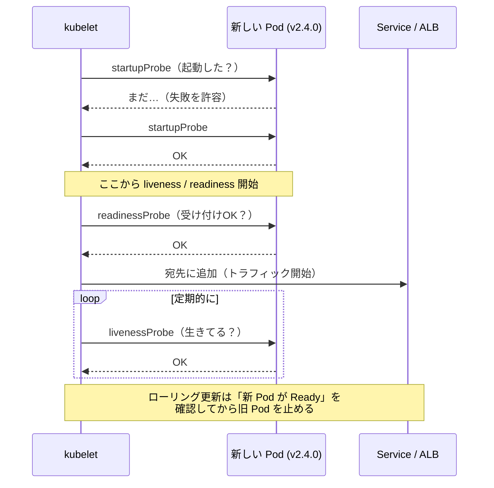
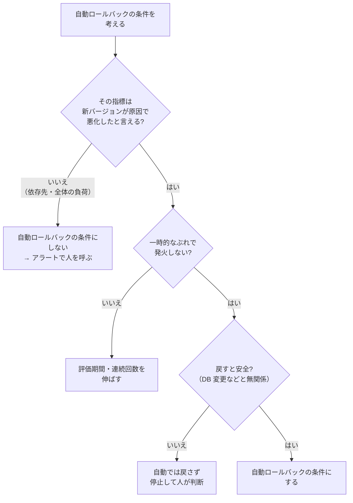

# ヘルスチェックと自動ロールバック

[[MOC_リリース・デプロイ体系|📚 目次]] ｜ [[02_段階的トラフィック移行と自動分析|← 前へ]] ｜ [[04_リリースのふりかえりとDORA指標|次へ →]]

> [!abstract] この記事で分かること
> - ヘルスチェックの 3 種類（liveness / readiness / startup）の役割の違い
> - 「深いヘルスチェック」が依存先の障害で全台を巻き込んでしまう理由
> - Node.js での `/healthz` 系エンドポイントの実装例
> - デプロイ失敗を自動で検知する仕組み（Kubernetes の `progressDeadlineSeconds`、ECS のデプロイサーキットブレーカー、CodeDeploy の CloudWatch アラーム連動ロールバック）
> - 自動ロールバックの条件設計、誤作動のパターン、自動で戻ったあとに人がすること
>
> **前提**：[[01_ロールバック戦略]] と [[03_ローリングアップデート]] を読んでいると理解しやすいです。

## 1. ひとことで言うと

ヘルスチェックは、工場の生産ラインにある **検品係** です。新しく作られた製品（新バージョンの Pod）を「ちゃんと動くか」確かめてから出荷（トラフィックを流す）し、不良品が続いたらラインを止めて前の型に戻します。

- **ヘルスチェック**：個々のプロセスが「生きているか」「リクエストを受けられるか」を定期的に確かめる
- **デプロイ失敗の自動検知**：ヘルスチェックの結果をまとめて、「このデプロイは失敗した」と判断する
- **自動ロールバック**：失敗と判断したら、人を待たずに前のバージョンへ戻す

前回の [[02_段階的トラフィック移行と自動分析]] が「動いているけど品質が悪い」を見つける仕組みだとすると、今回は **「そもそもまともに動いていない」を素早く確実に見つける**、いちばん手前の安全網です。

## 2. ヘルスチェックの 3 種類

Kubernetes では、コンテナの状態を確かめる **プローブ（Probe）** が 3 種類あります。それぞれ「失敗したときに何が起きるか」が違うので、ここを混同すると大事故につながります。

| 種類 | 問いかけ | 失敗したら | Shop API での中身 |
|---|---|---|---|
| **liveness**（生存） | プロセスは生きているか？固まっていないか？ | **コンテナを再起動** | イベントループが応答するか（依存先は見ない） |
| **readiness**（準備完了） | 今リクエストを受けてよいか？ | **Service の宛先から外す**（再起動はしない） | 起動処理が終わり、DB プールが使える状態か |
| **startup**（起動） | 起動処理は終わったか？ | 規定回数失敗したら再起動。成功するまで liveness/readiness を止める | 起動に時間がかかるアプリの初期化完了 |



なお、エンドポイント名は `/healthz` がよく使われてきましたが、Kubernetes 自身の API サーバーでは v1.16 以降 `/healthz` が非推奨となり、`/livez` と `/readyz` に分けられています。この回の実装例もそれにならいます。

ローリングアップデートは **新しい Pod が Ready になったことを確認してから旧 Pod を減らす** ので、readiness が正しく設定されていれば、起動に失敗した新バージョンにはトラフィックが流れず、旧 Pod も消されません。逆に readiness がないと、「起動途中で 503 を返す Pod」にトラフィックが流れてしまいます。

> [!note] ロードバランサーのヘルスチェック
> AWS ALB のターゲットグループにも同じ考え方のヘルスチェックがあります（readiness に相当）。ECS では ALB のヘルスチェックとコンテナのヘルスチェックの両方が、後述のサーキットブレーカーの判断材料になります。

## 3. 深いヘルスチェックの危険

### 3.1 浅い・深いとは

- **浅いヘルスチェック（Shallow）**：プロセス自身が応答できるかだけを見る
- **深いヘルスチェック（Deep）**：DB、Redis、外部決済 API など **依存先にも問い合わせて** 全部 OK なら OK

深いほうが「本当に使える状態か」を正確に表しているように見えますが、**依存先の障害が全台のヘルスチェック失敗に直結する** という大きな落とし穴があります。

### 3.2 全滅のシナリオ

```
外部決済 API が 30 秒だけ遅延した
        │
        ▼
Shop API 4 Pod の liveness が「決済 API に接続確認」をしていた
        │  → 4 Pod とも失敗
        ▼
kubelet が 4 Pod をすべて再起動
        │  → 再起動中は全リクエストが失敗
        ▼
決済と関係ない「商品一覧」「カート」まで全部止まる
（本来は「決済だけ一時的にエラー」で済んだはず）
```

readiness でも同じことが起きます。全 Pod が Not Ready になると Service の宛先が空になり、サイト全体が応答しなくなります（なお AWS ALB は、ターゲットグループの全ターゲットが unhealthy になると「フェイルオープン」して全ターゲットに振り分ける仕様がありますが、それに頼る設計にすべきではありません）。

### 3.3 原則

| プローブ | 依存先をチェックするか | 理由 |
|---|---|---|
| liveness | **しない** | 再起動しても依存先は直らない。再起動の嵐になるだけ |
| readiness | **原則しない**。するなら「その Pod 固有の問題」に限る | 全 Pod 共通の依存先が落ちると全台が外れる |
| startup | 起動時の初期化（設定読み込み、接続確立）まで | 起動できない Pod を早く見つけるため |

依存先の状態は、ヘルスチェックではなく **メトリクスとアラート**（[[04_アラート設計の原則]]）で見張り、アプリ側は **タイムアウト・リトライ・サーキットブレーカー** で「一部の機能だけ劣化する」ように作ります。

## 4. `/healthz` の実装例（Node.js）

Shop API（Express / TypeScript）に、役割ごとにエンドポイントを分けて実装します（`/healthz` を 1 つだけ作るのではなく、`/livez`・`/readyz`・`/startupz` に分けます）。

```typescript
// health.ts
import express from "express";
import { Pool } from "pg";

export function healthRouter(pool: Pool) {
  const router = express.Router();
  let startupComplete = false;
  let shuttingDown = false;

  // 起動処理（マイグレーション確認、キャッシュ読み込みなど）が終わったら呼ぶ
  const markStarted = () => { startupComplete = true; };

  // SIGTERM を受けたら readiness を落として新規リクエストを止める
  process.on("SIGTERM", () => { shuttingDown = true; });

  // liveness：プロセスが応答できるかだけ。依存先は見ない
  router.get("/livez", (_req, res) => {
    res.status(200).json({ status: "ok" });
  });

  // startup：初期化が終わったか
  router.get("/startupz", (_req, res) => {
    res.status(startupComplete ? 200 : 503).json({ started: startupComplete });
  });

  // readiness：この Pod がリクエストを受けてよいか
  router.get("/readyz", async (_req, res) => {
    if (!startupComplete || shuttingDown) {
      return res.status(503).json({ ready: false, reason: shuttingDown ? "shutting_down" : "starting" });
    }
    // 自分のコネクションプールが枯渇していないか（Pod 固有の問題）を見る。
    // DB サーバー自体の死活は見ない（全 Pod 共通の依存先なので）
    const poolExhausted = pool.waitingCount > 20;
    res.status(poolExhausted ? 503 : 200).json({
      ready: !poolExhausted,
      version: process.env.APP_VERSION,
    });
  });

  return { router, markStarted };
}
```

Kubernetes 側の設定です（プローブの既定値は `periodSeconds: 10`、`timeoutSeconds: 1`、`failureThreshold: 3`。2026 年時点）。

```yaml
      containers:
        - name: shop-api
          image: ghcr.io/example/shop-api:2.4.0
          ports:
            - containerPort: 3000
          startupProbe:
            httpGet: { path: /startupz, port: 3000 }
            periodSeconds: 5
            failureThreshold: 24      # 最大 5秒 × 24 = 120 秒まで起動を待つ
          readinessProbe:
            httpGet: { path: /readyz, port: 3000 }
            periodSeconds: 5
            failureThreshold: 2
          livenessProbe:
            httpGet: { path: /livez, port: 3000 }
            periodSeconds: 10
            failureThreshold: 3       # 30 秒応答がなければ再起動
```

> [!tip] SIGTERM で readiness を落とす理由
> Pod を止めるとき、Service の宛先から外れる処理と SIGTERM の送信は並行して進みます。SIGTERM を受けたら readiness を 503 にして新規リクエストを受けないようにし、処理中のリクエストを終えてから終了するのが、ゼロダウンタイムのための定石です（[[08_ゼロダウンタイムデプロイの条件]]）。

ヘルスチェック全般の基礎（Docker Compose の healthcheck など）は [[depends_on_healthcheck]] も参照してください。

## 5. デプロイ失敗の自動検知

個々の Pod のヘルスチェックをまとめて、「このデプロイ全体が失敗した」と判断する仕組みはプラットフォームごとに違います。

### 5.1 Kubernetes：`progressDeadlineSeconds`

Deployment の `.spec.progressDeadlineSeconds`（**既定値 600 秒**）は、「この時間内にロールアウトが進まなければ失敗とみなす」という期限です。期限を超えると、Deployment の status に次の条件が付きます。

```yaml
status:
  conditions:
    - type: Progressing
      status: "False"
      reason: ProgressDeadlineExceeded
```

> [!warning] Kubernetes は自動ではロールバックしない
> 公式ドキュメントにあるとおり、Kubernetes は停滞した Deployment に対して **status を報告する以外の動作をしません**。自動で戻したい場合は、CI や上位のツール（Argo Rollouts など）がこの状態を見て `kubectl rollout undo` を実行する必要があります。

GitHub Actions でデプロイするなら、`kubectl rollout status` が期限超過で失敗（終了コード ≠ 0）することを利用して、戻す処理につなげられます。

```yaml
      - name: デプロイ
        run: kubectl set image deployment/shop-api shop-api=ghcr.io/example/shop-api:${{ github.sha }}

      - name: ロールアウト完了を待つ
        id: rollout
        run: kubectl rollout status deployment/shop-api --timeout=10m

      - name: 失敗したら前のリビジョンへ戻す
        if: failure() && steps.rollout.outcome == 'failure'
        run: |
          kubectl rollout undo deployment/shop-api
          kubectl rollout status deployment/shop-api --timeout=10m
```

### 5.2 Amazon ECS：デプロイサーキットブレーカー

ECS のローリング更新（`ECS` デプロイコントローラー）には **デプロイサーキットブレーカー（Deployment Circuit Breaker）** があり、`rollback=true` にすると失敗時に直前の `COMPLETED` 状態のデプロイへ自動で戻します。

```bash
aws ecs update-service \
  --cluster shop \
  --service shop-api \
  --deployment-configuration "deploymentCircuitBreaker={enable=true,rollback=true}"
```

判定は 2 段階です（2026 年時点の公式ドキュメントより）。

1. **ステージ 1**：新しいタスクが `RUNNING` 状態になれるか。なれなかったタスクを失敗として数える
2. **ステージ 2**：`RUNNING` になったタスクが ELB・Cloud Map・コンテナのヘルスチェックに合格するか。不合格で置き換えられたタスクを失敗として数える

失敗の閾値は、既定（`BOUNDED_PERCENT`、値 50）では **希望タスク数 × 50%、ただし最小 3・最大 200** です。Shop API の 4 タスクなら 0.5 × 4 = 2 → 最小値の **3** になります。

さらに、ECS には CloudWatch アラームと連動する **デプロイアラーム** もあり、「タスクは起動したが 5xx が増えた」場合にも戻せます。

```bash
aws ecs update-service \
  --cluster shop --service shop-api \
  --deployment-configuration "deploymentCircuitBreaker={enable=true,rollback=true},alarms={alarmNames=[shop-api-5xx-high],enable=true,rollback=true}"
```

- 新タスクが全部健康になり、旧タスクが 0 になったあとも **ベイクタイム（Bake time：様子見の待ち時間）** の間アラームを見続け、終わってから `COMPLETED` になります（既定は 5 分未満。設定も可能）
- サーキットブレーカーとアラームのどちらか先に条件を満たしたほうがデプロイを失敗にします
- **デプロイ開始時点ですでにアラームが `ALARM` 状態だと、そのデプロイ中はアラームが無視されます**（障害を直すためのデプロイを止めないための仕様）。「アラームが鳴りっぱなしの状態でデプロイしたら、自動ロールバックが効かなかった」ということが起こり得ます

### 5.3 AWS CodeDeploy：CloudWatch アラーム連動ロールバック

CodeDeploy（[[05_CodeDeployとは]]）では、デプロイグループに **最大 10 個の CloudWatch アラーム** を関連付けられます。アラームが発火するとデプロイが停止し、自動ロールバックを有効にしていれば **最後に成功したリビジョンを新しいデプロイとして再デプロイ** します。

```bash
aws deploy update-deployment-group \
  --application-name shop \
  --current-deployment-group-name shop-api-prod \
  --alarm-configuration "enabled=true,alarms=[{name=shop-api-5xx-high},{name=shop-api-p99-latency}]" \
  --auto-rollback-configuration "enabled=true,events=DEPLOYMENT_FAILURE,DEPLOYMENT_STOP_ON_ALARM"
```

| `events` の値 | いつ戻すか |
|---|---|
| `DEPLOYMENT_FAILURE` | デプロイ自体が失敗したとき（ライフサイクルフックの失敗など） |
| `DEPLOYMENT_STOP_ON_ALARM` | 関連付けたアラームが発火してデプロイが止まったとき |

> [!note] CodeDeploy のロールバックは「新しいデプロイ」
> CodeDeploy のロールバックは、過去の状態を復元するのではなく、前のリビジョンを **新しいデプロイ ID で配り直す** ものです。そのため、前回のデプロイで消えたファイルなどは戻らないことがあります。

### 5.4 3 つの比較

| | Kubernetes Deployment | ECS サーキットブレーカー | CodeDeploy |
|---|---|---|---|
| 失敗の判断材料 | 期限内に進んだか | タスク起動・ヘルスチェック失敗数（＋アラーム） | デプロイの失敗・CloudWatch アラーム |
| 自動ロールバック | **なし**（外部で実装） | `rollback=true` で有効 | `autoRollbackConfiguration` で有効 |
| 見られるもの | 起動できない・Ready にならない | 起動できない・ヘルスチェック不合格・（アラーム） | 任意のメトリクス（アラーム次第） |

## 6. 自動ロールバックの条件設計と誤作動

### 6.1 条件設計のポイント



- **新バージョン起因と言える指標を使う**：可能ならバージョン別のメトリクス（[[01_リリース後の重点監視]]）を使う。全体の 5xx 率だと、依存先障害でも発火する
- **評価期間と連続回数を設ける**：CloudWatch アラームなら「1 分ごと、5 回中 3 回超過」のように、短いスパイクで発火しないようにする
- **デプロイ中だけ有効にする**：CodeDeploy や ECS のアラーム連動は、デプロイ中に評価される仕組みです。デプロイと無関係な時間帯の障害で「戻す」ことはありません
- **戻せない変更があるときは自動ロールバックを止める**：DB の Contract（[[02_Expand-Contractのリリース計画]]）やデータ形式の変更を含むリリースでは、古いバージョンに戻すと逆に壊れることがあります（[[03_ロールバックできない変更]]）

### 6.2 よくある誤作動

| 誤作動 | 原因 | 対策 |
|---|---|---|
| 依存先障害で何度もロールバック | 全体指標や深いヘルスチェックを条件にした | 依存先は条件から外す。バージョン別指標を使う |
| 起動が遅いだけなのに失敗扱い | startupProbe がない、期限が短い | startupProbe と十分な `progressDeadlineSeconds` |
| ロールバックとデプロイの往復（フラッピング） | CI が失敗を見て再デプロイを繰り返す | 自動ロールバック後は自動再デプロイを止める |
| 戻した先も失敗する | 前のバージョンも同じ設定や DB に依存していた | 「戻した後も監視する」。ECS のように戻せる先がない場合は停止 |
| 夜間のバッチ遅延で発火 | 閾値が時間帯の変動を考慮していない | デプロイ中だけ評価する、時間帯を考慮した閾値 |

## 7. 自動で戻した後の人の対応

自動ロールバックは「止血」であって「治療」ではありません。戻ったあとに人がやることを、手順書（[[02_ランブックの書き方]]）に書いておきます。

1. **通知を受ける**：ECS は EventBridge に `SERVICE_DEPLOYMENT_FAILED` などのイベントを、CodeDeploy は SNS 通知を送れます。Slack 等に流しておく
2. **本当に戻ったか確認する**：旧バージョンでエラー率が下がったか、全 Pod/タスクが旧バージョンか（戻した先が壊れていることもある）
3. **パイプラインを止める**：同じコミットが自動で再デプロイされないようにする（main ブランチを revert する、デプロイを一時停止するなど）
4. **原因を調べる**：失敗したタスクのログ、`kubectl describe`、ECS の `stoppedReason` を見る。データに影響が出ていないかも確認する
5. **関係者に連絡する**：リリース担当、プロダクトオーナーに「自動で戻った」ことを伝える
6. **記録してふりかえる**：自動ロールバックも **変更失敗率（DORA の Change fail rate）** に数え、ふりかえり（[[04_リリースのふりかえりとDORA指標]]）で扱う。誤作動だった場合は条件を見直す

> [!warning] 「自動で戻ったから問題なし」で終わらせない
> 自動ロールバックが静かに動き続けていると、誰も気づかないまま「リリースが一度も成功していない」状態になることがあります。自動ロールバックは必ず人に通知し、件数を数えましょう。

## よくある誤解・つまずき

- ❌ ヘルスチェックは依存先まで全部見たほうが安全
  ✅ 依存先の障害で全 Pod が再起動・切り離しされ、一部の障害がサイト全体の停止に広がります。liveness は依存先を見ない、readiness も Pod 固有の問題に絞るのが原則です。
- ❌ liveness と readiness は同じエンドポイントでよい
  ✅ 失敗したときの動作（再起動 vs 切り離し）が違います。「一時的に忙しいだけ」で再起動されると状況が悪化します。
- ❌ Kubernetes は失敗したデプロイを自動で戻してくれる
  ✅ `progressDeadlineSeconds` を超えても status を報告するだけです。戻すのは CI や Argo Rollouts など外側の仕組みです。
- ❌ 自動ロールバックがあれば DB 変更を含むリリースも安心
  ✅ アプリを戻しても DB は戻りません。戻せない変更を含むリリースでは、自動ロールバックをやめて人が判断する設計にします。
- ❌ 自動ロールバックが起きたら、それで対応完了
  ✅ 原因調査、パイプラインの停止、関係者への連絡、記録とふりかえりが必要です。

## まとめ

- ヘルスチェックは liveness（再起動）・readiness（切り離し）・startup（起動待ち）の 3 種類で、失敗時の動作が違う
- 深いヘルスチェックは依存先の障害で全台を巻き込む。依存先はメトリクスとアラートで見る
- Kubernetes は `progressDeadlineSeconds`（既定 600 秒）で停滞を報告するだけ。戻すのは外側の仕組み
- ECS はサーキットブレーカー（＋デプロイアラーム）、CodeDeploy は CloudWatch アラーム連動で自動ロールバックできる
- 自動ロールバックの条件は「新バージョン起因と言える」「ぶれで発火しない」「戻して安全」の 3 点で設計する
- 自動で戻った後も、確認・パイプライン停止・原因調査・連絡・ふりかえりは人がやる

## 確認クイズ

1. liveness プローブで「DB に `SELECT 1` を実行して成功したら OK」としていました。DB が 1 分間フェイルオーバーで応答しなくなると、何が起きますか。
> [!tip]- 答え
> 全 Pod の liveness が失敗し、kubelet が全 Pod を再起動します。DB が戻っても、Pod が再起動中のためしばらくサービス全体が止まります。liveness では依存先を見ないようにすべきです。

2. ECS で希望タスク数 4、サーキットブレーカーを既定の閾値設定で有効にしています。何回タスクが失敗するとデプロイは失敗と判断されますか。
> [!tip]- 答え
> 既定は `BOUNDED_PERCENT` の 50 なので 0.5 × 4 = 2 ですが、最小値 3 が適用されるため、3 回です。

3. CodeDeploy の自動ロールバックの `events` に `DEPLOYMENT_STOP_ON_ALARM` を指定すると、どんなときに戻りますか。
> [!tip]- 答え
> デプロイグループに関連付けた CloudWatch アラームがデプロイ中に発火し、デプロイが停止したときに、最後に成功したリビジョンが新しいデプロイとして再デプロイされます。

## 関連ノート

- [[02_段階的トラフィック移行と自動分析]] — 「動いているが品質が悪い」を見つける自動分析
- [[04_リリースのふりかえりとDORA指標]] — 自動ロールバックを変更失敗率として数える
- [[01_ロールバック戦略]] — ロールバックの方式全般
- [[04_ロールバック判断基準]] — 人が判断するときの基準
- [[03_ロールバックできない変更]] — 自動で戻してはいけない変更
- [[08_ゼロダウンタイムデプロイの条件]] — readiness とグレースフルシャットダウン
- [[depends_on_healthcheck]] — Docker Compose のヘルスチェック
- [[10-Kubernetes]] — Kubernetes の基礎
- [[05_CodeDeployとは]] — CodeDeploy の基本
- [[01_デプロイ直後の異常]] — デプロイ直後の障害対応ランブック

## 参考

- [Kubernetes: Configure Liveness, Readiness and Startup Probes](https://kubernetes.io/docs/tasks/configure-pod-container/configure-liveness-readiness-startup-probes/)
- [Kubernetes: Deployments（Progress Deadline Seconds / Failed Deployment）](https://kubernetes.io/docs/concepts/workloads/controllers/deployment/)
- [Kubernetes API health endpoints（/livez, /readyz）](https://kubernetes.io/docs/reference/using-api/health-checks/)
- [Amazon ECS: How the deployment circuit breaker detects failures](https://docs.aws.amazon.com/AmazonECS/latest/developerguide/deployment-circuit-breaker.html)
- [Amazon ECS: How CloudWatch alarms detect deployment failures](https://docs.aws.amazon.com/AmazonECS/latest/developerguide/deployment-alarm-failure.html)
- [AWS CodeDeploy: Redeploy and roll back a deployment](https://docs.aws.amazon.com/codedeploy/latest/userguide/deployments-rollback-and-redeploy.html)
- [AWS CodeDeploy: Monitoring deployments with CloudWatch alarms](https://docs.aws.amazon.com/codedeploy/latest/userguide/monitoring-create-alarms.html)
- [AWS Builders' Library: Implementing health checks](https://aws.amazon.com/builders-library/implementing-health-checks/)
