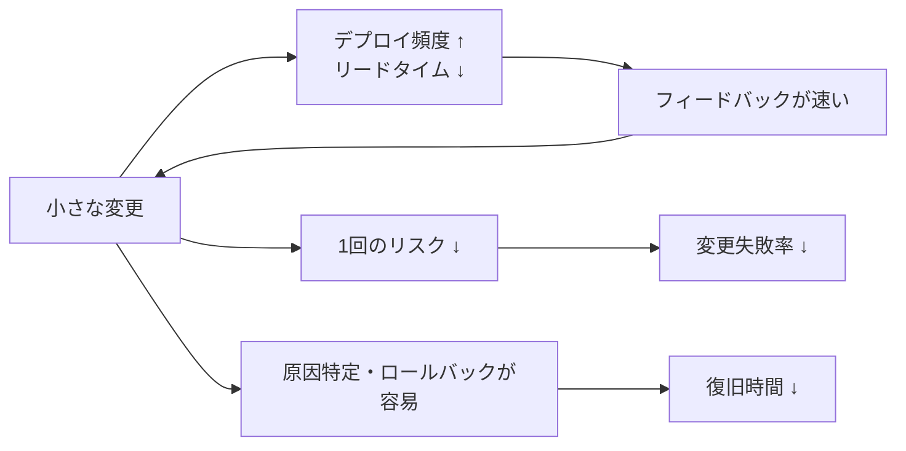
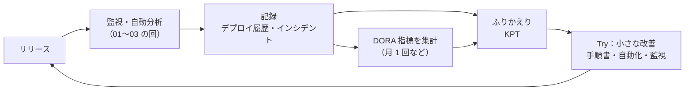

# リリースのふりかえりとDORA指標

[[MOC_リリース・デプロイ体系|📚 目次]] ｜ [[03_ヘルスチェックと自動ロールバック|← 前へ]]

> [!abstract] この記事で分かること
> - DORA 指標（5 つのソフトウェアデリバリー指標）の正確な定義と、2026 年時点の分類
> - GitHub Actions のデプロイ履歴とインシデント記録から DORA 指標を測る方法
> - 指標を「目標」にしてしまう落とし穴
> - リリースのふりかえりの進め方（KPT、非難しない文化）と、ポストモーテムとの違い
> - シリーズ全体のまとめ：リリースの成熟度ステップ
>
> **前提**：[[01_リリース後の重点監視]] と [[03_ヘルスチェックと自動ロールバック]] を読んでいると理解しやすいです。

## 1. ひとことで言うと

スポーツのチームは、試合が終わったら録画を見返して「よかったプレー」「次に直すプレー」を話し合います。そして、シーズンを通して得点・失点・勝率のような数字で「チームが強くなっているか」を確かめます。リリースも同じです。

- **ふりかえり**：1 回 1 回のリリースを見返して、次のリリースをよくする（試合の録画を見る）
- **DORA 指標**：何十回ものリリースを通して、チームの「届ける力」が伸びているかを数字で確かめる（シーズンの成績）
- この 2 つを回し続けることで、リリースは「怖いイベント」から「いつものこと」になっていきます

## 2. DORA 指標とは

### 2.1 DORA とは

**DORA（DevOps Research and Assessment）** は、ソフトウェアを届ける組織の能力を長年調査している研究プログラムです（現在は Google Cloud の一部）。毎年の調査レポート（State of DevOps Report など）で、「どんなチームが速く・安定して届けられているか」を統計的に分析しています。その中で使われる **ソフトウェアデリバリー性能の指標** が、いわゆる「DORA 指標」です。

### 2.2 5 つの指標（2026 年時点）

以前は「Four Keys（4 つの指標）」と呼ばれていましたが、DORA は 2024 年に 5 つ目の指標 **デプロイのやり直し率（Deployment rework rate）** を追加し、指標を「スループット」と「不安定さ」の 2 グループに整理し直しました。定義は dora.dev の記述に基づきます。

| グループ | 指標 | DORA の定義（要約） | Shop での例 |
|---|---|---|---|
| **スループット**（Throughput：どれだけ速く変更を流せるか） | 変更のリードタイム（Change lead time） | 変更がバージョン管理に **コミットされてから本番にデプロイされるまで** の時間 | クーポン機能の最後のコミットから本番反映まで 1 日 |
| | デプロイ頻度（Deployment frequency） | 一定期間のデプロイ回数、またはデプロイの間隔 | 本番デプロイが週 10 回 |
| | 失敗したデプロイからの復旧時間（Failed deployment recovery time） | **即時の対応が必要になった失敗デプロイ** から復旧するまでの時間 | 5xx 急増からロールバック完了まで 15 分 |
| **不安定さ**（Instability：デプロイがどれだけうまくいくか） | 変更失敗率（Change fail rate） | デプロイのうち、デプロイ後に **即時の対応（ロールバックやホットフィックスなど）が必要になった割合** | 20 回中 2 回 → 10% |
| | デプロイのやり直し率（Deployment rework rate） | デプロイのうち、**本番のインシデントが原因で発生した、計画外のデプロイ** の割合 | 20 回中 1 回が障害対応の緊急修正 → 5% |

> [!note] 指標の名前の変遷
> - 「平均復旧時間（MTTR）／サービス復旧時間」は、2023 年に **失敗したデプロイからの復旧時間** へ名前と範囲が変わりました。データセンターの停電のような「デプロイと無関係な障害」は含めず、**変更が原因の障害** からの復旧に絞った指標です。
> - 2024 年に、復旧時間は「安定性」グループから **スループット** グループへ移りました。
> - 「信頼性（Reliability）」は DORA の調査で扱われますが、上の 5 つのデリバリー指標とは別の、運用面の指標と位置づけられています。

### 2.3 なぜ「速さ」と「安定」をセットで見るのか

DORA の研究の重要な発見は、**速さと安定はトレードオフではない** ということです。よくできたチームは、デプロイ頻度が高く、リードタイムが短く、しかも失敗率が低く復旧も速い傾向があります。小さな変更を頻繁に出すほど、1 回の変更のリスクが小さく、原因の特定も戻すのも簡単になるからです（[[05_信頼性とスピードの両立]]）。



## 3. 測り方：GitHub Actions とインシデント記録から

### 3.1 何をデータにするか

| 指標 | 必要なデータ | Shop での取り方 |
|---|---|---|
| デプロイ頻度 | 本番デプロイの日時 | GitHub Actions の本番デプロイワークフローの成功実行 |
| 変更のリードタイム | 各コミットの時刻とデプロイ時刻 | デプロイの `headSha` に含まれるコミットの時刻 |
| 変更失敗率 | 「対応が必要になったデプロイ」の印 | ロールバック／ホットフィックスの記録とデプロイの紐付け |
| 復旧時間 | 失敗の検知時刻と復旧時刻 | インシデント記録（検知・復旧の時刻） |
| やり直し率 | 「インシデント対応のための計画外デプロイ」の印 | ホットフィックスのデプロイにラベルを付ける |

**デプロイの記録は機械から、失敗の記録は人の判断から** 取るのが現実的です。「どのデプロイが失敗だったか」は機械だけでは決めきれないためです。

### 3.2 デプロイ頻度とリードタイムを GitHub から取る

本番デプロイ用ワークフロー（例：`deploy-production.yml`）の成功実行を取得します（`gh` CLI、2026 年時点）。

```bash
# 過去 30 日の本番デプロイ（成功）を取得
gh run list \
  --workflow deploy-production.yml \
  --branch main \
  --status success \
  --created ">=2026-09-12" \
  --limit 500 \
  --json databaseId,headSha,createdAt,updatedAt > deploys.json

# デプロイ頻度（30 日間の回数）
jq 'length' deploys.json
```

リードタイムは「前回のデプロイ以降に入ったコミット」それぞれについて、コミット時刻からデプロイ完了時刻までを測り、**中央値** を取ります（平均は、たまに出る長期間ブランチに引っ張られるため）。

```bash
# 例：あるデプロイ（前回 SHA..今回 SHA）に含まれる各コミットのリードタイム（時間）
PREV=abc1234; CUR=def5678; DEPLOYED_AT="2026-10-10T05:12:00Z"
git log --format='%cI' "$PREV..$CUR" | while read c; do
  echo $(( ( $(date -d "$DEPLOYED_AT" +%s) - $(date -d "$c" +%s) ) / 3600 ))
done | sort -n
```

> [!tip] デプロイに「印」を付けておく
> [[01_リリース後の重点監視]] で作ったデプロイマーカー（Grafana アノテーション／Datadog イベント）と同じタイミングで、デプロイの記録を残しておくと集計が楽になります。GitHub の Deployments API（`environment: production`）を使う、Datadog の DORA Metrics 機能にデプロイイベントを送る、といった方法もあります。

### 3.3 失敗と復旧はインシデント記録から

変更失敗率・復旧時間・やり直し率は、**インシデント記録** と結び付けて数えます。インシデントのテンプレートに、次の項目を必ず入れておきましょう（[[01_インシデント対応の基本フロー]]）。

```yaml
# インシデント記録の項目（例）
incident_id: INC-2026-0142
caused_by_deploy: true                 # 変更が原因か
deploy_run_id: 1234567890              # 原因となったデプロイ（GitHub Actions の run ID）
detected_at: 2026-10-10T05:20:00Z      # 検知時刻
recovered_at: 2026-10-10T05:35:00Z     # 復旧時刻（ロールバック完了など）
recovery_action: rollback              # rollback / hotfix / feature_flag_off
remediation_deploy_run_ids: []         # 対応のために行った計画外デプロイ
```

- **変更失敗率** = `caused_by_deploy: true` のインシデントに紐付くデプロイ数 ÷ 全デプロイ数
- **復旧時間** = `recovered_at − detected_at`（デプロイ時刻から測る流儀もあるので、チーム内で定義をそろえる）
- **やり直し率** = `remediation_deploy_run_ids` に入ったデプロイ数 ÷ 全デプロイ数
- **自動ロールバック**（[[03_ヘルスチェックと自動ロールバック]]）や、フラグを切って止めたケースも「即時の対応が必要だった」ので失敗に数えます

> [!note] 完璧な計測より、まず会話から
> DORA 自身も、凝った計測の仕組みづくりに最初から時間をかけるより、チームでの会話や DORA の Quick Check（Web 上の簡易診断）、既存ツールのデータから始めることを勧めています。

## 4. 計測の落とし穴：指標の目的化

「指標が目標になると、その指標はよい指標ではなくなる」という **グッドハートの法則（Goodhart's law）** は、DORA 指標にもそのまま当てはまります。dora.dev でも、次のような落とし穴が挙げられています。

| 落とし穴 | 何が起きるか | Shop でありがちな例 |
|---|---|---|
| **指標を目標として押し付ける** | 数字だけ良くするごまかしが始まる | 「デプロイ頻度を週 20 回に」→ 空のコミットや設定ファイルの微修正を個別にデプロイ |
| **1 つの指標だけを見る** | 他の指標が悪化しても気づかない | 頻度だけ追って変更失敗率が倍増 |
| **チームどうしを比べる・競わせる** | 条件の違いを無視した比較になり、隠蔽が起きる | モバイルアプリチームと API チームを同じ物差しで順位付け |
| **失敗の定義をゆるめる** | 変更失敗率は下がるが、実態は変わらない | 「自動ロールバックは失敗に数えない」 |
| **測ることが目的になる** | 改善の会話が起きない | ダッシュボードを作ったきり誰も見ない |

指標は **チームが自分たちの改善を確かめるための道具** であって、評価や査定のための道具ではありません。DORA も、指標はアプリケーション（サービス）ごとに測り、**他チームとの比較ではなく、自分たちの過去との比較** に使うよう勧めています。

## 5. リリースのふりかえりの進め方

### 5.1 ふりかえりとポストモーテムの違い

| | リリースのふりかえり | ポストモーテム（[[01_ポストモーテムとは]]） |
|---|---|---|
| きっかけ | **定期的**（大きなリリースの後、または隔週など） | **インシデントが起きたとき** |
| 対象 | うまくいったリリースも含めたリリースのやり方全体 | 特定の障害 1 件 |
| 目的 | リリースの流れを少しずつ良くする | 障害の原因を深く分析し、再発を防ぐ |
| 深さ | 浅く広く（30〜60 分） | 狭く深く（タイムライン、根本原因分析） |
| 成果物 | 小さな改善アクション 1〜3 個 | ポストモーテム文書と再発防止策 |

**障害がなかったリリースもふりかえる** のがポイントです。「ヒヤリとしたけど大丈夫だった」「手順書のこの手順は実は不要だった」といった気づきは、障害が起きてからでは拾えません。障害が起きたリリースは、ポストモーテムを別に行い、ふりかえりではその結論を共有するだけにします。

### 5.2 KPT で進める

**KPT**（Keep / Problem / Try）は、日本でよく使われるふりかえりの枠組みです。

- **Keep**：うまくいったので続けたいこと
- **Problem**：困ったこと、うまくいかなかったこと
- **Try**：次に試すこと（Problem の解決策や、Keep をさらに伸ばす工夫）

Shop の「クーポン機能リリース」のふりかえり例です。

```
【事実の確認（5 分）】
 - デプロイ 3 回（うち 1 回はカナリアの自動分析で中止 → 修正して再デプロイ）
 - 監視ウィンドウ 60 分、終了条件はすべて満たした
 - 変更のリードタイム（中央値）：2.5 日

【Keep】
 - カナリアの自動分析が p99 悪化を検知して 5% の段階で止めてくれた
 - リリース用ダッシュボードのおかげで新旧比較がすぐできた

【Problem】
 - クーポン適用失敗の理由別メトリクスがなく、原因調査に 40 分かかった
 - 手順書の「キャッシュ削除」手順が古く、実際は不要だった
 - モバイルアプリのクラッシュ率を誰も見ていなかった

【Try】
 - 新機能の PR テンプレートに「新機能固有のメトリクス」欄を追加する（担当：A さん）
 - 手順書から不要手順を削除し、手順書の最終確認日を入れる（担当：B さん）
 - リリース用ダッシュボードにクラッシュ率のパネルを追加する（担当：C さん）
```

進め方のコツです。

1. **まず事実をそろえる**：デプロイ回数、ロールバックの有無、監視中の出来事、DORA 指標の推移を最初に共有する。記憶ではなく記録から話す
2. **Try は少なく、担当と期限を付ける**：10 個出しても実行されません。1〜3 個に絞り、チケットにする
3. **前回の Try を確認する**：やったか、効果はあったかを最初に見る。やらなかった Try は「本当に必要か」を見直す
4. **全員が話せる場にする**：リリース担当だけでなく、QA、サポート、プロダクト担当にも入ってもらうと、サーバー側からは見えない問題が出てくる

### 5.3 非難しない文化（Blameless）

ふりかえりで「誰のせいか」を追及すると、次からは問題が隠されるようになります。**人ではなく仕組みに目を向ける** のが非難しない文化（Blameless culture）です。

- ❌「B さんが手順を飛ばしたのが悪い」
- ✅「手順を飛ばしても気づけない手順書だった。チェックリスト化して、飛ばすと CI が止まるようにできないか」

ミスをした人はたいてい、その時点で手に入る情報の中で合理的に判断しています。「なぜその判断が合理的に見えたのか」を考えると、仕組みの穴が見つかります。詳しくは [[01_ポストモーテムとは]] を参照してください。

## 6. 改善のループ

ふりかえりと DORA 指標は、次のようなループで回します。



- **毎回のリリース**：重点監視 → 記録
- **隔週〜大きなリリースの後**：KPT でふりかえり、Try を 1〜3 個
- **月 1 回〜四半期**：DORA 指標の推移を見て、「どこがボトルネックか」を話し合う
  - リードタイムが長い → レビュー待ち？ 手動の承認？ テストが遅い？（[[MOC_CI-CD体系]]）
  - 変更失敗率が高い → テストやステージングの不足？ 変更が大きすぎる？（[[04_リハーサルとステージング環境]]）
  - 復旧時間が長い → ロールバック手順が手動？ 検知が遅い？（[[01_ロールバック戦略]]）

数字は「どこを見ればよいか」のヒントで、原因と対策は人の会話から出てきます。

## 7. シリーズ全体のまとめ：リリースの成熟度ステップ

このシリーズでは、デプロイ戦略からバージョニング、リリース判定、ロールバック、DB 変更、リリース後監視までを見てきました。最後に、チームのリリースがどう成熟していくかを、段階で整理します。全部を一度にやる必要はありません。**今いる段階の 1 つ上** を目指してください。

| 段階 | 状態 | 主な取り組み | 関連する回 |
|---|---|---|---|
| **0. 手作業** | 担当者がサーバーに入って手で入れ替える。止めて更新 | — | [[01_リリースとデプロイの違い]] |
| **1. 再現可能** | 手順書とチェックリストがあり、誰がやっても同じ手順。バージョン番号とタグがある | 手順書、SemVer、git タグ、リリースノート | [[03_リリース手順書とチェックリスト]]、[[01_セマンティックバージョニング]]、[[03_gitタグとリリースの作り方]] |
| **2. 自動化** | CI/CD でビルド・テスト・デプロイが自動。ローリング更新で止めずに入れ替え | GitHub Actions、ローリング更新、ヘルスチェック、リリースの自動化 | [[05_リリースの自動化]]、[[03_ローリングアップデート]]、[[03_ヘルスチェックと自動ロールバック]] |
| **3. 安全に戻せる** | ロールバック手順が決まっていて速い。DB 変更は Expand-Contract で戻せる形に | ロールバック戦略、判断基準、Expand-Contract | [[01_ロールバック戦略]]、[[04_ロールバック判断基準]]、[[02_Expand-Contractのリリース計画]] |
| **4. 段階的に出す** | カナリアやフィーチャーフラグで影響範囲を絞って出す。リリース後を重点監視 | カナリア、フラグ、デプロイマーカー、バージョン別メトリクス | [[05_カナリアリリース]]、[[06_フィーチャーフラグ]]、[[01_リリース後の重点監視]] |
| **5. 自動で判定する** | 自動分析で昇格・中止を機械が判断。異常時は自動ロールバック | Argo Rollouts / Flagger、アラーム連動ロールバック | [[02_段階的トラフィック移行と自動分析]] |
| **6. 継続的に改善する** | DORA 指標とふりかえりで、リリースのやり方そのものを改善し続ける | DORA 指標、KPT、非難しない文化 | この回 |

```
  怖い・まれ・大きい                                         いつものこと・頻繁・小さい
  ─────────────────────────────────────────────────────────────────────────→
  0 手作業 → 1 再現可能 → 2 自動化 → 3 安全に戻せる → 4 段階的 → 5 自動判定 → 6 継続改善
            「同じ手順で」  「人の手を減らす」 「失敗しても大丈夫」 「失敗を小さく」 「失敗を機械が止める」
```

段階が上がるほど、1 回のリリースは小さく、頻繁に、そして怖くないものになっていきます。それこそが DORA の研究が示す「速さと安定の両立」の姿です。

## よくある誤解・つまずき

- ❌ DORA 指標は今も「4 つ（Four Keys）」
  ✅ 2024 年に「デプロイのやり直し率」が加わり 5 つになり、「スループット」と「不安定さ」の 2 グループに整理されています。また「MTTR」は 2023 年に「失敗したデプロイからの復旧時間」に変わっています。
- ❌ デプロイ頻度を上げる目標を立てれば改善が進む
  ✅ 指標を目標として押し付けると、数字だけ良くするごまかしが起きます（グッドハートの法則）。指標はボトルネックを見つけるための道具です。
- ❌ 他チームより DORA 指標が悪いのは問題だ
  ✅ アプリの種類や条件が違うので、比べる意味は薄いです。比べるのは自分たちの過去です。
- ❌ 障害がなかったリリースはふりかえらなくてよい
  ✅ ヒヤリハットや不要な手順など、障害がないときにしか拾えない改善点があります。
- ❌ ふりかえりは原因を作った人を特定する場
  ✅ 人ではなく仕組みを直す場です。非難すると問題が隠され、次の改善の材料がなくなります。

## まとめ

- DORA 指標は 2026 年時点で 5 つ：スループット（変更のリードタイム、デプロイ頻度、失敗したデプロイからの復旧時間）と不安定さ（変更失敗率、デプロイのやり直し率）
- デプロイの記録は CI（GitHub Actions）から、失敗と復旧の記録はインシデント記録から取り、定義をチーム内でそろえる
- 指標を目標にしない、1 つだけ見ない、他チームと比べない
- リリースのふりかえりは定期的に、障害がなくても行う。KPT で Try を 1〜3 個に絞り、非難しない
- ポストモーテムは障害 1 件を深く、ふりかえりはリリースの流れを広く見直す
- 監視 → 記録 → 指標とふりかえり → 小さな改善 のループを回し、成熟度を一段ずつ上げる

## 確認クイズ

1. 30 日間に本番デプロイが 40 回あり、そのうち 4 回がロールバック、2 回がインシデント対応の緊急ホットフィックスでした（ホットフィックスのデプロイ自体は問題なし）。ロールバックされた 4 回が「即時の対応が必要になったデプロイ」だとすると、変更失敗率とデプロイのやり直し率はそれぞれいくつですか。
> [!tip]- 答え
> 変更失敗率は 4 ÷ 40 = 10%。デプロイのやり直し率は、インシデントが原因の計画外デプロイ 2 回なので 2 ÷ 40 = 5% です（定義をチーム内でそろえておくことが大切です）。

2. マネージャーが「来期はデプロイ頻度を倍にすること」を全チームの目標にしました。何が起こりやすいですか。
> [!tip]- 答え
> 変更を不自然に細切れにしたり、意味のないデプロイを増やしたりして、数字だけを良くする行動が起こりやすくなります（グッドハートの法則）。また、頻度だけを追って変更失敗率が悪化しても気づきにくくなります。複数の指標を、自分たちの改善のために使うのが適切です。

3. リリースのふりかえりとポストモーテムの違いを、きっかけと目的の観点で説明してください。
> [!tip]- 答え
> ふりかえりは定期的（障害の有無に関係なく）に行い、リリースのやり方全体を少しずつ良くすることが目的です。ポストモーテムはインシデントをきっかけに行い、その障害の原因を深く分析して再発を防ぐことが目的です。

## 関連ノート

- [[01_リリース後の重点監視]] — デプロイマーカーと記録の取り方
- [[02_段階的トラフィック移行と自動分析]] — 成熟度ステップ 5 の中心
- [[03_ヘルスチェックと自動ロールバック]] — 自動ロールバックも変更失敗に数える
- [[01_ポストモーテムとは]] — 障害 1 件を深く分析する方法と非難しない文化
- [[01_インシデント対応の基本フロー]] — 検知・復旧時刻の記録
- [[05_信頼性とスピードの両立]] — 速さと安定を両立させる考え方
- [[03_エラーバジェット方針]] — 信頼性の数字でリリースのペースを調整する
- [[MOC_CI-CD体系]] — リードタイムを短くする CI/CD の改善
- [[MOC_SRE・インシデント対応体系]] — SRE とインシデント対応の全体像
- [[01_リリースとデプロイの違い]] — シリーズの最初の回

## 参考

- [DORA: DORA's software delivery performance metrics](https://dora.dev/guides/dora-metrics/)
- [DORA: A history of DORA's software delivery metrics](https://dora.dev/guides/dora-metrics/history/)
- [DORA: Quick Check](https://dora.dev/quickcheck/)
- [GitHub CLI: gh run list](https://cli.github.com/manual/gh_run_list)
- [Google SRE Book: Postmortem Culture: Learning from Failure](https://sre.google/sre-book/postmortem-culture/)
- [Google SRE Book: Release Engineering](https://sre.google/sre-book/release-engineering/)
