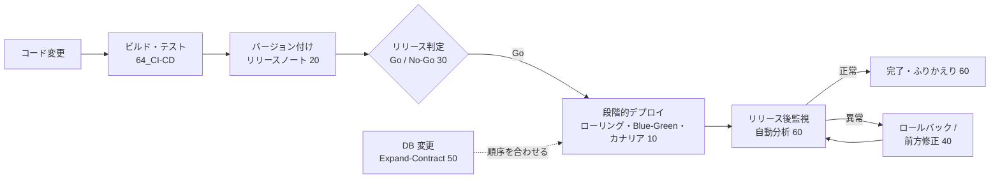

# MOC_リリース・デプロイ体系

65_リリース・デプロイ の入口ノート。**作った成果物を、安全に本番へ出し、問題があれば素早く戻す**ための型を扱う。61〜69 全体の地図は [[MOC_運用領域マップ]]。

10〜60 の全 29 回は、**初心者が頭から順に読めば実務でリリースを任されるレベルまで届く 1 本の教材**として書いている。各回は「前へ / 次へ」で章をまたいでつながり、共通の題材（EC サイト「Shop」：Node.js の API をコンテナで 4 台、PostgreSQL、GitHub Actions）で「注文 API にクーポン機能を追加する」リリースを追いかける。各回の末尾に確認クイズがある。

軸にしている資料：
- Google『Site Reliability Engineering』8 章 [Release Engineering](https://sre.google/sre-book/release-engineering/) と『The Site Reliability Workbook』16 章 Canarying Releases
- [DORA](https://dora.dev/)（ソフトウェアデリバリーの 5 指標）
- Martin Fowler の bliki（[Feature Toggles](https://martinfowler.com/articles/feature-toggles.html)、[BlueGreenDeployment](https://martinfowler.com/bliki/BlueGreenDeployment.html)、[ParallelChange](https://martinfowler.com/bliki/ParallelChange.html)）

---

## この領域で答えたい問い

| 問い | 章 |
|---|---|
| どうやって**止めずに**新しいバージョンに入れ替えるか | 10 |
| リリースに**名前（バージョン）と説明**をどう付けるか | 20 |
| **出してよいか**をどう判断し、どんな手順で出すか | 30 |
| 問題が起きたら**どう戻す**か、戻せないものは何か | 40 |
| **DB 変更**を含むリリースをどの順序で出すか | 50 |
| 出した後、**何を見て**成功・失敗を判断し、次に活かすか | 60 |

## 全体図

---

## 読み方

**通読（おすすめ）**：[[01_リリースとデプロイの違い]] から「次へ →」をたどる。1 回 20〜40 分程度。

**急ぎで実務に入るなら**：10 章の 01〜03・08 → 30 章の 03 → 40 章の 01・04 → 50 章の 01 → 60 章の 01。

**困ったときの逆引き**

| 状況 | まず読む |
|---|---|
| どのデプロイ方式を選べばいいか分からない | [[02_デプロイ戦略の全体像と選び方]] |
| デプロイ中に一瞬 502 / 503 が出る | [[08_ゼロダウンタイムデプロイの条件]] → [[03_ヘルスチェックと自動ロールバック]] |
| 新機能を一部のユーザーにだけ出したい | [[05_カナリアリリース]] / [[06_フィーチャーフラグ]] |
| バージョン番号をどう上げるか迷う | [[01_セマンティックバージョニング]] |
| リリースノートを書くのが面倒 / 何を書けばいいか | [[04_変更履歴とリリースノートの書き方]] → [[05_リリースの自動化]] |
| リリース手順書を作りたい | [[03_リリース手順書とチェックリスト]] |
| 年末・セール前に出していいか | [[05_凍結期間とメンテナンス窓]] / [[02_リリース可否の基準とGo-No-Go判断]] |
| リリース直後にエラーが増えた | [[04_ロールバック判断基準]] → [[01_ロールバック戦略]]（インシデント対応は [[01_デプロイ直後の異常]]） |
| 戻したいが戻せない | [[03_ロールバックできない変更]] → [[02_ロールフォワード（前方修正）]] |
| 列の削除・リネームを安全に出したい | [[01_アプリとDB変更のリリース順序]] → [[02_Expand-Contractのリリース計画]] |
| 大きなテーブルへのインデックス追加 | [[03_長時間DDLとデータ移行のリリース]] |
| リリースの良し悪しを数字で見たい | [[04_リリースのふりかえりとDORA指標]] |

---

## 10_デプロイ戦略
1. [[01_リリースとデプロイの違い]] — デプロイとリリースの分離、CI / CD、SRE のリリースエンジニアリング原則
2. [[02_デプロイ戦略の全体像と選び方]] — 6 方式の比較表と選定フロー、組み合わせ方
3. [[03_ローリングアップデート]] — maxSurge / maxUnavailable、readinessProbe、新旧混在
4. [[04_Blue-Greenデプロイ]] — 2 環境の切り替え、即時切り戻し、DNS TTL の罠
5. [[05_カナリアリリース]] — 1% → 100% の段階公開、比較する指標、Argo Rollouts
6. [[06_フィーチャーフラグ]] — 4 種類のトグル、OpenFeature、フラグ負債
7. [[07_シャドウデプロイとダークローンチ]] — トラフィックのミラーリング、副作用の扱い
8. [[08_ゼロダウンタイムデプロイの条件]] — ヘルスチェック、グレースフルシャットダウン、後方互換

クリップ：[[なぜデプロイは怖くなくなったのか]] ／ [[止めずに入れ替える — デプロイの仕組み｜ねる前エンジニアリング]]

## 20_バージョニング・リリースノート
1. [[01_セマンティックバージョニング]] — MAJOR.MINOR.PATCH、npm の ^ と ~、API バージョニング
2. [[02_カレンダーバージョニング]] — CalVer、ビルド番号、コンテナイメージのタグ戦略
3. [[03_gitタグとリリースの作り方]] — 注釈付き / 署名付きタグ、GitHub Releases、ビルドは 1 回
4. [[04_変更履歴とリリースノートの書き方]] — Keep a Changelog、破壊的変更と移行手順
5. [[05_リリースの自動化]] — Conventional Commits、semantic-release / release-please / Changesets

## 30_リリース判定・手順
1. [[01_リリースサイクルとブランチ戦略]] — オンデマンド / リリーストレイン / 継続的デプロイ、ホットフィックス
2. [[02_リリース可否の基準とGo-No-Go判断]] — 品質ゲート、エラーバジェット、Go / No-Go 会議
3. [[03_リリース手順書とチェックリスト]] — 手順書の 5 部構成、チェックリスト、告知テンプレート
4. [[04_リハーサルとステージング環境]] — 環境差分、本番データの匿名化、IaC
5. [[05_凍結期間とメンテナンス窓]] — リリース凍結と例外承認、計画停止の設計

## 40_ロールバック
1. [[01_ロールバック戦略]] — 6 つの戻し方の比較、「まず戻してから調べる」
2. [[02_ロールフォワード（前方修正）]] — 直して進む判断、ホットフィックスの流れ
3. [[03_ロールバックできない変更]] — DB・外部送信・モバイル・CDN など戻せない変更と事前対策
4. [[04_ロールバック判断基準]] — 定量 / 定性基準、誰が決めるか、判断フロー

## 50_DB変更のリリース
SQL の書き方そのものは [[07_ゼロダウンタイムのスキーマ変更]]（62 章）が本拠地。ここでは**順序と段取り**を扱う。
1. [[01_アプリとDB変更のリリース順序]] — マイグレーション先行 / アプリ先行、パイプラインのどこで流すか
2. [[02_Expand-Contractのリリース計画]] — 列分割を 5 回のリリースに分ける計画、Contract 忘れの防止
3. [[03_長時間DDLとデータ移行のリリース]] — 所要時間の見積もり、進捗監視、スロットリング、gh-ost / pg_repack

## 60_リリース後監視
1. [[01_リリース後の重点監視]] — 何をどれだけ見るか、デプロイマーカー、バージョン別メトリクス
2. [[02_段階的トラフィック移行と自動分析]] — プログレッシブデリバリー、AnalysisTemplate、Kayenta
3. [[03_ヘルスチェックと自動ロールバック]] — 深いヘルスチェックの危険、ECS / CodeDeploy / K8s の自動検知
4. [[04_リリースのふりかえりとDORA指標]] — DORA 5 指標、ふりかえり、リリース成熟度

---

## 隣接領域（ここでは扱わない）

| テーマ | 本拠地 |
|---|---|
| パイプライン・自動化そのもの | [[MOC_CI-CD体系\|64_CI-CD]] |
| ブランチ戦略・タグの基本操作 | 51_Git（[[01-Git-Flow]]、[[03-Trunk-Based-Development]]、[[04-タグとリリース管理]]） |
| コンテナ・Kubernetes の基礎 | 53_コンテナ（[[10-Kubernetes]]） |
| マイグレーションの書き方・ツール・SQL | [[MOC_データアーキテクチャ体系\|62_データアーキテクチャ]]/60 |
| 監視の仕組み（メトリクス・アラート・SLO） | [[MOC_可観測性体系\|66_可観測性]] |
| エラーバジェット方針・インシデント対応・ポストモーテム | [[MOC_SRE・インシデント対応体系\|69_SRE・インシデント対応]] |
| リリース判定の QA 観点 | [[MOC_QAプロセス\|86_QAプロセス]]（[[00_Webサイト品質ゲート_目次]]） |
| AWS CodeDeploy / CodePipeline | [[05_CodeDeployとは]]、[[06_CodePipelineとは]] |
