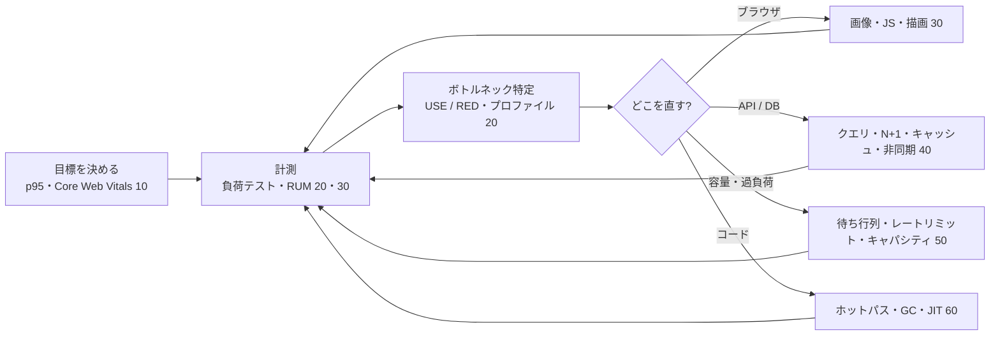

# MOC_パフォーマンス体系

66_パフォーマンス の入口ノート。**速さ・安定性・コストを、計測に基づいて改善する**方法を扱う。62〜69 全体の地図は [[MOC_運用領域マップ]]。

10〜60 の全 29 回は、**初心者が頭から順に読めば「遅い」を自分で測って直せるようになる 1 本の教材**として書いている。背骨は全回共通で **計測 → 仮説 → 改善 → 再計測**。どの回も「どう測るか」とセットで説明し、共通の題材（EC サイト「Shop」：Next.js ＋ Node.js API ＋ PostgreSQL ＋ Redis）の「商品一覧 API が p99 で 2 秒」「商品詳細ページの LCP が 4 秒」「セール時に注文 API が詰まる」を改善していく。各回の末尾に確認クイズがある。数値例は説明用の例として明記している。

軸にしている資料：Brendan Gregg『Systems Performance』と [brendangregg.com](https://www.brendangregg.com/)（USE メソッド・フレームグラフ）、[web.dev](https://web.dev/)（Core Web Vitals）、Dean & Barroso「The Tail at Scale」、[k6 docs](https://grafana.com/docs/k6/latest/)、[V8 blog](https://v8.dev/blog)、[FinOps Foundation](https://www.finops.org/)。

---

## この領域で答えたい問い

| 問い | 章 |
|---|---|
| 「速い」とは何で、何を目標にすればよいか | 10 |
| どこが遅いのかを**正しく測って突き止める**には | 20 |
| Web ページの表示・操作を速くするには | 30 |
| API と DB の応答を速くするには | 40 |
| アクセスが増えても**詰まらない・お金をかけすぎない**には | 50 |
| コードそのもの（CPU・メモリ・GC）を速くするには | 60 |

## 全体図

---

## 読み方

**通読（おすすめ）**：[[01_パフォーマンスとは何か]] から「次へ →」をたどる。1 回 20〜40 分程度。

**急ぎで実務に入るなら**：10 章の 01・02 → 20 章の 01・04・05 → 自分の担当領域（フロントなら 30 章、バックエンドなら 40 章）。

**困ったときの逆引き**

| 症状 | まず読む |
|---|---|
| 平均は速いのに「遅い」と言われる | [[02_レイテンシとパーセンタイル]] |
| 性能目標をどう書けばいいか | [[03_性能要件と目標の決め方]] |
| どこから手を付ければいいか分からない | [[04_最適化の進め方とトレードオフ]] → [[04_ボトルネックの特定（USE・RED）]] |
| 計測するたびに結果が違う | [[01_計測の基本と落とし穴]] → [[02_ベンチマークの書き方]] |
| リリース前に何人まで耐えられるか知りたい | [[03_負荷テストの設計と実施]] |
| CPU が高いが、どの関数か分からない | [[05_プロファイリング]] → [[06_フレームグラフの読み方]] |
| Search Console で LCP / INP / CLS が「不良」 | [[01_Core_Web_Vitals]] → [[06_LighthouseとRUMで計測する]] |
| ページ表示が遅い・画像が重い | [[04_画像とフォントの最適化]] → [[05_ネットワークと読み込みの最適化]] |
| クリックしても反応が遅い（INP） | [[02_ブラウザのレンダリングと描画]] → [[03_JavaScriptとバンドルの最適化]] |
| API が遅い。どこで時間を使っているか | [[01_APIレスポンスタイムの分解]] |
| 遅いクエリがある | [[02_DBクエリのチューニング実践]]（理論は [[05_実行計画の読み方]]） |
| 一覧画面だけ極端に遅い | [[03_N+1問題の発見と解決]] |
| 同じ計算を何度もしている | [[04_キャッシュで応答を速くする]] |
| メール送信などで応答が遅い | [[05_非同期化とキューで待ち時間を隠す]] |
| CPU 70% を超えたら急に遅くなる | [[01_スループットと待ち行列理論]] |
| アクセス集中で全体が落ちる | [[02_バックプレッシャーとレートリミット]] |
| セールに向けてサーバー台数を見積もりたい | [[03_キャパシティプランニング]] |
| クラウド費用が高い | [[04_コスト最適化とFinOps]] |
| メモリが増え続ける / GC で p99 が跳ねる | [[03_メモリアロケーションとGC]] |

---

## 10_考え方
1. [[01_パフォーマンスとは何か]] — レイテンシ・スループット・コスト、体感速度、計測のループ
2. [[02_レイテンシとパーセンタイル]] — 平均の罠、p95 / p99、テールレイテンシ、Coordinated Omission
3. [[03_性能要件と目標の決め方]] — 「p95 < 300ms at 200 rps」の書き方、パフォーマンスバジェット、桁感
4. [[04_最適化の進め方とトレードオフ]] — 推測するな計測せよ、アムダールの法則、優先順位

## 20_計測・分析
1. [[01_計測の基本と落とし穴]] — 何を測るか、ウォームアップ、ばらつき、時刻の取り方
2. [[02_ベンチマークの書き方]] — tinybench / mitata、ベンチの罠、CI での継続ベンチ
3. [[03_負荷テストの設計と実施]] — テストの種類、オープン / クローズドモデル、k6
4. [[04_ボトルネックの特定（USE・RED）]] — 調査手順、Linux 60 秒分析、詰まり場所の見分け方
5. [[05_プロファイリング]] — サンプリング、オン / オフ CPU、--cpu-prof、継続的プロファイリング
6. [[06_フレームグラフの読み方]] — 横幅と縦の意味、差分・オフ CPU フレームグラフ

## 30_フロントエンド
1. [[01_Core_Web_Vitals]] — LCP・INP・CLS の定義と閾値、フィールドとラボ
2. [[02_ブラウザのレンダリングと描画]] — クリティカルレンダリングパス、ロングタスク、レイアウトスラッシング
3. [[03_JavaScriptとバンドルの最適化]] — バンドル分析、コード分割、サードパーティ、ハイドレーション
4. [[04_画像とフォントの最適化]] — AVIF / WebP、srcset、LCP 画像、font-display、日本語フォント
5. [[05_ネットワークと読み込みの最適化]] — RTT、リソースヒント、CSR / SSR / SSG / ISR、bfcache
6. [[06_LighthouseとRUMで計測する]] — Lighthouse のスコア、web-vitals で RUM、Lighthouse CI

クリップ：[[Webサイトの「遅い」は3種類ある｜Web Vitalsを図で理解する]]

## 40_バックエンド・DB
1. [[01_APIレスポンスタイムの分解]] — 時間の内訳、Server-Timing、並列化とタイムアウト
2. [[02_DBクエリのチューニング実践]] — pg_stat_statements、キーセットページネーション、ロック待ち
3. [[03_N+1問題の発見と解決]] — 発見方法（クエリ数テスト）、include / IN / DataLoader
4. [[04_キャッシュで応答を速くする]] — ヒット率と平均レイテンシ、cache-aside、効かないケース
5. [[05_非同期化とキューで待ち時間を隠す]] — BullMQ / SQS、202 Accepted、worker_threads

## 50_スケーラビリティ・キャパシティ
1. [[01_スループットと待ち行列理論]] — リトルの法則、利用率と待ち時間、USL
2. [[02_バックプレッシャーとレートリミット]] — ロードシェディング、トークンバケット、リトライとジッター
3. [[03_キャパシティプランニング]] — 需要予測、1 台の限界、必要台数とヘッドルーム
4. [[04_コスト最適化とFinOps]] — FinOps のフェーズ、ライトサイジング、購入オプション、ユニットエコノミクス

## 60_低レベル最適化
1. [[01_CPUとメモリ階層の基礎]] — キャッシュラインと局所性、分岐予測
2. [[02_JITとコンパイラ最適化]] — V8 のパイプライン、Hidden Class、脱最適化
3. [[03_メモリアロケーションとGC]] — 世代別 GC、GC 停止と p99、メモリリーク調査
4. [[04_ホットパスの最適化]] — 改善の優先順位、Web でよくあるホットスポット、シリーズのまとめ

---

## 隣接領域（ここでは扱わない）

| テーマ | 本拠地 |
|---|---|
| アルゴリズムの計算量・OS とハードウェアの理論 | [[MOC_コンピューターサイエンス体系\|11_コンピューターサイエンス]] |
| パフォーマンスを設計で作り込む（フロント） | 47_フロントエンド設計（[[03_パフォーマンスを設計で作り込む]]） |
| ブラウザ DevTools の Performance パネル | 84_デバッグ（[[Performance・Memory（遅さとメモリリークの調査）]]） |
| インデックス・実行計画・トランザクションの仕組み | [[MOC_データアーキテクチャ体系\|68_データアーキテクチャ]] |
| スケールアウト・ロードバランサー・オートスケール・CDN の仕組み | [[MOC_サーバー・インフラ体系\|64_サーバー・インフラ]]/50 |
| キャッシュの設計（無効化・スタンピード） | [[MOC_分散システム体系\|69_分散システム]]/50 |
| メトリクス・トレースの収集、SLO | [[MOC_可観測性体系\|65_可観測性]] |
| ORM・コネクションプール・アプリからのデータアクセス | [[MOC_バックエンド体系\|34_Backend]]/30 |
| CI での性能チェック（Lighthouse CI） | 86_QAプロセス（[[06_パフォーマンス（Lighthouse CI）]]） |
