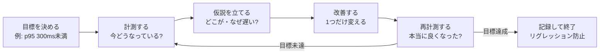

# パフォーマンスとは何か

[[MOC_パフォーマンス体系|📚 目次]] ｜ [[02_レイテンシとパーセンタイル|次へ →]]

> [!abstract] この記事で分かること
> - 「速い／遅い」を **レイテンシ・スループット・リソース効率（コスト）** の 3 つに分けて考える方法
> - 人が「速い」と感じる時間の目安（0.1 秒／1 秒／10 秒、RAIL モデル、Core Web Vitals）
> - 性能がビジネス（売上・離脱）にどう効くか、公開されている事例
> - 1 回のリクエストの時間が、フロントエンド・ネットワーク・バックエンド・DB のどこで使われるか
> - この章を貫く「**計測 → 仮説 → 改善 → 再計測**」のループと、66 章全体の地図
>
> **前提**：Web アプリ（フロント＋API＋DB）を一度作ったことがあれば読めます。

## 1. ひとことで言うと

パフォーマンス（performance、性能）とは「**限られた資源で、ユーザーの仕事をどれだけ速く・たくさん・安く片付けられるか**」です。

ラーメン屋で考えてみます。

- 注文してから 1 杯が出てくるまでの時間 → **レイテンシ**（待ち時間）
- 1 時間に何杯出せるか → **スループット**（処理量）
- それを何人の店員・何台のコンロで実現しているか → **リソース効率／コスト**

「速い店」と言っても、1 杯は早く出るけれど行列が捌けない店もあれば、大量に捌けるけれど 1 杯ずつは少し待たされる店もあります。性能の話をするときは、**どの顔の話をしているのか**を最初にはっきりさせるのが第一歩です。

> [!important] 要点
> - 性能には「レイテンシ」「スループット」「リソース効率（コスト）」の 3 つの顔がある
> - ユーザーが感じる速さには目安となる時間（0.1 秒・1 秒・10 秒）がある
> - 性能改善は勘ではなく「計測 → 仮説 → 改善 → 再計測」のループで進める

## 2. 性能の 3 つの顔

### 2.1 レイテンシ（latency）

**1 つの処理が始まってから終わるまでの時間**です。「応答時間（response time）」とほぼ同じ意味で使われます（厳密には、待ち行列で待っている時間を含めるかどうかで使い分ける人もいます）。

- 例：商品一覧 API に GET を送ってからレスポンスが返るまで 180ms
- 例：商品詳細ページを開いてから、一番大きな商品画像が表示されるまで 2.1 秒（これが LCP）

レイテンシは「1 回ごとに違う値」になるので、**平均ではなく分布（パーセンタイル）で見る**のが基本です。詳しくは次回 [[02_レイテンシとパーセンタイル]] で扱います。

### 2.2 スループット（throughput）

**単位時間あたりに処理できる量**です。Web API なら rps（requests per second、1 秒あたりのリクエスト数）、バッチなら「1 時間で何件処理できるか」、ネットワークなら Mbps などで表します。

- 例：Shop API 4 台で合計 800 rps を捌ける
- 例：夜間バッチが 1 時間に 50 万件の注文を集計できる

レイテンシとスループットは **別物** です。1 本の高速道路で例えると、レイテンシは「1 台の車が A 地点から B 地点まで何分かかるか」、スループットは「1 時間に何台通れるか」。車線を増やせばスループットは上がりますが、1 台あたりの所要時間は変わりません。

そして両者はつながっています。負荷（流入するリクエスト）がスループットの限界に近づくと、**待ち行列（キュー）が伸びてレイテンシが急に悪化します**。この関係は [[01_スループットと待ち行列理論]] で詳しく扱います。

### 2.3 リソース効率とコスト

**同じ仕事をするのに、CPU・メモリ・ディスク・ネットワーク・お金をどれだけ使うか**です。

- 例：1 リクエストあたり CPU 時間 8ms、メモリ 30MB
- 例：月間 1 億リクエストを捌くのにサーバー代が月 40 万円

サーバーを 10 倍に増やせば、たいていスループットは上がります。でもそれは「性能が良くなった」のではなく「お金で殴った」だけです。クラウドでは **性能 ≒ コスト** なので、「同じ性能をより少ない資源で」も立派な性能改善です（[[04_コスト最適化とFinOps]]）。

### 2.4 3 つの顔の関係

```
              レイテンシ（1回の速さ）
                    ▲
                    │   どれかを良くすると
                    │   どれかが悪くなることが多い
                    │
  スループット ◀────┼────▶ リソース効率／コスト
  （量を捌く力）        （少ない資源・お金で）
```

| 改善策の例 | レイテンシ | スループット | コスト |
| --- | --- | --- | --- |
| サーバー台数を増やす | ほぼ変わらない（混雑時は改善） | 上がる | 上がる |
| リクエストをまとめて処理（バッチ化） | 悪化しうる（待たされる） | 上がる | 下がる |
| キャッシュを入れる | 下がる（速くなる） | 上がる | メモリ分上がる／DB 分下がる |
| 圧縮して送る | 回線が遅いと改善 | 帯域あたり上がる | CPU が増える |

「性能を良くしたい」と言われたら、**どれを・どれだけ・何と引き換えに**良くしたいのかを確認しましょう。

## 3. ユーザーが感じる速さ

### 3.1 0.1 秒・1 秒・10 秒（Nielsen の目安）

ユーザビリティ研究者 Jakob Nielsen は、著書 *Usability Engineering*（1993 年）で、応答時間に 3 つの目安を示しました。30 年以上たった今も、UI 設計の基本として引用されています。

| 時間 | ユーザーの感じ方 | 設計上の意味 |
| --- | --- | --- |
| **0.1 秒** | 「即座に反応した」と感じる | 結果を出すだけでよく、特別なフィードバックは不要 |
| **1 秒** | 遅れには気づくが、思考の流れは途切れない | 0.1〜1 秒なら特別な表示は不要だが、「直接操作している感」は薄れる |
| **10 秒** | 注意を保てる限界 | これを超えるなら進捗表示（あと何秒か）が必要。ユーザーは別の作業に移りがち |

Shop で言えば：

- 「カートに入れる」ボタンの反応 → 0.1 秒以内にボタンの見た目を変える（裏の API が遅くても、まず「押せた」ことを返す）
- 商品一覧の検索 → 1 秒以内に結果を出したい
- 注文 CSV のエクスポート → 10 秒を超えるなら「作成中…」と進捗を出す、または非同期化してメールで通知する（[[05_非同期化とキューで待ち時間を隠す]]）

### 3.2 RAIL モデル

Google が Web 向けに整理したのが **RAIL モデル**です。ユーザー体験を 4 つの場面に分け、それぞれに時間目標を置きます（web.dev より）。

| 場面 | 目標 | ガイドライン |
| --- | --- | --- |
| **R**esponse（入力への応答） | ユーザー操作による変化を 100ms 以内に完了 | 入力イベントは 50ms 以内に処理する |
| **A**nimation（アニメーション） | 各フレームを 10ms 以内に作る | 60fps の 1 フレーム約 16ms のうち、ブラウザの描画分を残す |
| **I**dle（アイドル） | アイドル時間を最大化 | アイドル中の作業は 50ms 以下の塊に分ける |
| **L**oad（読み込み） | 中位スマホ・遅い 3G で 5 秒以内に操作可能に | 2 回目以降の訪問は 2 秒以内 |

> [!note] RAIL は「考え方の型」として使う
> web.dev の RAIL の記事自身が、性能目標の定義には **より新しい Core Web Vitals を使うこと** を勧めています。RAIL は「場面ごとに体感の時間予算が違う」という考え方を学ぶのに便利ですが、具体的な目標値は Core Web Vitals を使うのが 2026 年時点の主流です。

### 3.3 Core Web Vitals（今の Web の標準的な物差し）

Google が「良いユーザー体験」の指標として定めているのが **Core Web Vitals** です。

| 指標 | 何を測るか | 「良い」の閾値 |
| --- | --- | --- |
| LCP（Largest Contentful Paint） | 読み込み：一番大きな要素が表示されるまで | 2.5 秒以下 |
| INP（Interaction to Next Paint） | 応答性：操作してから次の描画まで | 200ms 以下 |
| CLS（Cumulative Layout Shift） | 見た目の安定性：レイアウトのズレ | 0.1 以下 |

ポイントは「**実ユーザーのページ表示の 75 パーセンタイルで判定する**」ことです。一部の速いユーザーではなく、4 人中 3 人がこの値以内に収まっているかを見ます。詳細は [[01_Core_Web_Vitals]] で扱います。

## 4. 性能がビジネスに与える影響

「速いほうが良い」のは直感的に分かりますが、どれくらい効くのかは、公開されている事例で確認しておきましょう。ここでは一次情報（web.dev のケーススタディ）で確認できたものだけを挙げます。

- **Vodafone（イタリア）**：ランディングページの LCP を 31% 改善（8.3 秒 → 5.7 秒）した A/B テストで、売上が 8%、訪問あたりのリード（見込み客）率が 15%、訪問あたりのカート投入率が 11% 改善した。
- **Deloitte「Milliseconds Make Millions」**（Google の委託調査、37 の小売・旅行ブランドのモバイルサイトのデータ）：モバイルサイトの速度が 0.1 秒改善すると、小売サイトでコンバージョン率が 8.4%、旅行サイトで 10.1% 上がった。ただしこれは「ユーザーの導線上の全ページで、4 つの速度指標がそれぞれ 0.1 秒改善した」場合の結果です。

> [!warning] 事例の数字の扱い方
> - よく見かける「Amazon は 100ms 遅くなると売上が 1% 下がる」などの数字は、出典が講演スライドや孫引きであることが多く、一次情報を確認しにくいものがあります。社内資料で使うときは出典を確かめましょう。
> - 他社の数字は「自社でも同じ」とは限りません。一番説得力があるのは、**自社サイトで A/B テストや RUM（実ユーザー計測）を使って出した数字**です。

性能はビジネスの数字以外にも効きます。

- **コスト**：1 リクエストの CPU 時間が半分になれば、同じ負荷を半分のサーバーで捌ける
- **信頼性**：遅いサービスは、タイムアウト → リトライ → さらに負荷増加、という連鎖障害を起こしやすい
- **開発体験**：テストやビルドが速いと開発サイクルが速くなる

## 5. 時間はどこで使われているか

商品詳細ページを開いたとき、1 回の表示にかかる時間は、ざっくり次のように分解できます。

```
ユーザーがリンクをタップ
│
├─ [ネットワーク] DNS → TCP/TLS 接続 → リクエスト送信 ………… 数十〜数百ms（回線・距離次第）
│
├─ [インフラ]    LB → Nginx → API サーバーに振り分け ………… 数ms
│
├─ [バックエンド] Shop API の処理
│    ├─ 認証・入力チェック …………………………………… 数ms
│    ├─ PostgreSQL へのクエリ（商品・在庫・レビュー）…… 数ms〜数百ms ← よく犯人になる
│    ├─ Redis 参照 ……………………………………………… 1ms 前後
│    └─ JSON 生成 ……………………………………………… 数ms
│
├─ [ネットワーク] レスポンス（HTML/JSON）の転送 ……………… サイズと回線次第
│
└─ [フロントエンド] ブラウザの処理
     ├─ HTML 解析、CSS / JS のダウンロード・実行 ………… 数百ms〜数秒 ← スマホで重い
     ├─ 画像のダウンロード（商品画像）…………………… LCP に直結
     └─ レイアウト・描画
```

（各時間は桁感をつかむための説明用の例です。実際の値は必ず計測して確かめます。）

ここから分かる大事なことは 2 つです。

1. **ユーザーが感じる時間のうち、サーバー（API）の処理はほんの一部であることが多い**。API を 50ms 速くしても、フロントの JS 実行に 2 秒かかっていれば体感はほとんど変わりません。
2. **どこが遅いかは場合によって違う**。だから「とりあえず DB をチューニング」ではなく、まず全体を分解して測ります（[[01_APIレスポンスタイムの分解]]、[[02_ブラウザのレンダリングと描画]]）。

### どう測るか（最初の一歩）

全体像をつかむだけなら、特別なツールはいりません。

**① ブラウザ側**：Chrome DevTools の Network パネルで各リクエストの「Timing」を見ると、DNS・接続・TTFB（Time To First Byte、最初の 1 バイトが返るまで）・ダウンロードが分かれて表示されます。Performance パネルでは JS 実行や描画の時間が見られます（[[Performance・Memory（遅さとメモリリークの調査）]]）。

**② サーバー側**：curl の `-w` オプションで、接続から応答までの内訳が取れます。

```bash
# curl-format.txt を用意して、時間の内訳を表示する
cat > curl-format.txt <<'EOF'
dns:        %{time_namelookup}s
connect:    %{time_connect}s
tls:        %{time_appconnect}s
ttfb:       %{time_starttransfer}s
total:      %{time_total}s
size:       %{size_download} bytes
EOF

curl -s -o /dev/null -w "@curl-format.txt" "https://shop.example.com/api/products?page=1"
```

出力例（説明用の例）：

```
dns:        0.012s
connect:    0.031s
tls:        0.068s
ttfb:       0.412s   ← サーバーが考えている時間（＋往復）が大きい
total:      0.437s
size:       48213 bytes
```

`ttfb - tls` がおおむね「サーバーが処理していた時間＋1 往復」です。この例ならサーバー側に 340ms ほど使っていそうだ、という **仮説** が立ちます。

**③ アプリの中**：API の中で時間を区切って測ります。Node.js なら `performance.now()` が使えます。

```ts
// src/routes/products.ts（Express 相当）
import { performance } from "node:perf_hooks";
import type { Request, Response } from "express";
import { db } from "../db";

export async function listProducts(req: Request, res: Response) {
  const t0 = performance.now();
  const rows = await db.query(
    "SELECT id, name, price FROM products ORDER BY created_at DESC LIMIT 20"
  );
  const t1 = performance.now();
  const body = JSON.stringify(rows.rows);
  const t2 = performance.now();

  // Server-Timing ヘッダーに載せると DevTools の Timing タブで見える
  res.setHeader(
    "Server-Timing",
    `db;dur=${(t1 - t0).toFixed(1)}, json;dur=${(t2 - t1).toFixed(1)}`
  );
  res.type("application/json").send(body);
}
```

`Server-Timing` ヘッダーはブラウザの DevTools にそのまま表示されるので、「フロントから見た時間」と「サーバー内の内訳」を 1 画面で見比べられて便利です（MDN 参照）。本格的な計測は [[01_計測の基本と落とし穴]] で扱います。

## 6. 計測 → 仮説 → 改善 → 再計測のループ

この章全体の背骨になる考え方です。



各ステップのコツ：

| ステップ | やること | よくある失敗 |
| --- | --- | --- |
| 目標 | 「何を・どの指標で・どこまで」を決める（[[03_性能要件と目標の決め方]]） | 「とにかく速く」で始めて終わりがない |
| 計測 | 今の値（ベースライン）を取る | 改善前を測っておらず効果を示せない |
| 仮説 | 「DB クエリがインデックスを使っていないから遅い」のように **原因と理由** をセットで | 「たぶんここ」で手を動かし始める |
| 改善 | **一度に 1 つだけ** 変える | 3 つ同時に変えて、どれが効いたか分からない |
| 再計測 | 同じ条件で測り直し、Before/After を比べる | 1 回だけ測って「速くなった」と判断（誤差かも） |

このループの進め方と優先順位は [[04_最適化の進め方とトレードオフ]] で詳しく扱います。

## 7. この章（66_パフォーマンス）の地図

```
10_考え方 ………………… 何を目指し、どう考えるか（いまここ）
   01 パフォーマンスとは何か → 02 レイテンシとパーセンタイル
   → 03 性能要件と目標の決め方 → 04 最適化の進め方とトレードオフ
        │
20_計測・分析 ………… どう測り、どこが遅いかを突き止めるか
   計測の基本 / ベンチマーク / 負荷テスト / USE・RED / プロファイリング / フレームグラフ
        │
   ┌────┴─────────────┬──────────────────┐
30_フロントエンド    40_バックエンド・DB     50_スケーラビリティ・キャパシティ
 Core Web Vitals     API の分解 / クエリ    待ち行列 / バックプレッシャー
 レンダリング / JS    N+1 / キャッシュ        キャパシティ計画 / コスト
 画像 / ネットワーク  非同期化
        │
60_低レベル最適化 …… CPU とメモリ階層 / JIT / GC / ホットパス
```

- まず **10** で「目標」と「物差し」を持ち、**20** で「測り方」と「犯人の探し方」を身につけます。
- そのうえで、遅い場所に応じて **30（ブラウザ側）／40（サーバー・DB 側）／50（量と容量の問題）** に進みます。
- **60** は、計測でホットパス（何度も通る重い処理）が特定できたときにだけ使う「最後の手段」です。

## よくある誤解・つまずき

- ❌「性能 ＝ 速さ（レイテンシ）だけ」
  ✅ スループットとコストも性能です。1 回は速くてもセール時に捌けなければ意味がなく、サーバー代が 3 倍なら事業的には失敗です。
- ❌「サーバーを速くすれば、ユーザーの体感も速くなる」
  ✅ 体感時間の多くはネットワークやブラウザ側で使われていることがよくあります。まずエンドツーエンドで分解して測りましょう。
- ❌「平均応答時間が 100ms だから、みんな快適」
  ✅ 平均は一部の非常に遅いリクエストを隠します。パーセンタイルで見る必要があります（[[02_レイテンシとパーセンタイル]]）。
- ❌「他社の事例で 0.1 秒＝売上 8% と出ているから、うちも同じ」
  ✅ 事例は傾向を示すもので、条件（業種、改善の範囲）が違えば効果も違います。自社で計測しましょう。

## まとめ

- 性能には **レイテンシ・スループット・リソース効率（コスト）** の 3 つの顔があり、互いにトレードオフの関係にある
- 体感の目安は **0.1 秒（即時）／1 秒（思考が途切れない）／10 秒（注意の限界）**。Web では Core Web Vitals（LCP 2.5 秒・INP 200ms・CLS 0.1、75 パーセンタイル）が標準の物差し
- 性能は売上・コスト・信頼性に効く。ただし数字は一次情報と自社の計測で確かめる
- 1 回の表示時間はフロント・ネットワーク・バックエンド・DB に分かれる。**まず分解して測る**
- 改善は **計測 → 仮説 → 改善 → 再計測** のループで、一度に 1 つずつ進める

## 確認クイズ

1. 「Shop API を 2 台から 4 台に増やした」とき、3 つの顔（レイテンシ・スループット・コスト）はそれぞれどう変わると考えられますか？
> [!tip]- 答え
> スループット（捌ける量）は上がり、コストも上がります。レイテンシは、もともと混雑していなければほぼ変わりません。混雑で待ち行列ができていた場合は、待ち時間が減るのでレイテンシも改善します。台数を増やしても「1 回の処理そのもの」は速くならない点がポイントです。

2. 注文履歴の CSV ダウンロードに 15 秒かかります。Nielsen の目安に照らすと、どんな対策が考えられますか？
> [!tip]- 答え
> 10 秒を超えるので、ユーザーは注意を保てず別の作業に移ります。進捗表示（あと何秒か、何％か）を出すか、処理を非同期化して「準備ができたら通知する」形にするのが妥当です。もちろん処理自体を速くすることも検討します。

3. curl で測ったら `tls: 0.07s`、`ttfb: 0.95s`、`total: 1.0s` でした。まずどこを疑い、次に何を測りますか？
> [!tip]- 答え
> TLS 接続完了から最初の 1 バイトまでに約 0.88 秒かかっているので、サーバー側の処理（API・DB）を疑います。次は API の中を区切って測る（`performance.now()` や `Server-Timing`、APM のトレース）ことで、DB クエリなのかアプリの処理なのかを切り分けます。

## 関連ノート

- [[02_レイテンシとパーセンタイル]] — 次回。平均ではなく分布で見る
- [[03_性能要件と目標の決め方]] — 目標の立て方
- [[04_最適化の進め方とトレードオフ]] — ループの回し方と優先順位
- [[01_計測の基本と落とし穴]] — 計測の詳しいやり方
- [[01_Core_Web_Vitals]] — フロントエンドの標準的な指標
- [[01_スループットと待ち行列理論]] — レイテンシとスループットの関係
- [[Webサイトの「遅い」は3種類ある｜Web Vitalsを図で理解する]] — 体感の遅さを図で整理したクリップ（30_フロントエンド）
- [[03_パフォーマンスを設計で作り込む]] — フロント設計の観点から
- [[MOC_可観測性体系]] — 本番での計測の仕組み

## 参考

- [Response Times: The 3 Important Limits（Nielsen Norman Group）](https://www.nngroup.com/articles/response-times-3-important-limits/)
- [Measure performance with the RAIL model（web.dev）](https://web.dev/articles/rail)
- [Web Vitals（web.dev）](https://web.dev/articles/vitals)
- [Vodafone: A 31% improvement in LCP increased sales by 8%（web.dev）](https://web.dev/case-studies/vodafone)
- [Milliseconds make millions（web.dev）](https://web.dev/case-studies/milliseconds-make-millions)
- [Server-Timing（MDN）](https://developer.mozilla.org/ja/docs/Web/HTTP/Headers/Server-Timing)
- [Performance measurement APIs（Node.js docs）](https://nodejs.org/api/perf_hooks.html)
