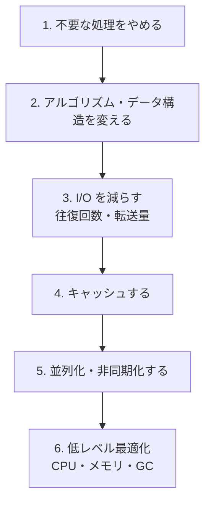

# 最適化の進め方とトレードオフ

[[MOC_パフォーマンス体系|📚 目次]] ｜ [[03_性能要件と目標の決め方|← 前へ]] ｜ [[01_計測の基本と落とし穴|次へ →]]

> [!abstract] この記事で分かること
> - 「推測するな、計測せよ」の出どころと、なぜ勘が外れるのか
> - Knuth の「早すぎる最適化は諸悪の根源」の **正しい引用と文脈**
> - アムダールの法則で「どこを速くすれば全体がどれだけ速くなるか」を計算する方法
> - 最適化の優先順位（不要な処理をやめる → アルゴリズム → I/O 削減 → キャッシュ → 並列化 → 低レベル）
> - 速さと引き換えに失うもの（可読性・一貫性・コスト・メモリ）と、改善の記録・リグレッション防止
>
> **前提**：[[03_性能要件と目標の決め方]] を読んでいると理解しやすいです。

## 1. ひとことで言うと

通勤時間を短くしたいとき、駅までの徒歩 5 分を走って 4 分にするより、乗り換えの待ち時間 20 分をなくすルートを探すほうがずっと効きます。そもそも「どこで時間を使っているか」を知らないまま走り出すと、頑張ったのに全体はほとんど変わらない、ということになります。

最適化（optimization）も同じです。**まず計測して一番時間を使っている場所（ボトルネック）を見つけ、効果の大きい手から順に、1 つずつ打つ**。そして速さと引き換えに何を失うかを意識します。

> [!important] 要点
> - 勘で直さず、**計測してボトルネックを特定** してから直す
> - 全体の改善幅は「その部分が全体に占める割合」で上限が決まる（アムダールの法則）
> - ボトルネックは 1 つ直すと **次の場所に移る**。目標に届いたら止める
> - 手を打つ順番は「やめる → アルゴリズム → I/O 削減 → キャッシュ → 並列化 → 低レベル」
> - 最適化にはコストがある。記録を残し、CI でリグレッションを防ぐ

## 2. 推測するな、計測せよ

### 2.1 出どころ

日本でよく言われる「**推測するな、計測せよ**」は、Rob Pike（Go 言語の設計者の 1 人）が 1987 年に書いた「Notes on Programming in C」のルールがもとになっています。

> **Rule 1.** You can't tell where a program is going to spend its time. Bottlenecks occur in surprising places, so don't try to second guess and put in a speed hack until you've proven that's where the bottleneck is.
> （プログラムがどこで時間を使うかは分からない。ボトルネックは意外な場所にある。だから、そこがボトルネックだと証明するまでは、推測で高速化の小細工を入れてはいけない。）
>
> **Rule 2.** Measure. Don't tune for speed until you've measured, and even then don't unless one part of the code overwhelms the rest.
> （計測せよ。計測するまで速度のチューニングをしてはいけない。計測した後でも、コードのある部分が他を圧倒していない限り、やるべきではない。）

### 2.2 なぜ勘は外れるのか

- 人は **コードの見た目** で重さを判断しがちですが、実際の時間は I/O（DB・ネットワーク・ディスク）の待ちで決まることが多い。ループが 3 重でも 1ms、1 行の `await` が 300ms、ということは普通にある
- 現代の CPU・JIT コンパイラ・DB のオプティマイザは賢く、「速そうな書き方」が実際には変わらない（または遅い）ことがある
- 本番のデータ量・アクセスの偏りは、手元の開発環境と違う

### 2.3 例：Shop 商品一覧 API で勘が外れる話

「商品一覧 API が遅い。JSON の組み立てでループを回しているから、そこが重いはずだ」と考えてループを書き換えた、とします。ところが計測すると（以下は説明用の例）：

```
GET /api/products の内訳（p50、Server-Timing より）
  認証・入力チェック      2ms
  DB: 商品 20 件取得       8ms
  DB: 在庫を 1 件ずつ取得  20 回 × 6ms = 120ms   ← 本当の犯人（N+1）
  JSON 組み立て            3ms                   ← 勘で直したのはここ
  ─────────────────────────────
  合計                   約 133ms
```

JSON 組み立てを 3ms → 1ms にしても全体は 133ms → 131ms。在庫取得を 1 回のクエリにまとめれば 133ms → 約 20ms です。**どこを直すかで効果が 50 倍以上違う** ことが、計測すれば一目で分かります（N+1 の詳細は [[03_N+1問題の発見と解決]]）。

## 3. Knuth の「早すぎる最適化」を正しく読む

### 3.1 よく引用される一文と、その前後

「**早すぎる最適化は諸悪の根源である**（premature optimization is the root of all evil）」は、Donald Knuth の 1974 年の論文「Structured Programming with go to Statements」（ACM Computing Surveys）の一節です。前後を含めると次のようになっています。

> Programmers waste enormous amounts of time thinking about, or worrying about, the speed of noncritical parts of their programs, and these attempts at efficiency actually have a strong negative impact when debugging and maintenance are considered. We should forget about small efficiencies, say about 97% of the time: premature optimization is the root of all evil. **Yet we should not pass up our opportunities in that critical 3%.**
>
> （プログラマーは、プログラムの重要でない部分の速度について考えたり心配したりすることに膨大な時間を浪費しており、こうした効率化の試みは、デバッグや保守を考えると実際には強い悪影響を持つ。小さな効率のことは、まあ 97％ の場合は忘れるべきだ。早すぎる最適化は諸悪の根源である。**それでも、決定的に重要な 3％ における機会を逃してはならない。**）

### 3.2 よくある誤読

| ❌ 誤読 | ✅ 実際の主張 |
| --- | --- |
| 「性能は後回しでいい」「最適化はするな」 | **重要でない部分の小さな効率化** に時間を使うな。重要な 3％ はちゃんと最適化せよ |
| 「動いてから考えればいい」 | どこが重要かは **計測で見つけよ**（Knuth は同じ論文で、どこが重要かを事前に勘で判断するのは誤りのもとで、計測ツールを使うべきだと述べている） |
| 「設計段階で性能を考えるのは早すぎる最適化」 | Knuth が戒めているのは「小さな効率（small efficiencies）」の小細工。データモデルやアーキテクチャの桁レベルの判断は別の話 |

つまり、Knuth と Pike は同じことを言っています。**全部を最適化しようとするな。計測して、効く場所だけを最適化せよ**。旧来の「最初は読みやすさを優先し、問題が出てから直す」という教えも、この意味で正しいのですが、「設計段階で桁を間違えない」（[[03_性能要件と目標の決め方]]）こととは両立させる必要があります。

## 4. アムダールの法則：全体はどれだけ速くなるか

### 4.1 式

**アムダールの法則（Amdahl's law）** は、「処理の一部だけを速くしたとき、全体がどれだけ速くなるか」を表します。

```
全体の速度向上 S = 1 / ((1 - p) + p / s)

  p : 速くする部分が、全体の時間に占める割合（0〜1）
  s : その部分を何倍速くするか
```

`s` を無限大にしても（その部分を時間 0 にしても）、`S` は `1 / (1 - p)` を超えられません。**全体に占める割合が小さい部分は、どれだけ頑張っても全体に効かない** ということです。

### 4.2 計算例：Shop 商品一覧 API

全体 500ms のうち、DB が 400ms（p = 0.8）、JSON 生成が 50ms（p = 0.1）、その他 50ms だとします（説明用の例）。

**案 A：DB を 2 倍速くする**（s = 2）

```
S = 1 / (0.2 + 0.8 / 2) = 1 / 0.6 ≒ 1.67 倍
500ms → 300ms
```

**案 B：JSON 生成を 10 倍速くする**（s = 10）

```
S = 1 / (0.9 + 0.1 / 10) = 1 / 0.91 ≒ 1.10 倍
500ms → 455ms
```

**案 B の上限**：JSON 生成を 0ms にしても `1 / 0.9 ≒ 1.11 倍`（450ms）にしかなりません。

10 倍の改善より 2 倍の改善のほうが全体には効く ── これがアムダールの法則の教えです。もともとは並列化（`s` ＝ CPU コア数）の限界を示す法則で、「並列化できない部分が 10％ あれば、コアをいくら増やしても 10 倍が上限」という形でもよく使われます。

### 4.3 TypeScript で確かめる

```ts
// amdahl.ts —— npx tsx amdahl.ts
function amdahl(p: number, s: number): number {
  return 1 / ((1 - p) + p / s);
}

const totalMs = 500;
for (const [label, p, s] of [
  ["DB を 2 倍速く", 0.8, 2],
  ["JSON を 10 倍速く", 0.1, 10],
  ["JSON を無限に速く", 0.1, Infinity],
] as const) {
  const speedup = amdahl(p, s);
  console.log(`${label}: ${speedup.toFixed(2)} 倍 → ${(totalMs / speedup).toFixed(0)}ms`);
}
// DB を 2 倍速く: 1.67 倍 → 300ms
// JSON を 10 倍速く: 1.10 倍 → 455ms
// JSON を無限に速く: 1.11 倍 → 450ms
```

## 5. ボトルネックは 1 つずつ移る

一番遅い場所を直すと、**2 番目に遅かった場所が新しいボトルネックになります**。

```
改善前   [■■■■■■■■■■■■■■■■ DB 400ms][■■ JSON 50][■■ 他 50]  = 500ms
            ↓ インデックス追加・N+1 解消
改善 1   [■■■■ DB 100][■■ JSON 50][■■ 他 50]                 = 200ms
            ↓ まだ DB が最大 → キャッシュ
改善 2   [■ DB 20][■■ JSON 50][■■ 他 50]                     = 120ms
            ↓ 今度は JSON と「他」が主役に
```

（数値は説明用の例です。）

ここで大事なのは 2 つです。

1. **毎回測り直す**。改善 2 の後に DB をさらに頑張っても、もう全体には効きません
2. **目標に届いたら止める**。目標が「p95 < 300ms」なら改善 1 で達成しています。それ以上の改善は、他の仕事（機能開発、別の遅い画面）と比べて本当に価値があるかを判断します

サーバー内部だけでなく、システム全体でもボトルネックは移ります。API を速くしたら DB の CPU が先に張り付いた、DB を増強したらコネクションプールが足りなくなった、という具合です。リソースの観点でボトルネックを探す方法は [[04_ボトルネックの特定（USE・RED）]] で扱います。

## 6. 最適化の優先順位

効果が大きく、副作用が小さいものから順に検討します。



| 順 | 手段 | Shop での例 | 主な副作用 |
| --- | --- | --- | --- |
| 1 | **不要な処理をやめる** | 一覧で使わない `description` 列まで取っていた → 列を絞る。表示しない商品のレビュー件数を数えていた → やめる | ほぼなし（仕様確認は必要） |
| 2 | **アルゴリズム・データ構造** | 配列の `includes` を二重ループで回す O(n²) → `Set` で O(n)。DB ならインデックスを張る | コードの変更範囲 |
| 3 | **I/O を減らす** | N+1 をまとめて 1 クエリに、画像を圧縮・適切なサイズに、API の往復回数を減らす | 実装の複雑さ |
| 4 | **キャッシュ** | 商品一覧を Redis に 60 秒キャッシュ、CDN で画像を配信 | **一貫性**（古いデータ）、メモリ、無効化の難しさ |
| 5 | **並列化・非同期化** | 独立した API 呼び出しを `Promise.all` で同時に、メール送信をキューへ | 複雑さ、デバッグの難しさ、負荷の集中 |
| 6 | **低レベル最適化** | ホットパスのオブジェクト生成を減らす、GC 設定の調整 | **可読性**、移植性、効果が環境依存 |

1〜3 は「仕事そのものを減らす」、4〜5 は「仕事の結果を使い回す／待ち時間を重ねる」、6 は「同じ仕事を速くこなす」です。上ほど効果が桁で効きやすく、下ほど効果が小さい割に副作用が大きくなります。

### 例：アルゴリズムを変える（O(n²) → O(n)）

```ts
// 重複チェック。カート内の商品 ID に重複があるか
// O(n²)：n=10,000 で約 5,000 万回の比較
function hasDuplicateSlow(ids: number[]): boolean {
  for (let i = 0; i < ids.length; i++) {
    for (let j = i + 1; j < ids.length; j++) {
      if (ids[i] === ids[j]) return true;
    }
  }
  return false;
}

// O(n)：Set（ハッシュ）なら 1 回の登録・検索が平均 O(1)
function hasDuplicateFast(ids: number[]): boolean {
  return new Set(ids).size !== ids.length;
}

// 簡易計測（本格的なベンチマークは「ベンチマークの書き方」を参照）
const ids = Array.from({ length: 10_000 }, (_, i) => i); // 重複なし＝最悪ケース
for (const [name, fn] of [["slow", hasDuplicateSlow], ["fast", hasDuplicateFast]] as const) {
  const t0 = performance.now();
  fn(ids);
  console.log(name, (performance.now() - t0).toFixed(2), "ms");
}
```

n が小さいうちはどちらでも差は分かりませんが、n が 10 倍になると O(n²) は 100 倍遅くなります。データが増えたときに突然遅くなる処理は、たいていこのパターンです。なお、`performance.now()` で 1 回だけ測るのは JIT のウォームアップなどの影響で不正確です（[[02_ベンチマークの書き方]]）。

### 例：独立した I/O を並列にする

```ts
// Before：3 つの独立した問い合わせを順番に待つ → 合計 ≒ 40 + 30 + 50 = 120ms（例）
const product = await getProduct(id);
const stock = await getStock(id);
const reviews = await getReviews(id);

// After：同時に投げて全部待つ → ≒ 一番遅いもの（50ms 前後、例）
const [product2, stock2, reviews2] = await Promise.all([
  getProduct(id),
  getStock(id),
  getReviews(id),
]);
```

ただし並列化すると、DB への同時接続数が増えます。コネクションプールが小さいと、待ちが増えて逆に遅くなることもあります（[[01_アプリケーションサーバーとは]]）。**並列化した後も必ず再計測** しましょう。

## 7. トレードオフ：速さと引き換えに失うもの

| 速さと引き換えに | 具体例 | 判断のポイント |
| --- | --- | --- |
| **可読性・保守性** | 手書きのループ展開、ビット演算、複雑なキャッシュ層 | ホットパス（何度も通る場所）以外ではやらない。やるならコメントと計測結果を残す |
| **一貫性（正しさ）** | キャッシュで 60 秒古い在庫数を表示、非同期化で注文確定が遅れて反映 | 古くてよいデータか？ 在庫や決済など「ずれると困る」ものは慎重に（[[69_分散システム/50_分散キャッシュ/キャッシュ戦略\|キャッシュ戦略]]） |
| **コスト** | サーバーやキャッシュを増やして速くする | 速さ 1ms あたりいくら払うか。目標を満たしたら止める（[[04_コスト最適化とFinOps]]） |
| **メモリ** | 全商品をメモリに載せる、事前計算結果を保持 | メモリ不足は GC 増加や OOM で逆に遅くなる（[[03_メモリアロケーションとGC]]） |
| **開発時間** | 2 週間かけて 5ms 速くする | その 2 週間で作れた機能や、他の遅い画面の改善と比べる |

「速いほど良い」ではなく、**目標を満たす範囲で、失うものが一番少ない手** を選ぶのが実務の最適化です。

## 8. 改善の記録とリグレッション防止

### 8.1 改善を記録する

最適化は「なぜその変なコードがあるのか」が後から分からなくなりがちです。改善ごとに、次のような記録をプルリクエストやドキュメントに残しましょう。

```markdown
## 性能改善: 商品一覧 API の在庫取得を 1 クエリに（N+1 解消）

- 目標: GET /api/products  p95 < 300ms @ 200 rps
- 計測条件: k6 constant-arrival-rate 200 rps × 5 分、ステージング、商品 10 万件
- Before: p50 133ms / p95 420ms / p99 2.0s
- After : p50  21ms / p95  65ms / p99 310ms
- 仮説: 在庫を商品ごとに 1 件ずつ取得していた（20 クエリ/リクエスト）
- 変更: WHERE product_id = ANY($1) で 1 クエリにまとめた
- トレードオフ: なし（クエリ数が減り DB 負荷も低下）
- 再現方法: k6 run products-slo-test.js
```

（数値は説明用の例です。）

**Before/After を同じ条件で測ったこと** と **再現方法** を書くのがポイントです。数字だけあっても、条件が違えば比較になりません。

### 8.2 リグレッション（性能の後退）を防ぐ

せっかく速くしても、数か月後に誰かが N+1 を再び入れれば元通りです。性能も **テストで守る** ものです。

| 守り方 | 何を検出できるか | 参照 |
| --- | --- | --- |
| 負荷テストの threshold を CI で実行 | API の p95/p99 の悪化 | [[03_負荷テストの設計と実施]] |
| マイクロベンチマークを CI で実行し、前回と比較 | ホットパスの関数の悪化 | [[02_ベンチマークの書き方]] |
| バンドルサイズ・Lighthouse CI | JS の肥大化、LCP の悪化 | [[06_パフォーマンス（Lighthouse CI）]] |
| クエリ数のテスト（1 リクエストあたりの SQL 本数を数える） | N+1 の再発 | [[03_N+1問題の発見と解決]] |
| 本番の SLO 監視・RUM | 実ユーザーでの悪化 | [[01_SLI・SLOの設計]] |

CI での性能テストは、実行環境のばらつきで結果が揺れます。閾値にある程度の余裕を持たせる、何回か実行して中央値で比べる、などの工夫が必要です。

## よくある誤解・つまずき

- ❌「Knuth が言っているから、性能は後回しでいい」
  ✅ Knuth は「重要でない 97％ の小さな効率化」を戒め、「重要な 3％ は逃すな」と言っています。重要な場所は計測で見つけます。
- ❌「一番複雑なコードが一番遅いはず」
  ✅ 時間は I/O 待ちで使われていることが多く、勘はよく外れます。必ず計測します。
- ❌「ある処理を 10 倍速くしたから、全体も大きく速くなるはず」
  ✅ 全体への効果はその処理が占める割合で上限が決まります（アムダールの法則）。
- ❌「キャッシュを入れれば解決」
  ✅ キャッシュは一貫性・メモリ・無効化という新しい問題を持ち込みます。まず不要な処理・アルゴリズム・I/O を見直します。
- ❌「一度速くしたら終わり」
  ✅ 変更が入るたびに後退し得ます。CI と本番監視で守り続けます。

## まとめ

- **推測するな、計測せよ**（Rob Pike）。ボトルネックは意外な場所にある
- Knuth の「早すぎる最適化は諸悪の根源」は「重要でない部分の小細工をやめ、**重要な 3％ は逃すな**」という意味
- **アムダールの法則**：全体の速度向上は、速くする部分の割合で上限が決まる。大きい部分から攻める
- ボトルネックは 1 つ直すと次に移る。**毎回測り直し、目標に届いたら止める**
- 優先順位は **やめる → アルゴリズム → I/O 削減 → キャッシュ → 並列化 → 低レベル**。下に行くほど副作用が大きい
- 速さと可読性・一貫性・コスト・メモリのトレードオフを意識し、改善は **記録** して **CI と監視でリグレッションを防ぐ**

## 確認クイズ

1. 全体 1,000ms の処理のうち、画像のリサイズが 300ms を占めています。リサイズを 3 倍速くすると全体は何 ms になりますか？ リサイズを 0ms にした場合の上限は？
> [!tip]- 答え
> p = 0.3、s = 3 なので S = 1 / (0.7 + 0.1) = 1.25 倍、全体は 800ms です。リサイズを 0ms にしても S = 1 / 0.7 ≒ 1.43 倍、700ms が限界です。残り 700ms の内訳を測ることも必要です。

2. 「商品一覧 API が遅い」と言われました。最初に Redis キャッシュを入れる前に、何を確認すべきですか？
> [!tip]- 答え
> まず計測して時間の内訳を調べます。そのうえで、優先順位の上から確認します。不要な列や処理を取っていないか（やめる）、インデックスが効いているか・N+1 がないか（アルゴリズム・I/O 削減）。キャッシュは一貫性やメモリのコストを伴うので、それでも足りないときの手段です。

3. 次の文の誤りを指摘してください。「Knuth は 'premature optimization is the root of all evil' と言った。だから設計段階では性能を一切考えなくてよい。」
> [!tip]- 答え
> Knuth の主張は「重要でない部分の小さな効率化（small efficiencies）に時間を使うな、ただし重要な 3％ の機会は逃すな」です。データモデルや API の粒度など、後から直すのが高くつく桁レベルの判断は、設計段階で性能要件をもとに考えるべきです。

## 関連ノート

- [[03_性能要件と目標の決め方]] — 前回。どこまで速くするかを決める
- [[01_計測の基本と落とし穴]] — 次回（20_計測・分析）。計測を正しく行う
- [[04_ボトルネックの特定（USE・RED）]] — ボトルネックの探し方
- [[05_プロファイリング]] — コードのどこで時間を使っているかを調べる
- [[02_ベンチマークの書き方]] — Before/After を正しく比べる
- [[04_ホットパスの最適化]] — 低レベル最適化を使う場面
- [[04_キャッシュで応答を速くする]] — キャッシュのトレードオフの詳細
- [[03_N+1問題の発見と解決]] — I/O 削減の代表例
- [[Performance・Memory（遅さとメモリリークの調査）]] — DevTools での調査（84 デバッグ）

## 参考

- [Notes on Programming in C（Rob Pike, 1987）](https://www.cs.princeton.edu/courses/archive/spr01/cs217/pike.html)
- [Structured Programming with go to Statements（Donald E. Knuth, ACM Computing Surveys, 1974）](https://dl.acm.org/doi/10.1145/356635.356640)
- [Revisiting Knuth's "Premature Optimization" Paper（Probably Dance）](https://probablydance.com/2025/06/19/revisiting-knuths-premature-optimization-paper/)
- [Validity of the single processor approach to achieving large scale computing capabilities（Gene Amdahl, 1967）](https://dl.acm.org/doi/10.1145/1465482.1465560)
- [Thresholds（Grafana k6 docs）](https://grafana.com/docs/k6/latest/using-k6/thresholds/)
- [Promise.all()（MDN）](https://developer.mozilla.org/ja/docs/Web/JavaScript/Reference/Global_Objects/Promise/all)
