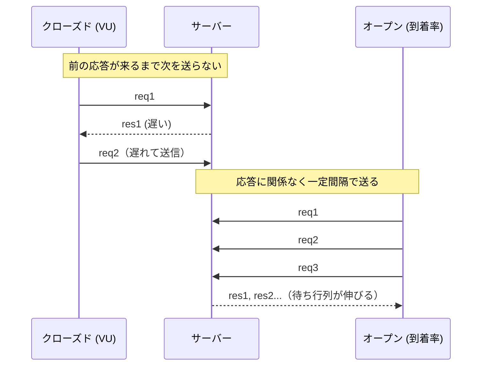

# 負荷テストの設計と実施

[[MOC_パフォーマンス体系|📚 目次]] ｜ [[02_ベンチマークの書き方|← 前へ]] ｜ [[04_ボトルネックの特定（USE・RED）|次へ →]]

> [!abstract] この記事で分かること
> - 負荷テストの種類（ロード・ストレス・スパイク・ソーク・ブレークポイント）と目的
> - オープンモデルとクローズドモデルの違い（k6 の `constant-arrival-rate` と `constant-vus`）
> - 実際のトラフィックに近いシナリオの作り方（比率・think time）
> - k6 のスクリプトと thresholds、結果の読み方、ツールの選び方
>
> **前提**：[[01_計測の基本と落とし穴]]、[[03_性能要件と目標の決め方]] を読んでいると理解しやすいです。

## 1. ひとことで言うと

負荷テスト（load testing）は「開店前のリハーサル」です。セール当日にレジが何台必要か、行列が何人を超えるとお客さんが帰り始めるかは、実際にお客さん役を大量に呼んで試してみないと分かりません。ただし、お客さん役の「来方」を間違える（全員が律儀に前の人の会計が終わるまで店に入らない、など）と、本番とはまったく違う結果になります。

要点：
- 目的に応じてテストの種類（負荷の形）を選ぶ
- 「到着率で負荷をかける（オープンモデル）」か「同時ユーザー数で負荷をかける（クローズドモデル）」かで結果が変わる
- 合格条件（thresholds）を先に決め、結果は 4 指標（レイテンシ・スループット・エラー率・リソース）で読む

## 2. 負荷テストの種類

k6 のドキュメントでは、目的別に次のように分類しています（名称は資料によって揺れます）。

| 種類 | 負荷の形 | 何を知りたいか | Shop での例 |
|---|---|---|---|
| スモークテスト（Smoke） | ごく小さい負荷・短時間 | スクリプトとシステムが最低限動くか | 1 VU で 1 分。毎回の負荷テスト前に |
| ロードテスト（Load / Average-load） | 想定される通常〜ピークの負荷 | 普段の負荷で目標（SLO）を満たすか | 平日ピークの 200 RPS を 30 分 |
| ストレステスト（Stress） | 想定以上の負荷 | 限界付近でどう劣化するか | セール想定の 2〜3 倍 |
| スパイクテスト（Spike） | 短時間に急増 | 急増に耐えるか、回復するか | タイムセール開始直後の 10 倍の急増 |
| ソークテスト（Soak / Endurance） | 通常負荷を長時間 | 時間とともに悪化しないか（メモリリーク・コネクション枯渇） | 通常負荷を 8〜24 時間 |
| ブレークポイントテスト（Breakpoint） | 少しずつ増やし続ける | どこで壊れるか（最大キャパシティ） | 50 RPS ずつ増やして SLO 違反点を探す |

```
負荷                                       負荷
 │    ┌──────────┐  ロード                  │          ▲ スパイク
 │   ╱            ╲                          │         ╱│╲
 │  ╱              ╲                         │________╱ │ ╲_______
 └──────────────────── 時間                  └──────────────────── 時間

負荷                                       負荷
 │   ┌───────────────────────────┐ ソーク     │                 ╱ ブレークポイント
 │  ╱                             ╲(数時間)   │             ╱    (壊れるまで)
 │ ╱                               ╲          │         ╱
 └──────────────────────────────────── 時間  └──────────────────── 時間
```

## 3. オープンモデルとクローズドモデル

負荷テストで一番誤解されやすく、一番結果に影響するのがここです。

### クローズドモデル（Closed model）

「**決まった人数のユーザーが、前のリクエストが終わってから次を送る**」モデルです。k6 では `constant-vus`（一定数の仮想ユーザー＝VU）や `ramping-vus` がこれに当たります。

問題は、**サーバーが遅くなると、送られるリクエストも減る**ことです。100 VU が応答 100ms なら 1000 RPS 送れますが、応答が 1 秒に悪化すると 100 RPS しか送れません。サーバーが苦しくなるほど負荷が勝手に下がるので、「遅くなってるけど落ちない」という楽観的な結果になります。この現象は「協調された欠落（coordinated omission）」と呼ばれます。

### オープンモデル（Open model）

「**ユーザーはサーバーの状態に関係なく、一定の割合でやってくる**」モデルです。k6 では `constant-arrival-rate` や `ramping-arrival-rate` がこれに当たります。実際の Web サービスは、サーバーが遅くても新しいお客さんは来続けるので、多くの場合こちらが本番に近いです。



| | クローズド（`constant-vus`） | オープン（`constant-arrival-rate`） |
|---|---|---|
| 指定するもの | 同時ユーザー数 | 1 秒あたりの到着数 |
| サーバーが遅くなると | 送信レートが下がる | 送信レートは保たれ、待ち行列が伸びる |
| 向いている場面 | 同時接続数が決まっている系（社内ツール、ワーカー） | 一般の Web API、EC サイト |
| 注意 | 協調された欠落で楽観的になりやすい | VU が足りないと目標レートを出せない（`dropped_iterations` を確認） |

待ち行列が伸びるとなぜレイテンシが急に悪化するのかは [[01_スループットと待ち行列理論]] で扱います。

## 4. シナリオ設計

### 実際のトラフィック比率を再現する

「注文 API だけを叩く」テストは、本番とは違う負荷になります。アクセスログや APM から、エンドポイントごとの比率を調べて再現します。

```
Shop の例（比率は説明用の例）
  商品一覧 GET /products         60%
  商品詳細 GET /products/:id     30%
  カート追加 POST /cart           7%
  注文確定 POST /orders           3%
```

注文確定が 3% しかなくても、DB に書き込みロックを取るので全体を詰まらせる原因になりえます。比率を守ると「読み取りが多い中での書き込み」という現実の競合が再現できます。

### think time

think time（考える時間）は、実際のユーザーがページを見てから次の操作をするまでの待ち時間です。クローズドモデルでは `sleep()` を入れないと、1 VU が人間ではありえない頻度でリクエストを送ります。オープンモデルでは到着率で負荷を決めるので、think time は「1 イテレーション内の複数ステップの間隔」の意味になります。

### データのばらつき

- 全 VU が同じ商品 ID を叩くと、キャッシュに全部当たって速く見えます。ID はランダムまたは本番のアクセス分布（人気商品に偏る）に沿って選びます。
- 同じユーザーで注文を大量に作ると、そのユーザーの行にロックが集中します。テストユーザーを多数用意します。

## 5. どう測るか：k6 のスクリプト例

k6 は JavaScript でシナリオを書き、Go 製のエンジンで実行する負荷テストツールです（2026 年時点で v1 系。TypeScript ファイルもそのまま実行できます）。

```js
// load-test.js — Shop のセール想定ロードテスト（オープンモデル）
import http from "k6/http";
import { check, sleep } from "k6";

const BASE = __ENV.BASE_URL || "https://staging.shop.example.com";

export const options = {
  scenarios: {
    browse: {
      executor: "constant-arrival-rate",
      rate: 180,               // 1 秒あたり 180 イテレーション開始
      timeUnit: "1s",
      duration: "10m",
      preAllocatedVUs: 100,    // 最初に用意する VU
      maxVUs: 500,             // 足りなければここまで増やす
      exec: "browse",
    },
    order: {
      executor: "constant-arrival-rate",
      rate: 20,                // 注文系は 20/s（比率を再現）
      timeUnit: "1s",
      duration: "10m",
      preAllocatedVUs: 50,
      maxVUs: 200,
      exec: "order",
    },
  },
  thresholds: {
    // 合格条件：満たさないと k6 は非ゼロの終了コードで終わる → CI で失敗にできる
    http_req_failed: ["rate<0.01"],                          // エラー率 1% 未満
    "http_req_duration{scenario:browse}": ["p(95)<300", "p(99)<800"],
    "http_req_duration{scenario:order}": [
      { threshold: "p(95)<500", abortOnFail: true, delayAbortEval: "1m" },
    ],
    dropped_iterations: ["count<100"],                       // 目標レートを出せたか
  },
};

export function browse() {
  const res = http.get(`${BASE}/products?page=${1 + Math.floor(Math.random() * 20)}`, {
    tags: { name: "GET /products" },     // URL の種類を束ねて集計する
  });
  check(res, { "list 200": (r) => r.status === 200 });
  sleep(Math.random() * 2);              // 一覧を眺める時間（think time）

  const id = 1 + Math.floor(Math.random() * 50000);
  const detail = http.get(`${BASE}/products/${id}`, { tags: { name: "GET /products/:id" } });
  check(detail, { "detail 200/404": (r) => r.status === 200 || r.status === 404 });
}

export function order() {
  const userId = 1 + Math.floor(Math.random() * 10000);  // ユーザーを分散させる
  const res = http.post(
    `${BASE}/orders`,
    JSON.stringify({ userId, items: [{ productId: 1 + Math.floor(Math.random() * 50000), qty: 1 }] }),
    { headers: { "Content-Type": "application/json" }, tags: { name: "POST /orders" } },
  );
  check(res, { "order 201": (r) => r.status === 201 });
}
```

```bash
k6 run -e BASE_URL=https://staging.shop.example.com load-test.js
# 時系列で残したいときは出力先を指定（例：JSON / Prometheus remote write など）
k6 run --out json=result.json load-test.js
```

ポイント：
- `tags: { name: ... }` を付けないと、`/products/123` と `/products/456` が別々の URL として集計されます。
- `check()` は失敗しても終了コードに影響しません。合否は `thresholds` で決めます。
- ストレステストにするなら `ramping-arrival-rate` で `stages` を段階的に上げます。

## 6. 結果の読み方

k6 の終了時サマリーは次のようなイメージです（**数値は説明用の例**）。

```
  █ THRESHOLDS
    http_req_duration{scenario:browse}
    ✓ 'p(95)<300' p(95)=212ms
    ✗ 'p(99)<800' p(99)=1.9s
    http_req_failed
    ✓ 'rate<0.01' rate=0.42%
    dropped_iterations
    ✓ 'count<100' count=0

  http_req_duration ...: avg=98ms  min=8ms  med=61ms  max=4.8s  p(90)=170ms p(95)=212ms
  http_reqs ...........: 119880  199.8/s
  vus_max .............: 214
```

読み方の手順：

1. **目標レートが出ているか**：`http_reqs` が狙いの RPS 付近か、`dropped_iterations` が 0 か。出ていなければ負荷生成側の問題（VU 不足・負荷マシンの CPU 不足）で、テスト自体が無効です。
2. **thresholds の合否**：上の例では p95 は合格だが p99 が 1.9 秒で不合格。一部のリクエストだけが極端に遅い＝ロック待ち・GC・特定の重いクエリなどを疑います。
3. **時系列で見る**：サマリーは全期間の集計なので、「最初は速く、10 分後から急に遅くなった」が分かりません。Grafana などで時系列を見て、レイテンシが上がり始めた時刻に何が起きたか（CPU が 100% に達した、コネクションプールが枯渇した）を対応付けます。
4. **サーバー側のメトリクスと突き合わせる**：k6 が見ているのはクライアント側の結果だけです。同時刻の API・DB・Redis の CPU・メモリ・コネクション数を見て、ボトルネックを特定します（手順は [[04_ボトルネックの特定（USE・RED）]]）。
5. **負荷 vs レイテンシの曲線を作る**：段階的に負荷を上げ、各段階の p95 を記録すると「どこで膝（急に悪化する点）が来るか」が分かります。

```
p95 レイテンシ
  2s │                               ●
     │                           ●
  1s │                       ●
     │               ●   ●          ← この辺りが「膝」。ここより手前で運用する
 0.2s│  ●   ●   ●
     └──────────────────────────────── RPS
       100 150 200 250 300 350 400   （説明用の例）
```

## 7. 本番に負荷をかけるときの注意とツール比較

### 本番・検証環境での注意

- **基本は本番相当の検証環境で行う**。本番で行うなら、低トラフィックの時間帯・関係者への事前告知・即座に止める手順（`abortOnFail`、キルスイッチ）を用意します。
- **外部サービスを巻き込まない**：決済代行・メール送信・SMS などはモックやサンドボックスに差し替えます。本物の決済 API に負荷をかけると、規約違反や課金・アカウント停止になりえます。
- **テストデータを区別して後片付けする**：テスト用の注文が在庫を減らしたり売上集計に混ざったりしないよう、フラグや専用ユーザーで識別します。
- **クラウドの上限・コストに注意**：オートスケールで大量のインスタンスが起動し、請求が跳ね上がることがあります。WAF・DDoS 対策に遮断されることもあるので、インフラ担当と調整します。
- **負荷生成マシン自体を監視する**：負荷マシンの CPU が 100% だと、測っているのは負荷マシンの限界です。

### ツール比較（2026 年時点）

| ツール | シナリオ記述 | 特徴 | 向いている場面 |
|---|---|---|---|
| k6（Grafana） | JavaScript / TypeScript | 軽量・CLI 中心・thresholds で CI 連携しやすい・オープンモデル対応 | 開発者が書く API 負荷テスト全般 |
| Locust | Python | Python で柔軟にユーザー行動を書ける・Web UI・分散実行 | Python チーム、複雑なユーザー行動 |
| JMeter（Apache） | GUI / XML | 歴史が長く、プロトコル・プラグインが豊富 | 既存資産がある、多様なプロトコル |
| Gatling | Scala / Java / Kotlin / JS | 高性能・詳細な HTML レポート・オープン/クローズド両対応 | JVM チーム、大規模負荷 |
| Artillery | YAML（+ JS） | 設定ファイルで手軽・Playwright 連携でブラウザ負荷も | 手早く書きたい、Node.js チーム |

迷ったら、開発者がコードとして管理しやすく CI に組み込みやすい k6 から始めるのがおすすめです。

## よくある誤解・つまずき

- ❌ 100 VU で耐えたから、同時 100 人のアクセスに耐えられる  
  ✅ クローズドモデルでは、サーバーが遅いほど負荷が下がります。到着率（RPS）で目標を決め、オープンモデルで確認します。
- ❌ 平均レイテンシが目標内なら合格  
  ✅ p95・p99 とエラー率を thresholds に入れます。平均は一部の極端に遅いリクエストを隠します。
- ❌ 同じ URL を叩き続ければ十分  
  ✅ キャッシュに全部当たって速く見えます。本番の比率・データ分布を再現します。
- ❌ k6 の結果だけ見ればボトルネックが分かる  
  ✅ k6 は症状しか見ていません。同時刻のサーバー側メトリクスと突き合わせて原因を特定します。
- ❌ 負荷テストは一度やれば終わり  
  ✅ コード・データ量・インフラが変われば結果も変わります。リリース前や定期的に回し、結果を記録して比較します。

## まとめ

- 目的に合わせてロード・ストレス・スパイク・ソーク・ブレークポイントを選ぶ。最初はスモークで動作確認
- Web サービスは基本オープンモデル（`constant-arrival-rate`）。クローズドモデルは協調された欠落で楽観的になりやすい
- エンドポイント比率・think time・データ分布を本番に近づける
- 合格条件は thresholds（p95/p99・エラー率・dropped_iterations）で先に決め、CI の合否に使う
- 結果は時系列とサーバー側メトリクスで読み、負荷 vs レイテンシの「膝」を探す
- 本番や外部サービスに負荷をかけるときは、告知・停止手順・モック化・後片付けを準備する

## 確認クイズ

1. `constant-vus` で 50 VU のテストをしたら、応答時間が 2 倍になったのに RPS は半分になり、エラーは出ませんでした。この結果から「本番でも落ちない」と言えますか？
> [!tip]- 答え
> 言えません。クローズドモデルでは応答が遅くなると送信レートが自動的に下がるため、サーバーが楽になっているだけです。本番では応答が遅くてもユーザーは来続けるので、`constant-arrival-rate` で目標 RPS をかけたときに待ち行列が伸びてタイムアウトが出ないかを確認します。

2. k6 のサマリーで `dropped_iterations` が大量に出ていました。何を意味し、どうすべきですか？
> [!tip]- 答え
> 到着率モデルで、開始すべきイテレーションを実行できる VU が足りず、目標レートの負荷をかけられなかったことを意味します。`maxVUs` を増やす、負荷生成マシンを強化・分散するなどして、狙った負荷が出ている状態で再テストします。

3. セール当日の注文 API を想定した負荷テストで、決済代行サービスの API はどう扱うべきですか？
> [!tip]- 答え
> 本物の決済 API には負荷をかけず、モック（固定レイテンシを返すスタブ）やサンドボックス環境に差し替えます。規約違反・課金・アカウント停止のリスクがあるためです。モックには本番に近い応答時間を設定し、外部依存の遅さも再現できるようにします。

## 関連ノート

- [[01_計測の基本と落とし穴]] — 計測環境の揃え方、ウォームアップ
- [[03_性能要件と目標の決め方]] — thresholds に入れる目標値の決め方
- [[04_ボトルネックの特定（USE・RED）]] — 負荷テスト中にどこが詰まっているかを調べる
- [[01_スループットと待ち行列理論]] — 負荷が上がるとレイテンシが急増する理由
- [[03_キャパシティプランニング]] — 負荷テスト結果から必要台数を見積もる
- [[03_オートスケーリング]] — スパイク時のスケールの挙動
- [[01_SLI・SLOの設計]] — 合格条件を SLO と揃える

## 参考

- [Open and closed models - Grafana k6 docs](https://grafana.com/docs/k6/latest/using-k6/scenarios/concepts/open-vs-closed/)
- [Load test types - Grafana k6 docs](https://grafana.com/docs/k6/latest/testing-guides/test-types/)
- [Thresholds - Grafana k6 docs](https://grafana.com/docs/k6/latest/using-k6/thresholds/)
- [Constant arrival rate - Grafana k6 docs](https://grafana.com/docs/k6/latest/using-k6/scenarios/executors/constant-arrival-rate/)
- [Locust documentation](https://docs.locust.io/)
- [Apache JMeter](https://jmeter.apache.org/)
- [Gatling documentation](https://docs.gatling.io/)
- [Artillery documentation](https://www.artillery.io/docs)
