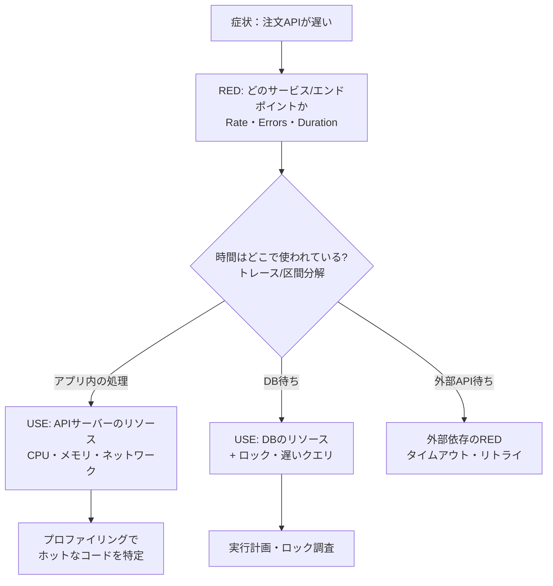

# ボトルネックの特定（USE・RED）

[[MOC_パフォーマンス体系|📚 目次]] ｜ [[03_負荷テストの設計と実施|← 前へ]] ｜ [[05_プロファイリング|次へ →]]

> [!abstract] この記事で分かること
> - 「遅い」と言われたときに、どこが詰まっているかを順番に調べる手順
> - RED メソッドで症状（サービス）を、USE メソッドで原因（リソース）を絞り込む流れ
> - Linux 60 秒分析の 10 コマンドで何を見るか
> - CPU・メモリ・ディスク・ネットワーク・ロック・外部依存の見分け方
>
> **前提**：[[02_REDメソッドとUSEメソッド]]（可観測性の章でメソッドの定義とダッシュボード設計を扱っています）、[[03_負荷テストの設計と実施]] を読んでいると理解しやすいです。

## 1. ひとことで言うと

高速道路の渋滞は、たいてい 1 か所の「詰まり（ボトルネック）」が原因です。料金所なのか、合流地点なのか、事故なのか。渋滞の後ろのほうで車線を増やしても、詰まりの場所が変わらなければ流れは良くなりません。

性能調査も同じで、**ボトルネック以外をいくら速くしても全体は速くなりません。** だから最初にやるべきは「どこが詰まっているか」を、勘ではなく手順で特定することです。

要点：
- まず RED（Rate・Errors・Duration）で「どのサービス・どのエンドポイントが」悪いかを特定
- 次に USE（Utilization・Saturation・Errors）で「どのリソースが」詰まっているかを特定
- 最後にプロファイリングで「どのコードが」原因かを特定（[[05_プロファイリング]]）

## 2. 調査の全体像：外側から内側へ



RED と USE の定義やダッシュボードへの載せ方は [[02_REDメソッドとUSEメソッド]] にまとまっているので、ここでは**調査のときにどの順で何を見るか**に絞ります。

## 3. RED で症状を絞り込む

RED メソッドは、リクエストを受けるサービスごとに次の 3 つを見る方法です。

| 項目 | 意味 | 調査で確認すること |
|---|---|---|
| Rate | 1 秒あたりのリクエスト数 | 負荷が増えたのか？ いつから？ |
| Errors | 失敗したリクエストの割合 | 遅いのと同時にエラー（タイムアウト・5xx）が増えたか？ |
| Duration | 所要時間（パーセンタイル） | p50 も遅いのか、p99 だけ遅いのか？ |

調査で見るポイント：

1. **いつから？**：デプロイ・設定変更・トラフィック増（セール開始）の時刻と一致するか。一致すれば原因候補が一気に絞れます。
2. **全部遅いのか、一部だけか？**：全エンドポイントが遅い → 共有リソース（CPU・DB・ネットワーク）。特定のエンドポイントだけ → そのコード・そのクエリ。
3. **p50 も遅いのか、p99 だけか？**：p50 も遅い → 全リクエストに効く要因（CPU 飽和・遅いクエリ）。p99 だけ → 一部に起きる要因（ロック待ち・GC 停止・キャッシュミス・特定の重いユーザー）。
4. **Rate が増えたら Duration も増えたか？**：負荷に比例して悪化 → キャパシティ不足（飽和）。負荷と無関係に悪化 → 外部依存・データ量の増加・リーク。

## 4. USE で原因リソースを特定する

USE メソッドは Brendan Gregg が提唱した、**すべてのリソースについて 3 つを確認する**チェックリスト方式の方法です。

| 項目 | 意味 | 例え |
|---|---|---|
| Utilization（使用率） | リソースが忙しかった時間の割合 | レジが稼働していた時間の割合 |
| Saturation（飽和） | 処理しきれずに待たされている仕事の量 | レジに並んでいる行列の長さ |
| Errors（エラー） | エラーイベントの数 | レジの故障回数 |

**使用率が 100% 未満でも飽和は起きます。** 1 分平均の CPU 使用率が 60% でも、瞬間的には 100% になって待ち行列ができていることがあるからです。だから使用率だけでなく飽和（待ち行列）を必ず見ます。

### リソース別チェックリスト（Linux）

| リソース | Utilization | Saturation | Errors |
|---|---|---|---|
| CPU | `mpstat` の %usr+%sys（コアごと）、`top` | `vmstat` の `r` がコア数を超える、ロードアベレージ | （まれ）`dmesg` のマシンチェック |
| メモリ | `free -m` の available が少ない | `vmstat` の `si`/`so`（スワップ）、OOM Killer | `dmesg` の Out of memory |
| ディスク | `iostat -xz` の `%util` | `iostat` の `aqu-sz`（キュー長）、`r_await`/`w_await` の増加 | `dmesg` の I/O error |
| ネットワーク | `sar -n DEV` の rxkB/s・txkB/s ÷ 帯域 | `sar -n TCP,ETCP` の retrans/s、`ss` の送受信キュー | `sar -n EDEV`、`ip -s link` の errors/drop |
| ソフトウェア資源 | DB コネクションプール使用数、スレッド数 | プール取得待ちの数・時間、イベントループ遅延 | プール取得タイムアウト |

最後の行が重要です。**現代の Web アプリでは、ハードウェアより先に「ソフトウェアのリソース」（コネクションプール、ファイルディスクリプタ、ワーカースレッド、ロック）が詰まることが多い**です。

## 5. どう測るか：Linux 60 秒分析

Netflix のパフォーマンスエンジニアリングチーム（Brendan Gregg ら）が公開した、サーバーにログインして最初の 60 秒で実行する 10 コマンドです。USE の観点で一通りのリソースをざっと確認できます。

```bash
uptime                 # 1. ロードアベレージ（1/5/15分）：増加中か減少中か
dmesg | tail           # 2. カーネルの直近メッセージ：OOM Killer、TCP drop、I/O エラー
vmstat 1               # 3. r（実行待ち）、free、si/so（スワップ）、us/sy/id/wa/st
mpstat -P ALL 1        # 4. CPU コアごとの使用率：1 コアだけ 100%（シングルスレッドの限界）
pidstat 1              # 5. プロセスごとの CPU 使用率：どのプロセスが食っているか
iostat -xz 1           # 6. ディスク：r/s, w/s, await, aqu-sz, %util
free -m                # 7. メモリ：available、buff/cache
sar -n DEV 1           # 8. NIC ごとのスループット：帯域上限に近いか
sar -n TCP,ETCP 1      # 9. TCP：active/s・passive/s（新規接続）、retrans/s（再送）
top                    # 10. 全体を最後に確認
```

（`mpstat`・`pidstat`・`iostat`・`sar` は sysstat パッケージに含まれます）

### 見るべきポイントの早見表

| コマンド | ここを見る | 怪しいサイン |
|---|---|---|
| `uptime` | ロードアベレージ | 1 分値が 15 分値より大きく、コア数を超えている → 負荷が増加中 |
| `dmesg` | 末尾のメッセージ | `Out of memory: Killed process`、`TCP: drop open request` |
| `vmstat 1` | `r`、`si`/`so`、`wa`、`st` | `r` > コア数（CPU 飽和）、`si`/`so` > 0（スワップ）、`wa` 高（I/O 待ち）、`st` 高（仮想化で CPU を奪われている） |
| `mpstat -P ALL 1` | コアごとの %usr | 1 コアだけ 100% で他は暇 → シングルスレッド処理（Node.js のメインスレッド！）が限界 |
| `pidstat 1` | %CPU の大きいプロセス | 想定外のプロセス（バックアップ、ログ圧縮）が CPU を使っている |
| `iostat -xz 1` | `%util`、`await`、`aqu-sz` | await が普段より大きく、aqu-sz > 1 → ディスク飽和 |
| `free -m` | available | available が小さく、buff/cache も小さい → メモリ不足 |
| `sar -n DEV 1` | rxkB/s・txkB/s | NIC の帯域上限に近い |
| `sar -n TCP,ETCP 1` | retrans/s | 再送が多い → ネットワーク品質の問題か、相手側の過負荷 |

> [!warning] Node.js での注意
> Node.js は JavaScript をメインスレッド 1 本で実行します。4 コアのマシンで全体の CPU 使用率が 25% でも、`mpstat -P ALL` や `pidstat` で見ると Node.js のプロセスが 1 コアを 100% 使い切っている、ということがよくあります。全体の使用率ではなく**プロセス単位・コア単位**で見ます。

## 6. どこが詰まっているかの見分け方

| 詰まっている場所 | 典型的な症状 | 確認方法 |
|---|---|---|
| CPU | 負荷に比例して全エンドポイントが遅くなる。p50 から悪化 | `pidstat` で対象プロセスが 100%（Node.js は 1 コア）、イベントループ遅延の増加 → CPU プロファイル |
| メモリ | 時間とともに遅くなる、GC 停止で p99 が悪化、最後は OOM | RSS・ヒープ使用量の右肩上がり、GC 時間、`dmesg` の OOM → ヒーププロファイル |
| ディスク | ログ書き込み・一時ファイル・DB のディスク I/O 待ち | `iostat` の await・aqu-sz、`vmstat` の wa |
| ネットワーク | 大きなレスポンスで遅い、再送・タイムアウト | `sar -n DEV`、retrans/s、レスポンスサイズ |
| ロック | CPU は暇なのに遅い。特定の行・テーブルへの更新で詰まる | PostgreSQL の `pg_stat_activity` の wait_event、`pg_locks` |
| コネクションプール | CPU も DB も暇なのに遅い。プール取得待ちが長い | プールの使用数 = 最大値、取得待ち時間のメトリクス |
| 外部依存 | 特定の処理だけ遅い・タイムアウト | 分散トレースで外部 API のスパンが長い |

**「CPU が暇なのに遅い」は、待っている（オフ CPU）サイン**です。ロック・I/O・コネクションプール・外部 API など、何かを待っています。CPU プロファイルには現れないので、トレースやオフ CPU 分析で調べます（[[05_プロファイリング]]、[[06_フレームグラフの読み方]]）。

## 7. 例：セール時に Shop の注文 API が詰まる

以下は調査の流れを示すための**架空の例**です（数値も説明用）。

**症状**：タイムセール開始直後から、注文 API（`POST /orders`）の p99 が 300ms → 6 秒に悪化し、タイムアウトエラーが 5% 出た。

**Step 1：RED**
- Rate：注文 API は普段の 8 倍。商品一覧 API も 5 倍。
- Errors：注文 API だけ 5%（タイムアウト）。商品一覧は 0.1%。
- Duration：商品一覧の p99 は 400ms とやや悪化程度。注文 API だけ極端に悪い。
- → 「全体の CPU 不足」より「注文 API 固有の何か」が怪しい。

**Step 2：時間の内訳（トレース）**
- 注文 API のトレースを見ると、アプリ内処理は 20ms 程度。ほとんどが「DB コネクション取得待ち」と「`UPDATE products SET stock = stock - 1` の待ち」。

**Step 3：USE（API サーバー）**
- `pidstat`：Node.js プロセスの CPU は 40%。飽和していない。
- コネクションプール：使用数 20/20 で張り付き、取得待ちが数百件 → **ソフトウェア資源が飽和**。

**Step 4：USE（DB）**
- DB サーバーの CPU 35%、`iostat` の await も正常。
- `pg_stat_activity` を見ると、多数のセッションが `wait_event_type = Lock` で待機。

```sql
-- ロック待ちのセッションと、待たせている側を確認する（PostgreSQL）
SELECT pid,
       pg_blocking_pids(pid) AS blocked_by,
       wait_event_type,
       wait_event,
       now() - query_start AS waiting,
       left(query, 60) AS query
FROM pg_stat_activity
WHERE wait_event_type = 'Lock'
ORDER BY waiting DESC;
```

**結論（仮説）**：セール対象の人気商品 1 行に `UPDATE ... stock = stock - 1` が集中し、行ロック待ちが発生。ロックを持ったトランザクションの中で外部の在庫通知 API を呼んでいたため、ロック保持時間が長かった。待っている間コネクションを握ったままなので、プールも枯渇し、注文 API 全体が詰まった。

**次の一手**：外部 API 呼び出しをトランザクションの外へ出す（ロック保持時間を短くする）、在庫引き当てを非同期化・キュー化する（[[05_非同期化とキューで待ち時間を隠す]]）、改善後に同じ負荷テストで再計測する。

このように、**CPU を増やしても API を増やしても解決しない詰まり**（ロック・プール）は、USE をソフトウェア資源まで広げないと見つけられません。

## よくある誤解・つまずき

- ❌ CPU 使用率が低いから性能に余裕がある  
  ✅ ロック・I/O・プール・外部 API の「待ち」で遅いこともあります。また Node.js は 1 コアだけ 100% のことがあります。
- ❌ 平均 CPU 60% なら飽和していない  
  ✅ 平均は瞬間的なピークを隠します。待ち行列（vmstat の `r`、イベントループ遅延、プール待ち）で飽和を確認します。
- ❌ 遅いならサーバーを増やせばいい  
  ✅ ボトルネックが DB のロックやプールなら、API を増やすほど DB への同時アクセスが増えて悪化することもあります。
- ❌ 目についたメトリクスから順に見る  
  ✅ RED で範囲を絞り、USE でリソースを網羅的に確認するという順番を守ると、見落としと遠回りが減ります。

## まとめ

- ボトルネック以外を速くしても全体は速くならない。まず「どこが詰まっているか」を特定する
- RED（Rate・Errors・Duration）で「どのサービス・エンドポイントが、いつから、どの程度」悪いかを絞る
- USE（Utilization・Saturation・Errors）で、CPU・メモリ・ディスク・ネットワークに加えコネクションプールやロックまで確認する
- Linux 60 秒分析の 10 コマンドで、サーバーの状態を素早く俯瞰できる
- 「CPU が暇なのに遅い」は待ち（オフ CPU）のサイン。トレース・ロック・プールを調べる

## 確認クイズ

1. 4 コアの API サーバーで全体の CPU 使用率が 25% なのに、Node.js の API が負荷に比例して遅くなっています。何を確認しますか？
> [!tip]- 答え
> `mpstat -P ALL 1` や `pidstat 1` でコア・プロセス単位の使用率を確認します。Node.js のメインスレッドが 1 コアを 100% 使い切っている（4 コア中 1 コア＝25%）可能性があります。その場合は CPU プロファイルでホットなコードを探すか、プロセス数を増やします（クラスタ化）。

2. 商品一覧 API の p50 は 50ms で安定しているのに、p99 だけが 2 秒になっています。疑うべき原因を 3 つ挙げてください。
> [!tip]- 答え
> 一部のリクエストにだけ起きる要因を疑います。例：GC の停止、キャッシュミス時だけ重いクエリが走る、特定のカテゴリ・ページ番号（大きい OFFSET）だけ遅い、ロック待ち、コネクションプールの取得待ちが瞬間的に発生する、など。

3. `vmstat 1` で `r` が常にコア数の 3 倍、`si`/`so` は 0、`wa` は 1% でした。どのリソースのどの状態ですか？
> [!tip]- 答え
> CPU の飽和です。実行待ちのタスクがコア数を大きく超えて並んでいます。スワップ（メモリ）や I/O 待ち（ディスク）は問題ありません。`pidstat` でどのプロセスが CPU を使っているかを確認し、プロファイリングに進みます。

## 関連ノート

- [[02_REDメソッドとUSEメソッド]] — RED・USE の定義とダッシュボード設計（可観測性の章）
- [[03_負荷テストの設計と実施]] — ボトルネックを再現する負荷のかけ方
- [[05_プロファイリング]] — 詰まっているリソースが分かった後、コードを特定する
- [[01_APIレスポンスタイムの分解]] — レスポンスタイムを区間ごとに分ける
- [[01_スループットと待ち行列理論]] — 使用率が上がると待ち時間が急増する理由
- [[01_アプリケーションサーバーとは]] — コネクションプールの仕組み
- [[06_データベースサーバーの運用]] — DB サーバー側の監視
- [[MOC_SRE・インシデント対応体系]] — 障害対応としての調査の進め方

## 参考

- [The USE Method - Brendan Gregg](https://www.brendangregg.com/usemethod.html)
- [USE Method: Linux Performance Checklist - Brendan Gregg](https://www.brendangregg.com/USEmethod/use-linux.html)
- [Linux Performance Analysis in 60,000 Milliseconds - Netflix Technology Blog](https://netflixtechblog.com/linux-performance-analysis-in-60-000-milliseconds-accc10403c55)
- [The RED Method: How to Instrument Your Services - Grafana Labs](https://grafana.com/blog/2018/08/02/the-red-method-how-to-instrument-your-services/)
- [pg_stat_activity - PostgreSQL docs](https://www.postgresql.org/docs/current/monitoring-stats.html#MONITORING-PG-STAT-ACTIVITY-VIEW)
- [pg_blocking_pids - PostgreSQL docs](https://www.postgresql.org/docs/current/functions-info.html)
