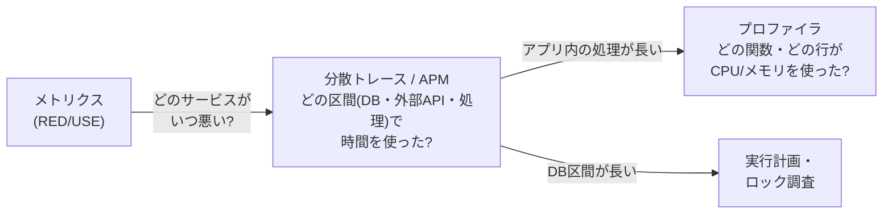

# プロファイリング

[[MOC_パフォーマンス体系|📚 目次]] ｜ [[04_ボトルネックの特定（USE・RED）|← 前へ]] ｜ [[06_フレームグラフの読み方|次へ →]]

> [!abstract] この記事で分かること
> - サンプリング型と計装型プロファイラの違いと、なぜ普段はサンプリング型を使うのか
> - CPU プロファイル・ヒーププロファイル・オフ CPU（待ち時間）プロファイルの使い分け
> - Node.js（`--cpu-prof`、`--inspect` + Chrome DevTools、0x、clinic.js の現状）と Python（cProfile、py-spy）での取り方
> - 本番での継続的プロファイリングと、APM・分散トレースとの使い分け
>
> **前提**：[[04_ボトルネックの特定（USE・RED）]] で「どのリソースが詰まっているか」を絞り込めていると理解しやすいです。

## 1. ひとことで言うと

プロファイリング（profiling）は「1 日の時間の使い方を記録する家計簿の時間版」です。「なんだか毎日時間が足りない」と感じたら、15 分ごとに「今何をしているか」をメモすると、意外にもスマホに 3 時間使っていた、と分かります。

プログラムも同じで、**「どの関数が時間（やメモリ）を使っているか」を推測ではなくデータで知る**のがプロファイリングです。経験豊富なエンジニアでも、遅い場所の予想はよく外れます。

要点：
- USE・RED で「どこ（どのサービス・リソース）」が分かったら、プロファイルで「どのコード」かを特定する
- 普段使いは低オーバーヘッドのサンプリング型
- CPU を使っている時間（オン CPU）と待っている時間（オフ CPU）は別の道具で見る

## 2. サンプリング型と計装型

| | サンプリング型（Sampling） | 計装型（Instrumentation / Tracing） |
|---|---|---|
| 仕組み | 一定間隔（例：1ms ごと）に「今どの関数を実行中か」のスタックを記録 | 関数の入口・出口すべてに計測コードを差し込む |
| 例え | 15 分ごとに「今何してる？」とメモ | 行動を変えるたびに必ず時刻をメモ |
| オーバーヘッド | 小さい（間隔で調整可能） | 大きい。小さい関数を大量に呼ぶほど重い |
| 正確さ | 統計的。短時間しか動かない関数は漏れることがある | 呼び出し回数は正確。ただし時間は計測コストで歪む |
| 代表例 | V8 CPU プロファイラ（`--cpu-prof`）、py-spy、perf、Pyroscope | Python の cProfile、APM の自動計装スパン |

**サンプリングで「全体の 40% がこの関数」と出たら、その関数のスタックがサンプルの 40% に現れた**ということです。たくさんサンプルを集めれば、時間の割合を十分な精度で推定できます。

計装型は、呼び出し回数を正確に知りたいとき（「この関数が 1 リクエストで 1 万回呼ばれている！」）に強力ですが、観測者効果（[[01_計測の基本と落とし穴]]）で小さな関数が実際より重く見えることに注意します。

## 3. プロファイルの種類

```
1 リクエスト 200ms の内訳（説明用の例）
├── オン CPU（CPUで計算している）      60ms  ← CPU プロファイルで見える
│     JSON シリアライズ、テンプレート、ソート…
└── オフ CPU（何かを待っている）       140ms  ← CPU プロファイルには出ない！
      DB クエリ待ち、外部 API 待ち、ロック待ち、ディスク I/O
```

| 種類 | 何が分かるか | 使う場面 |
|---|---|---|
| CPU プロファイル | どの関数が CPU 時間を使っているか | CPU 使用率が高い、イベントループがブロックされる |
| ヒーププロファイル（メモリ） | どこでメモリを割り当てているか／何が残っているか | メモリが増え続ける、GC が多い |
| オフ CPU プロファイル | どこで待っている（ブロックされている）か | CPU は暇なのに遅い |
| ウォールクロックプロファイル | オン + オフを合わせた経過時間ベース | 「時間がかかっている場所」全体を見たい |

Node.js では、DB や HTTP の待ちはイベントループ上では「何もしていない時間（idle）」になり、CPU プロファイルでは `(idle)` や `(program)` としてまとめて表示されます。**待ち時間の内訳を知るには、プロファイラより分散トレース（どのクエリ・どの外部呼び出しで待ったか）が向いています**（7 節）。

## 4. どう測るか：Node.js

### 4-1. `--cpu-prof`（最も手軽）

Node.js 組み込みの V8 CPU プロファイラを起動時に有効にし、終了時に `.cpuprofile` ファイルを書き出します（Node.js 22.4 / 20.16 で安定版になりました）。

```bash
# 本番ビルドで起動し、負荷をかけてから Ctrl+C で終了 → .cpuprofile が出力される
NODE_ENV=production node --cpu-prof --cpu-prof-dir=./profiles dist/server.js

# 別ターミナルで負荷をかける（例：autocannon で 30 秒）
npx autocannon -c 50 -d 30 http://localhost:3000/products
```

- サンプリング間隔の既定は 1000µs（1ms）。`--cpu-prof-interval` で変更できます。
- 出力された `.cpuprofile` は Chrome DevTools の Performance パネルや、[speedscope](https://www.speedscope.app/) にドラッグ＆ドロップで開けます（読み方は [[06_フレームグラフの読み方]]）。
- ヒープ割り当てのサンプリングは `--heap-prof`（既定の間隔は 512KiB ごと）で同様に取れます。

> [!tip] プロファイル中は負荷をかける
> アイドル状態のサーバーをプロファイルしても `(idle)` だらけになります。問題を再現する負荷（[[03_負荷テストの設計と実施]]）をかけながら取ります。

### 4-2. `--inspect` + Chrome DevTools

実行中のプロセスに DevTools を接続して、好きなタイミングで CPU プロファイル・ヒープスナップショットを取れます。

```bash
node --inspect dist/server.js           # 127.0.0.1:9229 で待ち受け
```

1. Chrome で `chrome://inspect` を開き、対象の「inspect」をクリック
2. **Performance** タブ（または Profiler）で記録開始 → 負荷をかける → 停止
3. **Memory** タブでヒープスナップショットを 2 回（負荷の前後）取り、比較（Comparison）して増えたオブジェクトを探す

> [!warning] 本番での `--inspect`
> インスペクタのポートにアクセスできれば任意のコードを実行できます。`0.0.0.0` で公開してはいけません。本番で使うなら SSH トンネル経由にし、終わったら閉じます。ヒープスナップショットはプロセスを一時停止させ、ヒープ同等のメモリを追加で使うので、本番では慎重に。

メモリリーク調査の詳しい手順は [[Performance・Memory（遅さとメモリリークの調査）]] にあります。

### 4-3. 0x

0x は、Node.js アプリのフレームグラフを 1 コマンドで生成するツールです（2026 年時点の README では Node.js 20 以降をサポート）。

```bash
npx 0x -o dist/server.js                              # 終了時にフレームグラフを生成してブラウザで開く
npx 0x -P 'autocannon -c 50 -d 20 localhost:$PORT' dist/server.js  # 負荷ツールと連動
```

### 4-4. clinic.js の現状（2026 年時点）

clinic.js（Doctor・Flame・Bubbleprof・HeapProfiler）は、かつて Node.js の性能診断の定番でしたが、**GitHub の README に「活発にメンテナンスされていない（not being actively maintained）」と明記されており、Node.js の内部実装に強く依存するため新しい Node.js では動かない・結果が正確でない可能性がある**と注意書きがあります。古い記事で紹介されていても、新規に導入するなら `--cpu-prof`・DevTools・0x を優先しましょう。

## 5. どう測るか：Python

### 5-1. cProfile（標準ライブラリ・計装型）

```bash
python -m cProfile -o out.prof app.py
python -c "import pstats; pstats.Stats('out.prof').sort_stats('cumulative').print_stats(15)"
```

出力の読み方：

| 列 | 意味 |
|---|---|
| ncalls | 呼び出し回数 |
| tottime | その関数自身で使った時間（子関数を除く） |
| cumtime | 子関数を含む累積時間 |

`cumtime` 順で「どの処理の下で時間がかかっているか」、`tottime` 順で「実際に CPU を使っている末端の関数」を探します。計装型なので、小さな関数を大量に呼ぶコードは実際より遅く見えます。`snakeviz out.prof` で可視化もできます。

### 5-2. py-spy（サンプリング型・本番向き）

py-spy は Rust 製のサンプリングプロファイラで、**対象プロセスのコードを変更せず、再起動もせずに**外からアタッチできます。

```bash
py-spy top --pid 12345                                  # どの関数が今重いかをライブ表示
py-spy record -o profile.svg --pid 12345 --duration 30  # 30 秒記録してフレームグラフ SVG を出力
py-spy record --format speedscope -o profile.json --pid 12345  # speedscope 形式
py-spy dump --pid 12345                                 # 今のスタックを一度だけ表示（ハング調査）
```

- Linux で既存プロセスにアタッチするには通常 root 権限が必要です。Docker / Kubernetes では `SYS_PTRACE` ケーパビリティを付けます。
- `--idle` を付けると待ち状態のスタックも含めます（オフ CPU も見たいとき）。

## 6. 本番での継続的プロファイリング

ラボで再現できない問題（特定の時間帯だけ遅い、特定の顧客データだけ重い）は、本番のプロファイルが必要です。**継続的プロファイリング（continuous profiling）**は、低いサンプリング頻度で常時プロファイルを取り続け、時系列で保存する手法です。

| ツール（2026 年時点） | 概要 |
|---|---|
| Grafana Pyroscope | OSS の継続的プロファイリング基盤。Grafana 上でメトリクス・ログ・トレースと関連付けて見られる |
| Datadog Continuous Profiler | APM と統合。トレースのスパンから対応するプロファイルへ移動できる |
| その他 | Google Cloud Profiler、AWS CodeGuru Profiler、Elastic Universal Profiling、Parca（OSS）など |

Node.js で Pyroscope に送る例：

```ts
// instrument.ts — アプリの最初に読み込む
import Pyroscope from "@pyroscope/nodejs";

Pyroscope.init({
  serverAddress: process.env.PYROSCOPE_URL ?? "http://pyroscope:4040",
  appName: "shop-api",
  tags: { region: process.env.REGION ?? "local" },
  wall: { collectCpuTime: true }, // CPU 時間も収集する
});
Pyroscope.start();
```

継続的プロファイリングの利点：
- 「昨日 14 時の遅延」の時点のプロファイルを後から見られる
- デプロイ前後のプロファイルを比較できる（差分フレームグラフ、[[06_フレームグラフの読み方]]）
- 全サーバーの CPU 時間を関数別に集計でき、コスト削減の候補が分かる（[[04_コスト最適化とFinOps]]）

オーバーヘッドは一般に小さい（数 % 以下と説明されることが多い）ですが、言語・設定・負荷で変わるので、導入時に自分の環境で前後比較してください。

## 7. APM・分散トレース・プロファイラの使い分け



| 道具 | 粒度 | 得意なこと | 苦手なこと |
|---|---|---|---|
| メトリクス | サービス・リソース単位 | 傾向・アラート | 原因の特定 |
| 分散トレース / APM | リクエスト × 区間（スパン） | 待ち時間の内訳、サービス間の遅延、N+1 の発見 | スパンの中の関数レベルの詳細 |
| プロファイラ | 関数・行 | CPU・メモリを使っているコードの特定 | 待ち時間の理由（どのクエリか） |

- 「注文 API の 200ms のうち 150ms が DB スパン」→ トレースで分かる → DB 調査へ（[[05_実行計画の読み方]]、[[03_N+1問題の発見と解決]]）
- 「DB は 10ms なのにアプリ処理が 180ms」→ トレースでは中身が分からない → プロファイラへ

## 8. プロファイル結果を読む手順

1. **条件を確認する**：本番ビルドか、問題を再現する負荷がかかっていたか、サンプル数は十分か（数秒分では足りないことが多い）。
2. **全体の割合を見る**：`(idle)` や `(garbage collector)` が大きくないか。GC が 20% を超えていたら、関数より先にメモリ割り当てを疑います（[[03_メモリアロケーションとGC]]）。
3. **Self time（自己時間）で並べる**：自分自身で CPU を使っている関数のトップ 10 を見る。
4. **Total time（累積時間）で上から辿る**：どのリクエストハンドラ・どの処理の下で時間がかかっているかを確認する。
5. **自分のコードに結び付ける**：ライブラリ内部の関数（`JSON.stringify`、正規表現、ORM のハイドレーション）が重いなら、それを呼んでいる自分のコードを探す。
6. **仮説を立て、ベンチマークで改善案を比べ、再計測する**（[[02_ベンチマークの書き方]]）。

## よくある誤解・つまずき

- ❌ CPU プロファイルに出てこないから DB は関係ない  
  ✅ 待ち時間（オフ CPU）は CPU プロファイルに出ません。トレースやオフ CPU 分析で確認します。
- ❌ cProfile で一番遅かった関数が本当のボトルネック  
  ✅ 計装型は小さい関数の呼び出しにオーバーヘッドが乗るので歪みます。サンプリング型（py-spy）でも確認します。
- ❌ 開発モードでプロファイルを取れば十分  
  ✅ 開発モードは余計なチェックやログが多く、本番と別物です。本番ビルド・本番相当データで取ります。
- ❌ clinic.js を入れれば何でも分かる  
  ✅ 2026 年時点でメンテナンスされておらず、新しい Node.js では正しく動かない可能性があります。組み込みの `--cpu-prof` や DevTools を優先します。
- ❌ プロファイラは本番で使ってはいけない  
  ✅ サンプリング型の継続的プロファイリングは本番向けに設計されています。ただし `--inspect` やヒープスナップショットは影響が大きいので慎重に。

## まとめ

- プロファイリングは「どのコードが時間・メモリを使っているか」をデータで知る手段。予想より計測を信じる
- 普段はサンプリング型（`--cpu-prof`、py-spy）。呼び出し回数が知りたいときは計装型（cProfile）
- CPU プロファイル・ヒーププロファイル・オフ CPU は見えるものが違う。待ち時間はトレースで見る
- Node.js は `--cpu-prof` → speedscope / DevTools、`--inspect`、0x。clinic.js は 2026 年時点で非推奨扱い
- 本番の再現困難な問題は継続的プロファイリング（Pyroscope、Datadog など）で捕まえる
- メトリクス → トレース → プロファイラの順で、外側から内側へ絞り込む

## 確認クイズ

1. 商品一覧 API が遅いので CPU プロファイルを取ったら、ほとんどが `(idle)` でした。何が考えられ、次に何をしますか？
> [!tip]- 答え
> ① 負荷をかけずにプロファイルを取った、または ② 処理時間の大半が DB や外部 API の待ち（オフ CPU）である、の 2 つが考えられます。問題を再現する負荷をかけて取り直し、それでも idle が多ければ分散トレースで待ち時間の内訳（どのクエリ・どの外部呼び出し）を調べます。

2. 本番で動いている Python の API サーバーが、再起動すると直る謎の CPU 高騰を起こします。コードを変更せずに原因を調べるには何を使いますか？
> [!tip]- 答え
> py-spy をプロセスに外からアタッチします（`py-spy top --pid ...` でライブ確認、`py-spy record` でフレームグラフを保存）。コード変更も再起動も不要です。継続的プロファイリングを導入しておけば、高騰した時刻のプロファイルを後から見られます。

3. サンプリング型プロファイラで、1 回 0.01ms しかかからないが 1 リクエストで 1 回しか呼ばれない関数を見つけられないことがあります。なぜですか？
> [!tip]- 答え
> サンプリング間隔（例：1ms）より短い時間しか実行されない関数は、サンプルに引っかかる確率が低いからです。ただしそういう関数は全体時間への影響も小さいので、通常は問題になりません。呼び出し回数が知りたい場合は計装型やトレースを使います。

## 関連ノート

- [[04_ボトルネックの特定（USE・RED）]] — プロファイル前に詰まっているリソースを絞り込む
- [[06_フレームグラフの読み方]] — プロファイル結果の可視化と読み方
- [[02_ベンチマークの書き方]] — プロファイルで見つけた箇所の改善案を比較する
- [[03_メモリアロケーションとGC]] — GC が多いプロファイルの対処
- [[04_ホットパスの最適化]] — ホットな関数の最適化
- [[Performance・Memory（遅さとメモリリークの調査）]] — DevTools での調査手順（デバッグの章）
- [[02_Node.jsアプリを本番で動かす]] — 本番 Node.js の運用
- [[MOC_可観測性体系]] — メトリクス・トレースとの関係

## 参考

- [Command-line options (--cpu-prof, --heap-prof) - Node.js docs](https://nodejs.org/api/cli.html#--cpu-prof)
- [Flame Graphs for Node.js / Profiling Node.js Applications - Node.js docs](https://nodejs.org/en/learn/getting-started/profiling)
- [Debugging Node.js (Inspector) - Node.js docs](https://nodejs.org/en/learn/getting-started/debugging)
- [0x - GitHub](https://github.com/davidmarkclements/0x)
- [Clinic.js - GitHub（メンテナンス状況の注記）](https://github.com/clinicjs/node-clinic)
- [The Python Profilers (cProfile) - Python docs](https://docs.python.org/3/library/profile.html)
- [py-spy - GitHub](https://github.com/benfred/py-spy)
- [Grafana Pyroscope documentation](https://grafana.com/docs/pyroscope/latest/)
- [Pyroscope Node.js SDK - Grafana docs](https://grafana.com/docs/pyroscope/latest/configure-client/language-sdks/nodejs/)
- [speedscope](https://www.speedscope.app/)
- [Off-CPU Analysis - Brendan Gregg](https://www.brendangregg.com/offcpuanalysis.html)
