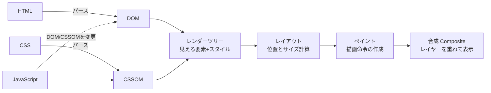

# ブラウザのレンダリングと描画

[[MOC_パフォーマンス体系|📚 目次]] ｜ [[01_Core_Web_Vitals|← 前へ]] ｜ [[03_JavaScriptとバンドルの最適化|次へ →]]

> [!abstract] この記事で分かること
> - HTML と CSS が画面のピクセルになるまでの流れ（クリティカルレンダリングパス）
> - レンダーブロッキングリソースが LCP を遅らせる理由と対策
> - メインスレッドとロングタスク（50ms）が INP を悪化させる仕組み
> - レイアウトスラッシング、`transform` / `opacity` アニメーション、`content-visibility`
> - INP 改善の基本「タスク分割」と `scheduler.yield()` の使い方
>
> **前提**：[[01_Core_Web_Vitals]] を読んでいると理解しやすいです。

## 1. ひとことで言うと

ブラウザは「**1 人の職人（メインスレッド）が、設計図（HTML）と内装指示書（CSS）を読んで部屋を組み立て、ペンキを塗り、最後に写真を撮って見せる**」工房のようなものです。職人は 1 人しかいないので、誰かが長い作業（重い JavaScript）を頼むと、その間はお客さんの呼び出し（クリック）に応えられません。また、組み立て中に指示書が届くまで作業を始められない（レンダーブロッキング）こともあります。

- 画面が出るまでの道のり＝**クリティカルレンダリングパス**。ここが詰まると LCP が遅れる
- 操作に反応するのもメインスレッド。**50ms を超えるタスク（ロングタスク）** が INP を悪化させる
- 「どの工程をやり直させるか」でアニメーションや DOM 操作のコストが大きく変わる

## 2. クリティカルレンダリングパス



| 工程 | 何をするか | 性能上のポイント |
|---|---|---|
| DOM 構築 | HTML を上から読み、要素の木（DOM: Document Object Model）を作る | 同期 `<script>` に出会うとパースが止まる |
| CSSOM 構築 | CSS を読み、スタイルの木（CSSOM）を作る | CSSOM が完成するまで描画しない（CSS はレンダーブロッキング） |
| レンダーツリー | DOM と CSSOM を合わせ、実際に表示する要素だけを残す | `display:none` は含まれない |
| レイアウト（Layout / Reflow） | 各要素の位置と大きさを計算 | 要素数が多いほど重い。幅が変わると子孫も再計算 |
| ペイント（Paint） | 色・文字・影などの描画命令を作り、ピクセルに塗る | 影やぼかしなど複雑な効果は重い |
| 合成（Composite） | 複数のレイヤーを GPU で重ねて画面に出す | ここだけで済む変更は非常に安い |

### 2-1. レンダーブロッキングリソース

ブラウザは「スタイルが決まっていない状態で描くと、後から見た目が大きく変わる（FOUC: Flash of Unstyled Content）」のを避けるため、`<head>` 内の CSS をすべて取得・解析するまで最初の描画をしません。また、`async` / `defer` のない `<script>` はダウンロードと実行が終わるまで HTML のパースを止めます。

```html
<!-- ❌ パースも描画も止める -->
<head>
  <link rel="stylesheet" href="/all-styles.css">      <!-- 300KB、全ページ分 -->
  <script src="/analytics.js"></script>               <!-- 同期スクリプト -->
</head>

<!-- ✅ 改善例 -->
<head>
  <style>/* ファーストビューに必要な最小限の CSS（クリティカル CSS）をインライン */</style>
  <link rel="stylesheet" href="/product-page.css">    <!-- ページ単位に分割 -->
  <script src="/app.js" defer></script>               <!-- パース完了後に実行 -->
  <script src="/analytics.js" async></script>         <!-- 取得でき次第、順不同で実行 -->
</head>
```

| 属性 | ダウンロード | 実行タイミング | 順序 |
|---|---|---|---|
| なし | パースを止めて取得 | 取得後すぐ（パース停止） | 記述順 |
| `defer` | 並行して取得 | HTML パース完了後 | 記述順 |
| `async` | 並行して取得 | 取得でき次第（パースを一時停止） | 順不同 |
| `type="module"` | 並行して取得 | `defer` と同様 | 記述順 |

Next.js などのフレームワークは多くを自動でやってくれますが、手で追加した `<script>` や巨大なグローバル CSS は自分で確認する必要があります。

## 3. メインスレッドとロングタスク

### 3-1. なぜ 1 本のスレッドが問題なのか

ブラウザのメインスレッドは、**JavaScript の実行・スタイル計算・レイアウト・ペイント・入力イベントの処理** をすべて 1 本で順番に行います。あるタスクが実行中のとき、クリックが来ても処理は次の順番まで待たされます。

```
  メインスレッド（数値は説明用の例）
  時間 →
  |■■■■■■■■■■■■■■■■■■ 300ms のタスク ■■■■■■■■■■■■■■■■■■|処理|描画|
            ↑ ここでクリック
            |<――――― 入力遅延 220ms ―――――>|<-60ms->|<20ms>|
                                     INP ≒ 300ms（Needs improvement）
```

**ロングタスク（Long Task）** は **50ms を超えるタスク** と定義されています。50ms の根拠は、ユーザーが「即座」と感じる 100ms 以内に応答するために、入力を受けてから処理する時間を残しておく、という RAIL モデルの考え方です。

### 3-2. タスク分割と `scheduler.yield()`

長い処理を小さく分け、合間にブラウザへ制御を返す（**yield する**）と、その隙間でクリック処理や描画が割り込めます。

```ts
// 商品一覧で 2,000 件の価格を再計算して描画する例
type Product = { id: number; price: number; el: HTMLElement };

// scheduler.yield() があれば使い、なければ setTimeout で代用する
function yieldToMain(): Promise<void> {
  const s = (globalThis as any).scheduler;
  if (s?.yield) return s.yield();
  return new Promise((resolve) => setTimeout(resolve, 0));
}

export async function applyDiscount(products: Product[], rate: number) {
  let deadline = performance.now() + 40; // 40ms ごとに区切る
  for (const p of products) {
    p.el.textContent = `¥${Math.round(p.price * (1 - rate)).toLocaleString()}`;
    if (performance.now() > deadline) {
      await yieldToMain();                // ここでクリックや描画が割り込める
      deadline = performance.now() + 40;
    }
  }
}
```

- `setTimeout(0)` で yield すると、続きはタスクキューの **最後尾** に回るため、他のスクリプトに割り込まれて完了が遅れることがあります。
- `scheduler.yield()` は続きを **優先的に** 再開してくれるため、分割しても全体の完了が遅れにくいのが利点です。
- **対応状況（2026 年時点、MDN / Chrome for Developers で確認）**：Chrome / Edge 129 以降、Firefox 142 以降が対応。Safari は未対応で、Baseline ではありません。上のように **機能検出してフォールバック** を用意してください。

### 3-3. INP 改善の他の定石

- **まず見た目を更新してから重い処理**：クリック直後に「読み込み中」表示だけ先に描画し、重い処理は yield の後に回す。
- **不要な処理をしない**：入力のたびに検索するならデバウンスする。
- **React なら** `useTransition` / `useDeferredValue` で緊急でない更新を後回しにする。
- **重い計算は Web Worker へ**：メインスレッド以外のスレッドで実行する。
- **DOM を小さく保つ**：要素数が多いとスタイル計算・レイアウトが重くなります（Lighthouse の DOM サイズ監査は、1,400 要素前後を「大きすぎる」目安としていました。監査名や閾値はバージョンで変わるため要確認）。

## 4. 描画コストを下げる

### 4-1. レイアウトスラッシング（強制同期レイアウト）

通常、ブラウザはスタイル変更をためておき、フレームの描画前にまとめてレイアウトします。ところが **スタイルを書き換えた直後に `offsetHeight` などのレイアウト値を読む** と、正しい値を返すためにその場でレイアウトを強制的に実行します（**強制同期レイアウト**）。これをループ内で繰り返すのが **レイアウトスラッシング** です。

```ts
const cards = document.querySelectorAll<HTMLElement>(".product-card");

// ❌ 書く→読む→書く→読む… のたびにレイアウトが走る（N 回）
cards.forEach((card) => {
  card.style.width = "50%";
  card.style.height = `${card.offsetWidth * 1.2}px`; // 読み取りで強制レイアウト
});

// ✅ 先に全部読む → 後でまとめて書く（レイアウトは 1〜2 回）
cards.forEach((card) => (card.style.width = "50%"));
const widths = Array.from(cards, (card) => card.offsetWidth); // ここで 1 回
cards.forEach((card, i) => (card.style.height = `${widths[i] * 1.2}px`));
```

レイアウトを強制するプロパティには `offsetTop/Width/Height`、`getBoundingClientRect()`、`scrollTop`、`getComputedStyle()` などがあります。この例の場合はそもそも CSS の `aspect-ratio: 5 / 6` で済み、JS が不要です。

### 4-2. アニメーションは `transform` と `opacity` で

どのプロパティを変えるかで、やり直す工程が変わります。

```
  変更するプロパティ          レイアウト  ペイント  合成
  width / height / top / left     ●         ●       ●   ← 重い
  color / background / box-shadow           ●       ●
  transform / opacity                               ●   ← 安い（GPU で処理）
```

```css
/* ❌ left を動かす：毎フレーム レイアウト→ペイント */
.cart-badge.enter { animation: slide-bad 300ms; }
@keyframes slide-bad { from { left: -100px; } to { left: 0; } }

/* ✅ transform を動かす：合成だけで済み、メインスレッドが混んでいても滑らか */
.cart-badge.enter { animation: slide-good 300ms; }
@keyframes slide-good { from { transform: translateX(-100px); } to { transform: none; } }
```

`will-change: transform` で事前にレイヤーを作らせることもできますが、乱用するとメモリを大量に消費するので、必要な要素だけに付けます。なお、`transform` によるアニメーションは CLS にも数えられません。

### 4-3. `content-visibility: auto`

画面外の要素のレイアウト・ペイントを、見えるまでスキップさせる CSS プロパティです。長い商品レビュー一覧やフッター付近の大きなセクションに効きます。2024 年 9 月に主要ブラウザがそろい、2026 年時点で Baseline です。

```css
.review-section {
  content-visibility: auto;
  contain-intrinsic-size: auto 800px; /* 描画前の仮の高さ。無いとスクロールバーが跳ねる */
}
```

## 5. どう測るか

### 5-1. DevTools の Performance パネル

ロングタスク、強制同期レイアウト（紫のレイアウトに赤い三角の警告）、各インタラクションの入力遅延・処理時間・表示遅延は、Chrome DevTools の Performance パネルで記録すると確認できます。具体的な操作方法は [[Performance・Memory（遅さとメモリリークの調査）]] にまとめてあります。読み方の考え方はフレームグラフと同じです（[[06_フレームグラフの読み方]]）。

- **CPU スロットリング**（4x〜6x slowdown）をかけて測ると、低スペックスマホでの重さが見えます。開発用 PC は実ユーザーの端末よりずっと速いことを忘れないでください。

### 5-2. コードでロングタスクを集める

```ts
// Long Animation Frames API（LoAF, Chrome 123+）で、遅いフレームとその原因スクリプトを取る
const observer = new PerformanceObserver((list) => {
  for (const entry of list.getEntries() as any[]) {
    if (entry.duration < 100) continue;
    const scripts = (entry.scripts ?? []).map(
      (s: any) => `${s.sourceURL || "inline"}:${s.sourceFunctionName} ${Math.round(s.duration)}ms`
    );
    console.log(`遅いフレーム ${Math.round(entry.duration)}ms`, scripts);
  }
});
observer.observe({ type: "long-animation-frame", buffered: true });
```

古い `longtask` エントリは「どのスクリプトか」がほとんど分かりませんでしたが、LoAF は原因スクリプトの URL と関数名を返します（2026 年時点で Chromium のみ）。実ユーザーの INP の原因調査では `web-vitals` の attribution ビルドが LoAF を内部で使っています（[[06_LighthouseとRUMで計測する]]）。

### 5-3. Before / After の例

Shop の商品一覧でフィルタを切り替えると固まる問題を、タスク分割と `content-visibility` で改善した場合のイメージです（**数値は説明用の例** です）。

| 計測項目（CPU 4x スロットリング） | Before | After |
|---|---|---|
| フィルタクリック時の最長タスク | 420ms | 45ms × 複数 |
| そのインタラクションの INP | 480ms | 130ms |
| 初回表示時のレイアウト時間 | 180ms | 60ms |

## よくある誤解・つまずき

- ❌ JavaScript を `async` にすればすべて解決
  ✅ ダウンロード中のブロックは防げますが、**実行時間** はメインスレッドを占有します。実行が重ければ INP は改善しません。
- ❌ 非同期処理（`await fetch`）中はメインスレッドが止まっている
  ✅ 通信を待っている間はメインスレッドは空いています。問題は応答後の JSON パースや大量 DOM 更新など **同期的な重い処理** です。
- ❌ `will-change` を全部に付ければ速くなる
  ✅ レイヤーが増えすぎてメモリと合成コストが増え、逆効果になります。
- ❌ ロングタスクさえなければ INP は良い
  ✅ 表示遅延（レイアウト・ペイント）が大きい場合もあります。DOM が巨大だと 1 回の再描画で 100ms を超えることがあります。

## まとめ

- HTML→DOM、CSS→CSSOM→レンダーツリー→レイアウト→ペイント→合成 の順に画面ができる
- CSS と同期 `<script>` はレンダーブロッキング。`defer` / `async`、クリティカル CSS、CSS 分割で対処
- メインスレッドは 1 本。**50ms 超のロングタスク** が入力を待たせ INP を悪化させる
- 重い処理は分割して yield。`scheduler.yield()` は機能検出してフォールバック付きで使う
- レイアウト値の読み書きを交互にしない。アニメーションは `transform` / `opacity`
- 画面外の大きなセクションは `content-visibility: auto` で描画を省く

## 確認クイズ

1. `<head>` 内の CSS ファイルが 3 秒かかって届くとき、HTML 自体は 0.3 秒で届いていても画面がなかなか出ないのはなぜですか？
> [!tip]- 答え
> CSS はレンダーブロッキングリソースで、CSSOM が完成するまでブラウザは最初の描画を行わないためです。クリティカル CSS のインライン化や CSS の分割・軽量化で改善します。

2. 次のコードの問題点と直し方を答えてください。`items.forEach(el => { el.style.height = el.offsetWidth + "px"; })`
> [!tip]- 答え
> ループの中で「書く（style.height）」と「読む（offsetWidth）」を交互に行っているため、毎回強制同期レイアウトが発生します（レイアウトスラッシング）。先に全要素の `offsetWidth` を読んでから、まとめて書き込みます。CSS の `aspect-ratio` で済むならそれが最善です。

3. `scheduler.yield()` を Safari のユーザーにも安全に使うにはどうしますか？
> [!tip]- 答え
> `globalThis.scheduler?.yield` があるかを機能検出し、ない場合は `setTimeout(resolve, 0)` を使う Promise でフォールバックします（2026 年時点で Safari は未対応）。

## 関連ノート

- [[01_Core_Web_Vitals]] — LCP・INP・CLS の定義
- [[03_JavaScriptとバンドルの最適化]] — メインスレッドを占有する JS そのものを減らす
- [[Performance・Memory（遅さとメモリリークの調査）]] — DevTools Performance パネルの使い方
- [[06_フレームグラフの読み方]] — Performance パネルのフレームチャートの読み方の基礎
- [[03_パフォーマンスを設計で作り込む]] — 設計段階での描画コストの考え方
- [[Webサイトの「遅い」は3種類ある｜Web Vitalsを図で理解する]] — INP とメインスレッドの直感的な説明

## 参考

- [Critical rendering path（MDN）](https://developer.mozilla.org/en-US/docs/Web/Performance/Guides/Critical_rendering_path)
- [Render-blocking resources（Chrome for Developers）](https://developer.chrome.com/docs/lighthouse/performance/render-blocking-resources)
- [Optimize long tasks（web.dev）](https://web.dev/articles/optimize-long-tasks)
- [Use scheduler.yield() to break up long tasks（Chrome for Developers）](https://developer.chrome.com/blog/use-scheduler-yield)
- [Scheduler: yield() method（MDN）](https://developer.mozilla.org/en-US/docs/Web/API/Scheduler/yield)
- [Optimize Interaction to Next Paint（web.dev）](https://web.dev/articles/optimize-inp)
- [Avoid large, complex layouts and layout thrashing（web.dev）](https://web.dev/articles/avoid-large-complex-layouts-and-layout-thrashing)
- [How to create high-performance CSS animations（web.dev）](https://web.dev/articles/animations-guide)
- [content-visibility（web.dev）](https://web.dev/articles/content-visibility)
- [Long Animation Frames API（Chrome for Developers）](https://developer.chrome.com/docs/web-platform/long-animation-frames)
- [Measure performance with the RAIL model（web.dev）](https://web.dev/articles/rail)
