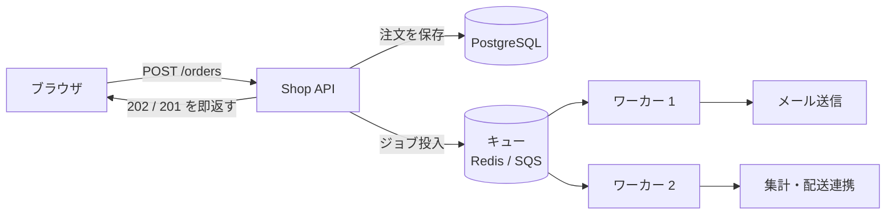

# 非同期化とキューで待ち時間を隠す

[[MOC_パフォーマンス体系|📚 目次]] ｜ [[04_キャッシュで応答を速くする|← 前へ]] ｜ [[01_スループットと待ち行列理論|次へ →]]

> [!abstract] この記事で分かること
> - ユーザーを待たせなくてよい処理（メール送信・画像変換・集計）をジョブキューに逃がす考え方
> - BullMQ / Amazon SQS を使った実装例と、`202 Accepted` での応答
> - ワーカーの並列度、再試行と冪等性
> - Node.js のイベントループをブロックしない方法（worker_threads）、ストリーミングレスポンス、async/await の直列化ミス
> - 非同期化のトレードオフ（結果整合性・運用の手間）と、その測り方
>
> **前提**：[[01_APIレスポンスタイムの分解]] と [[02_Node.jsアプリを本番で動かす]] を読んでいると理解しやすいです。

## 1. ひとことで言うと

非同期化は、**クリーニング店の「引換券」**です。店頭でシャツが洗い上がるまで客を待たせたりしません。受付だけして引換券を渡し、洗濯は奥の工場で行います。客の待ち時間は「受付の数十秒」だけになります。

- ユーザーへの応答に**本当に必要な処理だけ**をリクエスト内で行い、残りは**キュー（Queue：順番待ちの列）**に積んで後で処理する
- 処理そのものは速くならない。**ユーザーから見えなくする（隠す）**技術
- 代わりに「まだ終わっていない状態」が生まれる（結果整合性）。これを画面と運用で扱う必要がある

## 2. 何を非同期にするか

Shop の注文 API（`POST /api/orders`）を例に、リクエスト内でやっていることを分けます（時間は説明用の例）。

| 処理 | 時間（例） | ユーザーが結果を待つ必要は？ | 置き場所 |
|---|---|---|---|
| 在庫の確保・注文の保存 | 30ms | **ある**（注文成立を伝える） | リクエスト内 |
| 決済の確定 | 300ms | **ある**ことが多い | リクエスト内 |
| 注文確認メール送信 | 400ms | ない | キュー |
| 売上集計テーブルの更新 | 150ms | ない | キュー |
| 外部の配送システムへ連携 | 600ms | ない | キュー |

```
Before（全部同期）
POST /orders ─┬─ 在庫・保存 ██ 30
              ├─ 決済       ████████████ 300
              ├─ メール     ████████████████ 400
              ├─ 集計       ██████ 150
              └─ 配送連携   ████████████████████████ 600
              合計 ≒ 1480ms、しかもメールや配送の障害で注文が失敗する

After（キューへ）
POST /orders ─┬─ 在庫・保存 ██ 30
              ├─ 決済       ████████████ 300
              └─ キュー投入 ▏ 2（×3 件）
              合計 ≒ 340ms
                              ワーカー（裏で）→ メール / 集計 / 配送連携
```

判断の目安は「**その結果がないとレスポンスを返せないか**」です。返せるなら非同期候補です。副次的な効果として、メールサーバーなど**外部の障害が注文 API の失敗に直結しなくなります**。

## 3. ジョブキューの実装

### 3.1 全体像



API サーバーとワーカーは**別プロセス（別コンテナ）**にします。重いジョブが API の応答を邪魔せず、それぞれ独立にスケールできます。

### 3.2 BullMQ（Redis ベース）の例

**BullMQ**：Redis をバックエンドにした Node.js のジョブキューライブラリ（2026 年時点の v5 系の API）。

```ts
// queue.ts（API とワーカーで共有）
import { Queue } from "bullmq";
export const connection = { host: process.env.REDIS_HOST, port: 6379 };
export const orderQueue = new Queue("order-events", { connection });
```

```ts
// api.ts：注文を保存してジョブを積み、すぐ返す
app.post("/api/orders", async (req, res) => {
  const order = await createOrderAndCharge(req.body);   // 必要な処理だけ同期で

  await orderQueue.add(
    "order-created",
    { orderId: order.id },                 // ジョブには ID だけ入れ、詳細はワーカーが DB から読む
    {
      jobId: `order-created:${order.id}`,  // 同じ jobId のジョブは重複登録されない
      attempts: 5,                          // 最大 5 回試行
      backoff: { type: "exponential", delay: 1000 }, // 1s, 2s, 4s ... と間隔を空ける
      removeOnComplete: 1000,               // 完了ジョブを溜め込まない
    },
  );

  res.status(201).json({ id: order.id, status: "confirmed" });
});
```

```ts
// worker.ts：別プロセスで起動
import { Worker } from "bullmq";
import { connection } from "./queue";

const worker = new Worker(
  "order-events",
  async (job) => {
    const order = await loadOrder(job.data.orderId);
    await sendConfirmationMail(order);
    await updateSalesSummary(order);
  },
  { connection, concurrency: 10 }, // 1 プロセスで同時に 10 ジョブ
);

worker.on("failed", (job, err) => logger.error({ jobId: job?.id, err }, "job failed"));
```

### 3.3 Amazon SQS の例

AWS 上なら、マネージドなキューの **SQS** もよく使われます（AWS SDK for JavaScript v3）。

```ts
import { SQSClient, SendMessageCommand } from "@aws-sdk/client-sqs";
const sqs = new SQSClient({});

await sqs.send(new SendMessageCommand({
  QueueUrl: process.env.ORDER_QUEUE_URL,
  MessageBody: JSON.stringify({ type: "order-created", orderId: order.id }),
}));
```

SQS の標準キューは**少なくとも 1 回（at-least-once）**の配信で、同じメッセージが 2 回届くことがあります。だから次節の冪等性が必須です。

### 3.4 202 Accepted で「受け付けた」と返す

画像変換やレポート生成のように、**依頼そのものの結果**が後でできあがる場合は `202 Accepted`（受け付けたが処理は未完了）を返し、状態を確認する URL を渡します。

```ts
app.post("/api/reports", async (req, res) => {
  const job = await reportQueue.add("sales-report", { month: req.body.month });
  res.status(202)
     .location(`/api/reports/${job.id}`)
     .json({ id: job.id, status: "queued" });
});

app.get("/api/reports/:id", async (req, res) => {
  const job = await reportQueue.getJob(req.params.id);
  if (!job) return res.sendStatus(404);
  const state = await job.getState(); // waiting / active / completed / failed など
  res.json({ id: job.id, state, result: state === "completed" ? job.returnvalue : undefined });
});
```

画面側はポーリング（数秒おきに確認）、WebSocket / SSE での通知、完了メールなどで結果を受け取ります。注文 API のように「注文自体は確定済み」なら、`201 Created` で返してよく、202 は「依頼の結果がまだない」ときに使います。

## 4. ワーカーの並列度・再試行・冪等性

### 4.1 並列度（concurrency）

| ジョブの性質 | 並列度の考え方 |
|---|---|
| I/O 待ちが中心（メール・外部 API） | 1 プロセスで高め（10〜50）にできる。ただし相手のレート制限を超えない |
| CPU が重い（画像変換・PDF 生成） | 1 プロセス内の並列度を上げても速くならない。プロセス数（≒CPU コア数）で増やす |
| DB を叩く | コネクションプールの上限（[[01_アプリケーションサーバーとは]]）を超えない |

**どう測るか**：キューの**滞留数（待ちジョブ数）**と**ジョブの待ち時間（投入から開始まで）**をメトリクスにします。滞留が増え続けるなら処理能力不足（[[01_スループットと待ち行列理論|待ち行列]]）で、ワーカーを増やすか、ジョブを軽くします。

```ts
// BullMQ のキュー状況を定期的にメトリクスへ
const counts = await orderQueue.getJobCounts("waiting", "active", "delayed", "failed");
metrics.gauge("queue.order_events.waiting", counts.waiting);
```

### 4.2 再試行と冪等性

ジョブは失敗します（外部 API の一時障害、ワーカーの再起動）。再試行は必須ですが、再試行や重複配信で**同じジョブが 2 回実行されても結果が同じ**でなければなりません。この性質を**冪等性（Idempotency）**と言います。

```ts
// 冪等なメール送信：送信済みの記録を DB の一意制約で守る
async function sendConfirmationMail(order: Order) {
  const inserted = await db.query(
    `INSERT INTO sent_mails (order_id, kind) VALUES ($1, 'confirmation')
     ON CONFLICT (order_id, kind) DO NOTHING
     RETURNING order_id`,
    [order.id],
  );
  if (inserted.rowCount === 0) return; // 送信済み → 何もしない
  await mailer.send(order.email, renderConfirmation(order));
}
```

> [!note] 厳密には「記録してから送る」と「送ってから記録する」で失敗時の挙動が変わる
> 上の例は「記録してから送る」ため、送信直前にクラッシュするとメールが 1 通も届かない可能性があります。逆にすると 2 通届く可能性があります。どちらを許容するかはビジネス判断です。何度も失敗したジョブは**デッドレターキュー（DLQ：失敗ジョブの退避先）**に移し、人が確認できるようにします。

## 5. Node.js で「待たせない」ための注意

### 5.1 イベントループをブロックしない

Node.js は 1 本のスレッド（イベントループ）で全リクエストをさばきます。**CPU を 200ms 使う処理が 1 つあると、その間ほかの全リクエストが止まります**。

```
イベントループ  [req1][req2][■■■■■■ 画像リサイズ 200ms ■■■■■■][req3][req4]
                                                         ↑ req3, req4 はこの間ずっと待たされる
```

対策は 2 つです。

1. **ジョブキューに出して別プロセスのワーカーで実行**（前節）
2. **リクエスト内で結果が必要なら worker_threads**（別スレッドで CPU 処理）

```ts
// hash-worker.ts：別スレッドで動く処理
import { parentPort } from "node:worker_threads";
import { scryptSync } from "node:crypto";
parentPort!.on("message", ({ password, salt }) => {
  parentPort!.postMessage(scryptSync(password, salt, 64).toString("hex"));
});
```

```ts
// main.ts：メインスレッドは結果を await するだけ（ブロックしない）
import { Worker } from "node:worker_threads";
const worker = new Worker(new URL("./hash-worker.js", import.meta.url));

function hashInWorker(password: string, salt: string): Promise<string> {
  return new Promise((resolve) => {
    worker.once("message", resolve);
    worker.postMessage({ password, salt });
  });
}
```

> [!tip] 実務ではスレッドプールを使う
> 上は仕組みを示す最小例で、同時に複数呼ぶと結果が取り違えられます。実際には **piscina** などのワーカープールライブラリを使います。なお `crypto.scrypt`（コールバック版）や `zlib` の非同期 API は、もともと libuv のスレッドプールで実行されるため、同期版（`scryptSync`）を使わなければメインスレッドは止まりません。

**どう測るか**：イベントループの遅延を測ります。`perf_hooks.monitorEventLoopDelay()` の p99 が数十 ms を超えていたら、どこかで CPU を長く使っています（[[05_プロファイリング]] で特定）。

```ts
import { monitorEventLoopDelay } from "node:perf_hooks";
const h = monitorEventLoopDelay({ resolution: 10 });
h.enable();
setInterval(() => {
  metrics.gauge("nodejs.eventloop.delay_p99_ms", h.percentile(99) / 1e6); // ns → ms
  h.reset();
}, 10_000);
```

### 5.2 ストリーミングレスポンス

大きな CSV のエクスポートなどで、全件をメモリに作ってから返すと、**最初の 1 バイトが届くまで（TTFB）が長く**、メモリも大量に使います。**ストリーミング**で、できた分から順に送ります。

```ts
import { pipeline } from "node:stream/promises";
import { Transform } from "node:stream";
import QueryStream from "pg-query-stream";

app.get("/api/admin/orders.csv", async (req, res) => {
  const client = await pool.connect();
  try {
    res.setHeader("Content-Type", "text/csv; charset=utf-8");
    res.write("id,user_id,total,created_at\n");
    const rows = client.query(new QueryStream(
      "SELECT id, user_id, total, created_at FROM orders ORDER BY id"));
    const toCsv = new Transform({
      objectMode: true,
      transform(r, _enc, cb) { cb(null, `${r.id},${r.user_id},${r.total},${r.created_at.toISOString()}\n`); },
    });
    await pipeline(rows, toCsv, res); // バックプレッシャー（受け手が遅ければ読む側も待つ）が効く
  } finally {
    client.release();
  }
});
```

ただし数分かかるようなエクスポートは、接続を張りっぱなしにするより **202 + ジョブ + 完成したらダウンロード URL** の方が安定します。LLM の応答のように「少しずつ見せたい」ものは SSE（Server-Sent Events）でストリーミングするのが定番です。

### 5.3 async/await の直列化ミス

非同期 API を使っていても、書き方次第で**わざわざ直列に待つ**コードになります。

```ts
// ❌ for...of + await：100 件を 1 件ずつ順番に（100 × 50ms = 5 秒）
for (const id of productIds) {
  await updateSearchIndex(id);
}

// ❌ forEach + async：待たない（エラーも拾えず、レスポンス後も走り続ける）
productIds.forEach(async (id) => { await updateSearchIndex(id); });

// ✅ 同時実行数を制限して並列に（p-limit、2026 年時点の v6 系）
import pLimit from "p-limit";
const limit = pLimit(10);
await Promise.all(productIds.map((id) => limit(() => updateSearchIndex(id))));
// 100 件 ÷ 10 並列 × 50ms ≒ 0.5 秒（説明用の見積もり）
```

制限なしの `Promise.all(ids.map(...))` は、1 万件なら 1 万本を同時に投げて DB や外部 API を潰します。並列度の上限は [[02_バックプレッシャーとレートリミット]] の考え方で決めます。そもそもこの処理がユーザーを待たせる必要がないなら、キューへ出すのが正解です。

## 6. 非同期化のトレードオフ

| 得るもの | 失うもの・増えるもの |
|---|---|
| API の応答時間が短くなる | **結果整合性**：直後に見ると「まだ反映されていない」状態がある（注文直後の売上集計など） |
| 外部障害が API の失敗に直結しない | **運用**：キュー・ワーカーの監視、DLQ の対応、デプロイ単位が増える |
| ピークをならせる（キューが緩衝材になる） | **デバッグの難しさ**：処理が API とワーカーに分かれ、トレースをつなぐ必要がある |
| ワーカーだけ独立にスケールできる | **冪等性**の設計が必須 |

非同期化した処理の性能は、API の応答時間ではなく **「投入から完了までの時間（end-to-end レイテンシ）」** と **滞留数** で測ります。「API は 340ms になったが、確認メールが届くのは 30 分後」では、ユーザー体験としては失敗です。メールなら「p99 で 1 分以内に送信」のように、ジョブ側にも目標（[[03_性能要件と目標の決め方]]）を決めます。

## よくある誤解・つまずき

- ❌ 非同期にすれば処理が速くなる → ✅ 処理時間は同じです。ユーザーの待ち時間から外すだけで、合計の仕事量はむしろ少し増えます。
- ❌ `async` を付ければブロックしない → ✅ async 関数の中でも、同期の CPU 処理（巨大な JSON.parse、同期の暗号化など）はイベントループを止めます。
- ❌ キューに入れたジョブは必ず 1 回だけ実行される → ✅ 再試行や at-least-once 配信で 2 回以上実行されることがあります。冪等に作ります。
- ❌ `Promise.all` で全部同時に投げれば最速 → ✅ 相手（DB・外部 API）が詰まって全体が遅くなります。同時実行数を制限します。
- ❌ API が速くなったので成功 → ✅ ジョブの完了までの時間と滞留数も測らないと、遅さが裏に移っただけかもしれません。

## まとめ

- 「結果がなくてもレスポンスを返せる処理」はキューに出し、API は必要な処理だけ行ってすぐ返す
- BullMQ / SQS でジョブを積み、別プロセスのワーカーで処理する。依頼の結果が後でできる場合は 202 Accepted + 状態確認 URL
- ワーカーの並列度は I/O か CPU かで決め、滞留数と待ち時間で能力不足を検知する
- 再試行は指数バックオフで、ジョブは冪等に。失敗し続けるものは DLQ へ
- Node.js では CPU 処理を worker_threads / 別プロセスに逃がし、イベントループ遅延を測る。大きなレスポンスはストリーミング
- 非同期化は結果整合性と運用コストとの交換。end-to-end のレイテンシにも目標を置く

## 確認クイズ

1. 注文 API で「注文確認メールの送信」をキューに出すべき理由を、性能と可用性の 2 つの観点で答えてください。
> [!tip]- 答え
> 性能：メール送信の数百 ms がユーザーの待ち時間から外れます。可用性：メールサーバーの障害や遅延が注文 API の失敗やタイムアウトに直結しなくなり、ジョブとして後から再試行できます。

2. 画像変換ワーカーの `concurrency` を 1 から 20 に上げても処理速度が上がりませんでした。なぜですか。どうすればよいですか。
> [!tip]- 答え
> 画像変換は CPU が重い処理で、1 プロセス（1 スレッド）内で並列度を上げても CPU を同時に使えないからです。ワーカープロセスを CPU コア数に合わせて増やすか、sandboxed processor / worker_threads で複数コアを使います。

3. SQS から同じ「ポイント付与」ジョブが 2 回届き、ポイントが二重に付与されました。どう防ぎますか。
> [!tip]- 答え
> ジョブを冪等にします。例えば `point_grants (order_id)` に一意制約を付け、`INSERT ... ON CONFLICT DO NOTHING` で付与記録とポイント加算を同じトランザクションで行い、記録済みなら何もしないようにします。

## 関連ノート

- [[04_キャッシュで応答を速くする]] — 前回。重い集計は事前計算 + キャッシュとも組み合わせる
- [[01_スループットと待ち行列理論]] — 次回。キューの滞留と待ち時間の理論
- [[02_バックプレッシャーとレートリミット]] — 並列度の上限と流量制御
- [[01_APIレスポンスタイムの分解]] — 直列の待ちと Promise.all
- [[05_プロファイリング]] — イベントループを止めている CPU 処理を特定する
- [[02_Node.jsアプリを本番で動かす]] — Node.js のプロセス構成とクラスタ
- [[01_アプリケーションサーバーとは]] — コネクションプールとワーカー数

## 参考

- [BullMQ Docs: Concurrency](https://docs.bullmq.io/guide/workers/concurrency)
- [BullMQ Docs: Retrying failing jobs](https://docs.bullmq.io/guide/retrying-failing-jobs)
- [AWS Docs: Amazon SQS standard queues（at-least-once delivery）](https://docs.aws.amazon.com/AWSSimpleQueueService/latest/SQSDeveloperGuide/standard-queues.html)
- [MDN: 202 Accepted](https://developer.mozilla.org/en-US/docs/Web/HTTP/Reference/Status/202)
- [Node.js docs: Don't Block the Event Loop (or the Worker Pool)](https://nodejs.org/en/learn/asynchronous-work/dont-block-the-event-loop)
- [Node.js docs: worker_threads](https://nodejs.org/api/worker_threads.html)
- [Node.js docs: perf_hooks.monitorEventLoopDelay](https://nodejs.org/api/perf_hooks.html#perf_hooksmonitoreventloopdelayoptions)
- [Node.js docs: stream.pipeline](https://nodejs.org/api/stream.html#streampipelinesource-transforms-destination-options)
