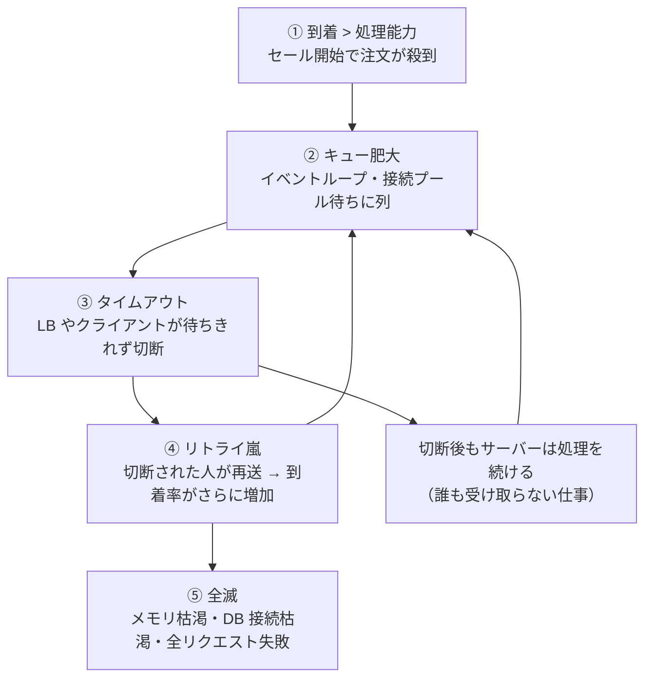

# バックプレッシャーとレートリミット

[[MOC_パフォーマンス体系|📚 目次]] ｜ [[01_スループットと待ち行列理論|← 前へ]] ｜ [[03_キャパシティプランニング|次へ →]]

> [!abstract] この記事で分かること
> - 処理能力を超えるリクエストが来たときに、システムが「全滅」まで転がり落ちる仕組み
> - バックプレッシャー（Node.js stream の highWaterMark、キューの上限）とロードシェディング（早く断る）の実装
> - レートリミットの 4 つのアルゴリズムの違いと、Redis・Nginx での実装例
> - 429 と Retry-After、指数バックオフ＋ジッター、タイムアウトの予算、サーキットブレーカーの考え方
>
> **前提**：[[01_スループットと待ち行列理論]] を読んでいると理解しやすいです。

## 1. ひとことで言うと

人気のラーメン屋に、席数の 3 倍のお客さんが一度に来たとします。店主が「全員どうぞ」と店内に入れると、狭い店内はぎゅうぎゅうで注文も取れず、結局 1 杯も出せなくなります。うまい店は **入口で整理券を配り（レートリミット）**、**満席なら「1 時間後にまた来てください」と早めに伝え（ロードシェディング）**、**厨房が追いつかないときは注文受付を一時止めます（バックプレッシャー）**。断られたお客さんは残念ですが、店内のお客さんには確実にラーメンが出ます。

- **過負荷では「全部さばく」は選べない**。選べるのは「一部を早く断る」か「全員を遅くして全滅する」か
- **バックプレッシャー（Backpressure）**：下流が詰まったら上流に「待って」と伝え、流量を抑える
- **ロードシェディング（Load Shedding）**：容量を超えた分を 503 などで即座に断る
- **レートリミット（Rate Limiting）**：利用者ごと・API ごとに「単位時間に何回まで」を決めて守らせる
- クライアント側は **バックオフ＋ジッター** でリトライし、**タイムアウトの予算** を守る

## 2. 過負荷で何が起きるか：全滅までの 4 段階

[[01_スループットと待ち行列理論]] で見たとおり、到着率が処理能力を超えると、列は理論上無限に伸びます。現実にはその前に、次の連鎖が起きます。



特に厄介なのが次の 2 点です。

- **誰も待っていない仕事**：クライアントが 10 秒でタイムアウトしても、サーバーは列に並んだリクエストを律儀に処理します。列が 15 秒分あれば、処理しているのは **全部すでに見捨てられたリクエスト** です。これを **グッドプット（Goodput：有効に使われたスループット）ゼロ** の状態と呼びます。
- **リトライの増幅**：クライアント 3 回、BFF 3 回、API 3 回とリトライが重なると、1 回の失敗が最大 3 × 3 × 3 = 27 倍の負荷になります。

```text
スループット（応答できた件数）
   ^
   |            ┌───────── 理想：上限で頭打ち（超えた分は早く断る）
   |           /
   |          /  ＼
   |         /     ＼  ← 対策なし：上限を超えると「誰も得しない処理」で崩落
   |        /        ＼___
   |       /
   +------+-----+---------------> 到着率
          処理能力
```

この回の対策はすべて、**崩落カーブを「頭打ち」に変える** ためのものです。

## 3. バックプレッシャー：上流に「待って」と伝える

### 3.1 Node.js stream の highWaterMark

Node.js の stream は、バックプレッシャーの仕組みを標準で持っています。

- 書き込み側の内部バッファが **highWaterMark** に達すると、`writable.write()` が `false` を返す
- 書き手は書き込みを止め、`'drain'` イベントを待ってから再開する
- 既定の highWaterMark は、バイトのストリームで 64 KiB（Node.js v22 で 16 KiB から引き上げ）、objectMode で 16 個（2026 年時点）

`write()` の戻り値を無視すると、遅い相手（低速回線のクライアントなど）に向けたデータがすべてメモリに溜まり、最後はプロセスがメモリ不足で落ちます。**自分で `write()` を呼ぶより `pipeline()` を使う** のが確実です。

```ts
// 注文一覧 CSV エクスポート：100 万行でもメモリ一定で流す
import { pipeline } from "node:stream/promises";
import { Transform } from "node:stream";
import type { Request, Response } from "express";
import pg from "pg";
import QueryStream from "pg-query-stream";

const pool = new pg.Pool();

export async function exportOrders(req: Request, res: Response) {
  const client = await pool.connect();
  try {
    // サーバー側カーソルで 1,000 行ずつ取り出す（全件をメモリに載せない）
    const rows = client.query(
      new QueryStream("SELECT id, user_id, total, created_at FROM orders ORDER BY id", [], {
        batchSize: 1000,
      }),
    );
    const toCsv = new Transform({
      writableObjectMode: true,
      transform(row, _enc, cb) {
        cb(null, `${row.id},${row.user_id},${row.total},${row.created_at.toISOString()}\n`);
      },
    });
    res.setHeader("Content-Type", "text/csv");
    // res（クライアント）が遅ければ toCsv が止まり、DB からの読み出しも止まる
    await pipeline(rows, toCsv, res);
  } finally {
    client.release();
  }
}
```

詳しい仕組みは [[03_ストリーム処理]] と Node.js 公式の Backpressuring in Streams を参照してください。

### 3.2 キューには必ず上限を付ける

メモリ上の配列、Redis のリスト、ジョブキュー……**上限のないキューは、過負荷を先送りしてメモリ不足で爆発させる装置** です。

| キュー | 上限の付け方 | 溢れたとき |
|---|---|---|
| アプリ内の処理待ち | 同時実行数とキュー長の上限（下の例） | 503 で即座に断る |
| ジョブキュー（BullMQ / SQS） | 滞留数・最古メッセージの年齢を監視 | 投入側を遅らせる、受付を 202 で返しつつ投入を制限 |
| DB 接続プール | プールの `connectionTimeoutMillis` を短めに | 待ちすぎずにエラーにする |
| Nginx → API | `worker_connections`、upstream の `max_conns` | 502/503 |

キューの深さの目安は「**列の長さ ÷ スループット ＝ 待ち時間**」（リトルの法則）です。1 台 100 req/s で、許せる待ちが 0.5 秒なら、キューは 50 件までにします。

## 4. ロードシェディング：早く断る

容量を超えたリクエストは、**処理を始める前に** 安く断ります。1 秒待たせてから失敗するより、1 ms で 503 を返すほうが、サーバーにもクライアントにも親切です。

```ts
// load-shed.ts — 同時実行数とキュー待ち時間で入口制限する Express ミドルウェア
import type { Request, Response, NextFunction } from "express";

const MAX_INFLIGHT = 64;        // 負荷テストで求めた「安全な同時実行数」（例）
const MAX_QUEUE = 32;           // 待たせてよい数 = 許容待ち時間 × スループット
const MAX_QUEUE_WAIT_MS = 500;  // これ以上待たせたら諦めて断る

type Waiter = { run: () => void; timer: NodeJS.Timeout };
let inflight = 0;
const waiting: Waiter[] = [];

function release() {
  const w = waiting.shift();
  if (w) {
    clearTimeout(w.timer);
    w.run();                    // 空いた枠をそのまま次の待ち人に渡す
  } else {
    inflight--;
  }
}

function reject(res: Response) {
  res.set("Retry-After", "2").status(503).json({ error: "overloaded" });
}

export function loadShed(req: Request, res: Response, next: NextFunction) {
  const run = () => {
    if (req.socket.destroyed) { // 待っている間にクライアントが切断 → 仕事をしない
      release();
      return;
    }
    res.on("close", release);   // 応答完了・切断のどちらでも枠を返す
    next();
  };
  if (inflight < MAX_INFLIGHT) {
    inflight++;
    return run();
  }
  if (waiting.length >= MAX_QUEUE) return reject(res);   // 列も満杯 → 即 503
  const w: Waiter = {
    run,
    timer: setTimeout(() => {   // 待ちすぎ → 列から外して 503
      const i = waiting.indexOf(w);
      if (i >= 0) waiting.splice(i, 1);
      reject(res);
    }, MAX_QUEUE_WAIT_MS),
  };
  waiting.push(w);
}
```

実務でのポイント：

- **優先度を付ける**：混雑時は商品一覧（キャッシュで代替可能）より注文確定を優先し、管理画面のレポートやレコメンドは先に断る（[[05BFFとAPIゲートウェイとグレースフルデグレーデーション|グレースフルデグレーデーション]]）
- **ヘルスチェックは断らない**：`/healthz` まで 503 にすると LB が「全台故障」と判断して振り分け先がなくなる
- **503 と 429 の使い分け**：サーバー全体が混んでいるなら 503 Service Unavailable、特定の利用者が使いすぎなら 429 Too Many Requests

## 5. レートリミット：アルゴリズムと実装

### 5.1 4 つのアルゴリズム

| アルゴリズム | 仕組み | 長所 | 短所 |
|---|---|---|---|
| **固定ウィンドウ（Fixed Window）** | 「12:00:00〜12:00:59 に 100 回」のように区切りごとにカウント | 実装が最も簡単（Redis の INCR 1 回） | 境界の前後で 2 倍まで通る（12:00:59 に 100 回 + 12:01:00 に 100 回） |
| **スライディングウィンドウ（Sliding Window）** | 「直近 60 秒で 100 回」。ログ方式（全時刻を記録）と、前後 2 つの窓の重み付き平均で近似するカウンター方式がある | 境界問題がない | ログ方式はメモリを食う。カウンター方式は近似 |
| **トークンバケット（Token Bucket）** | バケツに一定速度でトークンが溜まり（上限あり）、1 リクエストで 1 個使う | **平均レートを守りつつ、短いバースト（まとめ打ち）を許せる** | パラメータが 2 つ（補充速度と容量）で、少し考える必要がある |
| **リーキーバケット（Leaky Bucket）** | バケツに入れたリクエストが、穴から一定速度で漏れ出す（処理される） | 下流への流量を **一定に平滑化** できる | バーストを即座には通さない（待たせる） |

```text
トークンバケット（容量 10、毎秒 5 個補充）

  補充 5 個/秒 ──▶ [● ● ● ● ● ● ● ● ● ●] 容量 10
                         │ 1 リクエスト = 1 個
                         ▼
  空なら 429（次の 1 個が溜まるまで 0.2 秒 → Retry-After）

  → 普段は 5 req/s、溜まっていれば一瞬 10 件まで通せる
```

API の利用者向け制限には **トークンバケット**、下流（DB、外部 API）への流量を一定にしたいときは **リーキーバケット** がよく選ばれます。

### 5.2 Redis での実装（複数台の API で共有する）

API が 4 台あると、各台のメモリで数えても「1 台あたり 100 回 = 合計 400 回」になってしまいます。共有の Redis で数えます。

**固定ウィンドウ（最小構成）**

```ts
// rate-limit-fixed.ts — ioredis v5、Redis 7 以上（EXPIRE の NX オプション）
import Redis from "ioredis";
const redis = new Redis(process.env.REDIS_URL!);

export async function fixedWindow(userId: string, limit = 100, windowSec = 60) {
  const window = Math.floor(Date.now() / 1000 / windowSec);
  const key = `rl:fw:${userId}:${window}`;
  // INCR と EXPIRE を 1 往復でまとめて送る
  const [[, count]] = (await redis.multi().incr(key).expire(key, windowSec, "NX").exec()) as [
    [Error | null, number],
    unknown,
  ];
  const resetSec = windowSec - (Math.floor(Date.now() / 1000) % windowSec);
  return { allowed: count <= limit, remaining: Math.max(0, limit - count), resetSec };
}
```

**トークンバケット（Lua スクリプトで原子的に）**

「読む → 計算する → 書く」を別々のコマンドで行うと、2 台が同時に読んだときに数え漏れが起きます。Lua スクリプトは Redis 内で 1 つの操作として実行されるので安全です。時刻も各 API サーバーの時計ではなく Redis の `TIME` を使い、サーバー間の時計のずれを避けます。

```ts
// rate-limit-token-bucket.ts
import Redis from "ioredis";
const redis = new Redis(process.env.REDIS_URL!);

const TOKEN_BUCKET = `
local key      = KEYS[1]
local rate     = tonumber(ARGV[1])   -- 1 秒あたりの補充数
local capacity = tonumber(ARGV[2])   -- バケツの容量（許せるバースト）
local cost     = tonumber(ARGV[3])   -- このリクエストで使うトークン数
local t   = redis.call('TIME')
local now = tonumber(t[1]) * 1000 + math.floor(tonumber(t[2]) / 1000)  -- ミリ秒

local data   = redis.call('HMGET', key, 'tokens', 'ts')
local tokens = tonumber(data[1]) or capacity
local ts     = tonumber(data[2]) or now
tokens = math.min(capacity, tokens + math.max(0, now - ts) / 1000 * rate)

local allowed, retry_ms = 0, 0
if tokens >= cost then
  tokens = tokens - cost
  allowed = 1
else
  retry_ms = math.ceil((cost - tokens) / rate * 1000)
end
redis.call('HSET', key, 'tokens', tostring(tokens), 'ts', now)
redis.call('PEXPIRE', key, math.ceil(capacity / rate * 1000) + 1000)
return { allowed, retry_ms }
`;

export async function tokenBucket(userId: string, rate = 5, capacity = 10, cost = 1) {
  const [allowed, retryMs] = (await redis.eval(
    TOKEN_BUCKET, 1, `rl:tb:${userId}`, rate, capacity, cost,
  )) as [number, number];
  return { allowed: allowed === 1, retryAfterSec: Math.ceil(retryMs / 1000) };
}
```

```ts
// Express に組み込む
app.post("/api/orders", async (req, res, next) => {
  const { allowed, retryAfterSec } = await tokenBucket(req.user.id, 2, 5); // 注文は 2/秒、バースト 5
  if (!allowed) {
    res.set("Retry-After", String(Math.max(1, retryAfterSec)));
    return res.status(429).json({ error: "too_many_requests" });
  }
  next();
});
```

> [!warning] Redis が落ちたら？
> レートリミッターのために Redis を毎回呼ぶと、Redis 障害で API 全体が止まりかねません。Redis エラー時は「通す（fail open）」か「断る（fail closed）」かを事前に決めておきます。一般的な API の利用制限なら fail open、ログイン試行回数の制限のようなセキュリティ目的なら fail closed が多いです。2026 年時点では `rate-limiter-flexible` などのライブラリも広く使われています。

### 5.3 Nginx の limit_req

アプリに届く前に Nginx で止めれば、Node.js の CPU を使わずに済みます。Nginx の `limit_req` は **リーキーバケット方式** です。

```nginx
http {
    # クライアント IP ごとに平均 10 req/s。状態の保存に 10MB（約 16 万 IP 分）
    limit_req_zone $binary_remote_addr zone=api_per_ip:10m rate=10r/s;
    # 注文 API はさらに厳しく
    limit_req_zone $binary_remote_addr zone=order_per_ip:10m rate=2r/s;

    server {
        location /api/ {
            # 20 件までのバーストは遅延なしで通し、超えたら拒否
            limit_req zone=api_per_ip burst=20 nodelay;
            limit_req_status 429;   # 既定は 503
            proxy_pass http://shop_api;
        }
        location = /api/orders {
            limit_req zone=order_per_ip burst=5 nodelay;
            limit_req_status 429;
            proxy_pass http://shop_api;
        }
    }
}
```

- `burst` なしだと、10r/s は「100 ms に 1 件」と解釈され、同時に 2 件来ただけで 2 件目が拒否される。普通は `burst` を付ける
- `nodelay` なしだと、バースト分は一定間隔に **遅延させて** 流す（下流の平滑化向き）
- 本番投入前は `limit_req_dry_run on;` で「止めたらどれだけ止まるか」をログだけで確かめられる
- 会社や携帯キャリアの NAT 配下では多数の利用者が同じ IP になる。ログイン後の API は IP よりユーザー ID で制限する（アプリ側）

## 6. クライアント側：429 / Retry-After、バックオフ、タイムアウトの予算

### 6.1 429 と Retry-After

- **429 Too Many Requests**（RFC 6585）：この利用者が送りすぎ
- **Retry-After**（RFC 9110）：何秒後（または何時）に再試行してよいか。429 や 503 と一緒に返す
- `RateLimit-Policy` / `RateLimit` ヘッダーで残り回数を伝える仕様は、2026 年時点でまだ IETF のドラフト段階です。広く使われている `X-RateLimit-*` との違いは [[03_レート制限と冪等性]] を参照してください。

### 6.2 指数バックオフ＋ジッター

失敗した全員が「1 秒後に再送」すると、1 秒後にまた同時に殺到します。待ち時間を **指数的に伸ばし（Exponential Backoff）**、さらに **ランダムにばらす（Jitter）** ことで再送を時間方向に散らします。AWS の Marc Brooker の検証では、ジッターなしのバックオフは呼び出しの塊が残り、ランダムな「Full Jitter」が総呼び出し数を大きく減らしました。

```ts
// fetch-with-retry.ts — Node.js 18+ の fetch と AbortSignal.timeout を使用
const RETRYABLE = new Set([429, 502, 503, 504]);

export async function fetchWithRetry(url: string, init: RequestInit = {}, opts = {
  maxAttempts: 3, baseMs: 200, capMs: 5_000, perTryTimeoutMs: 2_000,
}) {
  for (let attempt = 1; ; attempt++) {
    try {
      const res = await fetch(url, { ...init, signal: AbortSignal.timeout(opts.perTryTimeoutMs) });
      if (!RETRYABLE.has(res.status) || attempt >= opts.maxAttempts) return res;
      // サーバーが Retry-After を指定していればそれを優先する
      const ra = Number(res.headers.get("retry-after"));
      await sleep(Number.isFinite(ra) && ra > 0 ? ra * 1000 : fullJitter(attempt, opts));
    } catch (err) {
      if (attempt >= opts.maxAttempts) throw err;   // タイムアウト・接続エラー
      await sleep(fullJitter(attempt, opts));
    }
  }
}

// Full Jitter：0 〜 min(cap, base × 2^attempt) の一様乱数
function fullJitter(attempt: number, o: { baseMs: number; capMs: number }) {
  return Math.random() * Math.min(o.capMs, o.baseMs * 2 ** attempt);
}
const sleep = (ms: number) => new Promise((r) => setTimeout(r, ms));
```

守るべきルール：

- **リトライするのは 1 か所だけ**（たいてい一番外側）。各層でリトライすると掛け算で増える
- **冪等でない操作（注文確定の POST）は、Idempotency-Key なしでリトライしない**（[[03_レート制限と冪等性]]）
- 400 や 401 など、何度送っても結果が変わらないエラーはリトライしない
- 回数だけでなく **リトライ予算**（例：全リクエストの 10% まで）で上限を設けると、障害時の増幅を抑えられる

詳細は [[03_リトライと指数バックオフ]] と [[再試行とバックオフ]] にあります。

### 6.3 タイムアウトの予算（Deadline）

利用者が待てるのが 3 秒なら、その 3 秒を下流で **分け合う** 必要があります。各層が独立に「10 秒」を設定すると、外側がタイムアウトした後も内側が仕事を続けます。

```text
ブラウザ ── 3.0s ──▶ BFF ── 残り 2.8s ──▶ 注文 API ── 残り 2.5s ──▶ 決済 API（1 回 1.0s × 最大 2 回）
                                         └─ DB クエリ 0.5s
外側ほど長く、内側ほど短く。内側の合計（リトライ込み）が外側を超えないように
```

```ts
// 受け取った締め切りから残り時間を計算して、下流に渡す
app.post("/api/orders", async (req, res) => {
  const deadline = Number(req.get("x-request-deadline")) || Date.now() + 2_500;
  const remaining = () => deadline - Date.now();
  if (remaining() < 100) return res.status(503).end();    // もう間に合わない仕事はしない

  const payRes = await fetch("https://payment.internal/charge", {
    method: "POST",
    headers: { "x-request-deadline": String(deadline), "content-type": "application/json" },
    body: JSON.stringify(req.body),
    signal: AbortSignal.timeout(Math.min(1_000, remaining() - 50)),
  });
  // ...
});
```

### 6.4 サーキットブレーカー（軽く）

**サーキットブレーカー（Circuit Breaker）** は、失敗が続く下流への呼び出しを一時的に **呼ばずに即失敗** させる仕組みです。家のブレーカーと同じで、壊れた先に電流（リクエスト）を流し続けて自分まで巻き込まれるのを防ぎます。

```text
 Closed（通常）──失敗率が閾値超え──▶ Open（即失敗）──一定時間後──▶ Half-Open（試しに数件）
     ▲                                                              │
     └────────────── 試しが成功 ────────────────────────────────────┘（失敗なら Open に戻る）
```

Node.js では `opossum` などのライブラリで実装できます。リトライが「もう 1 回試す」なら、サーキットブレーカーは「しばらく試さない」で、両方を組み合わせて使います。

## 7. どう測るか：過負荷に強いかを確かめる

対策を入れたら、**わざと容量の 1.5〜2 倍の負荷をかけて**、崩落せずに頭打ちになるかを確認します（[[03_負荷テストの設計と実施]]）。

```ts
// overload.ts — k6：容量の 2 倍まで到着率を上げる
import http from "k6/http";
import { Counter } from "k6/metrics";

const shed = new Counter("shed_responses");

export const options = {
  scenarios: {
    overload: {
      executor: "ramping-arrival-rate",
      startRate: 100, timeUnit: "1s", preAllocatedVUs: 500, maxVUs: 3000,
      stages: [
        { target: 480, duration: "3m" },   // 容量（例：4 台 × 120 = 480 req/s）まで
        { target: 960, duration: "3m" },   // 2 倍
        { target: 960, duration: "5m" },   // 維持
      ],
    },
  },
};

export default function () {
  const res = http.get("https://staging.shop.example/api/products?page=1");
  if (res.status === 503 || res.status === 429) shed.add(1);
}
```

見る指標：

| 指標 | 健全な状態 | 崩落している状態 |
|---|---|---|
| 成功レスポンスのスループット（グッドプット） | 容量付近で頭打ちのまま | 容量を超えると **下がる** |
| 成功レスポンスの p99 | SLO 内を維持 | 秒単位に悪化 |
| 503 / 429 の件数 | 超過分だけ増え、応答は数 ms | — |
| in-flight・キュー長 | 上限で止まる | 増え続ける |
| メモリ使用量 | 一定 | 右肩上がり |
| 負荷を下げた後 | すぐ正常に戻る | なかなか戻らない（溜まった列とリトライ） |

本番では、Nginx の `$limit_req_status`、アプリの「shed したリクエスト数」「in-flight」をメトリクスに出しておき、[[02_REDメソッドとUSEメソッド]] のダッシュボードで「断っている量」を常に見えるようにします。**断ることは隠すものではなく、監視すべき正常な動作** です。

## よくある誤解・つまずき

- ❌ キューを大きくすれば、溢れずに全部さばける → ✅ 待ち時間が伸びるだけで、処理能力は増えません。クライアントのタイムアウトを超えた分は「誰も受け取らない仕事」になります。
- ❌ 断るのはユーザーに失礼なので、できるだけ受け付ける → ✅ 全員を受け付けて全員に失敗させるより、一部を早く断って残りに確実に応答するほうが、成功する人の数は多くなります。
- ❌ リトライは多いほど成功率が上がる → ✅ 障害中のリトライは負荷を増やして回復を遅らせます。回数を絞り、ジッターを入れ、1 か所でだけ行います。
- ❌ レートリミットは攻撃対策だけのもの → ✅ 正規の利用者（バッチを回すパートナー企業、バグったモバイルアプリ）の暴走から他の利用者を守る、公平性のための仕組みでもあります。
- ❌ 各 API サーバーのメモリでカウントすれば十分 → ✅ 台数分だけ上限が増え、オートスケールで台数が変わると制限値も変わってしまいます。共有ストア（Redis）か、LB・API ゲートウェイで数えます。

## まとめ

- 過負荷はキュー肥大 → タイムアウト → リトライ嵐 → 全滅と連鎖する。目標は崩落を「頭打ち」に変えること
- バックプレッシャーは下流の詰まりを上流に伝える。Node.js では `pipeline()` を使い、キューには必ず上限を付ける
- ロードシェディングは処理前に安く断る。503/429 と Retry-After を返し、優先度とヘルスチェックに配慮する
- レートリミットはトークンバケットが基本。複数台なら Redis の Lua で原子的に、手前で止めるなら Nginx の limit_req
- クライアントは 1 か所で、Full Jitter のバックオフと Retry-After を守ってリトライし、タイムアウトは予算として下流に配る

## 確認クイズ

1. API 1 台のスループットが 80 req/s で、利用者に許せる待ち時間は 0.25 秒です。この台の処理待ちキューの上限はおよそ何件にすべきですか。
> [!tip]- 答え
> リトルの法則から 80 × 0.25 = 20 件です。それを超えて並べても、待ち時間が 0.25 秒を超えるだけなので、超えた分は 503 で早く断ります。

2. Nginx で `limit_req zone=api rate=10r/s;`（burst なし）と設定したら、普通の利用者からも 503 が多発しました。原因と対処は何ですか。
> [!tip]- 答え
> limit_req はリーキーバケットで、10r/s は「100 ms に 1 件」として扱われます。ページ表示で同時に数件の API を呼ぶだけで 2 件目以降が超過になります。`burst=20 nodelay` のようにバーストを許し、`limit_req_status 429` で利用者起因の拒否であることを明示します。

3. ブラウザ → BFF → 注文 API → 決済 API の各層がそれぞれ「タイムアウト 10 秒・3 回リトライ」の設定でした。何が問題ですか。
> [!tip]- 答え
> 決済 API が遅くなると、リトライが掛け算で最大 27 倍に増幅し、障害を悪化させます。また外側がタイムアウトした後も内側は処理を続けます。リトライは 1 か所に絞り、タイムアウトは外側ほど長く・内側ほど短く、締め切り（deadline）を下流に伝える設計にします。

## 関連ノート

- [[01_スループットと待ち行列理論]] — キューが伸びる理由とリトルの法則
- [[03_キャパシティプランニング]] — 断らずに済むだけの容量を用意する
- [[03_レート制限と冪等性]] — API 設計としての 429・X-RateLimit ヘッダー・Idempotency-Key
- [[03_リトライと指数バックオフ]] / [[02_タイムアウトとキャンセル]] — HTTP クライアント側の実装
- [[タイムアウトとリトライ、やりすぎると何が起きるか｜ねる前エンジニアリング]] — リトライ増幅の解説
- [[再試行とバックオフ]] / [[06_キュー詰まり]] — 分散システム・運用の観点
- [[03_ストリーム処理]] — stream とバックプレッシャーの基礎
- [[05BFFとAPIゲートウェイとグレースフルデグレーデーション]] — 混雑時に機能を落として生き残る
- [[02_ロードバランサーの仕組み]] — LB 側のタイムアウトとヘルスチェック

## 参考

- [Backpressuring in Streams（Node.js）](https://nodejs.org/en/learn/modules/backpressuring-in-streams)
- [Stream（Node.js API docs）](https://nodejs.org/api/stream.html)
- [Node.js 22 is now available!（highWaterMark の変更）](https://nodejs.org/en/blog/announcements/v22-release-announce)
- [Module ngx_http_limit_req_module（nginx.org）](https://nginx.org/en/docs/http/ngx_http_limit_req_module.html)
- [RFC 6585: Additional HTTP Status Codes（429）](https://www.rfc-editor.org/rfc/rfc6585)
- [RFC 9110: HTTP Semantics — Retry-After](https://www.rfc-editor.org/rfc/rfc9110#name-retry-after)
- [RateLimit header fields for HTTP（IETF Draft）](https://datatracker.ietf.org/doc/draft-ietf-httpapi-ratelimit-headers/)
- [Exponential Backoff And Jitter（AWS Architecture Blog）](https://aws.amazon.com/blogs/architecture/exponential-backoff-and-jitter/)
- [Using load shedding to avoid overload（Amazon Builders' Library）](https://aws.amazon.com/builders-library/using-load-shedding-to-avoid-overload/)
- [Timeouts, retries, and backoff with jitter（Amazon Builders' Library）](https://aws.amazon.com/builders-library/timeouts-retries-and-backoff-with-jitter/)
- [Handling Overload（Google SRE Book）](https://sre.google/sre-book/handling-overload/)
- [Addressing Cascading Failures（Google SRE Book）](https://sre.google/sre-book/addressing-cascading-failures/)
- [EVAL / Scripting with Lua（Redis docs）](https://redis.io/docs/latest/develop/programmability/eval-intro/)
