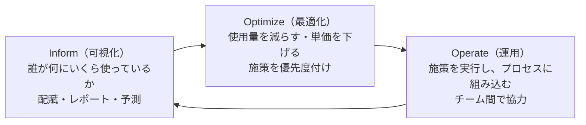

# コスト最適化とFinOps

[[MOC_パフォーマンス体系|📚 目次]] ｜ [[03_キャパシティプランニング|← 前へ]] ｜ [[01_CPUとメモリ階層の基礎|次へ →]]

> [!abstract] この記事で分かること
> - 性能とコストの関係：「速くする」ことが「安くする」ことになる場面と、ならない場面
> - FinOps の原則と 3 つのフェーズ（Inform / Optimize / Operate）
> - ライトサイジング、購入オプション（オンデマンド / Savings Plans / リザーブド / スポット）、スケジュール停止、Graviton（ARM）
> - 意外と高いデータ転送コストと、1 注文あたりのインフラコスト（ユニットエコノミクス）の測り方
>
> **前提**：[[03_キャパシティプランニング]]、[[03_オートスケーリング]] を読んでいると理解しやすいです。

## 1. ひとことで言うと

家計の見直しを想像してください。電気代を下げたいとき、いきなり冷蔵庫を買い替える前に、まず **明細を見て何にいくら使っているかを知り**（可視化）、**使っていない部屋の照明を消し**（無駄の削除）、**長く使う家電は年間契約で安く**（購入方法の工夫）、**省エネ家電に替えます**（効率改善）。そして「1 人あたりの光熱費」で比べれば、家族が増えても適切かどうか判断できます。

クラウドのコストも同じです。

- **FinOps（Financial Operations）**：エンジニア・財務・事業が協力して、クラウドの費用対効果を最大化する文化と実践
- コスト削減の基本は **使用量を減らす（Usage）** と **単価を下げる（Rate）** の 2 方向
- 性能改善は使用量を減らす最も強力な手段の 1 つ。一方、余裕（ヘッドルーム）や冗長化はコストを払って買っている
- 最終的に見るべきは総額ではなく **ユニットコスト**（1 注文あたり、1,000 リクエストあたり）

## 2. 性能とコストの関係

### 2.1 速くすると安くなる

[[01_スループットと待ち行列理論]] のリトルの法則のとおり、1 リクエストの処理時間が半分になれば、同じサーバーで約 2 倍さばけます。つまり **台数を半分にできる** 可能性があります。

| 改善 | 性能への効果 | コストへの効果（例） |
|---|---|---|
| N+1 クエリを解消（[[03_N+1問題の発見と解決]]） | DB の CPU 使用率が下がる | DB インスタンスを 1 サイズ下げられる |
| 商品一覧をキャッシュ（[[04_キャッシュで応答を速くする]]） | p99 が下がる | API 台数・DB 読み取りが減る |
| 画像を AVIF/WebP に（[[04_画像とフォントの最適化]]） | LCP が改善 | 転送量（データ転送料）が減る |
| CPU のホットパスを最適化（[[04_ホットパスの最適化]]） | スループット向上 | 同じ台数でより多く処理 |

### 2.2 性能のためにコストを払っているもの

逆に、性能や信頼性を **お金で買っている** 部分もあります。

- **ヘッドルーム**：目標利用率 60% なら、ピーク時でも 40% は待機。これは待ち時間を抑えるための保険料
- **N+1・マルチ AZ**：故障時の余力（[[03_キャパシティプランニング]]）
- **キャッシュ層・CDN・リードレプリカ**：それ自体に料金がかかる

「コスト削減」のつもりでヘッドルームを削ると、セール時に p99 が悪化して売上を失うかもしれません。**SLO を守れる範囲で最も安い構成** を探すのが目標で、SLO を割ってまで削るのは最適化ではありません。

### 2.3 どこまで最適化するか

エンジニアの時間もコストです。月 3 万円のサーバー代を 1 万円にするために 2 人で 1 か月かけるのは、多くの場合割に合いません。**コストの大きい順に、効果と工数を見積もって** 取り組みます（[[04_最適化の進め方とトレードオフ]]）。

## 3. FinOps の原則とフェーズ

### 3.1 6 つの原則

FinOps Foundation は次の原則を掲げています（2026 年時点）。

| 原則 | 意味（要約） |
|---|---|
| Teams need to collaborate | エンジニア・財務・事業がコストについて一緒に話す |
| Business value drives technology decisions | 総額ではなく、事業価値（売上・利用者あたりのコストなど）で判断する |
| Everyone takes ownership for their technology usage | 使う人（開発チーム）が自分のコストに責任を持つ |
| FinOps data should be accessible, timely, and accurate | コストデータを、すぐ、正確に、誰でも見られるようにする |
| FinOps should be enabled centrally | 割引購入や標準化などは中央のチームが支援する |
| Take advantage of the variable cost model of the cloud | 使った分だけ払うクラウドの特性を活かす（減らせるときに減らす） |

### 3.2 3 つのフェーズ



- **Inform**：コストを可視化し、チーム・サービスごとに配賦（割り当て）する。タグ付けが土台（§6）
- **Optimize**：ライトサイジング、購入オプション、停止スケジュールなどの改善余地を見つけ、優先度を付ける（§4、§5）
- **Operate**：施策を実行し、定例やアラートで継続的に回す。一度で終わりではなく、Inform に戻って繰り返す

**一度に全部やらない** のがポイントです。FinOps Foundation は成熟度を Crawl（はう）/ Walk（歩く）/ Run（走る）で表しており、まずは「タグを付けてサービス別のコストが見える」状態（Crawl）から始めます。

## 4. 使用量を減らす：ライトサイジング・停止・効率改善

### 4.1 ライトサイジング（Right-sizing）

**ライトサイジング** は、実際の使用量に合わせてインスタンスのサイズを適正化することです。「念のため大きめ」で作ったまま放置されたサーバーは、どの組織にもあります。

手順：

1. **2〜4 週間のメトリクスを見る**：CPU の平均だけでなく p95・最大、メモリ（EC2 のメモリは CloudWatch エージェントを入れないと取れない）、ネットワーク
2. **候補を出す**：AWS Compute Optimizer は使用状況から推奨サイズを提示する
3. **負荷テストで確かめる**：小さくしたサイズで SLO を守れるか（[[03_負荷テストの設計と実施]]）
4. **少しずつ適用して監視**：1 台だけ変えて、p99 とエラー率を比較

```bash
# AWS CLI：Compute Optimizer の EC2 推奨を一覧する（Compute Optimizer の有効化が必要）
aws compute-optimizer get-ec2-instance-recommendations \
  --query 'instanceRecommendations[].{id:instanceArn,now:currentInstanceType,finding:finding,rec:recommendationOptions[0].instanceType}' \
  --output table
```

> [!warning] 平均 CPU 10% でも小さくできないことがある
> メモリ使用量が大きい、ピークだけ高い、ネットワーク帯域がインスタンスサイズに比例している、といった場合です。CPU だけで判断せず、[[03_キャパシティプランニング]] の資源別の表で確認します。

### 4.2 オートスケールとスケジュール停止

- **本番**：オートスケール（[[03_オートスケーリング]]）で深夜は台数を減らす。最小台数は可用性で決める
- **ステージング・開発環境**：夜間と週末は **止める**。平日 9〜21 時だけ動かせば、稼働は週 60 時間 ÷ 168 時間 ≒ 36%。単純計算で約 6 割削減できる

```hcl
# Terraform：ステージングの ASG を平日夜に 0 台、朝に 2 台へ
resource "aws_autoscaling_schedule" "stg_night" {
  scheduled_action_name  = "stg-night-stop"
  autoscaling_group_name = aws_autoscaling_group.shop_api_stg.name
  recurrence             = "0 21 * * MON-FRI"
  time_zone              = "Asia/Tokyo"
  min_size               = 0
  max_size               = 0
  desired_capacity       = 0
}

resource "aws_autoscaling_schedule" "stg_morning" {
  scheduled_action_name  = "stg-morning-start"
  autoscaling_group_name = aws_autoscaling_group.shop_api_stg.name
  recurrence             = "0 9 * * MON-FRI"
  time_zone              = "Asia/Tokyo"
  min_size               = 2
  max_size               = 2
  desired_capacity       = 2
}
```

RDS や単体の EC2 は、AWS の「Instance Scheduler on AWS」や EventBridge Scheduler で停止・起動できます。

### 4.3 Graviton（ARM）などの効率改善

AWS Graviton は AWS 独自の ARM ベースのプロセッサです。AWS は、Graviton ベースのインスタンスは同等の x86 インスタンスより最大 20% 安く、同じ性能で最大 60% 少ないエネルギーで動くと説明しています（2026 年時点の AWS の公表値）。

Node.js は arm64 を公式にサポートしているので、移行しやすい部類です。注意点は次のとおりです。

- **ネイティブモジュール**（`sharp`、`bcrypt` など）は arm64 用のバイナリが必要。多くは提供されているが、`npm ci` を arm64 環境で実行する
- **Docker イメージ** はマルチアーキテクチャでビルドする

```bash
docker buildx build --platform linux/amd64,linux/arm64 -t registry.example.com/shop-api:1.42.0 --push .
```

- **必ず自分のワークロードで測る**：公表値は目安。x86 と Graviton で同じ k6 シナリオを流し、§7 の「1,000 リクエストあたりのコスト」で比べる

## 5. 単価を下げる：購入オプション

同じインスタンスでも、買い方で単価が大きく変わります（割引率は AWS の公表上限で、2026 年時点。条件により異なります）。

| 購入オプション | 仕組み | 割引の目安 | 向いている用途 |
|---|---|---|---|
| **オンデマンド（On-Demand）** | 使った分だけ、約束なし | 基準 | 変動分、短期、検証 |
| **Compute Savings Plans** | 1 年 / 3 年、「1 時間あたり $X 使う」と金額で約束。インスタンスファミリーやリージョンを問わない（Fargate・Lambda にも適用） | 最大 66% | 常に動いているベースライン。柔軟性重視 |
| **EC2 Instance Savings Plans** | 特定リージョン・特定インスタンスファミリーで金額を約束 | 最大 72% | 構成が固まっているベースライン |
| **リザーブドインスタンス（RI）** | 特定のインスタンスタイプなどを 1 年 / 3 年予約。RDS・ElastiCache などは今も RI が中心 | 最大 72% 程度 | DB など長期に同じ構成で動くもの |
| **スポット（Spot）** | AWS の余剰容量を安く使う。**2 分前の通知で中断されうる** | 最大 90% | 中断されてよいもの：バッチ、CI、キューのワーカー、ステートレス API の一部 |

```text
Shop API の台数（1 日の変化、例）

台数
 15 |                          ┌───┐        ← セール時：オンデマンド（+ スポット混在）
 10 |               ┌──────────┘   └──┐
  6 |      ┌────────┘                 └──┐  ← 日中の変動分：オンデマンド / スポット
  4 |██████████████████████████████████████ ← 常時のベースライン：Savings Plans / RI
    +----------------------------------------> 時刻
     0時      9時          20時   22時    24時
```

基本戦略：

- **常に動いている最小台数ぶん** を Savings Plans / RI で約束する。約束しすぎると使わなくても払うことになるので、過去の **最低** 使用量を目安に
- **変動分** はオンデマンド。中断に耐えられるならスポットを混ぜる（ASG の Mixed Instances Policy で、複数のインスタンスタイプを指定して中断リスクを分散）
- **スポットで動かす API は graceful shutdown 必須**：中断通知を受けたら LB から外れ、処理中のリクエストを終わらせる（[[02_Node.jsアプリを本番で動かす]]）
- **ライトサイジングを先に、約束は後に**：大きすぎる構成のまま 3 年約束すると、無駄を 3 年固定することになる

## 6. 意外と高いもの：ストレージとデータ転送

コンピュート（EC2）以外で、請求書を見て驚きやすいのがデータ転送とストレージです。

### 6.1 データ転送

AWS の場合（2026 年時点の一般的な料金体系。単価はリージョンと量で異なるので料金ページで確認）：

| 経路 | 料金 |
|---|---|
| インターネット → AWS（受信） | 原則無料 |
| AWS → インターネット（送信） | GB 単位で課金。全サービス合計で月 100 GB までは無料枠 |
| 同じリージョン内の **AZ 間** | 両方向に GB 単位で課金 |
| **NAT ゲートウェイ** 経由 | 時間料金に加え、処理したデータ量にも課金 |
| CloudFront（CDN）→ インターネット | 一般にオリジンから直接配信するより単価が低く、オリジンへの転送も減る |

Shop でありがちな「意外と高い」例：

- **商品画像を EC2 や S3 から直接配信**：画像の多いページは 1 ページ数 MB。CDN 経由にするとキャッシュヒット分のオリジン転送がなくなる（[[04_CDNによる負荷軽減]]）。画像の軽量化は性能とコストの両方に効く
- **プライベートサブネットから S3・ECR へ NAT 経由でアクセス**：コンテナイメージの pull やログ送信が NAT のデータ処理料金になる。VPC エンドポイント（S3 はゲートウェイ型が無料）で回避できる
- **AZ をまたぐ通信**：API が別 AZ の Redis や DB と大量にやりとりする。可用性のためのマルチ AZ は必要なので、ゼロにするのではなく「量」を意識する
- **ログとメトリクスの送信量**：デバッグログを本番で出しっぱなしにすると、転送と取り込み・保存の料金が膨らむ

### 6.2 ストレージ

- **使われていない EBS ボリュームとスナップショット**：インスタンス削除後に残りがち
- **EBS の種類**：gp2 から gp3 への移行は、一般に同等以上の性能でより安くなる
- **S3 のライフサイクル**：古いログを低頻度アクセス層・アーカイブ層へ移す、一定期間後に削除する
- **DB のストレージ**：不要になった履歴データのアーカイブ。データが減れば性能（インデックスがメモリに乗る）にも効く

## 7. どう測るか：タグ付け、可視化、ユニットエコノミクス

### 7.1 タグ付け

コストを「どのサービス・どのチーム・どの環境のものか」に分けるには、リソースに **タグ** を付けます。

```hcl
# Terraform：プロバイダの default_tags で全リソースに自動付与
provider "aws" {
  region = "ap-northeast-1"
  default_tags {
    tags = {
      Service    = "shop-api"
      Env        = "prod"
      Team       = "shop-backend"
      CostCenter = "ec"
    }
  }
}
```

- AWS では、タグを請求のグループ分けに使うには、Billing コンソールで **コスト配分タグとして有効化** する必要があります（有効化前のコストには遡って適用されない点に注意）
- タグのキーと値の表記揺れ（`env` / `Env` / `environment`）を防ぐため、命名規則を決め、AWS Organizations のタグポリシーや CI のチェックで強制します
- タグを付けられないコスト（データ転送の一部、サポート料金など）もあるので、100% の配賦は目指しすぎない

```bash
# AWS CLI：先月のコストをサービス（タグ）別に集計
aws ce get-cost-and-usage \
  --time-period Start=2026-09-01,End=2026-10-01 \
  --granularity MONTHLY \
  --metrics UnblendedCost \
  --group-by Type=TAG,Key=Service
```

日々の監視には AWS Cost Explorer、予算超過のアラートには AWS Budgets、詳細分析には CUR（Cost and Usage Report）を Athena などで集計する方法がよく使われます。**オートスケールの最大台数と予算アラートはセット** にしておきます（暴走時の請求爆発を防ぐ）。

### 7.2 ユニットエコノミクス（1 注文あたりのインフラコスト）

総額は事業が伸びれば当然増えます。見るべきは **1 単位あたりのコスト（ユニットコスト）** です。

```text
1 注文あたりのインフラコスト = Shop のインフラ月額 ÷ 月間注文数

例（数値は説明用）
  9 月：インフラ 120 万円 ÷ 40 万注文 = 3.0 円/注文
 10 月：インフラ 135 万円 ÷ 50 万注文 = 2.7 円/注文   ← 総額は増えたが効率は改善
```

- 総額が増えても、ユニットコストが下がっていれば健全に成長している
- 総額が横ばいでも、ユニットコストが上がっていれば何かが非効率になっている（新機能の重いクエリ、ログの出しすぎなど）
- 粗利や客単価と比べると、「インフラ費が売上の何 % か」を事業側と共通の言葉で話せる

### 7.3 性能改善の効果を金額で示す

負荷テストの結果から **1,000 リクエストあたりのコスト** を出すと、インスタンスタイプ比較や性能改善の効果を金額で比べられます。

```ts
// cost-per-1k.ts — 負荷テスト結果からコスト効率を比べる（料金・スループットは例の値）
type Candidate = { name: string; hourlyUsd: number; safeRps: number };

const candidates: Candidate[] = [
  { name: "x86 大きめ",     hourlyUsd: 0.20, safeRps: 180 },
  { name: "x86 小さめ×2",   hourlyUsd: 0.20, safeRps: 190 },
  { name: "Graviton 大きめ", hourlyUsd: 0.16, safeRps: 175 },
];

for (const c of candidates) {
  const reqPerHour = c.safeRps * 3600;              // 目標利用率で計画した処理量
  const usdPer1k = (c.hourlyUsd / reqPerHour) * 1000;
  console.log(`${c.name.padEnd(16)} ${(usdPer1k * 1e6).toFixed(0)} µ$ / 1,000 req`);
}
```

`safeRps` は [[03_キャパシティプランニング]] と同じく「SLO を守れる限界 × 目標利用率」を使います。こうしておくと「N+1 解消で safeRps が 120 → 180 になった → 必要台数が 15 → 10 台 → 月 ○ 万円削減」のように、性能改善の価値を事業側に説明できます。

## よくある誤解・つまずき

- ❌ コスト削減 = 小さいインスタンスにすること → ✅ SLO を割れば売上を失います。使用量（無駄・非効率）と単価（購入方法）の両面から、SLO を守れる範囲で最適化します。
- ❌ Savings Plans / RI はたくさん買うほど得 → ✅ 約束した分は使わなくても払います。ライトサイジングを先に済ませ、常に動いている最低ラインだけを約束します。
- ❌ スポットは本番では使えない → ✅ 2 分前の中断通知に対応し、複数タイプに分散して、ステートレス API の一部やワーカーに使えば大きく節約できます。全台スポットは避けます。
- ❌ データ転送は安いので気にしなくてよい → ✅ 画像配信、NAT ゲートウェイ経由の通信、AZ 間通信、ログ送信が積み重なると、コンピュートに匹敵することがあります。
- ❌ FinOps は財務部門の仕事 → ✅ コストを生むのは設計と実装です。開発チームが自分のサービスのコストを見て、責任を持つのが FinOps の原則です。

## まとめ

- 性能改善は使用量を減らす最強の手段。一方、ヘッドルームや冗長化は性能・信頼性のための保険料
- FinOps は「チームで協力し、事業価値で判断し、使う人が責任を持つ」文化。Inform → Optimize → Operate を繰り返す
- 使用量を減らす：ライトサイジング、オートスケール、開発環境の夜間停止、Graviton などの効率改善
- 単価を下げる：ベースラインは Savings Plans / RI、変動分はオンデマンド、中断に耐えるものはスポット
- データ転送（CDN、NAT、AZ 間）とストレージの無駄を見逃さない
- タグで配賦し、総額ではなく「1 注文あたり」「1,000 リクエストあたり」のユニットコストで判断する

## 確認クイズ

1. Shop のステージング環境（API 2 台）を平日 9 時〜21 時だけ動かし、夜間と週末は止めます。常時稼働と比べて、コンピュート料金はおよそ何 % 削減できますか。
> [!tip]- 答え
> 稼働時間は 12 時間 × 5 日 = 60 時間 / 週で、常時稼働の 168 時間の約 36% です。約 64% 削減できます（EBS などのストレージ料金は止めても発生します）。

2. Shop API は深夜に最低 4 台、昼は 6〜8 台、セール時に最大 15 台で動きます。Savings Plans はどの量を約束するのが妥当ですか。
> [!tip]- 答え
> 常に動いている最低ラインの 4 台分（相当の時間あたり金額）が目安です。それ以上はオンデマンド、中断に耐えられる部分はスポットにします。15 台分を約束すると、平常時は使わない分まで払い続けることになります。

3. 9 月のインフラ費は 100 万円・注文 25 万件、10 月は 110 万円・注文 22 万件でした。どう評価し、何を調べますか。
> [!tip]- 答え
> 1 注文あたり 4.0 円 → 5.0 円と効率が 25% 悪化しています。注文が減ったのにコストが増えているので、タグ別のコストで増えたサービスを特定し、新機能の重いクエリ、ログ量の増加、停止忘れのリソース、データ転送の増加などを調べます。

## 関連ノート

- [[03_キャパシティプランニング]] — 必要台数とヘッドルーム（コストの前提になる計画）
- [[01_スループットと待ち行列理論]] — 速くすると同じ台数でより多くさばける理由
- [[04_最適化の進め方とトレードオフ]] — 工数と効果で優先順位を付ける
- [[03_オートスケーリング]] / [[04_CDNによる負荷軽減]] — 台数の自動増減と転送量の削減（64 章）
- [[02_Node.jsアプリを本番で動かす]] — スポット中断にも耐える graceful shutdown
- [[04_画像とフォントの最適化]] — 転送量を減らすと性能とコストの両方に効く
- [[01_CPUとメモリ階層の基礎]] — 次の章：1 台の効率をハードウェアの視点で上げる

## 参考

- [FinOps Principles（FinOps Foundation）](https://www.finops.org/framework/principles/)
- [FinOps Phases（FinOps Foundation）](https://www.finops.org/framework/phases/)
- [FinOps Maturity Model（FinOps Foundation）](https://www.finops.org/framework/maturity-model/)
- [Compute Savings Plans pricing（AWS）](https://aws.amazon.com/savingsplans/compute-pricing/)
- [Amazon EC2 Reserved Instances（AWS）](https://aws.amazon.com/ec2/pricing/reserved-instances/)
- [Amazon EC2 Spot Instances（AWS）](https://aws.amazon.com/ec2/spot/)
- [Spot Instance interruption notices（AWS docs）](https://docs.aws.amazon.com/AWSEC2/latest/UserGuide/spot-instance-termination-notices.html)
- [AWS Graviton Processor（AWS）](https://aws.amazon.com/ec2/graviton/)
- [Amazon EC2 On-Demand Pricing — Data Transfer（AWS）](https://aws.amazon.com/ec2/pricing/on-demand/)
- [Using AWS cost allocation tags（AWS docs）](https://docs.aws.amazon.com/awsaccountbilling/latest/aboutv2/cost-alloc-tags.html)
- [AWS Compute Optimizer](https://aws.amazon.com/compute-optimizer/)
- [Instance Scheduler on AWS](https://aws.amazon.com/solutions/implementations/instance-scheduler-on-aws/)
