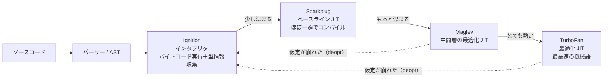

# JITとコンパイラ最適化

[[MOC_パフォーマンス体系|📚 目次]] ｜ [[01_CPUとメモリ階層の基礎|← 前へ]] ｜ [[03_メモリアロケーションとGC|次へ →]]

> [!abstract] この記事で分かること
> - インタプリタ・AOT コンパイル・JIT コンパイルの違い
> - V8 のコンパイラパイプライン（Ignition → Sparkplug → Maglev → TurboFan）と、最適化・脱最適化（deopt）の流れ
> - Hidden Class（Map）とインラインキャッシュ、「単相（monomorphic）」を保つ書き方
> - `--trace-opt` / `--trace-deopt` で JIT の動きを観察する方法
> - CPython 3.11 以降の特化適応インタプリタと実験的 JIT の現状
>
> **前提**：[[01_CPUとメモリ階層の基礎]]、[[05_プロファイリング]] を読んでいると理解しやすいです。

## 1. ひとことで言うと

外国語の本を読むとき、最初は 1 文ずつ辞書を引きながら読みます（インタプリタ）。同じ言い回しが何度も出てくると、「これはこういう意味」と覚えて辞書なしで読めるようになります（JIT コンパイル）。ところが途中で同じ言い回しが別の意味で使われると、覚えた訳が使えなくなり、辞書に戻ります（脱最適化）。

- JavaScript エンジンは**実行しながら「よく通るコード」を見つけ、その場で機械語に最適化**する
- 最適化は「これまでこうだった」という**仮定**に基づくので、仮定が崩れると最適化が捨てられる
- だから「**同じ形のデータを、同じ型で**渡し続ける」コードは速くなりやすい

## 2. インタプリタ・AOT・JIT

| 方式 | 仕組み | 長所 | 短所 | 例 |
|---|---|---|---|---|
| インタプリタ（interpreter） | 命令を 1 つずつ解釈して実行 | 起動が速い | 実行は遅い | 初期の JS、CPython（基本） |
| AOT（Ahead-Of-Time）コンパイル | 実行前に機械語へ変換 | 実行が速い、起動も速い | 実行時の情報を使えない | C, C++, Rust, Go |
| JIT（Just-In-Time）コンパイル | 実行中に、頻繁に使われる部分を機械語へ変換 | 実行時の型情報で大胆に最適化できる | ウォームアップが必要、メモリを使う | V8（Node.js / Chrome）、JVM、PyPy |

JS は型宣言がない動的言語なので、AOT で速い機械語を作るのは困難です（TypeScript の型は実行時には消えます）。そこで JIT は「**実際に動かして観察した型**」をもとに最適化します。これを**投機的最適化（speculative optimization）**と呼びます。

## 3. V8 のパイプライン

2026 年時点の V8（Chrome / Node.js）は、4 段階の実行層（tier）を持っています。



| 層 | 役割（V8 blog より） |
|---|---|
| Ignition | すべての JS をバイトコードにして解釈実行。**型フィードバック**（どの型が来たか）を集める |
| Sparkplug | バイトコードをほぼ即座に機械語化するベースライン JIT（2021 年導入）。最適化はしないが解釈のオーバーヘッドを消す |
| Maglev | 「十分に良いコードを、十分に速く」作る中間の最適化 JIT（Chrome M117 で導入）。コンパイルは Sparkplug の約 10 倍遅く、TurboFan の約 10 倍速い |
| TurboFan | ピーク性能のための最適化 JIT。インライン化・型の特殊化・不要なチェックの除去などを行う |

> [!note] 2026 年時点の補足
> TurboFan の内部表現は「Sea of Nodes」から **Turboshaft** という新しい中間表現へ移行が進んでいます（V8 blog "Land ahoy: leaving the Sea of Nodes"）。利用者から見た使い方は変わりません。

**ホットコード（hot code）**とは、何度も呼ばれる関数や何度も回るループのことです。V8 は呼び出し回数などをもとに、ホットなものから順に上の層へ引き上げます（具体的な閾値は公開仕様ではなく、バージョンで変わります）。

### 脱最適化（deoptimization, deopt）

TurboFan が `add(a, b)` を「a も b も小さな整数（Smi）だった」という観察に基づいて整数加算の機械語にしたとします。そこへ文字列が来ると、機械語の前提が崩れます。V8 は最適化コードを捨て、Ignition に戻って実行を続けます。これが deopt です。

```
add(1, 2) × 10万回 → 「整数専用」に最適化 → 速い
add("a", "b")      → 型チェック失敗 → deopt → インタプリタへ戻る
                   → 再び型情報を集め直し、より汎用的なコードで再最適化
```

1 回の deopt は大した問題ではありませんが、**最適化 → deopt → 再最適化を繰り返す**とホットパスがずっと遅いままになります。

## 4. Hidden Class とインラインキャッシュ

### Hidden Class（Map / Shape）

JS のオブジェクトはいつでもプロパティを追加できますが、V8 は内部で「**このオブジェクトはどんなプロパティを、どの順で、どの位置に持つか**」を表す Hidden Class を割り当てます。V8 では **Map**、SpiderMonkey では **Shape** と呼びます。同じ Map を持つオブジェクトは、プロパティの位置が同じなので「先頭から 2 番目」のように直接読めます。

```
const a = {};      // Map0: {}
a.x = 1;           // Map1: {x}       （Map0 → Map1 へ遷移）
a.y = 2;           // Map2: {x, y}

const b = {};
b.y = 2;           // Map3: {y}       ← 順番が違うので別の Map
b.x = 1;           // Map4: {y, x}    ← a と b は「形」が違う
```

### インラインキャッシュ（Inline Cache, IC）

`obj.x` を読むたびに辞書を検索するのは遅いので、V8 は**その読み出し箇所ごとに**「前回は Map1 だったので x は位置 0」と覚えておきます。これがインラインキャッシュです。その箇所に来る Map の種類数で状態が変わります。

| 状態 | その箇所に来た Map の種類 | 速さ |
|---|---|---|
| 単相（monomorphic） | 1 種類 | 最速。TurboFan がインライン化しやすい |
| 多相（polymorphic） | 2〜4 種類 | やや遅い（候補を順にチェック） |
| 超多相（megamorphic） | それ以上 | 遅い（汎用の検索にフォールバック） |

## 5. 単相を保つ書き方

Shop API の例で、価格計算のホットパスを考えます。

```ts
// ❌ 形がバラバラ：生成箇所ごとにプロパティの順序や有無が違う
function fromDb(row: any) {
  const p: any = { id: row.id };
  if (row.discount) p.discount = row.discount; // ある時だけ追加 → Map が分岐
  p.price = row.price;
  return p;
}
function fromCache(json: any) {
  return { price: json.price, id: json.id }; // 順序が違う → 別の Map
}

// ✅ 形を揃える：常に同じプロパティを同じ順で初期化する
class Product {
  constructor(
    public id: number,
    public price: number,
    public discount: number = 0, // 無い時も 0 で持つ（undefined を後から足さない）
  ) {}
}
function priceWithTax(p: Product): number {
  return Math.round((p.price - p.discount) * 1.1); // この p.price は単相になりやすい
}
```

その他のコツ：

- **型を混ぜない**：同じ変数・配列に数値と文字列を混在させない。`price` は常に number（DB ドライバが numeric を文字列で返す場合は入口で変換）
- **プロパティを `delete` しない**：Map が「辞書モード」に落ちることがあります。`undefined` や `null` を代入するほうが無難です
- **配列の要素型を揃える**：整数だけの配列に小数や `undefined` を入れると、内部の要素表現（elements kind）がより汎用的なものに変わり、元に戻りません
- **コンストラクタかオブジェクトリテラル 1 か所で生成する**：生成箇所を集約すると自然に形が揃います

> [!warning] やりすぎない
> これらは**プロファイルで特定したホットパスにだけ**意識すれば十分です。アプリ全体を「V8 に優しい書き方」で縛ると可読性が落ち、効果はほぼ測定誤差です。エンジンの最適化はバージョンごとに改善されるため、「昔のテクニック」が今は不要なこともあります。まず読みやすく書き、測ってから直します。

## 6. どう測るか — JIT の動きを観察する

### --trace-opt / --trace-deopt

```ts
// jit-demo.js（素の JS で実行）
function add(a, b) { return a + b; }

let s = 0;
for (let i = 0; i < 1e6; i++) s += add(i & 0xff, 1); // 小さな整数だけ → 最適化される
console.log("phase1 done");
for (let i = 0; i < 10; i++) add("x", String(i));   // 文字列が来る → deopt
console.log("phase2 done");
```

```bash
# 2026 年時点の Node.js（V8 フラグはバージョンで出力形式が変わります）
node --trace-opt --trace-deopt jit-demo.js 2>&1 | grep -E "add|phase"
```

Node.js 22.12 で実行した出力（アドレス等を省略。trace は stderr に出るので `console.log` の行とは順序が前後します）：

```
[marking 0x... <JSFunction add ...> for optimization to TURBOFAN, ConcurrencyMode::kConcurrent, reason: hot and stable]
[compiling method 0x... <JSFunction add ...> (target TURBOFAN), mode: ConcurrencyMode::kConcurrent]
[completed optimizing 0x... <JSFunction add ...> (target TURBOFAN)]
[bailout (kind: deopt-eager, reason: not a Smi): begin. deoptimizing 0x... <JSFunction add ...>, ...]
```

この環境では Maglev を経由せず TurboFan に直接上がっています。Node.js のバージョンや V8 フラグ（`--maglev` など）によって、`target MAGLEV` の行が出るかどうかは変わります。

`reason:` に deopt の理由（`not a Smi`＝小さい整数ではなかった、`wrong map`＝想定外の Hidden Class、など）が出ます。**同じ関数が何度も deopt していないか**を見るのがポイントです。出力は膨大なので `grep` で関数名に絞ります。

### その他の観察手段

| 方法 | 分かること |
|---|---|
| CPU プロファイル（`node --cpu-prof`、DevTools） | どの関数に時間がかかっているか。最適化済みかどうかは直接は見えない |
| `--allow-natives-syntax` + `%GetOptimizationStatus(fn)` | 関数の最適化状態をビットフラグで取得（デバッグ専用、本番では使わない） |
| Deopt Explorer（VS Code 拡張）、`v8-deopt-viewer` | `--log-deopt` 等のログを可視化 |

### Before/After の確認

形を揃える修正をしたら、[[02_ベンチマークの書き方]] の手順で比べます。例えば「`priceWithTax` を 1000 万回呼ぶ」ベンチで、形バラバラ版 120ms → 揃えた版 40ms のように差が出ることがあります（数値は説明用の例）。**差が誤差程度なら、読みやすいほうを残します。**

## 7. Python の場合

CPython（標準の Python 実装）は長くシンプルなインタプリタでしたが、近年 JIT 的な仕組みが入っています。

| バージョン | 変更 | 中身 |
|---|---|---|
| 3.11 | 特化適応インタプリタ（PEP 659, Specializing Adaptive Interpreter） | 実行中に、よく通るバイトコードを型に特化した版（例：int 同士の加算専用）に書き換える。V8 のインラインキャッシュに近い発想 |
| 3.13 | 実験的 JIT（PEP 744） | ホットな特化バイトコードを中間表現（micro-ops）に変換し、copy-and-patch 方式で機械語化。**既定で無効**、ビルド時に `--enable-experimental-jit` が必要。公式も効果は「控えめ（modest）」としている |
| 3.14 | Windows / macOS 公式バイナリが実験的 JIT に対応 | 依然として experimental。環境変数 `PYTHON_JIT` で有効・無効を切り替え |

```bash
# 特化の様子を見る（3.11+）：adaptive=True で特化後の命令が見える
python -c "
import dis
def f(a, b): return a + b
for _ in range(1000): f(1, 2)
dis.dis(f, adaptive=True)
"
# BINARY_OP_ADD_INT のような特化命令が表示される
```

Python でも考え方は同じで、**ホットなループで型を混ぜない**と特化が効きやすくなります。ただし Python で CPU バウンドな処理が本当に遅いなら、NumPy などのネイティブ実装ライブラリに処理を寄せるほうが桁違いに効きます。

## よくある誤解・つまずき

- ❌「TypeScript で型を付ければ JIT が速くなる」
  ✅ TS の型はコンパイル時に消えます。JIT が見るのは**実行時に実際に来た値**です。ただし型を付けると「型を混ぜない」コードになりやすいので間接的には役立ちます。
- ❌「ベンチマークの 1 回目の結果がそのコードの速さ」
  ✅ 1 回目はインタプリタで動いています。ウォームアップ後に測らないと JIT の効果を見落とします（逆に、起動直後の性能が重要な CLI やサーバーレスでは 1 回目こそ重要です）。
- ❌「deopt が 1 回でも出たら問題」
  ✅ 起動直後の deopt はよくあることです。問題なのはホットパスで**繰り返し** deopt するケースです。
- ❌「V8 の最適化テクニックはアプリ全体に適用すべき」
  ✅ 効くのはプロファイルで上位に出る数か所だけです。それ以外では可読性を優先します。

## まとめ

- JIT は実行中に型を観察し、ホットなコードを投機的に最適化する
- V8 は Ignition → Sparkplug → Maglev → TurboFan の 4 層で段階的に最適化し、仮定が崩れると deopt する
- Hidden Class（Map）とインラインキャッシュにより、**同じ形のオブジェクト**を扱う箇所は速い（単相）
- オブジェクトの形を揃え、型を混ぜず、`delete` を避けると最適化が安定する
- `--trace-opt` / `--trace-deopt` で観察し、ベンチで Before/After を確認する
- CPython も 3.11 で特化適応インタプリタ、3.13 で実験的 JIT を導入。ただしやりすぎず可読性優先

## 確認クイズ

1. 同じ関数に、あるときは `{id, price}`、あるときは `{price, id}` の順でプロパティを作ったオブジェクトを渡しています。何が起きますか？
> [!tip]- 答え
> プロパティの追加順が違うため、V8 は別々の Hidden Class（Map）を割り当てます。関数内の `obj.price` のインラインキャッシュは多相になり、単相より遅くなります。生成箇所をクラスやファクトリ関数に集約して順序を揃えると改善します。

2. `--trace-deopt` の出力で、ある関数に `reason: not a Smi` が何度も出ています。何を疑いますか？
> [!tip]- 答え
> 整数（Smi）を前提に最適化された関数に、小数・文字列・`undefined` など別の型の値が繰り返し渡されています。呼び出し元で型を揃える（例：DB から文字列で返る数値を入口で `Number()` 変換する）ことを検討します。

3. CPython 3.13 の JIT は既定で有効ですか？
> [!tip]- 答え
> いいえ。3.13 の JIT は実験的機能で既定では無効です。ソースからビルドする際に `--enable-experimental-jit` を指定する必要があり、3.14 でも experimental 扱いです。

## 関連ノート

- [[01_CPUとメモリ階層の基礎]] — JIT が生成した機械語が動く土台
- [[03_メモリアロケーションとGC]] — オブジェクト生成とメモリ管理（次回）
- [[04_ホットパスの最適化]] — どこを最適化すべきかの優先順位
- [[02_ベンチマークの書き方]] — ウォームアップと JIT を考慮した計測
- [[05_プロファイリング]] — ホットな関数を見つける
- [[03_JavaScriptとバンドルの最適化]] — フロントエンドでの JS 実行コスト
- [[MOC_コンピューターサイエンス体系]] — コンパイラ・言語処理系の理論

## 参考

- [V8 blog: Maglev - V8's Fastest Optimizing JIT](https://v8.dev/blog/maglev)
- [V8 blog: Sparkplug — a non-optimizing JavaScript compiler](https://v8.dev/blog/sparkplug)
- [V8 blog: Land ahoy: leaving the Sea of Nodes](https://v8.dev/blog/leaving-the-sea-of-nodes)
- [V8 docs: Maps (Hidden Classes) in V8](https://v8.dev/docs/hidden-classes)
- [V8 blog: Elements kinds in V8](https://v8.dev/blog/elements-kinds)
- [mrale.ph: What's up with monomorphism?](https://mrale.ph/blog/2015/01/11/whats-up-with-monomorphism.html)
- [PEP 659 – Specializing Adaptive Interpreter](https://peps.python.org/pep-0659/)
- [PEP 744 – JIT Compilation](https://peps.python.org/pep-0744/)
- [What's New In Python 3.13](https://docs.python.org/3/whatsnew/3.13.html)
- [What's New In Python 3.14](https://docs.python.org/3/whatsnew/3.14.html)
