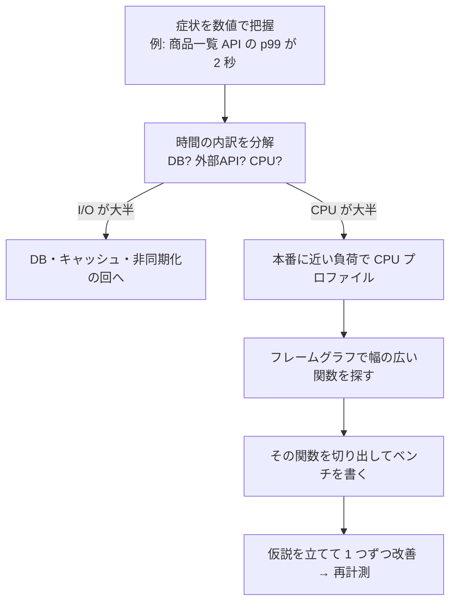

# ホットパスの最適化

[[MOC_パフォーマンス体系|📚 目次]] ｜ [[03_メモリアロケーションとGC|← 前へ]]

> [!abstract] この記事で分かること
> - ホットパス（実行時間の大半を占める少数のコード）とは何か、どう見つけるか
> - 改善の優先順位：アルゴリズム → データ構造 → 不要な処理の削除 → I/O・シリアライズ → 低レベル
> - Web でよくあるホットスポット（JSON・正規表現と ReDoS・ログ・例外）
> - Before/After をベンチで検証し、可読性とのバランスを取る方法
> - シリーズ全体（全 29 回）の振り返り
>
> **前提**：[[05_プロファイリング]]、[[06_フレームグラフの読み方]]、[[02_ベンチマークの書き方]] を読んでいると理解しやすいです。

## 1. ひとことで言うと

家の電気代を下げたいとき、全部の豆電球を LED に替えるより、**エアコンと冷蔵庫（使用量の大半）を見直す**ほうが効きます。プログラムも同じで、実行時間の大半は少数のコードに集中しています。この「**よく通る道＝ホットパス（hot path）**」を見つけて直すのが、最小の労力で最大の効果を得る方法です。

- 実行時間の 80〜90% が、コードの 10〜20% に集中していることが多い（いわゆるパレートの法則的な偏り）
- ホットパスは**推測ではなくプロファイルで**見つける
- 直すときは「低レベルの小技」より先に「**そもそもの処理量を減らす**」

## 2. ホットパスを特定する手順



1. **症状を数値で**：どのエンドポイント・どのパーセンタイルが遅いか（[[02_レイテンシとパーセンタイル]]）
2. **時間を分解する**：トレースで DB・外部 API・アプリの CPU 時間に分ける（[[01_APIレスポンスタイムの分解]]）。I/O が大半なら [[02_DBクエリのチューニング実践]]、[[03_N+1問題の発見と解決]]、[[04_キャッシュで応答を速くする]] が先です
3. **CPU プロファイルを取る**：負荷をかけながら取ります。

```bash
# 負荷をかけつつ 30 秒プロファイル（2026 年時点の Node.js / k6）
node --cpu-prof --cpu-prof-dir=./prof dist/server.js &
k6 run --duration 30s --vus 50 load/products.js
kill -INT %1     # 終了時に .cpuprofile が書き出される
# DevTools の Performance タブ、または speedscope などで開く
```

4. **フレームグラフで「幅」を見る**：横幅が広い＝CPU 時間が長い関数です（[[06_フレームグラフの読み方]]）。自分のコードの関数だけでなく、`JSON.stringify`、`RegExp`、ロガーなどライブラリ側が太いこともよくあります
5. **切り出してベンチ**：ホットな関数をマイクロベンチで再現できると、改善を素早く試せます（[[02_ベンチマークの書き方]]）

## 3. 改善の優先順位

効果の大きい順に、上から検討します。

```
効果 大 ┌───────────────────────────────────────────┐
  ▲    │ ① アルゴリズム・計算量   O(n²) → O(n log n) / O(n)│ 10〜1000 倍
  │    │ ② データ構造             配列探索 → Map / Set    │
  │    │ ③ 不要な処理の削除       重複計算・使わないデータ│ 数倍
  │    │ ④ I/O・シリアライズ      JSON・ログ・圧縮       │
  ▼    │ ⑤ 低レベル               形を揃える・アロケーション│ 数 %〜数十 %
効果 小 └───────────────────────────────────────────┘
```

①②で 100 倍速くなる可能性があるのに、⑤で 10% を削っても意味がありません。また ⑤ は可読性を最も損ないます。

### ① アルゴリズム・計算量

```ts
// Shop: 注文明細に商品情報を付ける
// ❌ O(n × m)：明細ごとに商品配列を線形探索
const enriched = items.map((it) => ({
  ...it,
  product: products.find((p) => p.id === it.productId),
}));

// ✅ O(n + m)：先に Map を作って O(1) で引く
const byId = new Map(products.map((p) => [p.id, p]));
const enriched2 = items.map((it) => ({ ...it, product: byId.get(it.productId) }));
```

明細 1 万件 × 商品 1 万件なら、比較回数は最大 1 億回 → 約 2 万回です。

### ② データ構造（Map / Set の活用）

| やりたいこと | 遅い書き方 | 速い書き方 |
|---|---|---|
| 含まれているか | `arr.includes(x)`（O(n)） | `set.has(x)`（平均 O(1)） |
| キーで引く | `arr.find(o => o.id === id)` | `map.get(id)` |
| 重複除去 | `arr.filter((x, i) => arr.indexOf(x) === i)`（O(n²)） | `[...new Set(arr)]` |
| 先頭から取り出す（キュー） | `arr.shift()`（O(n)） | リングバッファや両端キュー実装 |

### ③ 不要な処理の削除

- ループの中で毎回同じ計算（正規表現のコンパイル、`new Intl.NumberFormat()`、設定の読み込み）をしていないか → ループの外へ
- 使わない列まで DB から取って、変換して、捨てていないか → 必要な列だけ
- 同じリクエスト内で同じ計算を何度もしていないか → 1 回だけ計算して使い回す

```ts
// ❌ 呼ぶたびにフォーマッタを生成（Intl のオブジェクト生成は重い）
const fmt = (n: number) => new Intl.NumberFormat("ja-JP", { style: "currency", currency: "JPY" }).format(n);
// ✅ モジュールスコープで 1 回だけ
const yen = new Intl.NumberFormat("ja-JP", { style: "currency", currency: "JPY" });
const fmt2 = (n: number) => yen.format(n);
```

### ④ I/O・シリアライズ、⑤ 低レベル

④は次節で詳しく扱います。⑤は前の 3 回（[[01_CPUとメモリ階層の基礎]]、[[02_JITとコンパイラ最適化]]、[[03_メモリアロケーションとGC]]）の内容で、**①〜④をやり尽くしてもまだ CPU が支配的なとき**に初めて使います。

## 4. Web でよくあるホットスポット

### JSON シリアライズ

大きなレスポンスでは `JSON.stringify` / `JSON.parse` がフレームグラフの上位に出ることがあります。Node.js はシングルスレッドなので、**巨大な JSON の処理中は他のリクエストが全部待たされます**。

| 対策 | 内容 |
|---|---|
| 返すデータを減らす | ページネーション、必要なフィールドだけ返す（③と同じ） |
| スキーマベースのシリアライザ | `fast-json-stringify`（Fastify が内部で使用）はスキーマから専用の関数を生成する |
| キャッシュ | 同じ商品一覧なら、シリアライズ済みの文字列/Buffer ごとキャッシュする |
| 重い変換を逃がす | 巨大なエクスポートは Worker Threads やジョブキューへ（[[05_非同期化とキューで待ち時間を隠す]]） |

### 正規表現と ReDoS

正規表現は便利ですが、書き方によっては**入力長に対して指数関数的に時間がかかる**ことがあります（バックトラッキングの爆発）。これを悪用した DoS 攻撃を **ReDoS（Regular expression Denial of Service）**と呼びます。

```ts
// ❌ 入れ子の量指定子：(a+)+ のような形は危険
const bad = /^(\w+\s?)*$/;
console.time("bad");
bad.test("a".repeat(30) + "!"); // マッチ失敗時に組み合わせを総当たり → 秒単位で固まることも
console.timeEnd("bad");

// ✅ 曖昧さのないパターンにする / 入力長を制限する
const good = /^\w+(?:\s\w+)*$/;
```

対策：

- 入れ子の量指定子 `(x+)+`、`(x*)*`、重なり合う選択肢 `(a|a)*` を避ける
- ユーザー入力に正規表現を適用する前に**長さの上限**をチェックする
- 静的解析（`eslint-plugin-regexp`、`safe-regex` など）で危険なパターンを検出する
- ループ内で `new RegExp(...)` を毎回作らない（③）

### ログ出力

1 リクエストで何十行もログを書く、オブジェクトを丸ごと `JSON.stringify` して出す、同期 I/O でファイルに書く——いずれもホットパスを重くします。

- 本番のログレベルを `info` 以上にし、`debug` の引数を**組み立てる処理自体**も走らないようにする
- `console.log`（出力先によっては同期的に書き込む）より、非同期・高速なロガー（例：`pino`）を使う
- 構造化ログで必要なフィールドだけを出す

### 例外の多用

`new Error()` は**スタックトレースの取得**にコストがかかります。「見つからなかった」のような通常の分岐を例外で表現し、ホットパスで大量に throw すると目に見えて遅くなることがあります。

```ts
// ❌ 在庫チェックで通常ケースに例外を使う
function reserveOrThrow(id: string) { if (!stock.has(id)) throw new Error("no stock"); /* ... */ }

// ✅ 通常の結果として返す
function reserve(id: string): { ok: true } | { ok: false; reason: "no_stock" } {
  if (!stock.has(id)) return { ok: false, reason: "no_stock" };
  /* ... */
  return { ok: true };
}
```

例外は「本当に例外的な事態」に使うのが、性能面でも設計面でも健全です。

## 5. どう測るか — Before/After をベンチで検証する

改善は必ず**同じ条件で**前後を比較します。

```ts
// bench-enrich.ts — 実行: npx tsx bench-enrich.ts
import { Bench } from "tinybench";

const products = Array.from({ length: 10_000 }, (_, i) => ({ id: i, name: `p${i}`, price: i * 10 }));
const items = Array.from({ length: 10_000 }, (_, i) => ({ productId: (i * 7) % 10_000, qty: 1 }));

const bench = new Bench({ time: 1000 });
bench
  .add("before: find", () => {
    items.map((it) => ({ ...it, product: products.find((p) => p.id === it.productId) }));
  })
  .add("after: Map", () => {
    const byId = new Map(products.map((p) => [p.id, p]));
    items.map((it) => ({ ...it, product: byId.get(it.productId) }));
  });

await bench.run();
console.table(bench.table());
```

確認のポイント：

1. **マイクロベンチで改善を確認**（例：before 150ms → after 2ms。数値は説明用の例）
2. **結果が同じか確認**：速くなっても出力が変わったら意味がありません。テストを先に用意します
3. **負荷テストで全体を確認**：マイクロベンチで 70 倍速くなっても、API 全体の p99 が改善するとは限りません。[[03_負荷テストの設計と実施]] と同じシナリオで再計測し、**p50/p99 とスループット**を比べます
4. **プロファイルを取り直す**：ホットパスが消えると、次に太い場所が見えてきます。そこが次の候補です

```
改善前のフレームグラフ              改善後
┌──────────────────────────┐   ┌──────────────────────────┐
│ enrich (find)    70%     │   │ JSON.stringify    35%    │ ← 次の候補
│ JSON.stringify   20%     │   │ DB待ち/その他     ...    │
│ その他           10%     │   │ enrich (Map)       3%    │
└──────────────────────────┘   └──────────────────────────┘
```

## 6. 可読性とのバランス

| 判断基準 | 最適化してよい | やめておく |
|---|---|---|
| プロファイル上の比重 | 上位に出ている | 1% 未満 |
| 効果 | ベンチ・負荷テストで明確 | 誤差の範囲 |
| 可読性への影響 | ほぼ無い（Map 化など） | 大きい（手書きのビット演算、SoA 化） |
| 目標 | SLO を満たしていない | すでに十分速い |

- 最適化したコードには**なぜそう書いたかをコメント**で残す（「プロファイルで 70% を占めていたため Map 化」など）
- 可能ならベンチを CI に残し、後の変更で性能が戻らないようにする（[[06_パフォーマンス（Lighthouse CI）]] の考え方）
- 「速さ」の目標は [[03_性能要件と目標の決め方]] で決めたもの。**目標を達成したら止める**のも重要な判断です

## よくある誤解・つまずき

- ❌「遅そうなところは見れば分かる」
  ✅ 経験者でも予想はよく外れます。JSON 化やログなど「普通の処理」がホットパスであることは珍しくありません。必ずプロファイルを取ります。
- ❌「最適化＝低レベルな小技」
  ✅ 最も効くのはアルゴリズムとデータ構造、そして「やらなくてよい処理をやめる」ことです。
- ❌「マイクロベンチで速くなったから完了」
  ✅ 全体の p99 に効いたかを負荷テストで確認するまでが改善です。
- ❌「正規表現の性能はささいな問題」
  ✅ ReDoS はたった 1 リクエストでサーバーを止めうる、セキュリティ上の問題でもあります。

## まとめ

- ホットパスは実行時間の大半を占める少数のコード。プロファイルとフレームグラフで特定する
- 優先順位は ① 計算量 → ② データ構造 → ③ 不要な処理の削除 → ④ I/O・シリアライズ → ⑤ 低レベル
- Web でよくあるホットスポットは JSON、正規表現（ReDoS）、ログ、例外の多用
- 改善はマイクロベンチ → 結果の同一性 → 負荷テスト → 再プロファイルで検証する
- 目標を満たしたら止める。可読性を犠牲にする最適化は、効果が測れた場所だけに

## シリーズ全体のまとめ

全 29 回を通して繰り返してきたのは、たった 1 つのサイクルです。

```
   ┌──────────┐     ┌──────────┐     ┌──────────┐     ┌──────────┐
   │ ① 計測   │ ──→ │ ② 仮説   │ ──→ │ ③ 改善   │ ──→ │ ④ 再計測 │
   │ 数値で    │     │ ボトル    │     │ 1 回に    │     │ 同じ条件で│
   │ 現状把握  │     │ ネックを  │     │ 1 つだけ  │     │ 比較      │
   └──────────┘     │ 1 つ特定  │     │ 変える    │     └────┬─────┘
        ▲           └──────────┘     └──────────┘          │
        └──────────── 目標未達なら次のボトルネックへ ─────────┘
                       目標達成なら止める
```

| 章 | 回 | 一番大事なこと |
|---|---|---|
| 10 考え方 | [[01_パフォーマンスとは何か]] 〜 [[04_最適化の進め方とトレードオフ]] | 平均ではなくパーセンタイルで見る。目標を先に決め、トレードオフを意識する |
| 20 計測・分析 | [[01_計測の基本と落とし穴]] 〜 [[06_フレームグラフの読み方]] | 推測するな、計測せよ。ベンチ・負荷テスト・USE/RED・プロファイルで場所を特定する |
| 30 フロントエンド | [[01_Core_Web_Vitals]] 〜 [[06_LighthouseとRUMで計測する]] | LCP・INP・CLS をユーザー視点で測り、JS・画像・ネットワークを減らす。ラボと実ユーザー（RUM）の両方で見る |
| 40 バックエンド・DB | [[01_APIレスポンスタイムの分解]] 〜 [[05_非同期化とキューで待ち時間を隠す]] | 時間を分解すると多くは DB 待ち。インデックス・N+1 解消・キャッシュ・非同期化 |
| 50 スケーラビリティ | [[01_スループットと待ち行列理論]] 〜 [[04_コスト最適化とFinOps]] | 使用率が上がるほど待ち時間は急増する。バックプレッシャー、余裕を持ったキャパシティ、コストとのバランス |
| 60 低レベル最適化 | [[01_CPUとメモリ階層の基礎]] 〜 [[04_ホットパスの最適化]] | メモリ階層・JIT・GC を理解したうえで、プロファイルで見つけたホットパスにだけ適用する |

最後に、このシリーズで最も伝えたかった 3 つです。

1. **測らずに直さない**：直感はよく外れます。数値が議論と判断の共通言語です
2. **大きいところから**：アーキテクチャ・I/O・アルゴリズムの改善は、低レベルな小技の何十倍も効きます
3. **目標を決めて止める**：性能は機能・可読性・コストとのトレードオフです。「十分速い」を定義し、達成したら他の価値に時間を使いましょう

## 確認クイズ

1. 商品一覧 API の CPU プロファイルで、`Array.prototype.find` を含む関数が 70%、`JSON.stringify` が 20% を占めていました。どちらから、どう手を付けますか？
> [!tip]- 答え
> 比重が大きく、かつ計算量の改善（優先順位①②）が見込める `find` 側からです。線形探索を `Map` による O(1) の参照に置き換え、マイクロベンチと負荷テストで効果を確認します。その後プロファイルを取り直し、`JSON.stringify` が次のホットパスになっていれば、返すフィールドを減らす・スキーマベースのシリアライザ・キャッシュを検討します。

2. ユーザーが入力したメールアドレスを `/^([a-zA-Z0-9]+\.?)+@example\.com$/` で検証しています。何が問題で、どう対策しますか？
> [!tip]- 答え
> `([a-zA-Z0-9]+\.?)+` は入れ子の量指定子で、マッチしない長い入力に対してバックトラッキングが爆発する ReDoS の危険があります。曖昧さのないパターンに書き換える（例：`/^[a-zA-Z0-9]+(?:\.[a-zA-Z0-9]+)*@example\.com$/`）、入力長の上限を先にチェックする、静的解析ツールで検出する、といった対策をとります。

3. マイクロベンチで関数が 50 倍速くなりました。改善完了と言ってよいですか？
> [!tip]- 答え
> まだです。出力が改善前と同じであることをテストで確認し、本番に近い負荷テストで API 全体の p50/p99・スループットが改善したかを確かめます。さらにプロファイルを取り直し、次のボトルネックと目標達成状況を確認して、続けるか止めるかを判断します。

## 関連ノート

- [[01_CPUとメモリ階層の基礎]] / [[02_JITとコンパイラ最適化]] / [[03_メモリアロケーションとGC]] — 低レベル最適化の土台
- [[05_プロファイリング]] / [[06_フレームグラフの読み方]] — ホットパスの見つけ方
- [[02_ベンチマークの書き方]] / [[03_負荷テストの設計と実施]] — Before/After の検証
- [[04_最適化の進め方とトレードオフ]] — 最適化の進め方の全体像
- [[03_性能要件と目標の決め方]] — 「どこで止めるか」の基準
- [[Performance・Memory（遅さとメモリリークの調査）]] — DevTools での調査
- [[MOC_コンピューターサイエンス体系]] — アルゴリズムと計算量の理論

## 参考

- [Node.js docs: Flame Graphs](https://nodejs.org/en/learn/diagnostics/flame-graphs)
- [Node.js CLI options: --cpu-prof](https://nodejs.org/api/cli.html#--cpu-prof)
- [Brendan Gregg: Flame Graphs](https://www.brendangregg.com/flamegraphs.html)
- [OWASP: Regular expression Denial of Service - ReDoS](https://owasp.org/www-community/attacks/Regular_expression_Denial_of_Service_-_ReDoS)
- [Node.js docs: Don't Block the Event Loop (or the Worker Pool)](https://nodejs.org/en/learn/asynchronous-work/dont-block-the-event-loop)
- [fast-json-stringify](https://github.com/fastify/fast-json-stringify)
- [pino: Benchmarks](https://github.com/pinojs/pino/blob/main/docs/benchmarks.md)
- [tinybench](https://github.com/tinylibs/tinybench)
- [MDN: Map](https://developer.mozilla.org/ja/docs/Web/JavaScript/Reference/Global_Objects/Map)
