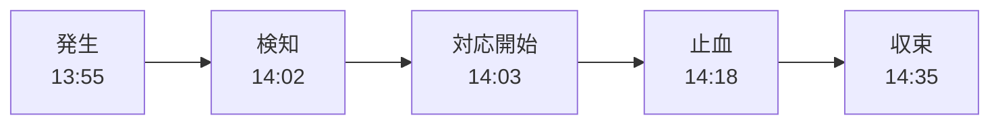

# インシデントタイムラインの記録

**インシデントタイムライン**は、インシデントの間に「いつ・何が起き・誰が何を判断し・何を実行したか」を時系列で並べた記録です。対応中は後から来た人が状況をつかむために使い、対応後はポストモーテムの土台になります。この章では、何を記録するか、どう記録すれば負担なく続けられるかを整理します。

---

## 1. なぜ記録するのか

| 場面 | 記録の役割 |
|------|------------|
| **対応中** | 途中参加者や交代した IC がすぐ状況を把握できる |
| **対応中** | 何を試したか、何が効いたかを見失わない |
| **ポストモーテム** | 「なぜその判断をしたか」を記憶ではなく記録から振り返る |
| **統計** | 検知・対応開始・止血・復旧の時刻から MTTD・MTTR を測る |

人の記憶は、インシデントの緊張下では特に不正確です。John Allspaw は、ポストモーテムでは「当時の人が何を見て、何を知っていて、なぜそれが妥当に思えたか」を再現することが重要だと述べています。その材料になるのがタイムラインです。

---

## 2. 記録する項目

| 種類 | 例 |
|------|----|
| **システムの出来事** | 13:50 payment-service v2.14.0 デプロイ完了 |
| **検知** | 14:02 アラート「checkout 5xx 率 > 5%」 |
| **宣言・体制** | 14:05 SEV2 宣言、IC 山田 |
| **観測** | 14:07 エラーは Visa のみ、他ブランドは正常 |
| **仮説** | 14:08 新 SDK のタイムアウト設定が原因か |
| **決定** | 14:10 ロールバックを決定 |
| **実行** | 14:12 ロールバック開始（佐藤） |
| **結果** | 14:18 5xx 率 0.4% に低下 |
| **連絡** | 14:20 ステータスページを Monitoring に更新 |
| **収束** | 14:35 収束宣言 |

**うまくいかなかった試み**も必ず記録します。「キャッシュをクリアしたが変化なし」は、ポストモーテムでも次回の対応でも役に立つ情報です。

---

## 3. 重要な時刻

ポストモーテムと統計のために、次の時刻は必ず特定します。

| 区間 | 指標 | この例 |
|------|------|--------|
| 発生 → 検知 | 検知までの時間（TTD） | 7 分 |
| 検知 → 対応開始 | 応答時間（TTA） | 1 分 |
| 検知 → 止血 | 影響を止めるまでの時間 | 16 分 |
| 発生 → 収束 | 影響時間 | 40 分 |

「発生」の時刻は、アラートの時刻ではなく**グラフ上で異常が始まった時刻**を使います。

---

## 4. 負担なく記録するコツ

- **チャンネルで実況する**：Slack などに一行ずつ書けば、投稿時刻がそのまま記録になる。[[05_インシデント中のコミュニケーションと告知]]の `[決定]` `[実行]` などのプレフィックスを使うと、後で抽出しやすい。
- **記録係（Scribe）を置く**：SEV1・SEV2 では、IC や Ops とは別に記録係を置く（[[03_インシデントコマンダーと役割分担]]）。
- **通話での決定もテキスト化**：「今決めたことをチャンネルに書きます」と宣言する。
- **ツールを使う**：PagerDuty、incident.io、FireHydrant などは、チャンネルの投稿やコマンドからタイムラインを自動で作る機能を持つ。
- **スクリーンショットを貼る**：ダッシュボードのグラフは時間がたつと粒度が粗くなるので、その場で保存する。

---

## 5. 対応後の整形

収束後、ポストモーテムを書く前にタイムラインを整えます。

1. チャンネルのログ、デプロイ履歴、アラート履歴、監査ログを集める。
2. **時刻を 1 つのタイムゾーンにそろえる**（UTC と JST が混ざりやすい）。
3. 雑談や重複を除き、出来事・判断・実行を残す。
4. 「このとき何を知っていたか」を補足する。判断の是非を後知恵で評価しない（[[03_根本原因分析と寄与要因]]）。

---

## 6. 記録の例（整形後）

| 時刻（JST） | 出来事 | 備考 |
|-------------|--------|------|
| 13:50 | payment-service v2.14.0 デプロイ | 新決済 SDK を含む |
| 13:55 | Visa 決済の失敗が始まる | グラフで確認 |
| 14:02 | アラート発火、佐藤が Ack | |
| 14:05 | SEV2 宣言、IC 山田 | |
| 14:07 | 失敗は Visa のみと判明 | |
| 14:09 | キャッシュクリアを試す → 変化なし | |
| 14:10 | ロールバックを決定 | 直前のデプロイと時刻が一致 |
| 14:18 | エラー率が平常に戻る | |
| 14:35 | 収束宣言 | |

---

## 7. 関連項目

- [[05_インシデント中のコミュニケーションと告知]]：実況の書き方
- [[03_インシデントコマンダーと役割分担]]：Scribe の役割
- [[01_ポストモーテムとは]]：タイムラインを使う場面
- [[02_ポストモーテム雛形]]：タイムライン欄の書き方
- [[05_ニアミスとインシデント統計からの学習]]：時刻から作る指標

---

**前へ** ← [[05_インシデント中のコミュニケーションと告知]]　｜　**次に読む** → [[01_ポストモーテムとは]]
