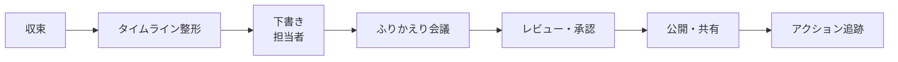

# ポストモーテムとは

**ポストモーテム**（事後検証、Postmortem）は、インシデントが収束したあとに、何が起き、なぜ起き、どう対応し、今後どう防ぐかを文書にまとめる活動です。目的は**責任者を探すことではなく、組織として学ぶこと**です。この章では、ポストモーテムの目的、書く基準、そして中心にある「非難しない（Blameless）」という考え方を整理します。

---

## 1. ポストモーテムの目的

Google SRE 本 16章「Postmortem Culture: Learning from Failure」は、ポストモーテムの主な目的を次のようにまとめています。

- インシデントを**記録として残す**
- 寄与した要因を**十分に理解する**
- 再発の可能性や影響を減らす**効果的な対策**を実行する

| 目的 | 得られるもの |
|------|--------------|
| 記録 | 半年後に同じ症状が出たときに参照できる |
| 理解 | システムの弱点、監視の抜け、手順の不備が見える |
| 改善 | 再発防止アクションが具体的なチケットになる |
| 共有 | 他チームが同じ失敗を避けられる |

---

## 2. 非難しない（Blameless）ポストモーテム

### 2.1 なぜ非難しないのか

人を責めると、次のことが起きます。

- 当事者が**事実を隠す**・都合の悪いことを話さなくなる
- 報告が遅れ、**小さな問題が大きなインシデントに育つ**
- 「気をつけます」で終わり、**仕組みが改善されない**

John Allspaw（元 Etsy）は、関係者が罰を恐れずに「自分が何を見て、何を考え、なぜそうしたか」を話せる状態こそが学習の前提だと述べています。Sidney Dekker の「ヒューマンエラーは原因ではなく、システムの問題の**症状**である」という考え方も、同じ方向を指しています。

### 2.2 書き方の違い

| 非難する書き方 | 非難しない書き方 |
|----------------|------------------|
| 佐藤さんが誤った設定をデプロイした | 誤った設定値がレビューとテストを通過し、本番に反映された |
| 確認を怠った | 本番と検証環境の設定の違いを確認する手順がなかった |
| 担当者の不注意 | 同じ見た目の 2 つのコマンドがあり、取り違えやすかった |

**「なぜその人にとって、その行動が妥当に見えたのか」**を問うのがポイントです。同じ状況なら、別の人も同じことをした可能性が高いと考えます。

### 2.3 非難しないこと ≠ 責任をとらないこと

非難しないのは、**個人を罰しない**という意味であり、**誰も何もしない**という意味ではありません。改善アクションには必ず担当者と期限をつけます（[[04_再発防止アクションの管理]]）。

---

## 3. いつ書くか：書く基準

事前に基準を決めておき、「書くかどうか」で揉めないようにします。

| 基準の例 |
|----------|
| SEV1・SEV2 のインシデント（[[02_重大度レベル（Severity）]]） |
| 利用者に見える停止・劣化が一定時間以上続いた |
| データの消失・破損が起きた |
| オンコール担当が介入した（ロールバック、手動復旧など） |
| 検知が利用者からの問い合わせだった（監視の抜け） |
| 関係者の誰かが「書くべきだ」と求めた |

SEV3 以下でも、**学びが大きいもの**や[[05_ニアミスとインシデント統計からの学習]]で扱うニアミスは書く価値があります。

---

## 4. ポストモーテムの流れ

1. **下書き**：対応の中心にいた人（多くは IC）が、収束後 **数営業日以内**に雛形に沿って書く（[[02_ポストモーテム雛形]]）。
2. **ふりかえり会議**：関係者で読み合わせ、事実の抜けや解釈の違いを直す。司会は当事者以外が望ましい。
3. **レビュー**：シニアエンジニアやマネージャーが、原因分析の深さとアクションの妥当性を確認する。
4. **共有**：社内の誰でも読める場所に置く。Google では優れたポストモーテムを紹介する「今月のポストモーテム」のような取り組みがあると SRE 本で紹介されています。
5. **アクション追跡**：再発防止策をチケット化し、完了まで追う。

---

## 5. 公開ポストモーテム

大きな障害では、利用者向けにポストモーテムを公開することがあります（Cloudflare、GitHub、AWS などが公開しています）。

- 社内向けとは別に、**利用者向けの言葉**で書く
- 影響範囲、時系列、原因の概要、再発防止策を含める
- 内部の人名・機密情報は含めない
- 他社（依存サービス）を一方的に責めない

---

## 6. よくある失敗

| 失敗 | 対策 |
|------|------|
| 書いて終わり、アクションが実行されない | アクションの完了率を追う（[[04_再発防止アクションの管理]]） |
| 原因が「ヒューマンエラー」で止まる | 寄与要因を複数挙げる（[[03_根本原因分析と寄与要因]]） |
| 書くのが遅れて記憶が薄れる | 期限を決め、タイムラインを先に整える |
| 誰も読まない | 定期的に紹介する場を作る、検索しやすい場所に置く |

---

## 7. 関連項目

- [[02_ポストモーテム雛形]]：コピーして使えるテンプレート
- [[03_根本原因分析と寄与要因]]：原因の掘り下げ方
- [[04_再発防止アクションの管理]]：アクションを実行まで持っていく
- [[06_インシデントタイムラインの記録]]：ポストモーテムの材料
- 91_トラブルシューティング事例集：書いたポストモーテムの保管先の一つ

---

**前へ** ← [[06_インシデントタイムラインの記録]]　｜　**次に読む** → [[02_ポストモーテム雛形]]
