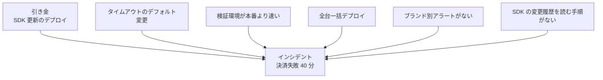

# 根本原因分析と寄与要因

ポストモーテムで最も難しいのが「なぜ起きたか」の分析です。昔から使われている **根本原因分析（RCA: Root Cause Analysis）** や **5 Whys** は便利ですが、「原因はただ 1 つ」という前提に引っぱられやすいという批判もあります。この章では、5 Whys の使い方と限界、そして現在の SRE で主流になりつつある**寄与要因（Contributing factors）**という考え方を整理します。

---

## 1. 5 Whys

トヨタ生産方式で知られる手法で、「なぜ？」を 5 回程度くり返して原因を掘り下げます。

**例：決済エラーのインシデント**

| なぜ | 答え |
|------|------|
| なぜ決済が失敗したか | 決済 API の呼び出しがタイムアウトした |
| なぜタイムアウトしたか | 新しい SDK のデフォルトのタイムアウトが 30 秒から 3 秒に変わった |
| なぜそれに気づかなかったか | SDK の変更履歴を確認する手順がなかった |
| なぜテストで見つからなかったか | 検証環境の決済サンドボックスは常に 1 秒以内に応答する |
| なぜ本番で早く止まらなかったか | 段階公開せず全台に一度にデプロイした |

### 5 Whys のよい点

- 簡単で、誰でもすぐ使える
- 「設定ミス」で止めずに、**仕組みの問題**まで降りていける

---

## 2. 5 Whys の限界

| 限界 | 説明 |
|------|------|
| **1 本道になる** | 実際には原因が枝分かれしているのに、1 本の鎖として書いてしまう |
| **止めどころが恣意的** | 何回目の「なぜ」で止めるかで、結論が変わる |
| **人で止まりやすい** | 「なぜ？→担当者が確認しなかったから」で止まり、非難につながる |
| **後知恵バイアス** | 結果を知っている立場から見ると、当時の判断が明らかに間違いに見える |

John Allspaw や Richard Cook（「How Complex Systems Fail」）は、複雑なシステムの障害には**単一の根本原因は存在しない**と主張しています。複数の要因が重なって初めて障害になり、どれか 1 つを取り除いても別の組み合わせで起きうる、という考え方です。Sidney Dekker は、「ヒューマンエラー」は調査の**出発点**であって結論ではない、と述べています。

---

## 3. 寄与要因で考える

「根本原因は何か」ではなく、「**どんな条件が重なって障害になったか**」を列挙します。SRE Workbook のポストモーテムの章でも、Trigger（引き金）と Root cause / Contributing factors を分けて書く形を示しています。

### 寄与要因の分類

漏れを防ぐため、次の観点で洗い出します。

| 観点 | 問い | 例 |
|------|------|----|
| **技術** | システムのどこが脆かったか | タイムアウト値が外部 SDK のデフォルトに依存 |
| **テスト・検証** | なぜ事前に見つからなかったか | 検証環境と本番の応答時間の差 |
| **リリース** | なぜ影響が広がったか | 段階公開・カナリアがない |
| **検知** | なぜ気づくのが遅れたか | 決済ブランド別の監視がない |
| **対応** | なぜ復旧に時間がかかったか | ロールバック手順が文書化されていない |
| **組織・情報** | 必要な情報が届いていたか | SDK の破壊的変更の告知を誰も見ていなかった |

---

## 4. 分析を進めるための問い

後知恵バイアスを避けるために、**当時の視点**で問いを立てます。

- そのとき、**何が見えていたか**（どのダッシュボード、どのアラート）
- そのとき、**何を知っていたか / 知らなかったか**
- その判断は、**当時の情報からは妥当だったか**
- **同じ状況なら、別の人も同じことをしたか**
- 何が**うまく働いて**、被害をこの程度に抑えたか

最後の問いは見落とされがちです。障害を止めた要因（アラートが鳴った、ロールバックが速かった）を知ることも、システムの強さを理解するうえで大切です。

---

## 5. 「ヒューマンエラー」と書きたくなったら

| 書きたくなる言葉 | 代わりに問うこと |
|------------------|------------------|
| 確認漏れ | 確認が必要なことを、仕組みが教えてくれたか |
| 操作ミス | なぜ誤操作が簡単にでき、止める仕組みがなかったか |
| 知識不足 | 必要な知識はどこに書かれていて、どう届くはずだったか |
| 手順違反 | 手順は現実的だったか、守られていない理由は何か |

---

## 6. アクションへのつなげ方

寄与要因ごとに、[[02_ポストモーテム雛形]]のアクション種類（予防・検知・緩和・プロセス）で対策を考えます。**全部の要因に対策する必要はありません**。効果とコストを比べて選び、選ばなかった理由も書いておきます（[[04_再発防止アクションの管理]]）。

---

## 7. 関連項目

- [[01_ポストモーテムとは]]：非難しない文化
- [[02_ポストモーテム雛形]]：原因と寄与要因の書き場所
- [[04_再発防止アクションの管理]]：要因から対策へ
- [[06_インシデントタイムラインの記録]]：当時の視点を再現する材料
- [[01_カオスエンジニアリング入門]]：寄与要因を事前に見つける方法

---

**前へ** ← [[02_ポストモーテム雛形]]　｜　**次に読む** → [[04_再発防止アクションの管理]]
