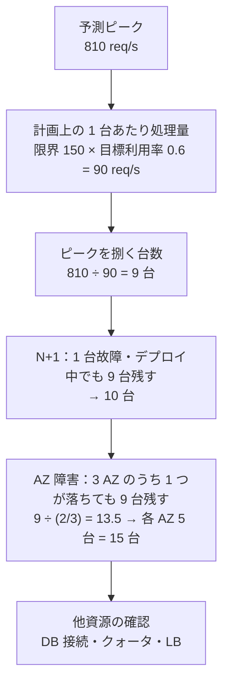
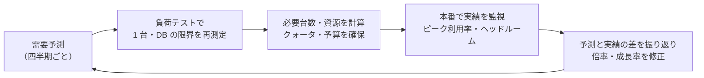

# キャパシティプランニング

[[MOC_パフォーマンス体系|📚 目次]] ｜ [[02_バックプレッシャーとレートリミット|← 前へ]] ｜ [[04_コスト最適化とFinOps|次へ →]]

> [!abstract] この記事で分かること
> - 需要（成長率・季節性・セール）を予測し、「いつ・どれだけ」足りなくなるかを数字にする方法
> - 負荷テストで測った 1 台の限界から、安全率・N+1・AZ 障害を考慮して必要台数を計算する手順
> - CPU 以外（メモリ・DB 接続・ディスク・ネットワーク）の容量と、DB がボトルネックになりやすい理由
> - 定期的な見直しのプロセスと、Shop のブラックフライデー準備の進め方
>
> **前提**：[[01_スループットと待ち行列理論]]、[[03_負荷テストの設計と実施]]、[[03_オートスケーリング]] を読んでいると理解しやすいです。

## 1. ひとことで言うと

結婚式場の料理の発注を考えてください。招待客 100 人なら 100 人分ちょうどではなく、当日の飛び入りや取りこぼしを考えて少し多めに頼みます。さらに「厨房のコンロ 1 台が壊れても間に合うか」「同じ日に別の披露宴が重なっても回るか」も事前に確かめます。前日に足りないと分かっても、食材は間に合いません。

**キャパシティプランニング（Capacity Planning：容量計画）** は、これをシステムで行うことです。

- **需要予測**：いつ、どれだけのリクエストが来るか
- **供給の測定**：1 台（1 資源）がどこまで耐えられるか
- **差分の計画**：何台・どの資源を、いつまでに用意するか。故障時の余力（N+1、AZ 障害）も含める
- **定期見直し**：予測と実績を比べて、計画を更新し続ける

オートスケーリング（[[03_オートスケーリング]]）があっても計画は必要です。オートスケールの **最大台数・DB の上限・クラウドのクォータ** を決めるのは計画だからです。

## 2. 需要予測：成長率・季節性・イベント

### 2.1 3 つの成分に分けて考える

```text
将来のピーク = 現在のピーク × 成長 × 季節性 × イベント倍率

            ▲ リクエスト数
            │                               ┃ ← イベント（セール開始の瞬間）
            │                      ╱╲  ╱╲   ┃
            │            ╱╲  ╱╲  ╱  ╲╱  ╲  ┃  ← 季節性（週末・月末・年末）
            │   ╱╲  ╱╲ ╱  ╲╱  ╲╱         ╲ ┃
            │ ╱  ╲╱  ╲╱                       ← 成長トレンド（右肩上がり）
            └────────────────────────────────▶ 時間
```

| 成分 | 例 | データの取り方 |
|---|---|---|
| **成長（トレンド）** | 会員数が月 5% 増 | 過去 6〜12 か月のピーク RPS の推移、事業計画（広告予算、新規出店） |
| **季節性（周期）** | 平日夜 21 時がピーク、週末は 1.3 倍、12 月は 1.5 倍 | 過去 1 年以上のメトリクス、前年同月比 |
| **イベント** | ブラックフライデー、テレビ CM、インフルエンサー紹介 | 過去のイベントの実績、マーケティング部門の計画 |

重要なのは **平均ではなくピーク** で、しかも **秒単位のピーク** を使うことです。1 日 86 万リクエストは平均 10 req/s ですが、セール開始の 1 分間には 100 倍来ることもあります。メトリクスの集計粒度が 5 分だと、秒単位のスパイクは平らに見えます（[[01_計測の基本と落とし穴]]）。

### 2.2 計算例（数値は説明用の例）

```text
現在の注文 API の平常時ピーク : 150 req/s
成長率                         : 月 5% → 12 か月後 150 × 1.05^12 ≒ 270 req/s
年末の季節性                   : × 1.5 → 405 req/s
ブラックフライデー開始直後     : 平常ピークの × 3（昨年実績から）→ 270 × 3 ≒ 810 req/s
```

予測の根拠（昨年の倍率、マーケティングの見込み）は必ず書き残します。後で予測と実績を比べ、予測の精度を上げていくためです。**予測は外れる前提** で、外れたときの備え（オートスケール、ロードシェディング、[[02_バックプレッシャーとレートリミット]]）と組み合わせます。

```python
# 過去のピークから月次成長率をざっくり求める（pandas）
import pandas as pd

df = pd.read_csv("daily_peak_rps.csv", parse_dates=["date"])   # date, peak_rps
monthly = df.set_index("date")["peak_rps"].resample("MS").max()
growth = (monthly.iloc[-1] / monthly.iloc[-13]) ** (1 / 12) - 1  # 直近 12 か月の平均成長率
print(f"月次成長率 ≒ {growth:.1%}")
print("12 か月後の予測ピーク:", round(monthly.iloc[-1] * (1 + growth) ** 12))
```

## 3. 供給を測る：1 台の限界は負荷テストで

### 3.1 「限界」の定義を決める

「1 台が何 req/s まで耐えられるか」は、**SLO を守れる上限** で定義します。CPU が 100% になる点ではありません。

[[03_負荷テストの設計と実施]] の手順で到着率を段階的に上げ、次のどれかに最初に当たった点を「1 台の限界」とします。

- p99 レイテンシが SLO（例：800 ms）を超える
- エラー率が SLO（例：0.1%）を超える
- CPU・メモリ・接続プールなどのどれかが飽和する（[[04_ボトルネックの特定（USE・RED）]]）

```text
負荷テスト結果（Shop 注文 API、1 台、例）
  到着率      CPU    p99       エラー
   80 req/s   45%   180 ms     0%
  120 req/s   68%   350 ms     0%
  150 req/s   82%   790 ms     0%    ← SLO ぎりぎり = 「1 台の限界」
  170 req/s   93%   2,100 ms   0.8%
```

### 3.2 注意点

- **本番に近い環境・データで測る**：商品 100 件のステージング DB では、インデックスの効き方もキャッシュヒット率も違う
- **シナリオの比率を本番に合わせる**：一覧 70%・詳細 25%・注文 5% など、アクセスログから比率を出す
- **ボトルネックが API 以外なら、それが限界**：API を 1 台で測っても、DB が先に詰まるなら「DB の限界」が全体の限界（後述）
- **コードやデータ量が変われば限界も変わる**：リリースごと、少なくとも四半期ごとに測り直す

## 4. 必要台数の計算：ピーク × 安全率、N+1、AZ 障害

### 4.1 計算の手順



数値はすべて説明用の例です。各ステップの意味は次のとおりです。

1. **ヘッドルーム（Headroom：余裕）を引く**：限界 150 req/s の台を 150 で使うと、[[01_スループットと待ち行列理論]] で見たとおり少しの揺れで待ちが爆発します。目標利用率 60〜70% 相当で計画します。ここでは 150 × 0.6 = 90 req/s。この余白が、秒単位のスパイク・予測の誤差・オートスケールの起動待ちを吸収します。
2. **ピーク ÷ 計画処理量**：810 ÷ 90 = 9 台。
3. **N+1**：デプロイのローリング更新中や 1 台故障中でも 9 台が稼働しているように +1。規模が大きければ N+2 や「+10%」にします。
4. **AZ 障害**：クラウドでは AZ（アベイラビリティゾーン）単位の障害も起こります。3 AZ に分散していて 1 AZ が丸ごと落ちても、残り 2 AZ で 9 台必要なら、各 AZ に 9 ÷ 2 = 4.5 → 5 台、合計 15 台です。2 AZ 構成なら 1 AZ で 9 台が必要なので合計 18 台になり、3 AZ のほうが効率が良いことが分かります（[[05_高可用性と冗長化]]）。

> [!tip] AZ 障害時は「残りの台の利用率が一時的に上がる」でもよいか
> AZ 障害は頻度が低いので、「その間は目標利用率 60% ではなく 85% まで許容する」と割り切る判断もあります。その場合 810 ÷ (150 × 0.85) ≒ 6.4 → 7 台が 2 AZ に残ればよく、各 AZ 4 台 = 12 台で済みます。どこまで許容するかは SLO とコストの取引で、**決めた前提を文書に残す** ことが大切です。

### 4.2 USL で補正する

台数が増えるほど 1 台あたりの効率は下がります（[[01_スループットと待ち行列理論]] の USL）。台数を変えた負荷テストで α・β を求めていれば、「15 台で本当に 15 倍出るか」を補正できます。少なくとも、**計画した台数で一度は全体の負荷テストを行う** のが確実です。

## 5. CPU 以外の資源：どれが先に尽きるか

台数の計算は CPU や RPS で行うことが多いですが、実際に先に尽きるのは別の資源であることがよくあります。

| 資源 | 何を見積もるか | 計算・確認の例（例の値） |
|---|---|---|
| **CPU** | 1 台の RPS 限界 × 台数 | 上の計算 |
| **メモリ** | プロセスのメモリ × プロセス数、キャッシュ容量 | Node.js 1 プロセス 400 MB × 4 プロセス = 1.6 GB + OS。ピーク時のヒープ増加も見る |
| **DB 接続** | 台数 × プロセス数 × プール上限 ≦ DB の max_connections − 予約分 | 15 台 × 4 プロセス × プール 10 = 600 本 → PostgreSQL では多すぎる。PgBouncer で束ねる |
| **DB の CPU・I/O** | 書き込み TPS、読み取り QPS、IOPS | 注文 810 req/s × 1 注文あたりクエリ 8 本 = 約 6,500 QPS。DB 単体の負荷テストで確認 |
| **ディスク容量** | データ増加量 × 保持期間 | orders が 1 日 10 万行 × 1 KB × 365 日 ≒ 36 GB/年 + インデックス + WAL。残り 30% で警告 |
| **ネットワーク** | レスポンスサイズ × RPS | 一覧 API 50 KB × 500 req/s = 25 MB/s ≒ 200 Mbps。インスタンスの帯域上限、NAT・LB の上限 |
| **外部サービス** | 決済 API などのレート上限 | 決済代行の上限が 300 req/s なら、注文 810 req/s は捌けない → キュー化か事前の上限引き上げ交渉 |
| **クラウドのクォータ** | EC2 の vCPU 上限、ALB、RDS、IP アドレス | Service Quotas で確認し、**数週間前に** 引き上げ申請 |

### 5.1 DB がボトルネックになりやすい理由

```text
      LB
   ┌──┴───┬────┬────┐
  API   API  API  API ... 15 台   ← ステートレスなので台数を増やせる
   └──┬───┴────┴────┘
      ▼
  PostgreSQL（プライマリ 1 台）    ← 書き込みはここに集中。簡単には増やせない
```

1. **状態を持っている**：API はステートレスなので並べればよいが、DB はデータの一貫性を守るため、書き込みは基本的にプライマリ 1 台に集まる
2. **API を増やすと DB 負荷も比例して増える**：API を 2 倍にすれば DB へのクエリも 2 倍。接続数も増え、PostgreSQL は接続ごとにプロセスを持つため、接続が多いだけでメモリとコンテキストスイッチを消費する
3. **ロック競合が台数で増える**：人気商品の在庫行を全台が取り合う（USL の α・β）
4. **スケールアップに停止を伴いやすい**：インスタンスタイプ変更はフェイルオーバーや再起動を伴うことが多く、セール直前には変えにくい
5. **データ量に応じて遅くなる**：1 年で行数が増えると、同じクエリでも遅くなる。インデックスがメモリに乗らなくなった瞬間に急に遅くなる

対策の順番は、クエリとインデックスの改善（[[02_DBクエリのチューニング実践]]、[[03_インデックスの基本と設計]]）→ キャッシュで読み取りを減らす（[[04_キャッシュで応答を速くする]]）→ 読み取りをリードレプリカへ → 接続プーラー（PgBouncer）→ 書き込みの非同期化（[[05_非同期化とキューで待ち時間を隠す]]）→ スケールアップ、です。シャーディングは最後の手段です。

## 6. どう測るか：定期見直しのプロセス

キャパシティ計画は一度作って終わりではなく、**予測 → 計測 → 比較 → 更新** を回し続けます。



監視しておくべき指標（ダッシュボードとアラート）：

| 指標 | 目的 | アラートの例 |
|---|---|---|
| ピーク時の CPU 利用率（台の平均と最大） | ヘッドルームの残量 | 週次ピークが 70% 超 |
| ピーク RPS ÷ 計画上の容量 | 計画に対してどこまで来たか | 80% 超で計画見直し |
| DB 接続数 / max_connections | 接続の枯渇 | 70% 超 |
| ディスク使用率と増加速度 | 「あと何日で満杯か」 | 残り 30 日未満 |
| オートスケールの台数が最大値に張り付いた時間 | 最大台数の不足 | 1 回でも張り付いたら確認 |
| p99 レイテンシと利用率の関係 | 1 台の限界が変わっていないか | 同じ利用率で p99 が悪化 |

```sql
-- PostgreSQL：テーブルごとのサイズと、直近の増え方を把握する
SELECT relname,
       pg_size_pretty(pg_total_relation_size(relid)) AS total_size,
       n_live_tup
FROM pg_stat_user_tables
ORDER BY pg_total_relation_size(relid) DESC
LIMIT 10;
```

この結果を毎月記録しておけば、「orders は月 3 GB ずつ増えている → ストレージは 14 か月後に満杯」と予測できます。

見直しのタイミング：

- **定期**：四半期ごと（成長の速いサービスは毎月）
- **イベント前**：大型セール、CM、新機能リリースの 1〜2 か月前
- **変化があったとき**：大きなリリース後（1 台の限界が変わる）、インスタンスタイプ変更後、障害の振り返りで容量不足が原因だったとき

## 7. 例：Shop のブラックフライデー準備

以下のスケジュールと数値はすべて説明用の例です。

| 時期 | やること |
|---|---|
| **8 週間前** | マーケティング部門とセール内容（開始時刻、目玉商品、メール配信数、CM の有無）を共有。昨年の実績倍率から需要予測（注文 API 810 req/s、一覧 API 2,000 req/s） |
| **6 週間前** | 本番相当のデータでステージングを用意し、負荷テスト。1 台の限界と DB の限界を測る。DB が 500 注文/秒で詰まることが判明 |
| **5 週間前** | ボトルネック対策：在庫引当てのロック粒度を見直し、注文後処理をキュー化。商品一覧を CDN・Redis キャッシュへ（[[04_CDNによる負荷軽減]]）。再測定で DB の限界が 1,000 注文/秒に |
| **4 週間前** | 必要台数を計算（API 15 台、ワーカー 6 台、RDS は 1 サイズ上げる）。EC2 の vCPU クォータ、RDS、決済代行のレート上限の引き上げを申請 |
| **3 週間前** | 予測の 1.5 倍で全体負荷テスト。ロードシェディングとレートリミットが効いて崩落しないことを確認（[[02_バックプレッシャーとレートリミット]]） |
| **2 週間前** | ゲームデー（障害訓練）：本番相当環境で 1 AZ を落とす、DB フェイルオーバー、Redis 停止を試す。ランブック整備 |
| **1 週間前** | 変更凍結（コードフリーズ）。RDS のサイズ変更などの停止を伴う作業はこの前に完了 |
| **当日** | 開始 1 時間前にスケジュールでオートスケールの最小台数を 15 台に引き上げ（[[03_オートスケーリング]]）。キャッシュの事前ウォームアップ。開始前後は監視担当を配置し、ダッシュボードとエスカレーション先を共有 |
| **翌週** | 振り返り：予測と実績（ピーク RPS、利用率、エラー、オートスケールの動き）を比べ、来年の倍率を更新。台数を平常に戻す |

ポイントは、**DB のサイズ変更やクォータ申請のように時間がかかるものから逆算** すること、そして **計画した台数で実際に負荷テストする** ことです。当日に「オートスケールの最大台数が 10 のままだった」「vCPU クォータで 12 台目が起動しなかった」というのは典型的な失敗です。

## よくある誤解・つまずき

- ❌ オートスケールがあるからキャパシティ計画は不要 → ✅ 最大台数、DB の上限、クォータ、外部 API の上限は自動では増えません。それを決めるのが計画です。
- ❌ 平均 RPS で台数を決める → ✅ 必要なのは秒単位のピークです。5 分平均のグラフではセール開始直後のスパイクが見えません。
- ❌ 1 台の限界は CPU 100% の点 → ✅ SLO（p99・エラー率）を守れる上限で定義し、さらにヘッドルームを引いて計画します。
- ❌ API サーバーを増やせば全体の容量も増える → ✅ DB や外部 API が先に詰まると、API を増やすほど DB 接続とロック競合が増えて悪化します。資源ごとに限界を確認します。
- ❌ 計画は一度作ればよい → ✅ コード・データ量・利用者の行動が変わると限界も需要も変わります。四半期ごとに測り直し、予測と実績を比べて精度を上げます。

## まとめ

- 需要は「成長 × 季節性 × イベント」に分解し、平均ではなく秒単位のピークで予測する。根拠を記録する
- 1 台の限界は負荷テストで「SLO を守れる上限」として測る。本番に近いデータとシナリオで
- 必要台数 = ピーク ÷ (限界 × 目標利用率)、そこに N+1 と AZ 障害時の余力を足す。前提を文書化する
- CPU だけでなくメモリ・DB 接続・ディスク・ネットワーク・外部 API・クォータも見積もる。特に DB は増やしにくい
- 予測 → 測定 → 実績比較 → 更新のサイクルを四半期ごとと大型イベント前に回す

## 確認クイズ

1. 1 台の限界（SLO を守れる上限）が 200 req/s、目標利用率 60%、予測ピークが 1,500 req/s です。3 AZ 構成で 1 AZ 障害時も目標利用率を守るには、合計何台必要ですか。
> [!tip]- 答え
> 計画上の 1 台あたり処理量は 200 × 0.6 = 120 req/s、ピークに必要なのは 1,500 ÷ 120 = 12.5 → 13 台です。1 AZ が落ちても残り 2 AZ で 13 台必要なので、各 AZ に 13 ÷ 2 = 6.5 → 7 台、合計 21 台です。

2. API を 10 台から 20 台に増やす計画です。各台 4 プロセス、プール上限 10、PostgreSQL の max_connections は 400 です。何が問題で、どう対処しますか。
> [!tip]- 答え
> 20 × 4 × 10 = 800 本となり、max_connections を超えます。プールを減らす（リトルの法則で必要数を見積もる）か、PgBouncer などの接続プーラーで束ねます。max_connections を単純に増やすと、PostgreSQL は接続ごとにプロセスを持つためメモリと CPU を圧迫します。

3. ブラックフライデー当日、オートスケールは正しく動いたのに 12 台目以降が起動せず、エラーが増えました。考えられる原因と、事前にすべきだったことは何ですか。
> [!tip]- 答え
> クラウドの vCPU クォータ（Service Quotas）や、オートスケールグループの最大台数の上限に達した可能性があります。計画した台数を実際に起動できるか、数週間前にクォータを確認・引き上げ申請し、計画台数での負荷テストで確かめておくべきでした。

## 関連ノート

- [[01_スループットと待ち行列理論]] — 利用率とヘッドルーム、USL による補正
- [[03_負荷テストの設計と実施]] — 1 台の限界を測る負荷テストの組み方
- [[02_バックプレッシャーとレートリミット]] — 予測を超えたときに崩落しないための備え
- [[04_コスト最適化とFinOps]] — 余力とコストのバランス
- [[03_オートスケーリング]] / [[01_スケーリングの基本]] / [[05_高可用性と冗長化]] — スケールの仕組みとマルチ AZ（61 章）
- [[06_データベースサーバーの運用]] / [[01_アプリケーションサーバーとは]] — DB 接続とコネクションプール
- [[01_SLI・SLOの設計]] — 「限界」を決める SLO
- [[MOC_SRE・インシデント対応体系]] — ゲームデーとイベント当日の体制

## 参考

- [Demand Forecasting and Capacity Planning — Google SRE Book, Introduction](https://sre.google/sre-book/introduction/)
- [Reliability Pillar — AWS Well-Architected Framework](https://docs.aws.amazon.com/wellarchitected/latest/reliability-pillar/welcome.html)
- [What is Service Quotas?（AWS）](https://docs.aws.amazon.com/servicequotas/latest/userguide/intro.html)
- [PostgreSQL: Connections and Authentication（max_connections）](https://www.postgresql.org/docs/current/runtime-config-connection.html)
- [PostgreSQL: The Cumulative Statistics System（pg_stat_user_tables）](https://www.postgresql.org/docs/current/monitoring-stats.html)
- [PgBouncer](https://www.pgbouncer.org/)
- [k6 documentation](https://grafana.com/docs/k6/latest/)
