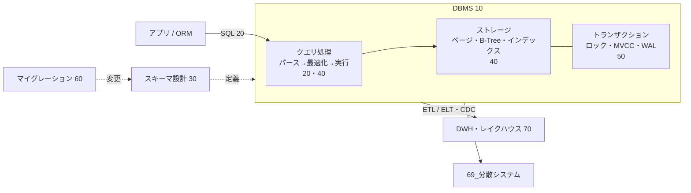

# MOC_データアーキテクチャ体系

68_データアーキテクチャ の入口ノート。**1 つのデータベースの中で、データをどう持ち、どう問い合わせ、どう安全に変更し続けるか**を扱う。複数ノードにまたがる話（複製・分割・一貫性・合意）は [[MOC_分散システム体系|69_分散システム]]。62〜69 全体の地図は [[MOC_運用領域マップ]]。

10〜70 の全 39 回は、**初心者が頭から順に読めば実務レベルまで届く 1 本の教材**として書いている。各回は「前へ / 次へ」で章をまたいでつながり、すべて共通の例題（EC サイト「Shop」の users / products / orders / order_items）を使う。各回の末尾に確認クイズがある。

軸にしている本は Martin Kleppmann & Chris Riccomini『Designing Data-Intensive Applications』第2版（DDIA 2e、O'Reilly 2026）。3 章（データモデル）・4 章（ストレージ）・5 章（エンコーディングと進化）・8 章（トランザクション）・11〜12 章（バッチ / ストリーム）に対応する。6〜7 章（レプリケーション・シャーディング）と 9〜10 章（一貫性・合意）は 69 で扱う。

---

## この領域で答えたい問い

| 問い | 章 |
|---|---|
| そもそも DB とは何で、中で何が起きているか | 10 |
| データをどんな**形**で持ち、**どう問い合わせる**か（SQL） | 20 |
| テーブルを**どう設計**すれば壊れにくいか | 30 |
| なぜ**速い / 遅い**のか（ディスク・インデックス・実行計画） | 40 |
| 同時に書いても**壊れない**ようにするには | 50 |
| 動いているサービスの構造を**安全に変える**には | 60 |
| 業務データを**分析に回す**には | 70 |

## 全体図

---

## 読み方

**通読（おすすめ）**：[[01_データベースとは]] から「次へ →」をたどる。1 回 20〜40 分程度。

**急ぎで実務に入るなら**：10 章 → 20 章の 01〜03 → 30 章の 01・02 → 40 章の 03 → 50 章の 01 → 60 章の 01。残りは必要になったときに。

**困ったときの逆引き**

| 症状 | まず読む |
|---|---|
| クエリが遅い | [[04_インデックスが効かないパターン]] → [[05_実行計画の読み方]] |
| JOIN したら行数が増えた / 合計が合わない | [[03_JOINとサブクエリ]] |
| NULL で結果がおかしい、NOT IN が 0 件 | [[05_NULLと三値論理]] |
| WHERE で SELECT の別名が使えない | [[06_SQLの実行順序]] |
| テーブル設計で迷う | [[01_データベース設計の流れとER図]] → [[02_正規化]] → [[03_非正規化と実務での判断]] |
| ID は連番？UUID？ | [[04_キーと制約の設計]] |
| 論理削除・履歴・ツリー構造の持ち方 | [[05_設計パターンとアンチパターン]] |
| 同時更新で在庫やポイントがずれる | [[02_分離レベルと読み取り異常]] → [[04_楽観ロック・悲観ロックとデッドロック]] |
| デッドロックが出る | [[04_楽観ロック・悲観ロックとデッドロック]] |
| テーブルが肥大化する / VACUUM とは | [[03_ロックとMVCC]] |
| 本番のスキーマ変更でサービスが止まった | [[07_ゼロダウンタイムのスキーマ変更]] → [[05_マイグレーションのよくある問題と対処法]] |
| 集計クエリで本番 DB が重い | [[01_OLTPとOLAP]] → [[02_列指向ストレージとデータウェアハウス]] |

---

## 10_DB基礎
1. [[01_データベースとは]] — なぜファイルではなく DB か、DB と DBMS、CRUD、アプリからの使い方、歴史
2. [[02_DBMSの仕組み]] — 3 層スキーマとデータ独立性、SELECT / UPDATE が DBMS の中を通る旅
3. [[03_データベースの種類と選び方]] — 8 種のデータモデル、OLTP / OLAP、組み込み・マネージド、選定フロー

## 20_データモデル・クエリ
1. [[01_リレーショナルモデルとテーブル]] — 関係モデル、データ型、キーと制約、1 対多 / 多対多
2. [[02_SQLの基本操作（CRUD）]] — DDL / DML、SELECT の基本、UPDATE / DELETE の事故防止、UPSERT
3. [[03_JOINとサブクエリ]] — JOIN の種類、行の増殖、EXISTS / IN、CTE
4. [[04_集約とウィンドウ関数]] — GROUP BY / HAVING、ランキング・累計・前月比
5. [[05_NULLと三値論理]] — 三値論理、NOT IN の罠、COALESCE
6. [[06_SQLの実行順序]] — 論理的な評価順序と物理実行、オプティマイザの入口
7. [[07_NoSQLのデータモデル]] — KV / ドキュメント / ワイドカラム / グラフ、アクセスパターン駆動設計

クリップ：[[SQL、NoSQLの違い]] ／ [[【SQL】NULLが気持ち悪い数学的理由｜真でも偽でもない第3の値]] ／ [[【入門】SQLの実行順序（論理・物理）。実行計画とは何か。]]

## 30_スキーマ設計
1. [[01_データベース設計の流れとER図]] — 概念→論理→物理設計、ER 図、Shop を 1 から設計
2. [[02_正規化]] — 更新時異常、第 1〜第 3 正規形への分解
3. [[03_非正規化と実務での判断]] — 冗長列・集計テーブル・マテビュー、判断チェックリスト
4. [[04_キーと制約の設計]] — 連番 / UUIDv7 / ULID、外部キー、制約が必要な理由
5. [[05_設計パターンとアンチパターン]] — 論理削除、履歴、ツリー、EAV など
6. [[06_マルチテナント設計]] — tenant_id / スキーマ分離 / DB 分離、Row Level Security

クリップ：[[正規形は6つあるのに、なぜ全員第3で降りるのか]] ／ [[教科書通りの正規化が現場で嫌われる理由]] ／ [[マルチテナントの仕組み]]

## 40_ストレージ・インデックス
1. [[01_データはディスクにどう保存されるか]] — ページ、ヒープ、バッファプール、ランダム I/O
2. [[02_B-TreeとLSM-Tree]] — 2 大ストレージ構造と書き込み / 読み取り増幅
3. [[03_インデックスの基本と設計]] — 複合・カバリング・部分インデックス、GIN / BRIN
4. [[04_インデックスが効かないパターン]] — 関数・型変換・LIKE・OR などの悪い例と直し方
5. [[05_実行計画の読み方]] — EXPLAIN ANALYZE、スキャンと結合の種類、遅いクエリの調査手順

クリップ：[[インデックスがあると、なぜ速いのか｜ねる前エンジニアリング]] ／ [[インデックスが効かない瞬間を、エンジニアはどこで見抜くのか]]

## 50_トランザクション
1. [[01_トランザクションとACID]] — BEGIN / COMMIT、ACID、アプリでのトランザクション境界
2. [[02_分離レベルと読み取り異常]] — 5 つの異常、4 つの分離レベル、PostgreSQL と MySQL の違い
3. [[03_ロックとMVCC]] — 共有 / 排他ロック、FOR UPDATE、MVCC と VACUUM
4. [[04_楽観ロック・悲観ロックとデッドロック]] — version 列、アトミック UPDATE、SKIP LOCKED
5. [[05_WALとクラッシュリカバリ]] — 先行書き込みログ、チェックポイント、バックアップと PITR

クリップ：[[トランザクションの仕組み]]

## 60_マイグレーション・スキーマ進化
1. [[01_マイグレーションとは]] — 仕組み、履歴テーブル、主要ツール比較
2. [[02_マイグレーションファイルの書き方]] — 1 ファイル 1 変更、Prisma / SQL での書き方
3. [[03_マイグレーションの実行とロールバック]] — 環境ごとの実行、CI/CD、3 種類のロールバック
4. [[04_マイグレーションの実践例]] — 列名変更・型変更・テーブル分割などをステップで
5. [[05_マイグレーションのよくある問題と対処法]] — コンフリクト、ドリフト、ロック待ち、中途半端な失敗
6. [[06_シードデータ]] — マスター / テスト / ダミーデータ、冪等なシード
7. [[07_ゼロダウンタイムのスキーマ変更]] — Expand / Contract、NOT VALID、CONCURRENTLY
8. [[08_データのエンコードとスキーマ進化]] — JSON / Protobuf / Avro、前方・後方互換

## 70_分析・データ基盤
1. [[01_OLTPとOLAP]] — 業務処理と分析処理、本番 DB で集計してはいけない理由
2. [[02_列指向ストレージとデータウェアハウス]] — 列指向、Parquet、スタースキーマ、主要 DWH
3. [[03_ETL・ELTとデータパイプライン]] — CDC、dbt、メダリオン、オーケストレーション
4. [[04_データレイクとレイクハウス]] — Iceberg / Delta Lake、タイムトラベル
5. [[05_バッチ処理とストリーム処理]] — Spark / Kafka / Flink、ウィンドウ、exactly-once

クリップ：[[OLAP、OLTPの仕組み]] ／ [[本番DBで集計してはいけない理由]] ／ [[データパイプラインの中身 — 取り込み・変換・置き場｜ねる前エンジニアリング]]

---

## 隣接領域（ここでは扱わない）

| テーマ | 本拠地 |
|---|---|
| ORM・コネクションプール・N+1 などアプリからのデータアクセス | [[MOC_バックエンド体系\|34_Backend]]/30（[[17_ORMとは]]） |
| Prisma・PostgreSQL の使い方 | 34_Backend/90_実装リファレンス |
| キャッシュ（Redis など） | 34_Backend/40 |
| レプリケーション・シャーディング・分散トランザクション・一貫性 | [[MOC_分散システム体系\|69_分散システム]] |
| DB 変更を含むリリース手順 | [[MOC_リリース・デプロイ体系\|63_リリース・デプロイ]]/50 |
| クエリの性能チューニング・キャパシティ | [[MOC_パフォーマンス体系\|66_パフォーマンス]]/40 |
| AWS の RDS / Aurora / DynamoDB / ElastiCache | [[61_AWS/05_データベース/00_目次\|61_AWS/05_データベース]] |
| DB の理論（関係代数など）・文字コード・数値表現 | [[MOC_コンピューターサイエンス体系\|11_コンピューターサイエンス]]/70 |
| 乱数のシード（DB のシードとは別物） | [[擬似乱数と乱数シード]] |

## 参考リソース

- Martin Kleppmann, Chris Riccomini『Designing Data-Intensive Applications』2nd ed.（O'Reilly, 2026） — [著者による紹介](https://martin.kleppmann.com/2026/03/24/designing-data-intensive-applications-2e.html)
- [PostgreSQL 公式ドキュメント（日本語）](https://www.postgresql.jp/document/) — 分離レベル・MVCC・インデックスの一次情報
- [Use The Index, Luke!](https://use-the-index-luke.com/ja) — インデックスと SQL 性能の定番解説
- [roadmap.sh: PostgreSQL DBA](https://roadmap.sh/postgresql-dba) — 基礎から運用までの学習マップ
- [DB-Engines Ranking](https://db-engines.com/en/ranking) — DBMS の人気動向（性能やシェアの順位ではない）
