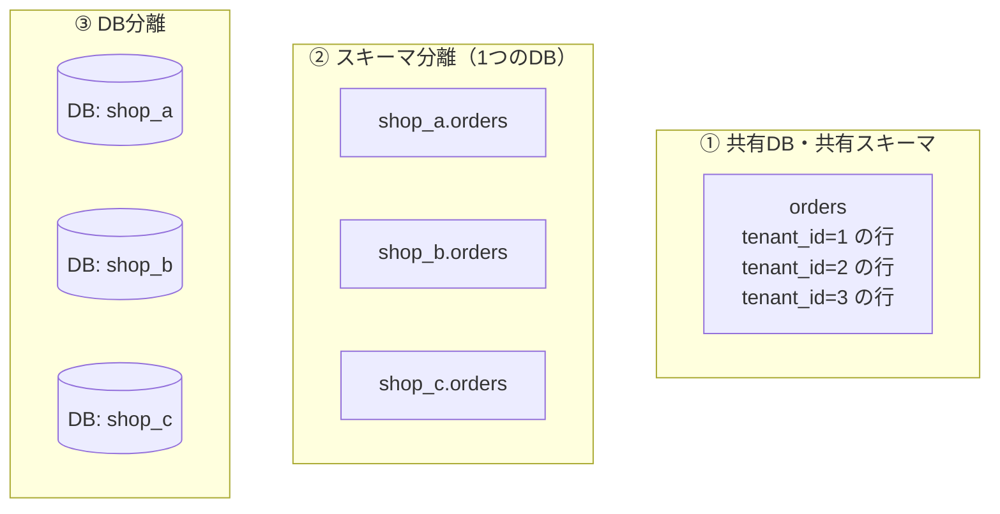

# マルチテナント設計

[[MOC_データアーキテクチャ体系|📚 目次]] ｜ [[05_設計パターンとアンチパターン|← 前へ]] ｜ [[01_データはディスクにどう保存されるか|次へ →]]

> [!abstract] この記事で分かること
> - マルチテナントとは何か、シングルテナントとの違い
> - DB の分け方 3 方式（共有 DB 共有スキーマ・スキーマ分離・DB 分離）の比較
> - `tenant_id` 方式で他社のデータが見える事故を防ぐ設計と、PostgreSQL の Row Level Security
> - ノイジーネイバー問題とその対策、テナントを別の DB へ移す手順
> - 自分のサービスでどの方式を選ぶかの判断基準
>
> **前提**：[[04_キーと制約の設計]] を読んでいると理解しやすいです。

## 1. ひとことで言うと

**マルチテナント（Multi-tenant）**は「1 棟のマンションに複数の世帯が住む」形です。建物（アプリ・サーバー）や水道（DB）は共有していても、各世帯（テナント＝サービスを契約している会社）は自分の部屋にしか入れません。反対に、会社ごとに一軒家（専用のアプリと DB）を建てるのが**シングルテナント**です。

Slack や Shopify のような SaaS では、何千もの会社が同じ URL・同じ API を使いながら、他社のデータは決して見えません。この「共有しつつ分ける」を DB でどう実現するかがマルチテナント設計です。

> [!info] 要点
> - 分け方は **共有スキーマ（tenant_id 列）→ スキーマ分離 → DB 分離** の順に、分離が強く・コストが高くなる
> - 多くの SaaS は**共有スキーマ＋RLS**で始めるのが合理的。規制や大口顧客には強い分離を足す
> - 最大のリスクは「`WHERE tenant_id = ?` の書き忘れ」で、これを**DB の仕組みで防ぐ**のが設計の肝

## 2. 3 つの方式

Shop を「複数の店舗が出店できる EC プラットフォーム」に拡張し、各店舗をテナントとします。



### 2.1 ① 共有 DB・共有スキーマ（tenant_id 方式）

すべてのテーブルに `tenant_id` 列を持たせ、全テナントのデータを同じテーブルに入れます。

- 長所：DB は 1 つなので、マイグレーション・バックアップ・監視が 1 回で済む。テナント追加は `INSERT INTO tenants` だけ。コストが最小
- 短所：**WHERE の書き忘れで他社のデータが見える**。バックアップも共有なので「A 社のデータだけ昨日に戻す」が難しい。1 テナントの重い処理が全員に響く（ノイジーネイバー）

### 2.2 ② スキーマ分離

1 つの DB の中に、テナントごとの**スキーマ（Schema：テーブルをまとめる名前空間）**を作ります。テーブル構造は全スキーマで同じです。

```sql
CREATE SCHEMA shop_a;
CREATE TABLE shop_a.orders (...);
-- 接続ごとに参照先を切り替える
SET search_path TO shop_a;
SELECT * FROM orders;   -- shop_a.orders を読む
```

- 長所：テーブルが物理的に分かれるので、WHERE の書き忘れでは漏れにくい。テナント単位のバックアップ（`pg_dump --schema`）や削除（`DROP SCHEMA ... CASCADE`）が簡単
- 短所：**マイグレーションをスキーマの数だけ実行**する必要があり、途中で失敗すると構造がバラバラになる。テナントが数千になるとテーブル・インデックスの数が膨れ、システムカタログが肥大化して DB 全体が重くなる。ノイジーネイバーは解決しない

なお MySQL では「スキーマ」と「データベース」はほぼ同じ意味なので、②と③の境目があいまいになります。

### 2.3 ③ DB 分離

テナントごとに別の DB（インスタンスやクラスタ）を用意し、アプリが接続先を切り替えます。

- 長所：データが完全に分離され、ノイジーネイバーもない。大口テナントだけ性能を上げる、データの保存地域を変える、暗号鍵を分けるといったことができる
- 短所：コストが最も高い。DB の数だけ監視・バックアップ・マイグレーション・接続管理が必要で、運用の自動化が必須

### 2.4 比較表

| 観点 | ① 共有スキーマ | ② スキーマ分離 | ③ DB 分離 |
|---|---|---|---|
| データ分離の強さ | 弱（アプリ＋RLS 頼み） | 中 | 強 |
| 1 テナントあたりのコスト | 最小 | 小 | 大 |
| マイグレーション | 1 回 | テナント数回 | テナント数回 |
| テナント単位のバックアップ・復元 | 難しい | 容易 | 容易 |
| ノイジーネイバー | 起きる | 起きる | 起きない |
| 向くテナント数 | 数千〜数百万 | 数十〜数千 | 数〜数百 |
| テナント横断の集計 | 容易（1 クエリ） | UNION が必要 | 別基盤へ集約が必要 |

AWS の SaaS 設計の文脈では、①を **Pool（プール）モデル**、③を **Silo（サイロ）モデル**、②のような中間を **Bridge（ブリッジ）モデル**と呼ぶこともあります。

## 3. 共有スキーマ方式を安全にする

### 3.1 キーと制約に tenant_id を組み込む

`tenant_id` を列として持つだけでは、「A 社の注文が B 社の会員を参照する」ような**テナントをまたぐ参照**を防げません。外部キーに `tenant_id` を含めると DB が防いでくれます。

```sql
CREATE TABLE tenants (
  id   BIGINT GENERATED ALWAYS AS IDENTITY PRIMARY KEY,
  name TEXT NOT NULL
);

CREATE TABLE users (
  id        BIGINT GENERATED ALWAYS AS IDENTITY PRIMARY KEY,
  tenant_id BIGINT NOT NULL REFERENCES tenants(id),
  email     TEXT   NOT NULL,
  name      TEXT   NOT NULL,
  UNIQUE (tenant_id, email),     -- メールの一意性は「テナント内で」
  UNIQUE (tenant_id, id)         -- 複合外部キーの参照先にするため
);

CREATE TABLE orders (
  id         BIGINT GENERATED ALWAYS AS IDENTITY PRIMARY KEY,
  tenant_id  BIGINT NOT NULL REFERENCES tenants(id),
  user_id    BIGINT NOT NULL,
  status     TEXT   NOT NULL DEFAULT 'pending',
  ordered_at TIMESTAMPTZ NOT NULL DEFAULT now(),
  FOREIGN KEY (tenant_id, user_id) REFERENCES users (tenant_id, id)  -- 同じテナントの会員しか参照できない
);

-- ほぼすべての検索が tenant_id で絞られるので、インデックスの先頭に置く
CREATE INDEX orders_tenant_id_ordered_at_idx ON orders (tenant_id, ordered_at);
```

ポイントは 3 つです。UNIQUE 制約は「全体で一意」か「テナント内で一意」かを業務で確認すること（同じメールアドレスが 2 つの店舗の会員になれるのが普通）、インデックスは `tenant_id` を先頭にすること（[[03_インデックスの基本と設計]]）、そして**全テーブルに `tenant_id` を NOT NULL で持たせる**ことです。子テーブル（order_items）にも持たせておくと、RLS やシャーディングが単純になります。

### 3.2 Row Level Security（RLS）

**Row Level Security（行レベルセキュリティ）**は、PostgreSQL が「このユーザーにはこの条件に合う行しか見せない」というポリシーを、すべてのクエリに自動で適用する機能です。アプリが `WHERE tenant_id = ?` を書き忘れても、DB が自動で絞り込みます。

```sql
-- 1. アプリ用のロール（スーパーユーザーや BYPASSRLS を持たせない）
CREATE ROLE app_user LOGIN PASSWORD 'change-me';
GRANT SELECT, INSERT, UPDATE, DELETE ON users, orders TO app_user;

-- 2. RLS を有効化（テーブル所有者にも適用するなら FORCE も）
ALTER TABLE orders ENABLE ROW LEVEL SECURITY;
ALTER TABLE orders FORCE ROW LEVEL SECURITY;

-- 3. ポリシー：セッション変数 app.tenant_id と一致する行だけ
CREATE POLICY tenant_isolation ON orders
  USING      (tenant_id = current_setting('app.tenant_id')::bigint)   -- 読める・更新/削除できる行
  WITH CHECK (tenant_id = current_setting('app.tenant_id')::bigint);  -- 書き込める行

-- users など tenant_id を持つ全テーブルに同じ設定をする（1 つでも漏れるとそこから漏洩する）
```

アプリはリクエストごとに、トランザクションの最初でテナントを設定します。

```sql
BEGIN;
SET LOCAL app.tenant_id = '42';     -- このトランザクションの間だけ有効
SELECT * FROM orders;               -- WHERE がなくても tenant_id = 42 の行だけ返る
INSERT INTO orders (tenant_id, user_id) VALUES (7, 1);
-- → ERROR: new row violates row-level security policy（他テナントには書けない）
COMMIT;
```

押さえておくべき挙動（PostgreSQL 公式ドキュメントより）：

- **スーパーユーザーと `BYPASSRLS` 属性のロールは常に RLS を素通り**します。アプリをスーパーユーザーで接続していると RLS は効きません
- **テーブル所有者も通常は素通り**します。所有者で接続するなら `FORCE ROW LEVEL SECURITY` が必要です
- RLS を有効にしてポリシーが 1 つもないと、**すべての行が見えない（デフォルト拒否）**
- `USING` は既存行の可視性（見えない行は黙って除外）、`WITH CHECK` は書き込む新しい行の検査（違反はエラー）。`WITH CHECK` を省略すると `USING` の式が使われます
- `SET LOCAL` はトランザクション終了で消えるので、コネクションプール（PgBouncer のトランザクションモードなど）で接続が使い回されても、前のリクエストのテナントが残りません。`SET`（LOCAL なし）はセッションに残るので危険です
- `current_setting('app.tenant_id')` は未設定だとエラーになります。設定し忘れたら「何も見えない」ではなく「失敗する」ほうが、気づけて安全です

RLS は MySQL にはありません。MySQL では、テナントで絞るビュー経由でのみアクセスさせる、ORM のグローバルスコープで必ず条件を付ける、などアプリ側の仕組みで守ります。

> [!warning] RLS は保険であって万能ではない
> RLS を入れても、アプリ側の `WHERE tenant_id = ?` は書くのがおすすめです。インデックスが確実に使われる条件になり、RLS の設定ミスに対する二重の防御にもなります。また、ポリシーの条件に重い関数を使うと全クエリが遅くなります。

## 4. ノイジーネイバー

**ノイジーネイバー（Noisy Neighbor：うるさい隣人）**は、1 つのテナントが CPU・I/O・接続を使い尽くし、同じ DB を共有する他のテナントまで遅くなる問題です。巨大な CSV エクスポートや、インデックスの効かない検索を連打する大口テナントが典型例です。①と②の方式で起こります。

対策を層ごとに重ねます。

| 層 | 対策 | 例 |
|---|---|---|
| クエリ | 実行時間の上限 | `ALTER ROLE app_user SET statement_timeout = '2s';` |
| アプリ | テナントごとのレート制限 | 1 テナント 100 リクエスト/秒まで |
| 接続 | テナントごとの接続数上限 | プールをテナント単位で分ける、1 テナントの同時接続を制限 |
| ジョブ | 重い処理の分離・優先度 | エクスポートはキューに入れ、無料プランは後回し |
| 読み取り | レプリカに逃がす | レポート系はリードレプリカで実行（[[MOC_分散システム体系]]） |
| 構成 | 大口テナントを隔離 | 専用シャード・専用 DB へ移す（5 章） |

監視では「テナントごとのクエリ時間・件数」を取れるようにしておくことが重要です。どのテナントが騒いでいるか分からなければ対策できません。

## 5. テナントの移行とスケール

### 5.1 シャーディング

共有スキーマの DB が 1 台に収まらなくなったら、**`tenant_id` をシャードキーにして水平分割（シャーディング）**します。同じテナントの行は必ず同じシャードに入るので、テナント内の JOIN やトランザクションは 1 台で完結します。PostgreSQL では Citus 拡張がこの方式を提供しています。全テーブルに `tenant_id` を持たせておくのはこのための準備でもあります。

### 5.2 テナントを別の DB へ移す

「大口顧客を専用 DB へ」「シャードの偏りを均す」ために、1 テナント分のデータを移すことがあります。

1. **移行先を用意**：同じスキーマ（マイグレーション適用済み）の DB を作る
2. **初期コピー**：`WHERE tenant_id = 42` の行を全テーブルからコピー（親 → 子の順）
3. **差分の同期**：コピー中の変更を追いかける。PostgreSQL 15 以降は論理レプリケーションのパブリケーションに**行フィルター**（`WHERE (tenant_id = 42)`）を指定できる
4. **切り替え**：そのテナントの書き込みを短時間止め、差分が追いついたら接続先（ルーティング表）を新 DB に変える
5. **検証して旧データを削除**：件数・合計値を比較し、問題なければ旧 DB から削除

ここで効いてくるのが ID の方式です。連番 ID だと移行先の DB で番号が衝突しうるので、ID を変換するか、移行先のシーケンスを調整する必要があります。**UUIDv7 のようなグローバルに一意な ID**なら衝突を気にせず移せます（[[04_キーと制約の設計]]）。

## 6. どれを選ぶか

```
                         ┌─ 法規制・契約で物理分離が必須？ ── Yes → ③ DB分離
                         │   （金融・医療・官公庁、データの保存地域指定）
スタート ────────────────┤
                         ├─ テナントごとにスキーマを変えたい／   Yes → ② スキーマ分離
                         │   テナント単位の復元が頻繁に必要？      （テナント数が数千以下）
                         │
                         └─ それ以外 ─────────────────────────→ ① 共有スキーマ + RLS
                                                                （大口だけ③へ移せるよう準備）
```

実務での指針：

- **迷ったら ① 共有スキーマ＋RLS**。最も安く、運用が単純で、テナント数の増加にも強い
- 最初から全テーブルに `tenant_id`、ID はグローバルに一意な方式にしておくと、後から ③ への移行やシャーディングが楽になる
- 「大半は ①、大口・規制対象だけ ③」という**ハイブリッド**が現実的な落とし所
- ②は中途半端になりやすい。マイグレーションの自動化と、テナント数の上限を見積もってから選ぶ

## よくある誤解・つまずき

- ❌ 共有スキーマ方式は危険だから使うべきでない → ✅ RLS・複合外部キー・テスト（他テナントのデータが見えないことの自動テスト）を組み合わせれば、多くの SaaS で十分安全です。
- ❌ RLS を有効にすれば、どのロールで接続しても守られる → ✅ スーパーユーザーと BYPASSRLS は常に素通り、テーブル所有者も `FORCE` がなければ素通りです。
- ❌ スキーマ分離ならノイジーネイバーも解決する → ✅ 同じ DB の CPU・I/O を共有しているので解決しません。解決するのは DB 分離です。
- ❌ `tenant_id` 列があればテナントをまたぐ参照は起きない → ✅ 単独の外部キーでは別テナントの行も参照できてしまいます。`(tenant_id, id)` の複合外部キーで防ぎます。
- ❌ `SET app.tenant_id` で設定すればよい → ✅ コネクションプールでは接続が使い回されるため、`SET LOCAL`（トランザクション内のみ有効）を使います。

## まとめ

- マルチテナントは「アプリと DB を共有しつつ、テナントのデータを分ける」設計。分け方は **共有スキーマ / スキーマ分離 / DB 分離** の 3 つ
- 分離が強いほど安全・隔離性が高いが、**コストと運用負荷**も上がる
- 共有スキーマでは **全テーブルに tenant_id、テナント内 UNIQUE、複合外部キー、tenant_id 先頭のインデックス、RLS** で事故を防ぐ
- **ノイジーネイバー**はタイムアウト・レート制限・接続制限・ジョブ分離・大口の隔離で多層的に対策する
- 迷ったら共有スキーマ＋RLS で始め、大口や規制対象だけ DB 分離へ移せるよう ID と tenant_id を準備しておく

## 確認クイズ

1. RLS を設定したのに、アプリから他テナントの行が見えてしまいました。考えられる原因を 2 つ挙げてください。
> [!tip]- 答え
> ①アプリがスーパーユーザーや BYPASSRLS 属性のロールで接続している。②アプリがテーブル所有者のロールで接続していて、`FORCE ROW LEVEL SECURITY` を設定していない。ほかに、ポリシーを作ったテーブルと実際に参照しているテーブルが違う（子テーブルに RLS を付け忘れた）ことも考えられます。

2. 共有スキーマ方式で `users.email` に `UNIQUE (email)` を付けると、どんな問題が起きることがありますか？
> [!tip]- 答え
> 同じ人が別の店舗（テナント）で会員登録できなくなります。業務上「テナント内で一意」なら `UNIQUE (tenant_id, email)` にします。

3. 新サービスで、テナントは中小企業が中心で数千社を見込み、1 社だけ金融機関が「専用環境」を求めています。どう設計しますか？
> [!tip]- 答え
> 中小企業は共有スキーマ＋RLS（Pool）で収容し、金融機関だけ DB 分離（Silo）にするハイブリッドが現実的です。同じアプリから接続先をテナントごとに引けるルーティング表を用意し、全テーブルに `tenant_id`、ID はグローバルに一意な方式にしておくと、後から別のテナントを専用 DB へ移すのも容易になります。

## 関連ノート

- [[04_キーと制約の設計]] — 複合外部キー、UUIDv7 とテナント移行
- [[05_設計パターンとアンチパターン]] — 何でも JSON・EAV でテナントごとのカスタム項目を作る危険
- [[03_インデックスの基本と設計]] — tenant_id を先頭にした複合インデックス
- [[01_マイグレーションとは]] — スキーマ分離・DB 分離でのマイグレーション運用
- [[MOC_分散システム体系]] — シャーディング、レプリケーション
- [[マルチテナントの仕組み]] — （クリップ）3 方式の比較、RLS、ノイジーネイバーの 4 つの対策を短く解説

## 参考

- [PostgreSQL Documentation: 5.9. Row Security Policies](https://www.postgresql.org/docs/current/ddl-rowsecurity.html)
- [PostgreSQL Documentation: CREATE POLICY](https://www.postgresql.org/docs/current/sql-createpolicy.html)
- [PostgreSQL Documentation: 29.4. Row Filters (Logical Replication)](https://www.postgresql.org/docs/current/logical-replication-row-filter.html)
- [AWS Whitepaper: SaaS Tenant Isolation Strategies](https://docs.aws.amazon.com/whitepapers/latest/saas-tenant-isolation-strategies/saas-tenant-isolation-strategies.html)
- [Citus Documentation: Multi-tenant Applications](https://docs.citusdata.com/en/stable/use_cases/multi_tenant.html)
