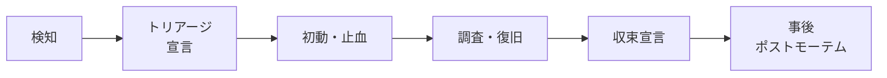

# インシデント対応の基本フロー

**インシデント**とは、サービスの利用者や事業に影響が出ている（または出そうな）想定外の事象のことです。インシデント対応でいちばん大事なのは、**原因を突き止めることより先に、影響を止めること**です。この章では、検知から事後の振り返りまでの流れを 6 つの段階に分け、それぞれで何をするかを整理します。

---

## 1. 全体の流れ

| 段階 | 目的 | 主な行動 | 終わりの目安 |
|------|------|----------|--------------|
| **検知** | 異常に気づく | アラート・問い合わせ・社内報告を受ける | 誰かが「見ている」状態になる |
| **トリアージ・宣言** | インシデントかどうか決める | 影響範囲を見積もり、重大度を付けて宣言する | 重大度と担当が決まる |
| **初動・止血** | 被害の拡大を止める | ロールバック、機能停止、トラフィック切り替え | 影響が増えなくなる |
| **調査・復旧** | 正常な状態に戻す | 原因の切り分け、恒久的でなくてよい修正 | 主要な指標が正常に戻る |
| **収束宣言** | 対応を閉じる | 監視を続けつつ体制を解散する | 関係者に「収束」を通知 |
| **事後** | 学んで再発を減らす | ポストモーテム、再発防止アクション | アクションが登録される |

Google SRE 本 15章「Managing Incidents」は、うまくいかない対応の典型として「技術的な問題に全員が没頭して全体を見る人がいない」「連絡が行き届かない」「勝手な変更（フリーランシング）」を挙げています。フローを決めておく目的は、これらを防ぐことです。

---

## 2. 検知

- **監視アラート**：エラー率・レイテンシ・SLO のバーンレートなど（66_可観測性/60_SLO・アラート）。
- **利用者からの問い合わせ**：サポート窓口や SNS。アラートより先に来る場合は、監視の抜けとして記録しておく。
- **社内からの報告**：「管理画面が重い」など。

検知から対応開始までの時間を **MTTD**（Mean Time To Detect）と呼びます。アラートが鳴ったら、受けた人はまず**「見ています」と表明（Acknowledge）**します。誰も見ていない時間をなくすためです（[[03_ページングとアラートの受け方]]）。

---

## 3. トリアージと宣言

- 「これはインシデントか？」を**数分で**決める。迷ったら**宣言する側に倒す**。宣言して何もなければ閉じればよいが、宣言が遅れると初動が遅れる。
- 重大度（SEV1〜SEV4）を付ける（[[02_重大度レベル（Severity）]]）。
- インシデント用のチャンネル（例：`#inc-20260926-checkout`）を作り、**インシデントコマンダー**を決める（[[03_インシデントコマンダーと役割分担]]）。

---

## 4. 初動・止血（Mitigation）

原因がわからなくても実行できる**止血策**を優先します。

| 状況 | 止血策の例 |
|------|------------|
| デプロイ直後にエラーが増えた | 直前のバージョンへロールバック |
| 新機能で障害 | Feature Flag で機能を OFF |
| 特定リージョン・AZ の異常 | トラフィックを健全な側へ切り替え |
| 外部 API の障害 | タイムアウトを短くしてフォールバック表示 |
| 特定ユーザーの大量リクエスト | レート制限・ブロック |

「なぜ壊れたか」を調べるのは、影響が止まってからで間に合います。SRE 本はこれを「**まず止血、次に原因**」と表現しています。具体的な手順は [[04_最初の5分で何をするか]] にまとめています。

---

## 5. 調査・復旧

- 仮説を立て、**1 つずつ**確かめる。複数人が同時に別々の変更を入れると、何が効いたかわからなくなる。
- 変更を加える前に、チャンネルに「〇〇を実行します」と書く。**実行した操作はすべて記録する**（[[06_インシデントタイムラインの記録]]）。
- 復旧の判断は「エラー率やレイテンシが平常に戻った」など**指標で**行う。

---

## 6. 収束と事後

- 指標が安定したら IC が**収束（Resolved）を宣言**し、関係者と利用者に通知する（[[05_インシデント中のコミュニケーションと告知]]）。
- 収束しても、しばらくは監視を強化する。再発する場合は同じインシデントとして再開する。
- 重大度に応じて**ポストモーテム**を書く（[[01_ポストモーテムとは]]）。SEV1・SEV2 は必須、とルール化しておくのが一般的です。

---

## 7. よくある失敗

| 失敗 | 起きること | 対策 |
|------|------------|------|
| 宣言しない | 個人が黙って対応し、応援が遅れる | 「迷ったら宣言」をルールにする |
| 原因調査から始める | 止血が遅れ、影響が長引く | 止血策の一覧を事前にランブック化 |
| 全員がコードを見る | 全体を見る人・連絡する人がいない | IC と Comms の役割を分ける |
| 記録を残さない | ポストモーテムで経過が再現できない | チャンネルで実況し、タイムラインを残す |

---

## 8. 情報漏洩インシデントで加わること（追記 2026-10-17）

障害対応と同じ流れに加えて、情報漏洩では次のことが必要になります（2026年の事例は [[10_2026年_国内情報漏洩の動向と対策]]）。

| 段階 | 追加でやること |
|---|---|
| 検知 | 漏洩は **外部からの指摘や性能の異常** で見つかることが多い（アフラック生命は CPU 高負荷で発覚）。性能アラートもセキュリティの観点で確認する |
| 初動・止血 | **証拠を消さない**。サーバーは電源を切らずにネットワークから切り離し、ログを保全する。侵害された可能性のある認証情報をリセットする |
| 調査 | 何が・何件・いつからを確定する。調査が進んで数字が変わることはよくある（アフラックは発生日を 6/15 → 6/10 に、KDDI は最大 1,422万件 → 1,223万件に訂正） |
| 報告 | 個人データの漏えい（おそれを含む）で一定の条件に当たるときは、**個人情報保護委員会へ報告し、本人に通知する**。速報は速やかに（目安 3〜5日以内）、確報は 30日以内（不正アクセスなど不正目的のおそれがあるときは 60日以内） |
| 委託先 | 委託先で起きたときは、委託元への連絡が遅れやすい（両毛システムズでは 43日）。**通知期限を契約で決めておく**（[[09_サプライチェーン攻撃と委託先管理]]） |
| 公表 | 分かっていることと調査中のことを分けて、段階的に公表する（第一報 → 第二報 → 調査結果） |

ランサムウェアの初動は [[08_ランサムウェア対策]] にまとめた。

---

## 9. 関連項目

- [[02_重大度レベル（Severity）]]：宣言時に付けるレベルの定義
- [[03_インシデントコマンダーと役割分担]]：誰が何をするか
- [[04_最初の5分で何をするか]]：初動の具体的なチェックリスト
- [[02_ランブックの書き方]]：止血手順を事前に用意する
- 65_リリース・デプロイ/40_ロールバック：止血策としてのロールバック
- 71_セキュリティ基礎/50：セキュリティインシデントの対応フロー

---

**前へ** ← [[04_オンコール疲弊対策と引き継ぎ]]　｜　**次に読む** → [[02_重大度レベル（Severity）]]
