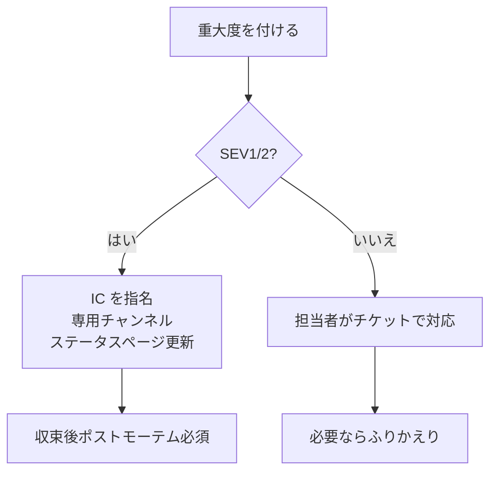

# 重大度レベル（Severity）

**重大度（Severity、SEV）**は、インシデントの影響の大きさを段階で表したものです。重大度を決めておくと、「誰を呼ぶか」「どれだけ急ぐか」「誰に知らせるか」「ポストモーテムを書くか」を**その場で議論せずに**決められます。この章では、よく使われる 4 段階の定義と、レベルの付け方のコツを整理します。

---

## 1. なぜ重大度を決めるのか

- **対応の強さをそろえる**：夜中に全員を起こすべきか、翌営業日でよいかを個人の感覚で決めない。
- **連絡先を決める**：経営層・カスタマーサポート・広報に知らせる基準になる。
- **事後の扱いを決める**：ポストモーテム必須かどうか。
- **統計を取る**：SEV ごとの件数や復旧時間の推移を追える（[[05_ニアミスとインシデント統計からの学習]]）。

PagerDuty の Incident Response ドキュメントや Atlassian の Incident Handbook も、まず重大度の定義を置くところから始めています。

---

## 2. 4 段階の定義例

| レベル | 影響 | 例（EC サイト） | 対応 | 通知先 | ポストモーテム |
|--------|------|------------------|------|--------|----------------|
| **SEV1** | 主要機能が全面停止、データ損失、セキュリティ侵害 | 全ユーザーが購入できない、個人情報漏えい | 24 時間即時。IC を立て総力で対応 | 経営層・CS・広報 | 必須 |
| **SEV2** | 主要機能が一部で停止・大きく劣化 | 特定の決済手段だけ失敗、検索が 10 秒以上 | 即時対応 | 関係部署・CS | 必須 |
| **SEV3** | 軽微な機能の障害、回避策がある | 注文履歴の CSV 出力が失敗 | 営業時間内に対応 | チーム内 | 任意 |
| **SEV4** | 利用者影響がほぼない | 管理画面の表示崩れ、社内ツールの遅延 | 通常のチケットで対応 | チーム内 | 不要 |

> 数字が小さいほど重い、という向きがよく使われます（P1〜P4 と呼ぶ組織もあります）。**向きと定義をチームで統一する**ことが大切です。

---

## 3. 判断軸

重大度は 1 つの軸では決まりません。次の軸を組み合わせます。

| 軸 | 問い |
|----|------|
| **影響範囲** | 何%のユーザー・どの顧客に影響しているか |
| **機能の重要度** | ログイン・決済などクリティカルパスか |
| **データ** | データの消失・破損・漏えいがあるか |
| **回避策** | 利用者が別の方法で目的を達成できるか |
| **SLO** | エラーバジェットをどの速さで消費しているか |
| **事業・法的影響** | 売上、契約上の SLA、法令違反のおそれ |

いずれか 1 つでも SEV1 の条件に当てはまれば SEV1、とする「**最悪の軸で決める**」ルールがわかりやすいです。

---

## 4. 付け方のコツ

- **迷ったら高いほうを付ける**。あとから下げるのは簡単だが、上げるのが遅れると応援が遅れる。
- **途中で変えてよい**。調査で影響が小さいとわかれば下げ、広がれば上げる。変更したことはチャンネルで宣言し、タイムラインに残す。
- **感情ではなく影響で決める**。「社長が気づいた」「大口顧客からの電話」は重要な情報だが、それ自体で SEV を上げない。影響範囲を確認する。
- **具体例を定義に書いておく**。抽象的な文だけでは判断がぶれる。自社のサービスでの例を 2〜3 個ずつ載せる。

---

## 5. 重大度と対応体制

SEV1・SEV2 では[[03_インシデントコマンダーと役割分担]]に沿って体制を組み、定期的な状況報告を行います（[[05_インシデント中のコミュニケーションと告知]]）。

---

## 6. よくある問題

| 問題 | 対策 |
|------|------|
| 何でも SEV1 にして、SEV1 の重みがなくなる | 定義と例を見直し、四半期ごとに実績と照らし合わせる |
| 低く付けがちで、応援が遅れる | 「迷ったら高く」を明文化し、下げたことを責めない |
| セキュリティ事案の扱いが曖昧 | 漏えいの疑いは原則 SEV1 とし、セキュリティ担当へ即連絡（71_セキュリティ基礎/50） |

---

## 7. 関連項目

- [[01_インシデント対応の基本フロー]]：宣言の段階で重大度を付ける
- [[03_エラーバジェット方針]]：SLO 消費と重大度の関係
- [[03_ページングとアラートの受け方]]：重大度ごとのページングの仕方
- [[05_ニアミスとインシデント統計からの学習]]：SEV 別の統計
- 66_可観測性/60_SLO・アラート：バーンレートによる判定

---

**前へ** ← [[01_インシデント対応の基本フロー]]　｜　**次に読む** → [[03_インシデントコマンダーと役割分担]]
