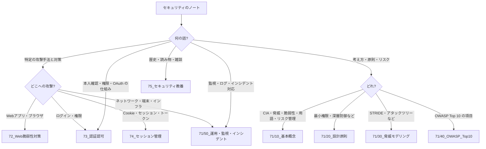

# MOC_セキュリティ体系

71〜75（セキュリティ分野）全体の入口ノート。71 は分野共通の基礎（概念・原則・脅威モデリング・OWASP Top 10・運用）を扱い、Web アプリ固有の脆弱性は 72、認証・認可は 73、セッション・Cookie・トークンは 74、歴史や読み物は 75 に置く。

分け方は OWASP ASVS 5.0 の章立て（V3 フロントエンド / V6 認証 / V7 セッション / V8 認可 / V10 OAuth・OIDC …）と CyBOK の知識領域、roadmap.sh Cyber Security を参考にした。

## 分野マップ

| フォルダ | 役割 | 入口 |
|---|---|---|
| 71_セキュリティ基礎 | 分野共通の考え方と運用 | 本MOC |
| 72_Web脆弱性対策 | Web アプリの脆弱性（XSS・SQLi・CSRF・CORS …）と対策 | [[MOC_Web脆弱性対策]] |
| 73_認証認可 | 本人確認・権限・フェデレーション（OAuth/OIDC/SAML）・実装 | [[MOC_認証認可]] |
| 74_セッション管理 | Cookie・セッション・トークン（JWT）とその攻撃 | [[MOC_セッション管理]] |
| 75_セキュリティ教養 | 歴史・経済学・匿名通信・ハッカー文化・書籍 | [[MOC_セキュリティ教養]] |

### 運用ルール

- **フォルダは内容で分け、出典で分けない**。動画・書籍・講座シリーズがいくつかのテーマにまたがるときは内容ごとに振り分け、元のまとまりは下の「シリーズの所在」表で追う（出典は `author` / `source` プロパティで持つ）
- **71 のファイル名は `番号_テーマ（出典）`** で統一し、フォルダ内の並び＝読む順にしている（例 `02_セキュリティの脅威と対策の基礎（知識地図1章）`）。72〜75 は移動前のまま（書籍の章番号 `05XSS基本編` や講座タイトルもそのまま）で、並び順は各 MOC で示す
- 暗号の理論（共通鍵・公開鍵・ハッシュのしくみ）は 11_コンピューターサイエンス/85_暗号、コンテナのセキュリティは 53_コンテナ が本拠地

### 新しいノートの置き場所

## 71_セキュリティ基礎

### 10_基本概念
1. [[01_CIA三原則・脅威・脆弱性・リスク（基礎講座第1回）]] — CIA・脅威/脆弱性/リスクの違い・攻撃者の種類
2. [[02_セキュリティの脅威と対策の基礎（知識地図1章）]] — マルウェア・不正侵入・フィッシングなど脅威の全体像
3. [[03_セキュリティの基本概念と専門用語（知識地図3章）]] — 7要素・CVE/CWE/CVSS/EPSS/KEV・暗号の用語
4. [[04_リスク管理とリスクアセスメント]] — ISO 27005 / NIST SP 800-30 / IPA 方式のリスク分析、ALE・FAIR、リスク対応、リスク登録簿

### 20_設計原則
1. [[01_最小権限の原則]]
2. [[02_深層防御]]
3. [[03_ゼロトラスト]]
4. [[04_セキュアバイデザイン]]
5. [[05_データ最小化]]

### 30_脅威モデリング
1. [[01_脅威モデリングの基礎]]
2. [[02_STRIDE]]
3. [[03_DREAD]]
4. [[04_アタックツリー]]
5. [[05_データフロー図]]

リスク管理（[[04_リスク管理とリスクアセスメント]]）の「リスク特定・分析」をシステム単位で行う道具、という位置づけ。

### 40_OWASP_Top10
1. [[00_OWASP概要]] — Top 10 とは・学び方
2. [[01_OWASP_Top10_2025の変更点]] — 2021 → 2025 の対応表（**個別ノートの番号は 2021年版**）
3. 2025年版で新設されたカテゴリ
   - [[2025_A03_ソフトウェアサプライチェーンの不備]]
   - [[2025_A10_例外的状況の不適切な処理]]
4. 個別項目（2021年版の番号。括弧内は 2025年版）
   - [[A01_アクセス制御の不備]]（→ A01）/ [[A02_暗号化の不備]]（→ A04）/ [[A03_インジェクション]]（→ A05）/ [[A04_安全でない設計]]（→ A06）/ [[A05_セキュリティの設定ミス]]（→ A02）
   - [[A06_脆弱で古いコンポーネント]]（→ A03 に拡張）/ [[A07_認証と識別の失敗]]（→ A07）/ [[A08_ソフトウェアとデータの整合性の不備]]（→ A08）/ [[A09_ログとモニタリングの不備]]（→ A09）/ [[A10_サーバーサイドリクエストフォージェリ]]（→ A01 に統合）

### 50_運用・監視・インシデント
防御の仕組み → 監視 → ツール → 運用 → 個別テーマ → 事例 の順。

1. [[01_ネットワーク・アプリ・エンドポイントの防御（知識地図4章）]]
2. [[02_ネットワークセキュリティ（基礎講座第4回）]] — FW・IDS/IPS・WAF・DDoS・マルウェア
3. [[03_セキュリティ監視と分析技術（知識地図2章）]]
4. [[04_セキュリティツールと情報基盤（知識地図5章）]]
5. [[05_セキュリティ設計と運用（基礎講座第5回）]] — 多層防御・セキュアコーディング・ログ監視・インシデント対応
6. [[06_ログ出力（徳丸本24章）]]
7. [[07_脆弱性管理（境界機器・パッチ運用）]]
8. [[08_ランサムウェア対策]]
9. [[09_サプライチェーン攻撃と委託先管理]]
10. [[10_2026年_国内情報漏洩の動向と対策]] — 2026年の国内事例のハブ（関連ノートに「2026年の事例から」を追記済み）

- インシデント対応の手順は [[01_インシデント対応の基本フロー]]（69_SRE・インシデント対応）

## シリーズの所在

| シリーズ | 置き場所 |
|---|---|
| セキュリティ基礎講座（全5回） | 第1回 → 71/10、第2回 → 73/10、第3回 → 72/00、第4・5回 → 71/50 |
| セキュリティ知識地図（1〜5章） | 1・3章 → 71/10、2・4・5章 → 71/50 |
| 安全なWebアプリケーションの作り方（徳丸本 01〜24章） | [[MOC_Web脆弱性対策]] の「徳丸本の章の所在」表 |
| セキュリティ1〜3・Tor・ダークウェブ など（🎙️ 全8回） | [[MOC_セキュリティ教養]] |
